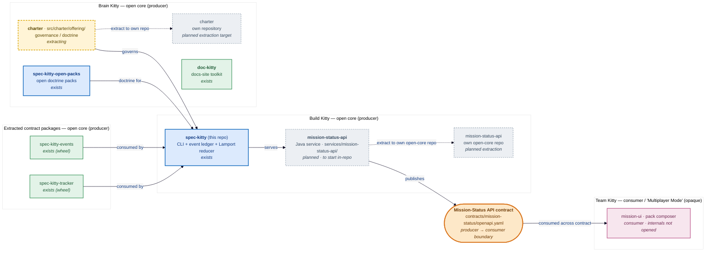

**Status:** Superseded (2026-10-19) by `spec-kitty-charter` ADR-0008 and ADR-0010. Accepted
2026-10-12.

> **Superseded (2026-10-19, operator ruling).** The charter does not move to its own
> repository as a Python package. Per `spec-kitty-charter`
> [ADR-0008](https://github.com/spec-kitty/spec-kitty-charter/blob/main/docs/adr/0008-rewrite-and-replace-against-bdd-and-openapi-contracts.md)
> (rewrite and replace) and
> [ADR-0010](https://github.com/spec-kitty/spec-kitty-charter/blob/main/docs/adr/0010-cutover-scope-and-seam-boundary.md)
> (cutover scope and seam boundary; recorded in
> [spec-kitty-charter#88](https://github.com/spec-kitty/spec-kitty-charter/pull/88)):
> the Python charter stays in core until it is retired, and nothing Python moves to
> `spec-kitty-charter`. Offering reads cut over to the `spec-kitty-charter` service through
> `charter.offering.api`; `charter.activation` stays in core until its post-GA rework (ADR
> [2026-10-16-1](2026-10-16-1-extract-charter-offering-first-activation-rework-post-ga.md),
> Amendment 2026-10-19). The 4.0.0 leg is a frozen seam and a green conformance corpus, not an
> extraction. Epic #6099 is re-scoped accordingly. The body below is kept unchanged as the
> record of the earlier decision.

**Date:** 2026-10-12

**Deciders:** Stijn Dejongh (operator).

**Technical Story:** #645 (move the ~129 `specify_cli → charter` imports onto the stable
charter API — now **GA-gating**); #3101 (the wheel/repo split design spike). Extends ADR
[2026-08-02-1](../3.x/2026-08-02-1-charter-wheel-assessment.md) (charter-wheel assessment) and
ADR [2026-04-25-1](../3.x/2026-04-25-1-shared-package-boundary.md) (shared-package boundary).
Companion: ADR [2026-10-01-2](2026-10-01-2-mission-status-read-api-and-dashboard-extraction.md)
(the open-core producer surface). Durable plans:
[Packs Extraction](../../plans/domains/packs-extraction-domain-plan.md) §3.1 and
[Doctrine & Charter](../../plans/domains/doctrine-charter-domain-plan.md) §3.6.

**Reader:** a maintainer planning the charter extraction, or changing the enforced layer
chain / shared-package-boundary gates.

> **Target state, not shipped state.** This record fixes the *direction* the 2026-10-12
> October direction update ratified. The repository does not contain a `charter`-repo split
> today, and the diagram below shows the **ratified target topology** — for example
> `services/mission-status-api/` does not exist yet (only `contracts/mission-status/` and the
> Python reducer ship). The extraction *mechanics* ride with a dedicated epic (to be filed);
> this ADR records the decision and its boundary, and changes no gate, layer rule or
> `pyproject.toml` package set.

---

## Context and Problem Statement

`spec-kitty-events` and `spec-kitty-tracker` are already external contract packages: the CLI
consumes them as ordinary versioned dependencies through their public import surface, never
vendoring their source (charter, "Architecture: Shared Package Boundaries"; ADR 2026-04-25-1).
The **charter** layer — the governance authority at `src/charter/offering/` (or all of
`src/charter/`) — is not yet such a unit. It already has a curated public surface
(`charter.offering.api`, #3179) and depends only on `kernel`, but `specify_cli` still reaches
charter internals directly across ~129 files, and the charter ships only inside the CLI wheel.

ADR 2026-08-02-1 assessed the `kernel → doctrine → charter` wheel split and deferred it; the
dormant `spec-kitty-doctrine` wheel groundwork was later deleted. The October direction update
(2026-10-12) changes the priority and the target: the charter is to become an
**independently-released external contract package in its own repository**, and its import-
decoupling precondition (#645) is now part of the 4.0.0 GA gate.

## Decision Drivers

- **Single canonical authority / architectural alignment** (charter governing principles): the
  charter is consumed through one public surface, like the other external contract packages,
  not through deep internal imports.
- **Open-core shape.** The charter ("Brain Kitty" governance/doctrine) is open-core producer
  material; releasing it as its own unit lets open-core consumers depend on it directly.
- **The GA gate expands (2026-10-12).** Charter modular extraction joins local integrity and
  the mission-status API backend as a GA gate leg; #645 is its precondition.

## Considered Options

1. **Keep the charter in-tree indefinitely.** Rejected: it leaves ~129 internal reaches in
   place and blocks open-core consumers from depending on the charter without the whole CLI.
2. **Ship the charter as a wheel built from this repo, but keep it in-tree.** A partial step;
   it does not give the charter its own release cadence or repository.
3. **Extract the charter into its own repository as an external contract package (chosen).**
   Released and versioned on its own, consumed through `charter.offering.api`, exactly as
   `spec-kitty-events` / `spec-kitty-tracker` are today.

## Decision Outcome

**Chosen option: Option 3.** The charter becomes an **external contract package in its own
repository**.

- **D-1 (Accepted): the charter is an external contract package.** Callers consume it only
  through `charter.offering.api`. The enforced module chain
  (`kernel <- charter <- {glossary, runtime, mission_runtime} <- specify_cli`) and the
  shared-package-boundary gates (`test_pyproject_shape.py`, `test_shared_package_boundary.py`,
  `test_layer_rules.py`, the `clean-install-verification` job) will gain `charter` as an
  external contract package when the extraction lands. **No gate, layer rule or package set
  changes in this ADR** — this records the direction.
- **D-2 (Accepted): #645 is the GA-gating precondition.** The ~129 `specify_cli → charter`
  internal imports move onto `charter.offering.api` before the charter can be packaged
  separately. Per ADR 2026-09-30-1 (allowlist ratchets are priced debt), drain them rather
  than holding them in an allowlist.
- **D-3 (Accepted): its own repository.** The released unit lives in its own repository
  (extending, not contradicting, 2026-08-02-1's wheel assessment: the wheel question —
  `charter.offering` alone or all of `src/charter/`, and whether `kernel` ships first — is
  settled by the extraction epic). The extraction mechanics ride with that epic (to be filed).
- **D-4 (Accepted): relationship to the open-core producer boundary.** The charter is a
  producer-side open-core unit. It is distinct from the **Mission Status Read API** producer
  surface (ADR 2026-10-01-2) and from the **charter backend *service*** (a future runtime
  resolution daemon, [charter-backend-service-future.md](../../architecture/charter-backend-service-future.md)):
  this ADR is about *packaging/repository topology*, not a runtime service.

### Consequences

#### Positive

- Open-core consumers can depend on the charter directly, at its own version, without the CLI.
- The ~129 internal reaches are drained, hardening the single-public-surface invariant (#3179).

#### Negative

- Cross-repo release coordination (version ranges, compatibility fixtures) like the other
  external contract packages already carry.
- Until the extraction lands, the charter still ships only inside the CLI wheel.

#### Neutral

- The pack *source-home* move to `spec-kitty-open-packs` (both tiers; source-location only,
  the no-bundle invariant unchanged, ADR 2026-08-16-3 not reversed) is a sibling packaging
  track, not part of this code extraction (see the Packs Extraction plan).

### Confirmation

- An architectural test pins `charter` as an external contract package once the extraction
  lands; a consumer pinned to `charter.offering.api` survives the split.
- #645 reaches zero `specify_cli → charter` internal reaches.

## Target topology

The ratified producer/consumer topology (target state; `services/mission-status-api/` does not
exist yet — the diagram shows where units are headed, not what is on disk now):

Alt-text: Build Kitty and Brain Kitty open-core producer subgraphs versus an opaque Team Kitty
consumer subgraph; units tagged exists / extracting / planned; dotted arrows for charter → its
own repository and mission-status-api → its own open-core repository; the Mission-Status API
contract is the producer → consumer boundary.

## More Information

- Charter, "Architecture: Shared Package Boundaries" (charter as a third external contract
  package, direction).
- [Packs Extraction domain plan](../../plans/domains/packs-extraction-domain-plan.md) §3.1
  (the code boundary, #3101) and §3.2 (the open-packs source home).
- [4.0.0 milestone roadmap](../../plans/4-0-0-milestone-roadmap.md) — the three-leg GA gate.
- The docsite→doc-kitty and QA test-absorption tracks ride with their own epics/ADRs (to be
  filed); this ADR references them only.

## Amendment 2026-10-13: two sibling entry-point seams, and a shrink-only activation baseline (#6188, #6099)

D-1 and D-2 name one seam, `charter.offering.api`. The offering / activation split (ADR 2026-10-06-2 §1) means the charter has two independently extractable layers, so there are two sibling seams. The decisions above are unchanged; this note says how they apply.

- **Two seams.** `charter.offering.api` is the seam for the offering layer. `charter.activation.api` is the seam for the activation layer. Each re-exports only its own layer's symbols, by object identity. `tests/architectural/test_charter_offering_does_not_import_activation.py` keeps the layers apart.
- **The `charter.*` facades stay the in-tree door for offering.** `specify_cli` must not import `charter.offering.*`, `charter.offering.api` included (C-001, stated in the `charter.offering.api` docstring and ratcheted by `tests/architectural/test_runtime_charter_doctrine_boundary.py`). It reaches offering through the `charter.*` facades, which re-export the offering objects. `src/glossary` and `src/mission_runtime` are scanned by the same gate.
- **A sanctioned exception to D-2.** 236 `(file, module)` reaches from `specify_cli`, `runtime`, `glossary` and `mission_runtime` into `charter.activation` internals existed when the activation seam was added. They are held as a shrink-only baseline (`tests/architectural/charter_activation_boundary_baseline.yaml`, count in `tests/architectural/_baselines.yaml`), owner #6099, drained onto `charter.activation.api` ~~before the 4.0.0 GA gate~~ (**superseded — see Amendment 2026-10-16: the activation drain is now post-GA**). `tests/architectural/test_runtime_charter_activation_boundary.py` fails on a new reach and on a stale row, and it also covers the lazy `charter.<name>` root facade. This is a temporary, priced exception to "drain rather than allowlist", not a precedent.

## Amendment 2026-10-16: extraction splits by seam — offering first (GA), activation rework post-GA (#6099)

Superseded by and recorded in ADR [2026-10-16-1](2026-10-16-1-extract-charter-offering-first-activation-rework-post-ga.md). The decisions above stand; this note narrows *what* the GA leg is and *when* the activation drain lands.

- **The charter extracts in two seam-scoped steps, not one.** `charter.offering` has **zero** code-level dependency on `charter.activation` (verified: offering → activation runtime imports = 0; activation → offering ≈ 360), so offering is the foundational layer and is independently liftable. The charter modular-extraction GA leg (D-2, and the roadmap's GA gate) is now scoped to **offering**.
- **The activation drain moves off the GA gate.** The Amendment 2026-10-13 clause "drained onto `charter.activation.api` before the 4.0.0 GA gate" is superseded: `charter.activation` **stays in core as-is for GA**, and its 236-reach drain and any activation extraction ride the post-GA **CLI 4.x stable** line. The shrink-only baseline remains priced debt (ADR 2026-09-30-1); only its deadline moves.
- **D-2's precondition citation is corrected.** The "~129 `specify_cli → charter` imports" move completed as **#6188** (closed 2026-10-13, PR #6200); **#645** is closed `not_planned`. Neither is an open precondition. The live extraction epic is **#6099**, which now carries four offering-extraction phases on milestone "4.0.0 release scope".
