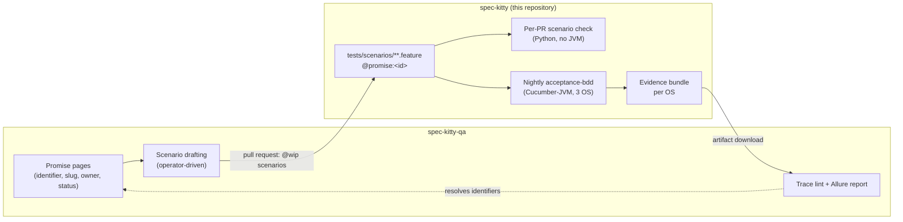

# The acceptance scenario contract

> **Status: design of record, not yet shipped.** The scenario tree, the Cucumber-JVM runner and
> the nightly job already exist ([ADR 2026-10-11-3](../adr/4.x/2026-10-11-3-acceptance-testing-and-bdd-support.md)).
> This page designs the four additions in
> [ADR 2026-10-13-1](../adr/4.x/2026-10-13-1-acceptance-scenarios-link-to-promises-by-identifier-only.md):
> the scenario contract, a per-pull-request check, a versioned evidence bundle and fixture builders.
> Sections say what is built today and what is not.

**Reader:** a maintainer or contributor who writes, reviews or generates scenarios under
`tests/scenarios/`, or who changes the `acceptance-jvm/` runner or the nightly job.

## Two layers, one link

Verification has two layers with different owners, formats and tooling.

| Layer | What it holds | Where it lives | Format |
|---|---|---|---|
| **Product promises** | What a user can rely on, at product level, with its owner, status and history | spec-kitty-qa (outside this repository) | Markdown pages with structured front matter |
| **Acceptance scenarios** | Executable examples that check the CLI does what a promise says | `tests/scenarios/<area>/*.feature` in this repository | Gherkin, run by Cucumber-JVM |
| **Engineering tests** | Unit, integration, acceptance-gate and e2e tests | `tests/` | pytest |

The promise layer and the scenario layer are deliberately **not** one format. Each repository
picks the scenario tooling that suits its stack, and promise pages stay readable by people who
never open a repository. Nothing in this repository reads, parses or copies promise pages.

The **only** link between the layers is the promise identifier, carried as a tag:

```gherkin
@promise:PR-CLI-INIT-001
Scenario: Re-running init keeps the project's files
```

The identifier is opaque here. This repository checks that the tag is well formed and nothing
else: it does not know whether the identifier exists, what it says, or whether it is ratified.
spec-kitty-qa resolves identifiers, computes coverage and reports gaps. The identifier is the
persistent one, never the human-readable slug, so renaming a promise page never touches a
scenario.

This keeps the open-core repository free of product-planning content: a scenario says what the
CLI does, and an identifier is meaningless without the promise store.



*Figure: promise pages stay in spec-kitty-qa; scenarios, the per-PR check, the nightly and its
evidence live here; spec-kitty-qa reads the evidence back and resolves the identifiers.*

## A. The scenario contract

**Layout (built).** One folder per CLI area under `tests/scenarios/`, one or more `.feature`
files per folder. The runner reads them in place.

**Tag vocabulary.** Tags are the whole interface between a scenario and everything outside it.

| Tag | Meaning in this repository | Rule the check enforces |
|---|---|---|
| `@promise:<id>` | Links the scenario to a promise. Inert at run time. | `<id>` matches `[A-Za-z0-9][A-Za-z0-9._-]*`; no tag repeats on one scenario. |
| `@wip` | Steps are not bound yet, or the scenario is not trusted yet. Runs in the non-gating pass. | Needs `@wip-owner:<handle>` and `@wip-since:<YYYY-MM-DD>`. |
| `@manual` | Never runs automatically (heavy or on-demand). | None. |
| `@defect:<issue>` | Reproduces a tracked bug. | `<issue>` is a positive integer. |
| `@qa:<ref>` | Traceability to a QA-corpus scenario it was converted from. | `<ref>` uses the identifier character set. |
| `@<area>` and other bare tags | Free-form selection tags. | None. |

Untagged and `@promise`-only scenarios gate the nightly, as today. How old a `@wip` scenario may
be is a reporting rule for spec-kitty-qa's trace lint, not a check here: the per-PR check only
requires the date to be present and valid.

**Drafted scenarios.** A scenario drafted from a promise, by hand or with AI help, lands as
`@wip` with the promise tag, an owner and a date. It may use step text that has no binding yet.
An engineer binds or rewords the steps, adds the positive control
([acceptance scenarios guide](../development/testing/acceptance-scenarios.md)) and removes
`@wip`. The tag is added by a person; tooling never invents a promise identifier.

## B. The per-pull-request scenario check (not built)

The nightly is the only thing that runs scenarios today, so a malformed feature file or a typo'd
step is found the next morning. The check below finds it on the pull request, without a JDK.

- **Where:** `tests/architectural/test_scenario_contract.py`, Python standard library plus first-party
  `kernel.clock` (no third-party dependency), with
  a small Gherkin reader for the subset the scenarios use (`Feature`, `Background`, `Scenario`,
  `Scenario Outline`, `Examples`, `Rule`, tags, steps, doc strings and data tables). No new
  dependency.
- **What it asserts:**
  1. Every `.feature` file parses and holds at least one scenario (`NO_SCENARIOS` otherwise,
     which catches a misspelt `Scenario:` keyword), and every scenario has at least one step.
  2. Every tag follows the vocabulary table above.
  3. Every step of a scenario **without** `@wip` matches exactly one step definition. Step
     definitions are read from the `@Given`/`@When`/`@Then` annotations in
     `acceptance-jvm/src/test/java/**/steps/*.java`; the Cucumber expression parameters in use
     (`{string}`, `{int}`, `{word}`) become regular expressions. An unsupported parameter type
     fails the check, so the reader cannot silently fall behind the runner.
  4. `@wip` scenarios may use unmatched steps; the check lists them as information.
- **Oracles:** one broken fixture per rule under `tests/architectural/fixtures/scenarios/`, and a
  guard that the real tree is not empty.
- **Routing:** the `scenarios` (`tests/scenarios/**`) and `acceptance_jvm` (`acceptance-jvm/**`)
  groups in `ci-router.yml` start gating the job that runs this file. Contributors still need no
  JDK.

## C. The evidence bundle (not built)

Each nightly leg hands its results to spec-kitty-qa. A result is only useful there if it says
which CLI build, on which OS, in which pass produced it. The current upload does not.

**Problems today:**

- The gating pass and the `@wip` pass write into the same `build/` folders, and the second pass
  runs with `--rerun-tasks`, so it **overwrites the gating pass's Cucumber JSON and JUnit XML**
  and mixes both passes' Allure results before the upload.
- The Allure results folder is not set, so the upload lists two possible folders and only warns
  if both are empty.
- Nothing records the CLI version, the commit, the OS or the pass.
- The artifact has no explicit retention.
- The job's `if:` mentions `pull_request`, an event `ci-nightly.yml` never receives.

**Design:**

- Each pass writes to its own folder, `acceptance-jvm/build/acceptance/<pass>/` with `<pass>` set
  to `gating` or `wip`, holding `allure-results/` (set through `allure.results.directory`),
  `cucumber.json` and `junit/`. A Gradle property selects the pass, and the tag filter comes from
  the pass, so CI cannot pair a pass name with the wrong filter.
- Before the scenarios run, the runner writes:
  - `allure-results/environment.properties`: CLI version (from the wheel it built), commit SHA,
    OS, JDK version, pass;
  - `allure-results/executor.json`: the CI run URL and run number, when present.
- After both passes, the job writes `acceptance-jvm/build/acceptance/evidence.json`:
  `schema_version`, commit SHA, CLI version, OS, the run URL, and per pass the outcome, scenario
  counts and the result paths. spec-kitty-qa reads this file first; a field it does not know
  never breaks it, and a `schema_version` it does not know makes it refuse.
- The upload keeps the name `acceptance-bdd-results-<os>`, uploads only
  `acceptance-jvm/build/acceptance/`, fails when the gating results are missing
  (`if-no-files-found: error`), and sets `retention-days: 30`.
- The job's `if:` drops the `pull_request` clause.

## D. Fixture builders (not built)

Today's Arrange steps can set up an initialised project and a git repository with history. The
promises that matter next (mission creation, the status lane walk, review and consolidation)
need a project with a mission in a known state.

- **Builders stay black-box.** A builder in `kitty.acceptance.environment` reaches a state only by
  running the CLI through the driver (`init`, `agent mission create`, `agent mission
  finalize-tasks`, `move-task`, ...). It never writes `.kittify/` or `kitty-specs/` files
  directly, so a builder breaks when the CLI's own path breaks, which is the point.
- **Steps on top:** `Given a project with a mission "<slug>"`, `Given the work package "<wp>" of
  mission "<slug>" is in lane "<lane>"`, and assert steps on `spec-kitty agent tasks status
  --json` output.
- **First scenarios:** a small mission-lifecycle area that proves the builders, each with a
  positive control.

## What this design does not cover

- Where promise pages live, their format, who ratifies them, and how they are versioned.
- Drafting scenarios from promises, and the QA docs site.
- Building the Allure report, keeping its history, and the trace lint.

All of these belong to spec-kitty-qa. This repository's side of that boundary is the tag
vocabulary in section A and the evidence bundle in section C.
