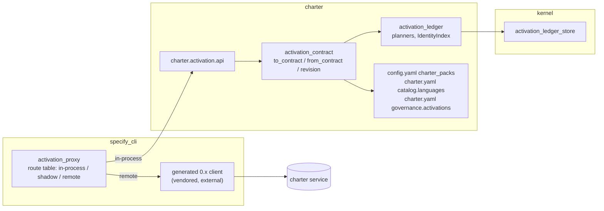

# Activation Ledger and the Charter Contract

> **Status: assessment, 2026-10-20.** The charter-side design this page measures against is
> **Proposed** (spec-kitty-charter PR #123: ADR-0020, ADR-0021, ADR-0022 and
> `docs/architecture/offering-and-activation.md`, all draft or provisional). Nothing here is a
> decision. Where the operator has ruled, the ruling is named. Every other choice is listed as an
> open question or an option.
>
> **Outcome (2026-10-21).** The operator chose **Option B** (`mission_pivot_option_b`, ratified
> 2026-10-20) and ruled R2 to R12 as recommended (`contract_rulings_r2_r12`). The rulings, the
> reduced flip as shipped and the residuals are recorded in the
> [Amendment 2026-10-20 of core ADR `2026-10-19-1`](../adr/4.x/2026-10-19-1-activation-ledger-persists-deactivation.md#amendment-2026-10-20-the-reduced-flip-option-b-and-the-charter-contract-rulings).
> The work-package tables below are the assessment-time snapshot; the
> [divergence register](#divergence-register) is kept current.

This page is for two readers:

- a **core maintainer** working on the activation ledger Mission
  (`persistent-deactivation-ledger-01M59YAA`), who needs to know what the charter contract
  changes about the remaining work packages;
- a **charter service contributor**, who needs to know where core's activation state lives, how
  it maps onto `ActivationConfig`, and which contract questions core needs answered.

**How to read the evidence.** Each finding is marked:

- **Measured**: reproduced by running the CLI or read directly from the code at a named
  revision (origin/main `f1663393` or the Mission branch HEAD `9974721c`);
- **Inferred**: a conclusion drawn from the code or the documents, not run.

## Context

The charter repository proposes this integration approach (all Proposed):

- **The offering and activations are separate resources, and the service stores activations**
  (ADR-0020). An activation is a stored, closed, camelCase `ActivationConfig` document keyed by
  an `activationId`, with a `revision` that is the `sha256:` digest of its RFC 8785 (JCS)
  serialization.
- **The service is the authority after cutover; core's file is a fetched copy** (ADR-0020 D5).
- **The published contract is the seam** (ADR-0021 D1). Core vendors a Python client generated
  from the released contract bundle with `openapi-generator` (D2).
- **A routing proxy in core routes each operation** to an in-process backend, a shadow, or the
  remote service, and each operation switches over on its own, fail closed (ADR-0021 D3 to D5).
- **The contract is published as 0.x while it iterates** (ADR-0022). The first release is 0.1.0;
  `ActivationConfig` lands in a later minor; 1.0.0 is minted on the operator's call.

Two operator rulings of 2026-10-20 frame how core takes this up (Mission decisions):

- **`contract_document_scope`.** `activation.yaml` does not hold the full `ActivationConfig`.
  Packs, languages and context activations stay in their current homes. An anti-corruption layer
  (ACL) maps the current homes onto the contract's schema. What matters is **content alignment,
  not shape**.
- **`required_always_active_divergence`.** Core keeps its semantics (a required artifact is never
  subtracted by a deny, and is not added under an explicit allow list). The difference from the
  service is logged as a divergence (ADR and conformance corpus) and settled before the remote
  cutover.

**What the contract is today (measured, charter PR #123 branch).** No contract file declares
`ActivationConfig`. `contracts/charter/openapi.yaml` declares only `/info`, `/packs`,
`/packs/refresh` and the action-context read, at `info.version: 1.0.0-SNAPSHOT`.
`CharterRefusalCode` has none of the activation codes (`artifact_required`, `artifact_locked`,
`activation_invalid`, `activation_not_found`), and `CharterRefusal` has no `pack` or `violations`.
`ActivationConfig` exists only as an outline table in ADR-0020 D4. The PR adds documents only.

## What core has built

The Mission replaces scattered activation keys with one git-tracked activation ledger,
`.kittify/charter/activation.yaml`, with a persistent deny list, so a deactivated artifact stays
deactivated (core ADR `2026-10-19-1`). At Mission HEAD, WP01 to WP06 are approved and WP07 is in
rework with re-review pending; WP08 to WP15 are planned.

| WP | Delivered |
|---|---|
| WP01 | Core ADR and glossary for the activation ledger |
| WP02 | Kernel floor (`src/kernel/activation_ledger_store.py`), the ledger seam, the write guard and a test factory |
| WP03 | The store re-pointed at the ledger; SPDD resolver, `init` and rendering writers |
| WP04 | The required floor, the activation and deactivation planners, the pack manager and the `deactivate` CLI |
| WP05 | Deny in identity space (`IdentityLookup`, `DenySet`, `resolve_deny`) and the charter-side readers |
| WP06 | `specify_cli` readers, fail-open callers, the mission-step executor and SPDD deny |
| WP07 (rework) | Cascade, the `activate` CLI, presets, synthesis and the interview |

Together these make an **in-process backend** that the ACL can sit on (measured, read from the
code):

- **One typed read model.** `ActivationLedger` and `load_activation_ledger`
  (`src/charter/activation/activation_ledger.py`) read the ledger whether its source is LEDGER
  or LEGACY.
- **One guarded write.** `prepare_ledger_write` normalizes deny lists (sorted, unique, empty
  removed) over the byte-precondition writer in `charter_yaml_io.py`, which already accepts
  several observed inputs.
- **Pure planners and one commit.** `plan_activation`, `plan_deactivation` (with an
  unselect-only mode), `commit_plan` and `promote_activations`.
- **A refusal seam.** `DeactivationRefused` with a `reason`, `RequiredArtifactDeactivationError`
  carrying the requiring packs, and `check_deactivation_permitted`.
- **An identity map.** The stem, declared id and URN lookups in `IdentityIndex`.
- **A structured cascade result.** `CascadeActivationResult` in `cascade.py`.
- **A public door.** `charter.activation.api` re-exports the ledger types, `IdentityIndex`,
  `deny_delta` and `EffectiveSet`.

## The ACL seam

**Verdict (inferred): feasible on what is built.** `activation_ledger.py` and `api.py` are the
right *inner* (domain) boundary, but not the contract boundary. They speak only the ledger's
snake_case key families and know nothing of packs, languages, context activations, revisions or
refusal codes. The ACL adds one mapping module and one proxy module; it reverts nothing.

| Piece | Proposed home | Why |
|---|---|---|
| Kernel floor (file path, raw read, source resolver) | `src/kernel/activation_ledger_store.py`, unchanged | Already contract-agnostic |
| Mapping and in-process backend: `to_contract`, `from_contract`, `revision`, refusal and skipped-report translation | **one new module**, `charter.activation.activation_contract`, re-exported through `charter.activation.api` | It reads four homes (the ledger, `config.yaml` `charter_packs`, `charter.yaml` `catalog.languages`, `charter.yaml` `governance.activations`) and the identity index. Those are activation internals that `specify_cli` may not reach. It should reach the offering through `charter.offering.api` |
| Routing proxy: route table from `operationId` to in-process, shadow or remote; fail closed per operation | a new module in `specify_cli`, for example `specify_cli.charter_seam.activation_proxy` | The remote backend is HTTP plus service lifecycle, a consumer concern. Charter is slated for extraction (ADR `2026-10-12-2`), and an extracted charter should not carry a client of itself |
| Generated client (vendored, ADR-0021 D2) | external contract package, consumed by `specify_cli` | Recommended: the in-process adapter returns contract-shaped JSON validated by the vendored JSON Schema, and the proxy wraps it into generated DTOs. A new architectural gate would pin "only the proxy imports the generated client" |

Diagram text alternative: the generated client and the routing proxy live in `specify_cli`. The
proxy sends each operation either to the remote charter service through the generated client, or
to the in-process backend. The in-process backend is the new mapping module in
`charter.activation`, reached through `charter.activation.api`. The mapping module reads the
ledger through the kernel floor, the identity index, and the three other homes. Dependencies
point inward only, along `kernel <- charter <- specify_cli`.

**Timing (measured, charter repository).** The mapping cannot be typed against generated DTOs
yet. 0.1.0 is blocked by charter #119 (the `openapi-generator` duplicate-DTO defect), and
`ActivationConfig` lands in the first minor after 0.1.0 (#125). The first remote route needs
1.0.0 (ADR-0021 D5, ADR-0022 D6, #128). The mapping can be built now against plain JSON
validated by the eventual JSON Schema, and its annotations swapped when the client lands
(inferred).

## Content alignment

**Mapping** means the representation differs and the meaning is the same; the ACL can fix it.
**Meaning** means the same field means different things; it needs a ruling or a divergence
entry.

| Contract field | Core home | Mapping vs meaning | Notes |
|---|---|---|---|
| `schemaVersion: 1` | none | Mapping | Constant on export, checked and dropped on import. The ledger refuses unknown keys, so it is not stored |
| `activatedKinds` | `activated_kinds` | Mapping | Core reads `null` as absent (every kind) and `[]` as no kind. The contract says "nullable"; whether `null` equals absent and what `[]` means is unspecified |
| `missionTypes` | `mission_type_activations` | Aligned | Core `init` provisions it, so a fresh core document is not the empty contract document |
| `selected` | `activated_<plural>` (three-state) | Mapping, plus two meaning gaps | Key maps to the singular `ArtifactKind` value. Meaning: the core `skill` default is "org-required plus built-in defaults", equal only while built-in defaults stay empty. Meaning: core writes the required floor into allow lists at write time (`promote_activations`); the contract derives it at read time and does not store it |
| `deactivated` | `deactivated_<plural>` | Mapping, plus two meaning gaps | Core preserves unknown `deactivated_<x>` keys; a closed contract answers 422. A stale deny of a required id is inert in core; contract writes refuse it with 409 |
| Canonical id spelling | Deny stores **stems**; allow stores whatever was written | Mapping, lossy for unknown tokens | The contract canonical form is the offering's declared id (the URN tail). `IdentityIndex` maps known ids both ways. An unknown deny token is kept by core and refused by the contract. Export therefore depends on the same offering's identity index |
| `packs` | `config.yaml` `charter_packs` (built-in implicit, org packs, project pack) | Mapping, plus one open meaning | Aggregated into one list. Core precedence is later-declared-wins; the contract says only "merge order". Core never means `null`. Whether core pack names and contract `packId` share one token space is unverified |
| `languages` | `charter.yaml` `catalog.languages` | Meaning | Partly derived in core (compiler stamp, language inference); authored in the contract. A recompile can change the in-process revision with no user write |
| `contextActivations` | `charter.yaml` `governance.activations` | Mapping, shape undefined | Contract shape is an ADR-0020 open question. Core's kind is plural and optional; org-charter activations are merged in and must not be exported |
| `appliedPresets` | not persisted | Gap | No core home. The ledger allows only lists of strings, so the `{pack, preset, at}` entries cannot go in `activation.yaml` as is. Without a home, the round-trip `ETag` cannot hold in-process |

## Operations mapping

| Contract operation | Core function today | Notes |
|---|---|---|
| Fetch `GET /activations/{id}` | `load_activation_ledger` plus reads of the three other homes, then `to_contract` | Revision is new |
| Register, whole document (`PUT`) | none; would be `prepare_ledger_write` plus writes to `config.yaml` and `charter.yaml` | A fifth deny-changing path beside core's four explicit `DenyListChoice` values; needs a new choice and an amendment to core ADR `2026-10-19-1` D4. Must run `check_deactivation_permitted` on every deny entry |
| Create (`PUT If-None-Match: *` or `POST`) | an empty ledger | `project.uuid` fits as the id; a `POST`-minted id has no core home |
| Select with cascade | `plan_activation`, `cascade_activation_targets`, `commit_plan` | `includeDeactivated` maps to the cascade-include-deactivated choice. Core `activate` also clears the artifact's own exclusion |
| Unselect | `plan_deactivation` in unselect-only mode | Function exists; no CLI verb |
| Deactivate (exclusion `PUT`) | `plan_deactivation` | Core also removes the id from a present allow list. Core cascade deactivation has no contract operation |
| Re-activate (exclusion `DELETE`) | no exact function | `plan_activation` also adds to a present allow list; a narrow "remove from deny only" plan is needed |
| Apply preset | `apply_preset_plan` without force | Core `--force` clears deny entries; the contract has no force and "a preset never removes a deny entry". Replace-vs-merge and the customized-key refusal are unspecified in the contract |
| Scalar change (languages, mission types, kinds) | whole-document read-modify-write | Mission-type cascade has no contract equivalent |
| `DELETE /activations/{id}` | none | Deleting the ledger flips resolution to a fresh or unmigrated state; likely not routed in-process |
| Effective reads (artifacts, skipped, graph, context) | `PackContext` accessors and cascade results | Offering side, outside the ledger seam |

**Revision and conditional writes (inferred).** Core has no revision. Its compare-and-swap is a
byte precondition inside one process, guarding plan-to-write. `If-Match` maps cheaply: compute
`revision = "sha256:" + sha256(JCS(to_contract(state)))`, compare on write (412 on mismatch),
then let the byte precondition cover the window. Every contributing file must be an observed
input. Python's `json.dumps(sort_keys=True)` is not JCS in general, so a JCS implementation is
needed. In-process and remote revisions match only if both sides apply the same id spelling,
sorting, deny-floor stripping and `appliedPresets` handling; otherwise the shadow reports false
differences.

## Divergence register

Each entry is a place where core's local semantics and the proposed contract differ in
**meaning**, not shape. None requires reverting WP01 to WP07 (inferred). Every divergence
that is not aligned, ruled or open, is also kept as data, with the conformance cases that pin
each one, in the `divergences:` section of
[`tests/charter/conformance/activation_ledger_cases.yaml`](../../tests/charter/conformance/activation_ledger_cases.yaml).
The aligned rows (Activate, Deactivate) are not divergences, so they live only on this page.

| Divergence | Core | Contract (Proposed) | Status |
|---|---|---|---|
| Required on read | A required artifact is not served when an explicit allow list omits it; the floor applies on writes only | Required and locked are always active on read | **Ruled**: logged, settle before cutover (`required_always_active_divergence`); doctor and `charter list` report the omission (R12) |
| Write-time floor | `promote_activations` writes required ids into allow lists | Required is derived, never stored | Open; export emits ids as is |
| Preset `--force` | Clears exclusions | A preset never removes a deny entry | **Ruled R7**: logged as a divergence; the contract preset maps to the no-force path |
| Activate | Select and clear own exclusion, one atomic choice | `select` clears the named id's own exclusion (charter #125, 2026-10-20) | **Aligned (charter #125)**: 1:1, no adapter composition (R8) |
| Deactivate | Exclude and unselect | `deactivate` records the exclusion and unselects (charter #125, 2026-10-20) | **Aligned (charter #125)**: 1:1, no adapter composition (R8) |
| Unknown deny keys | Preserved and ignored | Closed schema, 422 | **Ruled R5**: kept inert in core, dropped on export |
| Stale required deny | Inert | 409 on write | **Ruled R5**: kept inert in core, dropped on export |
| Languages | Partly derived | Authored | **Ruled R10**: export emits authored languages only |
| Id spelling | Stems in deny, mixed in allow | Declared id | **Ruled R11**: store stems, emit declared ids via `IdentityIndex` |
| Unknown token | Kept as its own stem | 422 | **Ruled R11**: refused on export |

## rc8 gaps

These were reproduced on origin/main and Mission HEAD against throwaway projects with synthetic
org packs (measured). Every test project used the legacy surface, so the ledger flip (WP14) is not
exercised by them.

### Declared ids written by a preset (the `EVD_003` class)

No `EVD_*` id exists in any local source, so the handover's example comes from a pack outside
this checkout. The class is general: a preset that lists a declared `id:` rather than the file
stem (the built-in case is `DIRECTIVE_024` versus `024-locality-of-change`).

- **Fixed on HEAD (measured).** Deactivation by either spelling removes every spelling from the
  allow list and denies the artifact; on main it is a silent no-op that leaves the artifact
  served. Activation of a *denied* artifact by its declared id works.
- **Remaining (measured).**
  - `activate <declared-id>` of an artifact that is not denied fails with `Unknown`, because the
    activation path swaps in the stem only when the stem is already denied.
  - The preset writer keeps the declared spelling.
  - `activate <stem>` beside a declared-id entry adds a duplicate in two spellings.
  - A stem deactivation leaves the declared-id allow entry, so `charter list --json` shows the
    artifact as activated and deactivated at once (`charter context` still drops it).
- **Minimal fix (inferred).** Run the token through `IdentityIndex.stem` up front, as
  deactivation does, then de-duplicate allow lists by identity on activate, deactivate and preset
  writes.

### `status --json`

`spec-kitty status --json` does not exist (measured). `spec-kitty charter status --json` has no
activation block on either revision. The data exists as `ActivationLedger`, and `charter list
--json` already exposes activated and deactivated ids per kind. A proposed minimal block mirrors
the contract's content: `source`, `path`, `activated_kinds`, `mission_types`, `selected`,
`deactivated`, optionally `required` (inferred).

### Refusals

`charter activate` has `--json` only with `--preset`; the positional form and `charter
deactivate` print plain text and exit 1 (measured). The coded envelope already exists
(`render_coded_error`).

| Core refusal | Contract code | What is missing |
|---|---|---|
| `RequiredArtifactDeactivationError` | `artifact_required` (409) | Rendered as text with no code. Contract `pack` is one id; core has a tuple of requiring packs with `via` |
| `DeactivationRefused`, reason `locked` | `artifact_locked` (409) | No subclass yet |
| `UnknownActivationIdError` | `activation_not_found` | Sufficient data; also fires wrongly for declared ids |
| Unknown kind, mission type as kind | `activation_invalid` | Text only |
| `ActiveCharterConfigError` (ledger key and list checks) | `activation_invalid` (422, `violations`) | No `violations` attribute; key and file are formatted into the message; first fault only |
| Unmigrated refusal | `activation_invalid` or a dedicated code | Data exists on the resolved source, lost in the message |
| `DenyListWriteRefused` | internal error | An internal guard, not an operator refusal |
| Preset errors | `activation_not_found` / `activation_invalid` | Already coded; list indexes not kept; no contract code for "would overwrite" |

### Cascade report

`CascadeActivationResult` serializes cleanly with `dataclasses.asdict` (measured, live run on
HEAD). Before it can serve as the contract's skipped report: ids are declared ids translated to
stems only while rendering; the source URN is absent; per-target failures, reinstated entries and
the "out of scope and deactivated" note are computed outside the object; and rendering is text
only. A small report builder in the CLI layer would close all four without changing the engine
(inferred).

## Open questions for the charter contract

Charter owns the contract (ADR-0015, ADR-0021 D1), so these are requests, not local shapes:

1. Skipped-report schema.
2. `CharterRefusal.pack` cardinality, and whether `via` is carried.
3. Pack merge winner (core: later-declared wins).
4. Does a select of a deactivated artifact clear its own exclusion?
5. Preset force semantics.
6. A cascade-deactivation operation.
7. `appliedPresets` entry shape.
8. `contextActivations` shape (singular kind, pack pin), and whether it stays in the document.
9. `[]` versus `null` for `activatedKinds` and `languages`.
10. Forward compatibility for unknown deny kinds.
11. A stale required deny: inert or refused.
12. Required-on-read semantics.
13. Charter #119 dedupe applied to `ActivationConfig`, the next schema at risk.
14. ADR-0020 "Requests to core" item 1 (stop the flat file rejecting the document): under
    `contract_document_scope` the file never holds contract keys, so the ledger's unknown-key
    refusal stays and the request is answered "mapped at the seam". Request 4 (does a select
    clear its own exclusion) is answered by charter #125: aligned 1:1 (R8).
15. Charter #125 describes `ActivationConfig` as "core's local file", which contradicts
    `contract_document_scope`.
16. ADR-0020 asks core to amend ADR `2026-10-16-1` ("state moves to the service for the
    cutover"); core ADR `2026-10-16-1` D-2 keeps the activation rework post-GA. **Ruled** (R2,
    `contract_epic_ga_milestone`): ADR `2026-10-16-1` carries the Amendment 2026-10-20.

## Impact on the remaining Mission work

**Central finding (inferred).** The ACL does not make the legacy-versus-ledger question moot. The
contract does not care where core stores state, but core's own constraints do: the
no-unknown-keys-in-`charter.yaml` rule, the `older_cli_downgrade` ruling, the deny-survival
promise, and a single local shape for the ACL, the shadow and the revision to map. Tolerant mode
wrote `deactivated_<kind>` into `charter.yaml` or `config.yaml`, and was designed never to ship
(the reduced flip deleted it: legacy saves never carry deny keys).
So some form of flip is still needed before anything ships; the open question is cost.

| WP | Verdict | Adjustment |
|---|---|---|
| WP07 (rework) | Valid with adjustment | Fold in the declared-id activation fix (core #6423). Keep the cascade result as data; `--json` is not added here |
| WP08 migration, `migrate activation-ledger`, dogfood | Still valid as planned | Move spellings verbatim (the ACL canonicalizes); re-check `target_version` against `pyproject.toml`; re-measure the dogfood on the rebased branch |
| WP09 bundle and doctor | Valid with small adjustment | Add a doctor warning for required ids omitted by an explicit allow list (the logged divergence) |
| WP10 deny-survival gate and conformance table | Valid with adjustment | Add a divergence section to the case corpus; record ids in both spellings |
| WP11 to WP13 fixture sweeps | Valid only under option A | Re-run the census on the rebased branch first; under option B, replaced by a bounded re-seed |
| WP14 flip | Valid (A) or reduced (B) | Both: delete `SPEC_KITTY_ACTIVATION_STRICT`, tolerant deny saves and the bootstrap copy; `init` writes the ledger. A also makes unmigrated reads fail closed |
| WP15 docs and changelog | Valid with adjustment | Amendment note on core ADR `2026-10-19-1` for both rulings and the ADR-0020 answer; changelog line for declared ids; under B, an upgrade note |

Shipping WP01 to WP07 alone is not a releasable increment (inferred): tolerant mode would ship,
deny keys would land in the legacy surface, nothing would create `activation.yaml`, a hidden
behavior switch would ship, and there would be no gate, docs or changelog. A no-pointer project
may also lose a deactivation on a later `charter generate`; that path was not run.

Contract work that belongs in a new epic, not this Mission: the mapping module and proxy,
`to_contract`/`from_contract`/`revision`, a register deny choice, `appliedPresets` persistence,
`--json` on `activate` and `deactivate`, and the activation block in `charter status --json`.
None of it can be typed against a published contract yet.

### Options for the remaining scope

The operator decides. Costs are as the planning assessment states them.

| Option | WPs left | What it does | What stays open, and cost |
|---|---|---|---|
| **A. Continue all** | 9: WP07 to WP15 | As planned, with the adjustments above | Nothing in scope. Largest cost, about 230 test files in WP11 to WP13, with drift and merge-conflict risk on a long-lived branch |
| **B. Partial flip, no sweep** | 6: WP07, WP08, WP09, WP10, a reduced WP14, WP15 | Migration, doctor, gate and corpus. Reduced flip: no deny keys in legacy saves; blank project and `init` write the ledger; on an unmigrated project deny writes refuse, naming `spec-kitty upgrade`, and reads stay legacy (allow keys only, as on main). Only tests turned red are re-seeded | The read half of "unmigrated fails closed" stays open (no deny can exist there, so answers equal main's). Two local read shapes survive until the epic retires the legacy reader. Needs an operator ruling amending `unmigrated_projects` and `pre_ledger_seam`. Saves three WPs |
| **C. Consolidate now** | 1 to 2: finish WP07, a short WP15 | Ship as is | Everything in the "not releasable" paragraph above |
| **C′. Consolidate with a safety stop** | 3: WP07, a deny-off-legacy WP, a short WP15 | Delete the env var; legacy saves refuse deny keys; deactivate on a no-ledger project falls back to main's behavior; blank and `init` write the ledger | No migration, so existing projects never get persistent deactivation. Behavior depends on project age; high docs debt. A stop-gap only |

The planning assessment recommends A, or B if effort should move to the contract epic, and
recommends against C. It proposes placing the epic on the "CLI 4.x stable" milestone, not under
the 4.0.0 GA gate (#6099), because core ADR `2026-10-16-1` D-2 already moves the activation rework
off GA.

## References

- Core ADR [`2026-10-19-1`: one activation ledger persists deactivation](../adr/4.x/2026-10-19-1-activation-ledger-persists-deactivation.md)
- Core ADR [`2026-10-16-1`: extract the charter offering first; activation rework post-GA](../adr/4.x/2026-10-16-1-extract-charter-offering-first-activation-rework-post-ga.md)
- Core ADR [`2026-10-12-2`: charter extraction to its own repository](../adr/4.x/2026-10-12-2-charter-extraction-to-its-own-repository.md)
- Mission [specification](../../kitty-specs/persistent-deactivation-ledger-01M59YAA/spec.md),
  [plan](../../kitty-specs/persistent-deactivation-ledger-01M59YAA/plan.md) and
  [decisions](../../kitty-specs/persistent-deactivation-ledger-01M59YAA/decisions/) (rulings
  `contract_document_scope` and `required_always_active_divergence`, 2026-10-20)
- spec-kitty-charter PR [#123](https://github.com/spec-kitty/spec-kitty-charter/pull/123):
  ADR-0020 (offering and activations), ADR-0021 (contract-first seam, generated client, routing
  proxy), ADR-0022 (contract versions start at 0.x), `docs/architecture/offering-and-activation.md`
  (all Proposed)
- spec-kitty-charter issues [#119](https://github.com/spec-kitty/spec-kitty-charter/issues/119)
  (duplicate DTOs), [#125](https://github.com/spec-kitty/spec-kitty-charter/issues/125)
  (activation set), [#13](https://github.com/spec-kitty/spec-kitty-charter/issues/13) (core
  ingests generated DTOs)
- Core issues [#6423](https://github.com/spec-kitty/spec-kitty/issues/6423) (activate refuses a
  declared id), [#6496](https://github.com/spec-kitty/spec-kitty/issues/6496) (one activation
  ledger)
- [Charter Backend Service (Future)](charter-backend-service-future.md)
