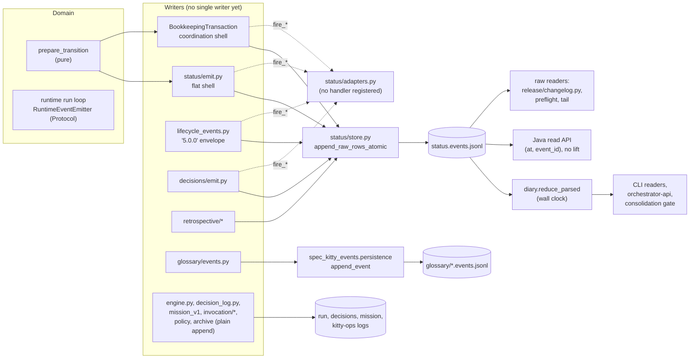

# Event Ledger Writers and Readers

This page maps **who writes and who reads every append-only event log and ledger in
core today**, states the target the event ADRs set, and lists the gaps between the two
with evidence, the ADR clause each one misses, a remedy and a tracker item. It is a
point-in-time grounding (core `main` at `fcb0ce13`, 2026-10-22; `spec-kitty-events`
locked at 11.0.0 in `uv.lock`, upstream at 11.2.1). Line numbers drift; the symbol
names are the stable part.

For the lane state machine itself (lanes, guards, CLI commands) read the
[status model](status-model.md). For contributor rules ("how do I write or read an
event today") read [Events in core](../development/reference/events-in-core.md).

## Scope and vocabulary

- **Event log**: an append-only JSONL file whose rows are facts (`status.events.jsonl`,
  `canonical-events.jsonl`, `run.events.jsonl`, `decisions.events.jsonl`,
  `mission-events.jsonl`, the glossary logs, `kitty-ops/*.jsonl`). These are what
  ADR 2026-10-14-1 calls "event logs" and what its single-writer rule covers.
- **State ledger**: an append-only or state file that records configuration or
  bookkeeping, not domain facts: the migration ledger (`.kittify/migration-ledger.jsonl`
  and `.kittify/migrations/clone-local.jsonl`, ADR 2026-10-17-1) and the activation
  ledger (`.kittify/charter/activation.yaml`, a YAML state file). They appear here
  only so a reader does not confuse them with the event ledger. Never write bare
  "the ledger".
- **Produce seam**: `src/specify_cli/status/adapters.py`, the in-process
  publish/subscribe surface. Open-core registers no handler, so every `fire_*` call is
  a no-op until a transport owner registers one. "Sync" names nothing live here.

## Current state: writers

Rows are grouped by file. "Contract writer" means the row is written through
`spec_kitty_events.persistence.append_event`, the library's fail-closed ledger write
contract (`spec-kitty-events` `docs/api/ledger-write-contract.md`).

| Log | Writer (file:line) | Row shape | Contract writer? | Locked? | Fires seam? |
|---|---|---|---|---|---|
| `kitty-specs/<m>/status.events.jsonl`, lane transitions, flat shell | `status/transition_pipeline.py:245` `prepare_transition` builds the event; `status/emit.py:845` `_persist_prepared` → EventBridge port (`events/event_bridge.py`, local file adapter) → `status/store.py:460` `append_event_stream_atomic_verified` → `store.py:333` `append_raw_rows_atomic` (temp file, fsync, `os.replace`) | `StatusEvent`, flat, no version, no clock; serialized by `store.py:293` `serialize_event_line` | No | Yes (`feature_status_lock`) | Yes, after the lock (`emit.py:1039`) |
| same file, lane transitions, coordination shell | `coordination/status_transition.py:1598` `emit_status_transition_transactional` → `coordination/transaction.py:984` `BookkeepingTransaction.append_events` → EventBridge port → `coordination/status_service.py` `append_event_stream_log` | same | No | Yes | Yes, deferred until after the commit (`coordination/outbound.py:103`) |
| same file, inner-state annotations | `status/emit.py:1223` `emit_inner_state_changed` (still calls the store directly, not the port) | `InnerStateChanged`, no version | No | Yes | Yes |
| same file plus `.kittify/canonical-events.jsonl`, internal lifecycle events | `status/lifecycle_events.py:397` `persist_lifecycle_event_local` → `:249` `_atomic_append` → `append_raw_rows_atomic`; file names at `:120-121` | local envelope `"5.0.0"`, marked `canonical-producer-exempt: #1198` (`:303`, `:314`) | No | Yes | Yes (`fire_lifecycle_fanout`) |
| same file, decision points | `decisions/emit.py:117` `_append_raw_event` → `append_raw_rows_atomic` | `DECISIONPOINT_SCHEMA_VERSION` payload; a line count stands in for a Lamport value | No, though the contract covers DecisionPoint ledgers | Yes | Yes |
| same file, retrospective run-terminus (superseded, no new callers) | `retrospective/events.py`, `append_raw_rows_atomic` under `retro_status_lock` | own envelope | No | Yes | No |
| same file, retrospective lifecycle | `retrospective/lifecycle_events.py` (`_append_retro_lifecycle_event`, `_locked_append`) | integer `schema_version` | No | Yes | **No** |
| same file, backfill migrations and whole-log rewrites | `migration/backfill_runtime_state.py`, `migration/verdict_provenance_backfill.py`, `migration/rebuild_state.py`, `consolidation/bookkeeping_projection.py`, the merge driver `event_log_merge.py` | synthesized or rewritten rows | No | Mostly | No |
| `.kittify/events/glossary/<mission_id>.events.jsonl` | `src/glossary/events.py:41` imports `spec_kitty_events.persistence.append_event`; torn-tail repair under a lock | package models | **Yes, the only user** | Yes (repair lock, and the contract write under the interim lock, #6606) | No |
| `kitty-ops/<op>.jsonl`, `ops-index.jsonl`, `op-closures.jsonl` | `invocation/writer.py:231` `write_started` (exclusive create, under the family lock), `:260` `write_completed` and `:153` `_append_validated` (the per-Op trail), `:193` `_append_line_no_follow` (index and closure spine, no-follow), `:45` `append_op_closure` | Op record schema v2 | No | Yes (interim lock, #6606): the exclusive create and every append, one lock for the `kitty-ops/` family | No |
| `kitty-ops/lifecycle.jsonl` | `invocation/lifecycle.py:58` `append_lifecycle_record` | Op lifecycle record | No | Yes (interim lock, #6606) | No |
| `kitty-ops/propagation-errors.jsonl` | `invocation/propagator.py`, from a background thread | own dict | No | Yes (interim lock, #6606) | No |
| `.kittify/runtime/runs/<run>/run.events.jsonl` | `src/runtime/next/_internal_runtime/engine.py:108` `_append_event`, marked `canonical-producer-exempt: #1248` (`:110`) | `{event_type, timestamp, payload}`, no `event_id`, no version | No | Yes (interim lock, #6606) | No |
| `kitty-specs/<m>/decisions.events.jsonl` | `events/decision_log.py:249` `DecisionGitLog._append_to_file`, then `safe_commit` | sanitized `mission_next` payload | No | Yes (interim lock, #6606) | No |
| `kitty-specs/<m>/mission-events.jsonl` | `mission_v1/events.py:62` `_write_event` | own dict | No | Yes (interim lock, #6606) | No |
| `kitty-specs/<m>/policy-audit.jsonl`, `.kittify/archive/archived-missions.jsonl`, `.kittify/encoding-provenance/global.jsonl` | `policy/audit.py`, `missions/_archive.py`, `charter/activation/_io.py` | own dicts | No | Yes (interim lock, #6606) | No |
| Migration ledger (state ledger) | `upgrade/ledger.py:248` `Ledger.append`, `:255` `append_many`: full-file atomic rewrite, deliberately not `O_APPEND` | `{id, applied_at, result, identity, content_hash, cli_version}` | n/a | No lock | n/a |
| Activation ledger (state ledger) | `charter.activation.activation_ledger` `prepare_ledger_write` | YAML state | n/a | n/a | n/a |

What holds today:

- **One interim lock for every other event log (#6606).** `kernel.event_log_append`
  (`append_event_log_lines`, `event_log_lock`) anchors a lock on the log (or, for
  `kitty-ops/<op>.jsonl`, on the family directory) at
  `<git-common-dir>/spec-kitty-locks/event-logs/<sha256[:32]>.lock`, refuses a log whose
  last byte is not LF, and writes the unit in one `O_APPEND` write plus `fsync`. It checks
  line framing only, never row content. It retires per log at the #6193 handover;
  `status.events.jsonl` and `canonical-events.jsonl` keep the Mission status lock.

- `status.events.jsonl` has a disciplined write funnel. Raw append primitives are
  importable only from the nine modules in `status/_unsafe.py:75-113`
  (`ALLOWED_CALLERS`, shrink-only), and `tests/architectural/test_status_events_writes_gate.py`
  fails on any write to that file outside `status/store.py` and its ledgered
  out-of-store sites, with a lock-composition census and a non-vacuity floor.
- The validation step is pure: `prepare_transition` does no writes, locks, git or
  fan-out (`status/transition_pipeline.py:27-35`).
- One family already writes through the contract: glossary (#6399, PR #6425).

What does not hold:

- There is **no single canonical writer**. About fifteen append implementations live in
  more than twelve modules and write at least six row shapes. The EventBridge port
  exists only as a skeleton (#6603): the three work package transition doors call it,
  and every other writer still appends on its own.
- ~~Eight writers append with an unlocked `open("a")` and no torn-tail check.~~ Since
  #6606 every one of them, the Op record appends and the glossary contract write take the
  one interim lock (`kernel.event_log_append`; contract above) and refuse a torn tail.
  `tests/architectural/test_event_log_writes_gate.py` ledgers every caller and fails a new
  raw writer (#6603).
- Two whole-log writers serialize with their own `json.dumps(..., sort_keys=True)`
  (`migration/rebuild_state.py`, `event_log_merge.py`) instead of
  `store.serialize_event_line`, which calls itself "the one authority for the on-disk
  row shape" (`store.py:293-300`).
- The flat `store.append_event` door was a non-atomic `open("a")` with no production
  caller, and its wrappers (`append_event_verified` through
  `status_service.append_event_log`, and `append_primary_checkout_event_verified`) had
  none either. #6614 deleted all of them on 2026-10-22 (G-16); `status.events.jsonl` is
  now written only through the atomic primitives in `status/store.py` (the
  `append_*_atomic*` family).

## Current state: readers

| Reader | file:line | Reads | Through | Order |
|---|---|---|---|---|
| `reduce` | `status/reducer.py:200` (`:205` calls `reduce_parsed`) | typed `StatusEvent` list | `spec_kitty_events.diary.reduce_parsed` | wall clock `at`, then `event_id`, with the approved-departure lift |
| `materialize_snapshot` / `materialize` | `status/reducer.py:397` (`:401`), `:435` | the log, read twice (stream + raw) | `spec_kitty_events.status.reduce`, a re-export of `diary.reduce` (`parse_diary` then `reduce_parsed`) | same |
| lane reader, views, aggregate | `status/lane_reader.py`, `status/views.py`, `status/aggregate.py` | `store.read_events` | `reduce` | same |
| orchestrator-api | `orchestrator_api/commands.py`, `wp_lifecycle.py`, `consolidation.py` | store | `reduce` / `materialize` | same |
| consolidation gate | `consolidation/reconciliation.py` `build_approved_wp_set` | store | `materialize_snapshot` | same |
| tail | `status/tail_reader.py` `poll_once`; CLI `cli/commands/events.py` (`events tail`, only `status.events.jsonl`) | raw bytes with a cursor | none (stream) | file offset |
| preflight actor lookup | `consolidation/preflight.py` `_latest_actor_for_transition` | `read_events_lenient` | none | **append order** (documented as deliberate) |
| changelog acceptance | `release/changelog.py:129-155` `_wp_lane_from_event_log` | raw `json.loads` loop over `mission_dir` | none | **last `to_lane` in file order** |
| status-surface guard | `coordination/status_surface_guard.py` | raw lines, event ids only | none | set membership |
| retrospective readers | `retrospective/summary.py`, `gate.py`, `generator.py` | raw rows | own fold | own `lamport` field |
| Mission Status Read API (Java) | `services/mission-status-api/.../reducer/StatusReducer.java`, ordering `AtThenEventId.java` | the log | own port of `reduce_parsed` | plain `(at, event_id)`, **no approved-departure lift** |
| Read API reference oracle | `tests/contract/_mission_status_*.py` | the log | `materialize_snapshot`, `tail_reader` | same as the CLI |
| migration ledger | `upgrade/ledger.py`, `registry.py` `migration_settled`, `spec-kitty migrate ledger` | both partitions | own normalizer | last record per id in file order |

**There is one reducer, not two.** Every reducer-based CLI lane read (`reduce`, `materialize_snapshot`, `materialize`) reaches the same wall-clock fold,
`diary.reduce_parsed`, through two parsers. The raw readers in the table (changelog acceptance, the preflight actor lookup, the retrospective folds) bypass it; see G-13. The ordering key is the writer's `at`, then
`event_id`; since `spec-kitty-events` 10.5.1 a non-seed departure from `approved` is lifted
to sort after the approval it followed (the #4941 fix, PR #6261). The Lamport reducer
`spec_kitty_events.status.reduce_status_events` is not on the CLI path, and CLI lane rows
carry no Lamport clock. What remains open is narrower than #4941 was: a non-approval
transition minted on a clock behind the event it follows still sorts before that event.

**The read API contract.** `contracts/mission-status/openapi.yaml:4` is `1.0.0-SNAPSHOT`
(unreleased until the `contract-mission-status-v1.0.0` tag). The Java service in
`services/mission-status-api/` serves the project, Mission list, SSE events and both artifact
routes (#957, PRs #6401 and #6427). `getMission`, `getWorkPackage` and
`getWorkPackageDetail` still return 404 by design, pinned by `OutOfScopeRoutesTest` (#6409).
No CLI command starts the service and it is not in the wheel.

## Current state at a glance

## Target, as the ADRs set it

- **One canonical event writer: the Java write service** (ADR 2026-10-22-1, which amends
  ADR 2026-10-14-1 D-1, D-2 and D-5).
  - There is one resident service per repository, keyed on the git common dir *(derived; ADR 2026-10-22-1 D-2)*. It is the
    command side of the Mission Write API (#6117).
  - The domain calls the Python **EventBridge port**, grown from `RuntimeEventEmitter`. Its
    adapter in `specify_cli` sends commands to the service.
  - The CLI decides when and what to write; the service decides how and where.
  - A native image runs first, with a JVM jar as fallback. With neither, the write fails
    closed, and there is no Python fallback writer.
  - Two gates prove the single writer: a Python writes gate and an ArchUnit rule.
- **Contract rows only.** Each persisted row is a `spec-kitty-events` row envelope whose
  `schema_version` is the row version, around a typed payload carrying its own payload
  version. The 3.0.0 envelope stays the wire form; the library ships the row-to-wire
  mapping (ADR 2026-10-14-1 D-3, D-3a; ADR 2026-10-13-2 D-1).
- **The internal lifecycle events are retired**: both `status/lifecycle_events.py` and
  `retrospective/lifecycle_events.py` go, and each fact becomes a canonical library
  event, added upstream first (ADR 2026-10-14-1 D-4).
- **Git and filesystem effects become internal consumers**: synchronous ones inside the
  unit of work (roll the append back on failure), asynchronous ones idempotent by
  `event_id` and rerunnable (ADR 2026-10-14-1 D-5).
- **The ledger is the publication seam**, default on: subscribers read it by cursor
  (`events tail`, the read API); the in-process seam fires for local adapters; nothing
  hosted lives in open-core (ADR 2026-10-13-2 D-2; ADR 2026-10-06-1 Amendment 2026-10-12).
- **Two retention tiers**: committed logs are never pruned; local logs follow a
  `ledger.retention` policy with a dry-run-first cleanup command (ADR 2026-10-13-2 D-3).
- **One read port**: every CLI status read goes through it, and the Java service is
  conformance-gated against the Python reducer (ADR 2026-10-01-2 D-5 as amended, D-9 to D-11).
- **Ordering: wall clock for 4.0.0.** ADR 2026-02-09-3 Amendment 2026-10-22 records it,
  together with from-lane continuity and the approved-departure lift; the merge rules are
  kept. Lamport-primary ordering is a post-GA direction (#6609); see gap G-3.

## Gap table

| ID | Gap | Evidence | ADR clause | Proposed remedy | Tracker |
|---|---|---|---|---|---|
| G-1 | **Partly closed (#6603):** the EventBridge port skeleton exists (`runtime/next/event_bridge.py`; local file adapter `specify_cli/events/event_bridge.py`) and the three work package transition doors call it; every other writer remains. No single canonical writer; about fifteen append implementations | table above; `runtime/next/event_bridge.py` (port), `specify_cli/events/event_bridge.py` (local file adapter); `status/_unsafe.py:75-113` contains only `status.events.jsonl` writers | 2026-10-14-1 D-1, D-2 | Done for the WP transition (the flat doors `_persist_prepared` and `emit_status_transition_batch`, and `BookkeepingTransaction.append_events`, call `record_work_package_transition`); still open: `emit_inner_state_changed` writes standalone annotations to the same file outside the port, and the port's unit is the append only (the coordination shell still materializes, commits and cuts the log on failure in process), narrower than ADR 2026-10-22-1's one unit of work, so #6675 must route that door and widen the unit; then move the other writers behind the port, one log at a time (#6193), with the Java write service's client as the adapter (#6675) | file new (supersedes the premise of #1927) |
| G-2 | **Partly closed (#6603):** `tests/architectural/test_event_log_writes_gate.py` freezes the door callers, raw writers and unresolved log-shaped writes of every named log; it drains as each log moves (#6193). Open: the gate drains only as logs move to the write service, and the residuals in its docstring (parameter-only and glob-built paths) | `tests/architectural/test_status_events_writes_gate.py` (`status.events.jsonl`) and `tests/architectural/test_event_log_writes_gate.py` (every other named log) | 2026-10-14-1 Confirmation (gate over `*.events.jsonl`, `canonical-events.jsonl`, `run.events.jsonl`, `mission-events.jsonl`, `kitty-ops/*.jsonl`) | Extend the gate to every named file, frozen at today's writers, draining with G-1 | file new (with G-1) |
| G-3 | Docs say the status path is Lamport-ordered; it is wall clock | `status/reducer.py:17-18`, `:205`, `:401`; ADR 2026-10-14-1 "Reducer duality" bullet; ADR 2026-02-09-3 (sort "primary: `logical_clock`", "`status emit` ticks the logical clock", the gate "uses the Lamport reduction wrapper"); ADR 2026-10-01-2 (overview "through the Lamport reducer", "ports the Lamport reduction"); `docs/architecture/diagrams/01_context/README.md`, `02_containers/README.md`; `docs/plans/domains/api-dashboard-domain-plan.md` | 2026-02-09-3 Decision; 2026-10-01-2 D-5 | Factual amendments (wording only); whether to make ordering truly Lamport-primary is an operator decision needing a clock on CLI rows (events #72) | file new (#6213 closed after step 1 only) |
| G-4 | Java read API does not port the #4941 approved-departure lift | `StatusReducer.java` Javadoc on `PORTED_EVENTS_VERSION` ("NOT yet ported"); `AtThenEventId.java` plain `(at, event_id)`; no golden covers the clock-ahead case | 2026-10-01-2 D-11 (conformance to the Python reducer) | Add the clock-ahead golden, port the lift before more read routes ship | #6268 |
| G-5 | ~~Eight unlocked plain appends, no torn-tail refusal~~ **Closed (#6606):** each takes the interim lock in `kernel.event_log_append` and refuses a torn tail | `invocation/lifecycle.py:65`, `events/decision_log.py:252`, `mission_v1/events.py:60-66`, `engine.py:107-123`, `policy/audit.py`, `missions/_archive.py`, `invocation/propagator.py`, `charter/activation/_io.py` | 2026-10-14-1 D-1 | Route through `persistence.append_event` where a model exists; otherwise its `O_APPEND` single write and torn-tail check | file new (Op family: #6564) |
| G-6 | Decision-point rows bypass the contract writer the library publishes for them | `decisions/emit.py:117-152`; `spec-kitty-events` `docs/api/ledger-write-contract.md`, "Unclocked envelopes" | 2026-10-13-2 D-1 ("the CLI then writes from the package's models") | Migrate this family next after glossary | #6412 |
| G-7 | Internal lifecycle modules and their exemptions remain | `status/lifecycle_events.py` (`"5.0.0"`, `#1198` at `:303`, `:314`); `retrospective/lifecycle_events.py`; 15 `canonical-producer-exempt` markers in `src/` | 2026-10-14-1 D-4 | Retire after G-1; payload models first (#6438) | #6185 (blocked on owner ruling), #6438 |
| G-8 | Side effects still inline in the shells | `coordination/transaction.py` commit path; `events/decision_log.py` swallows a failed commit as a warning | 2026-10-14-1 D-5 | Consumers after G-1; make the decision-log commit failure a recorded, rerunnable failure | file new (later step) |
| G-9 | No local retention policy | no `keep_runs` / `max_age_days` in `src/`; run journals grow unbounded | 2026-10-13-2 D-3 | `ledger.retention` plus a dry-run-first doctor cleanup that protects active and resumable Missions | file new (split out of #6185 item 4) |
| G-10 | `events tail` tails only `status.events.jsonl`; `--json` has no effect | `cli/commands/events.py:71` (`noqa: ARG001`) | 2026-10-13-2 D-2 | Extend tail to the other logs once G-1 names them | file new (low) |
| G-11 | ~~Produce-seam names still say "saas"~~ **Closed 2026-10-22 (#6607)** | The seam in `status/adapters.py` now reads `register_status_fanout_handler`, `register_lifecycle_fanout_handler`, `fire_status_fanout` and `fire_lifecycle_fanout`; `emit._status_fan_out`, `outbound.queue_fanout_emission` and `lifecycle_events.fanout_lifecycle_event` follow; the timeout variable is `SPEC_KITTY_STATUS_FANOUT_TIMEOUT`. There is no alias for any old name or for the old variable (operator ruling 2026-10-22, which supersedes this row's earlier "with an env alias" proposal). Contract test: `tests/status/test_adapters_contract.py` (stub handlers; open-core registers none), with the sink plugin `tests/conftest_fanout_sink.py` | 2026-10-13-2 follow-up debt (rename the `saas_fanout` slots); discharged by its Amendment 2026-10-22 | None open | #6607 |
| G-12 | CLI status reads do not go through one read port | `orchestrator_api/commands.py` and `tasks_status_cmd.py` call `reduce(...)` themselves; no read-port module | 2026-10-01-2 D-5 (amended: every CLI status read calls only that port) | Introduce the port, gate direct `reduce` callers | #5528 |
| G-13 | Raw readers that bypass the reducer | `release/changelog.py:129-155` (last `to_lane` in file order, skips corrupt lines, reads `mission_dir` not the resolved status surface); `consolidation/preflight.py` append order | 2026-10-01-2 D-5 | Changelog through `get_wp_lane` and the placement seam; record the preflight order in the ordering ADR or align it | file new (changelog) |
| G-14 | Core locks `spec-kitty-events` 11.0.0; upstream is 11.2.1 | `uv.lock`; `pyproject.toml:80` (`>=11.0.0,<12`) | 2026-10-13-2 D-1 (release order) | Refresh the lock to 11.2.x through the safe-adoption steps in the [contributor note](../development/reference/events-in-core.md#adopting-a-new-spec-kitty-events-release); it unblocks #6445, #6446 | file new (umbrella #6411) |
| G-15 | Migration ledger behaviour the ADR does not record | `upgrade/migrations/base.py` keeps reselection for a `runs_first` migration whose `structural_detect` fires; `upgrade/ledger.py` read-modify-write takes no lock | 2026-10-17-1 ("collapses to 'is this id in the applicable ledger'") | Factual amendment recording the structural reselection, or an operator decision to remove it | file new (low) |
| G-16 | ~~Dead or duplicate write code~~ **Closed 2026-10-22 (#6614)** | Deleted: `store.append_event`, `store.append_event_verified`, `store.append_primary_checkout_event_verified`, `coordination.status_service.append_event_log`, `kernel.atomic.notify_file_written` and `invocations_cmd.append_to_index`. Tests seed `status.events.jsonl` through `tests/_support/status_seed.py`, which calls `store.append_events_atomic`. Enforced by `tests/architectural/test_status_unsafe_allowlist.py` (re-pinned `STORE_APPEND_PRIMITIVES` and `COORD_WRAPPER_DOORS`), `tests/architectural/test_status_events_writes_gate.py` (the store write set is `os.replace` only, plus a single-writer census for `kitty-ops/ops-index.jsonl`), `tests/architectural/test_no_dead_symbols.py` (allowlist entries removed) and a `hasattr` ban in `test_1622_dead_symbol_retirement.py` | 2026-10-14-1 D-1 ("the low-level append primitives become private to it") | None open | #6614 |
| G-17 | A lock bump runs too few consumer tests per PR | `scripts/ci/gate_selection.py:107-109`: `reducer_lock` fans out to `{upgrade, status}` only; consolidation, decisions, glossary, `runtime/next`, retrospective, migration and dossier import `spec_kitty_events` directly; the reducer-verdict pins (`tests/migration`), `tests/contract/spec_kitty_events_consumer/` and the corpus parity tests run nightly only | 2026-10-14-1 "What must stay true" (consolidation gates keep their verdicts) | Derive the fan-out from a census of `spec_kitty_events` importers, gate it against drift, and run the nightly-only event directories when `uv.lock` changes the events version | file new |
| G-18 | ~~Core imports a private library symbol that changes strictness~~ **Closed 2026-10-22 (#6607)** | The importing code, `build_saas_lifecycle_queue_event` with `_canonical_lifecycle_payload_for_saas` and `_validate_lifecycle_payload` in `status/lifecycle_events.py`, had no live caller and was deleted, not replaced; the public `repo_root_for_lifecycle_log` went with it. The gate is `tests/architectural/test_events_tracker_public_imports.py` (not `test_shared_package_boundary.py`, which this row first named): it covers all six production roots and rejects any `_`-prefixed module segment or imported name, with no allowlist | Shared Package Boundary ADR 2026-04-25-1 (public imports only); its Amendment 2026-10-22 | Upstream ask, proposed: a public `known_event_types()` and public `diary` helpers in `spec-kitty-events`, so core never needs a private symbol for them | #6607 (upstream ask: proposed, not filed) |
| G-19 | The core reducer test is circular and partial | `tests/status/test_shared_reducer_materialization.py:17-25` replays 5 of the package's replay fixtures (the package ships more, e.g. `seed_lane_authority`) against the package's own reducer | 2026-10-01-2 D-11 (a conformance corpus) | Glob every packaged replay fixture; add a core-owned golden corpus (real Mission logs to expected lanes) that a bump must diff explicitly | file new (with G-17) |

## Ordering of the work

1. **Settled 2026-10-22**: the producer is the Java write service, and #6185 folds into
   #6117's modules (ADR 2026-10-22-1). Its migration order (port, module extraction, Java
   binding, lock spike, one file at a time) governs G-1, G-2, G-5 to G-8.
2. **No dependencies, in parallel**: G-17 and G-19 (test guardrails, before G-14), G-14
   (lock refresh), G-3 (doc amendments), G-4 (#6268), #6409
   (then close #957). G-11, G-16 and G-18 are closed (#6607, #6614, 2026-10-22).
3. **G-1 and G-2 together**: the port skeleton and the multi-file writes gate.
4. **After G-1**: G-6, G-7 (#6438, the lifecycle half of #6185), G-5, G-9, then G-8 and G-10.
5. **Read side, independent**: G-12 under #5528, G-13.

## Why event changes are risky

Two coupling points make a `spec-kitty-events` change or a writer change land
somewhere unexpected:

- **The consolidation gate reads status through the same reducer** (`build_approved_wp_set`
  through `materialize_snapshot`). A reducer ordering change in the library changes which
  work packages a `consolidate` lands. The approval-stamp bound, per-WP attribution and
  the status-surface guard also read `policy_metadata.lane_head`, `review_result`, `force`
  and actor provenance from the rows (ADR 2026-10-14-1, "What must stay true during the
  migration").
- **Two reducer implementations must agree**: the Python fold and the Java port. The
  Java service records the library version it is coupled to (`PORTED_EVENTS_VERSION`),
  and `ManifestCouplingTest` holds it equal to the version the conformance goldens were
  generated with, but a behaviour change no golden exercises passes that check (G-4).

The history of the recent bumps shows one recurring class: the library ships reducer
behaviour changes as **patch** releases (its `COMPATIBILITY.md` records each), and the
core tests that catch them sit in lanes the bump PR does not select.

| Bump | Core PR | Red that followed | Cause | Fix |
|---|---|---|---|---|
| 10.4.0 | #5032 | envelope snapshot test (nightly) | no `tests/contract/snapshots/spec-kitty-events-10.4.0.json` | #5195 |
| 10.4.2 | #6039 | 47 `SNAPSHOT_DRIFT` in the Mission-state audit (#6058); envelope snapshot | reducer changes changed the materialized snapshots; no snapshot (a `tests/migration` reducer-ordering red in nightly #6029 was first linked to this bump, but its triage calls it the #4941 residual, failing identically before the merge) | #6080, #6063, then 10.4.4 via #6088, #6092, #6094 |
| 10.4.6 | #6205 | `tests/upgrade/test_mission_corpus_recovery.py` red on `main` (#6238) | rollback-seed rule changed the pinned corpus verdicts; a `uv.lock`-only change selected no upgrade or status shard | #6245 (re-pin, plus the `reducer_lock` router group) |
| 11.0.0 | #6425 | caught in the PR: `LOCAL_ONLY_EVENT_TYPES` import removed | breaking removal in a major | same PR |

Most other September and October nightly reds had unrelated causes; 10.5.1 (#6261) left no confirmed
follow-on red. The guardrails added after each incident (`reducer_lock`, the
`mission_state` group, in-PR snapshots) narrowed the class but did not close it (G-17).

A related exposure: the pin `>=11.0.0,<12` lets a fresh install resolve a newer patch
or minor than the one CI tested, so a user can run reducer verdicts core never tested.

The contributor note lists the steps for adopting a new release safely.

## Citations

- ADR [2026-10-14-1](../adr/4.x/2026-10-14-1-event-native-core-one-canonical-event-writer.md): one canonical event writer.
- ADR [2026-10-13-2](../adr/4.x/2026-10-13-2-the-event-ledger-is-the-publication-seam-default-on-with-local-retention.md): the ledger is the publication seam.
- ADR [2026-10-01-2](../adr/4.x/2026-10-01-2-mission-status-read-api-and-dashboard-extraction.md): Mission Status Read API.
- ADR [2026-02-09-3](../adr/2.x/2026-02-09-3-event-log-merge-semantics.md): event-log merge semantics.
- ADR [2026-10-17-1](../adr/4.x/2026-10-17-1-explicit-migration-ledger.md): migration ledger.
- ADR [2026-10-06-1](../adr/4.x/2026-10-06-1-team-kitty-surfaces-are-hidden-unless-drain-is-on.md): Team Kitty surfaces (Amendment 2026-10-12).
- `spec-kitty-events` `docs/api/ledger-write-contract.md`, `docs/architecture/ordering-and-reduction.md`, `docs/api/versioning-and-compatibility.md`.
