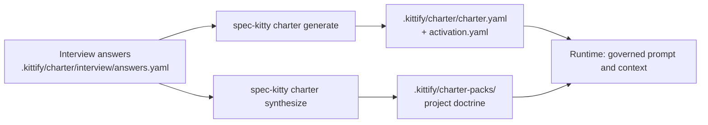

# Context

This is where Spec Kitty's shared vocabulary and governance model live: the
canonical glossary contexts, the audience/persona catalog used across the
docs, and the Charter governance model that shapes what your agent is told
to do and why.

- **Glossary contexts** (`*.md`) — canonical terminology per bounded context,
  relocated from `glossary/contexts/`. These remain the doctrine-extraction
  source consumed by `scripts/generate_contextive_glossaries.py`; the
  glossary seed files under `.kittify/glossaries/` are unchanged.
- **`audience/`** — architecture audience personas (internal/external)
  that every page names as its readers in `audience:` frontmatter.
- **Charter-era overview** — the Charter governance
  model, distilled here for quick reference. See
  [How Charter Works](charter-overview.md) and the
  [Governance Files Reference](governance-files.md).

### Glossary reference notes

Companion notes to the glossary contexts, folded in here from the legacy
root-level `glossary/` stub and the previously homeless context docs:

- [Glossary Conventions](glossary-conventions.md) — source-of-truth precedence,
  the policy/runtime layering, term status lifecycle, and the per-term entry
  schema every context page follows (folded from the root `glossary/` stub).
- [Contextive Glossary Integration](contextive-glossaries.md) — how the context
  pages generate Contextive-compatible IDE hover glossaries.
- [Spec Kitty Inc. Product Lines](product-lines.md) — Build Kitty and Brain Kitty (the
  open-core producer lines) and Team Kitty (the consumer line, "Multiplayer Mode"),
  distinct from the Spec Kitty toolkit and the SkyKitty fleet.
- [Team Kitty and Zeitgeist](team-kitty.md) — the hosted surfaces that were
  removed from open-core in #6164, what open-core keeps (the Mission Status Read
  API and the status-event produce seam), the vocabulary of the removed model, and
  why "sync" is a dead word.
- [Specification-Driven Development (SDD)](spec-driven.md) — the methodology
  behind Spec Kitty, rehomed from the repository root.
- [Naming Decision: Tool vs Agent](naming-decision-tool-vs-agent.md) — the
  canonical split between *tool* (concrete execution product) and *agent*
  (logical collaborator identity/role).
- [The SkyKitty Agent Fleet](../development/agent-fleet.md) — **SkyKitty**, the
  company agent fleet that runs missions on this repo (distinct from **Spec Kitty**,
  the toolkit, and **Team Kitty**, the hosted product), its roles, and the
  `ready-for-squad` handshake.
- [Historical Terms and Mappings](historical-terms.md) — legacy wording mapped
  to its current canonical term, with version scope and migration notes.

---

## Charter-era overview

You are looking at the current Spec Kitty documentation surface for new
projects and upgrades.

### Answer summary

- Current version line: Spec Kitty 4.0 (release candidates; `pyproject.toml` reads `4.0.0rc9` at the time of writing).
- Current runtime model: Charter-era missions with governed context injection.
- Current governance source: `.kittify/charter/charter.yaml` (the git-tracked,
  authoritative file; `charter.md` is a human-readable companion the runtime
  never parses), with activation choices in `.kittify/charter/activation.yaml`.
- Current mission loop: `spec-kitty next --agent <name> --mission <slug>`.
- Upgrade path: [the migration hub](../migrations/README.md).

### What is Charter?

Charter is the governance layer introduced in Spec Kitty 3.x.
`.kittify/charter/charter.yaml` is the single git-tracked, authoritative
charter — it's what the runtime resolves at every governed mission action.
`.kittify/charter/charter.md` is a human-readable narrative companion for
authors; the runtime never parses it. The flow is:

In words: the interview answers feed `charter generate`, which writes
`charter.yaml`, and `charter synthesize`, which writes project doctrine to
`.kittify/charter-packs/`; the runtime resolves `charter.yaml`, the activation
ledger and that doctrine, and injects governed context into each mission
action's prompt.

When you run `spec-kitty next --agent <name> --mission <slug>`, the runtime
automatically injects the relevant Charter context into the prompt file it
returns for the next mission action. For standalone work,
`spec-kitty dispatch "<request>"` uses the same governed-context model and
records an Op trail.

For the full mental model, see [How Charter Works](charter-overview.md).

### Documentation by type

#### Tutorials — learning-oriented

- [Governed Charter Workflow End-to-End](../guides/tutorials/charter-governed-workflow.md) — Start from a fresh repo, set up governance, synthesize doctrine, and run a governed mission action
- [Getting Started with Spec Kitty](../guides/tutorials/getting-started.md) — First project from scratch
- [Multi-Agent Workflow](../guides/tutorials/multi-agent-workflow.md) — Run a mission across multiple harnesses

#### How-to guides — task-oriented

- [How to Set Up Project Governance](../guides/how-to/governance/setup-governance.md) — Charter interview and generate (`charter sync` was removed, #5828)
- [How to Synthesize and Maintain Doctrine](../guides/how-to/governance/synthesize-doctrine.md) — `charter synthesize`, `charter resynthesize`, bundle validation
- [How to Run a Governed Mission](../guides/how-to/governance/run-governed-mission.md) — `spec-kitty next --agent` with Charter context injection
- [How to Manage the Glossary](../guides/how-to/governance/manage-glossary.md) — Living glossary, Charter integration, retrospective proposals
- [How to Use the Retrospective Learning Loop](../guides/how-to/governance/use-retrospective-learning.md) — `retrospect summary`, `agent retrospect synthesize`
- [Troubleshooting Charter Failures](../guides/how-to/governance/troubleshoot-charter.md) — Stale bundle, missing doctrine, compact-context, retro gate failures

#### Reference — authoritative specifications

- [Charter CLI Reference](../api/charter-commands.md) — All `charter` subcommands with flags
- [CLI Commands](../api/cli-commands.md) — Full spec-kitty CLI reference including Charter-era additions
- [Profile Invocation Reference](../api/profile-invocation.md) — standalone dispatch and invocation trail
- [Retrospective Schema Reference](../api/retrospective-schema.md) — `retrospective.yaml` schema, proposal kinds, exit codes
- [Governance Files Reference](governance-files.md) — Every file in `.kittify/charter/`

#### Explanation — conceptual background

- [Ops vs. Missions](ops-vs-missions.md) — When to use a lightweight `dispatch` Op versus a full governed Mission
- [Mission Types](mission-types.md) — Comparing software-dev, research, documentation, and plan missions
- [How Charter Works](charter-overview.md) — Mental model: doctrine → DRG → governed context
- [Understanding Charter: Synthesis, DRG, and Governed Context](../architecture/charter-synthesis-drg.md) — Deep dive into synthesis and the DRG
- [Understanding Governed Profile Invocation](../architecture/governed-profile-invocation.md) — The `(profile, action, governance-context)` triple
- [Understanding the Retrospective Learning Loop](../architecture/retrospective-learning-loop.md) — Why retrospectives exist and how the gate model works

### Migration

Upgrading from an earlier version? See
[Migrating from 2.x / Early 3.x](../migrations/from-charter-2x.md) — what changed,
migration steps, and known failure modes.

### What is archived

Documentation for Spec Kitty 1.x and 2.x is preserved through the
[migration hub](../migrations/README.md) for historical context. The 2.x
governance model did not include the DRG-backed synthesis pipeline or the
retrospective learning loop. If you are running a current project, use the
documentation above.
