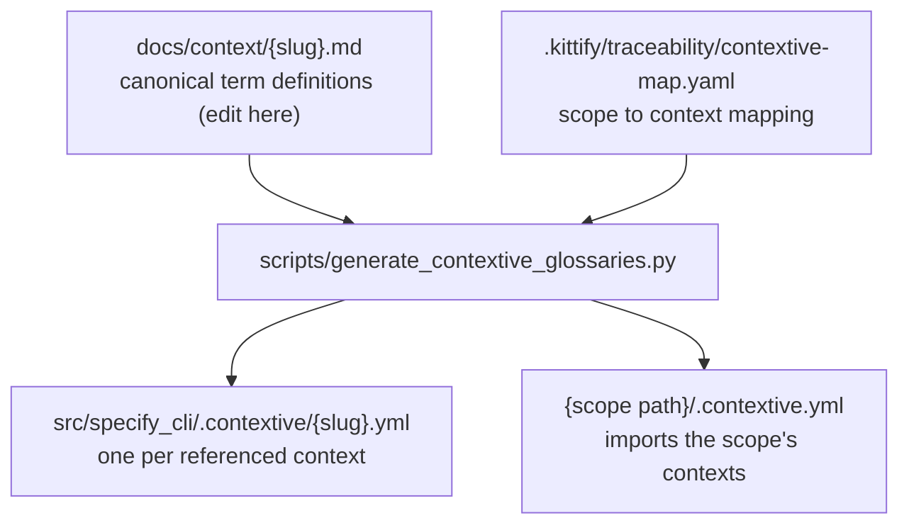

# Contextive Glossary Integration

Spec Kitty generates [Contextive](https://contextive.tech)-compatible YAML glossary files from the
canonical glossary markdown so that IDE users get in-editor term hover panels without any manual
duplication.

## How it works



In words: the generator reads every context page the map references and the map itself, then writes
one context YAML per referenced context and one scope YAML per mapped package.

- **Context YAMLs** (`src/specify_cli/.contextive/<slug>.yml`) contain the extracted terms for one
  glossary context domain.
- **Scope YAMLs** (`<scope path>/.contextive.yml`, for example `src/glossary/.contextive.yml`) use Contextive `imports:` to pull in only the
  contexts relevant to that package. This keeps files small and avoids copying definitions.

The mapping from source package → relevant contexts is in
`.kittify/traceability/contextive-map.yaml`.

## Running the generator

```bash
# Write / update all generated files
python scripts/generate_contextive_glossaries.py generate

# Check that generated files are up-to-date (exits 1 if stale)
python scripts/generate_contextive_glossaries.py check
```

## Where the mapping lives

`.kittify/traceability/contextive-map.yaml` — single source of truth for what gets generated where.

```yaml
context_base_dir: "src/specify_cli/.contextive"

scopes:
  - path: "src/glossary"
    description: "Core glossary subsystem"
    contexts:
      - lexical
      - system-events
```

## Adding a new scope mapping

1. Open `.kittify/traceability/contextive-map.yaml`.
2. Add a new entry under `scopes`:
   ```yaml
   - path: "src/specify_cli/my_new_package"   # illustrative path
     description: "What this package does"
     contexts:
       - orchestration     # choose from docs/context/ filenames (without .md)
   ```
3. Run the generator:
   ```bash
   python scripts/generate_contextive_glossaries.py generate
   ```
4. Commit the updated map together with every file the generator wrote: the new scope `.contextive.yml` and any new context YAML under `src/specify_cli/.contextive/`.

## Available context slugs

A context slug is a filename (without `.md`) under `docs/context/`. The generator checks only that
the file exists; it extracts terms from a page that has a `## Context:` heading followed by `###`
term entries with a definition table. These pages have that shape today:

| Slug | Domain | Mapped to a scope today |
|------|--------|-------------------------|
| `charter` | Charter domain model and artifact taxonomy | no |
| `configuration-project-structure` | Project layout and configuration artifacts | no |
| `dossier` | Artifact inventory and drift detection | yes |
| `execution` | CLI invocation and semantic safety gates | yes |
| `governance` | Charter, ADR, and policy precedence | yes |
| `identity` | Actors, roles, and Human-in-Charge | no |
| `identity-fields` | Repository, collaboration, and build identity fields | no |
| `lexical` | Glossary internal data model | yes |
| `orchestration` | Mission, work package, and Mission lifecycle | yes |
| `planning-and-tracking` | Issue tracker organization and dispatch | no |
| `practices-principles` | Working agreements | no |
| `product-lines` | Spec Kitty product lines | no |
| `system-events` | Event envelope and glossary evolution | yes |
| `technology-foundations` | General tech terms (API, CLI, YAML, Git) | yes |
| `testing-taxonomy` | Test categories and pytest markers | no |
| `topology` | Mission topology and where work runs | no |

Only a mapped slug gets a context YAML. The header comment in `contextive-map.yaml` lists 11 slugs;
the map's `scopes` reference seven.

## Keeping the generated files current

No CI workflow runs `check` against the repository today. The tests in
`tests/cross_cutting/encoding/test_contextive_traceability.py` exercise the generator on fixtures
and parse the real context pages; they do not compare the committed files with a fresh generation.
Run `check` yourself after you edit a page under `docs/context/`, and commit the regenerated file
with the page. `check` exits 1 and names each stale or missing file.

## Do not edit generated files

All files under `src/specify_cli/.contextive/` and any `<package>/.contextive.yml` file whose first
line reads `# GENERATED FILE` are machine-generated. Edit the canonical sources instead:

- Term definitions → `docs/context/<slug>.md`
- Scope mapping → `.kittify/traceability/contextive-map.yaml`
