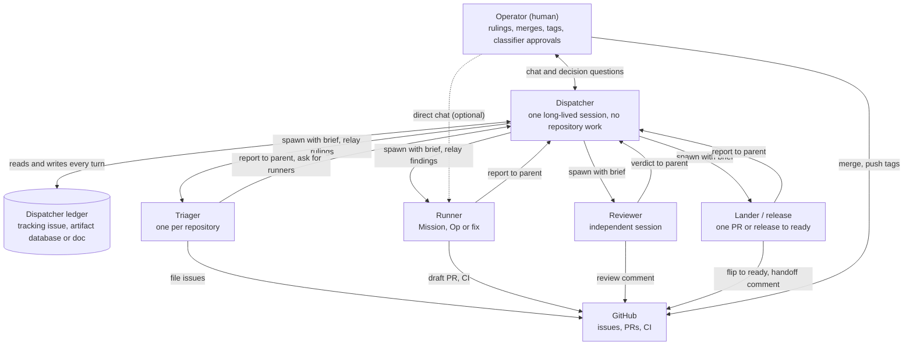
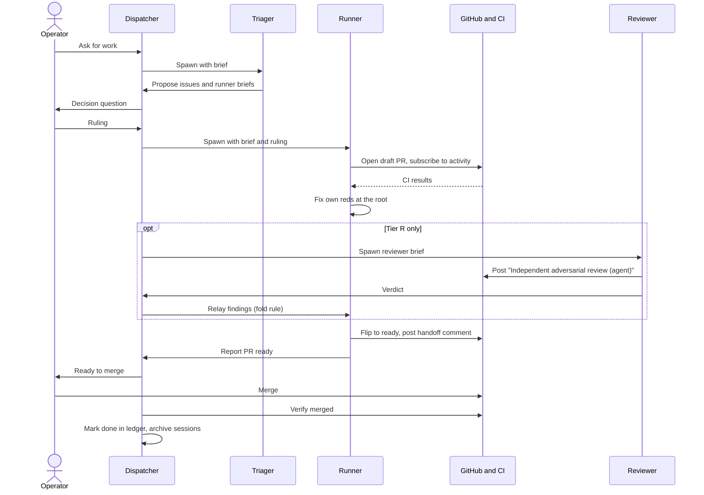

# Multi-Session Orchestration

Spec Kitty maintainers often run several pieces of work at once: a Mission in
one repository, a fix in another, a review of a third. The multi-session setup
splits that work across separate Claude Code sessions, each with one role. One
long-lived **dispatcher** session coordinates them, and the human **operator**
keeps every ruling, merge and tag.

This page explains the shape of the setup and why it is shaped that way. To run
it, follow [Run a multi-session orchestration](how-to/run-a-multi-session-orchestration.md).
All sessions share one cloud environment, set up as in
[Set up a Claude Code cloud environment](how-to/cloud-environment-setup.md).

## Topology

Every box below is a separate Claude Code session, usually a cloud session,
except the operator, who is a person. Sessions talk only through the
session-messaging tools. Nothing is shared in memory: shared state lives in the
dispatcher's ledger, never only in one session's chat context.

The operator talks to the dispatcher in chat and answers its decision
questions. The operator may also talk to any runner directly (the dotted edge).
A runner that then reports "the operator approved X", or asks the dispatcher to
act on the operator's behalf, is relaying data, not a ruling. The dispatcher
checks the runner's transcript before acting on it.

## Roles

| Role | Owns | Never |
|------|------|-------|
| Dispatcher | Spawning sessions, writing briefs, relaying rulings and findings, applying standing rules, asking the operator for decisions, keeping the ledger current, enforcing the concurrency cap, archiving finished sessions | Code, merges, auto-merge, self-reviews, guessing rulings |
| Triager (one per repository) | Watching a repository's issues, nightly runs and PRs; filing issues; asking the dispatcher for runners | Large implementation work |
| Runner (implementer) | One brief: a Mission (specify through draft PR), a fix, research or an assessment. Ad-hoc work runs under a Spec Kitty Op | Reviewing its own work (not even with its own subagents), merging |
| Reviewer | An independent adversarial review of a work package, a Mission or a PR; posts the review comment | Implementing, merging, marking ready |
| Lander / release | Getting one PR (or a release PR) to ready; the reviewer handoff comment; release dispatch, tag hand-over, the reopen PR | Pushing tags, merging; arming auto-merge except under the landing exception in standing rule 1 |

A lander is a runner whose brief is "get PR X ready and hand it over". Often it
is the implementer itself.

### Why the roles are split

- **Independent review.** A review counts only when a separate session does it.
  An implementer's own subagent shares its context and its blind spots, so it
  never counts.
- **Human-held decisions.** Rulings, merges and tags stay with the operator.
  The dispatcher answers a question only when a standing rule or an earlier
  ruling covers it, and says which one. Otherwise it asks.
- **No repository work in the dispatcher.** The dispatcher's context is the one
  that has to last. Keeping code out of it keeps it small and keeps its job to
  coordination.

## A typical flow

The sequence below follows one piece of work from request to archive. The
reviewer step applies only to Tier R work (see [Ready tiers](#ready-tiers)).

## Ready tiers

The review a PR needs before it may be marked ready is proportionate to its
risk. The brief names the tier; when in doubt, it is R.

- **Tier S**: docs-only, config-only, help or prose text, or a small fix with a
  focused test. Green CI is enough.
- **Tier R**: behavior-changing code, gates, migrations, status or
  consolidation logic, release work, or anything marked risky. A separate
  reviewer's PR comment headed "Independent adversarial review (agent)" comes
  first.

The full ready rule is standing rule 10 in the
[how-to](how-to/run-a-multi-session-orchestration.md#step-3-apply-the-standing-rules).

## Repository access is per session

A session reads and writes only the repositories attached to it: the one it was
started on, plus any it adds with `add_repo`. In auto mode the permission
classifier may refuse `add_repo` for a repository the brief did not name. A
runner refused that way falls back to read-only clones and guesses at the other
repository's issues. So:

- start every runner on the repository it writes to, and pass cross-repository
  context in the brief;
- a runner that must comment on another repository reports the text, and the
  dispatcher posts it or hands it to the operator;
- `gh` in a cloud session is limited to search; use the GitHub MCP tools.

## Why the dispatcher keeps a ledger

The dispatcher's chat context is not durable: it is summarized as it grows and
lost on a restart. Everything it must remember goes into one ledger outside the
chat, which it re-reads every turn: which sessions run, what each was asked,
what the operator ruled, and which ones wait on the operator. The ledger's
columns are in the
[how-to](how-to/run-a-multi-session-orchestration.md#step-2-start-the-ledger).

## Relation to other pages

- [The SkyKitty agent fleet](agent-fleet.md) describes an earlier, label-driven
  fleet on the issue tracker, now switched off. This setup coordinates sessions
  through messages and a ledger instead.
- [Multi-agent orchestration](../architecture/multi-agent-orchestration.md)
  describes how external orchestration providers drive a Mission through
  `spec-kitty orchestrator-api`. That is a different layer: one Mission's work
  packages, not several sessions.
