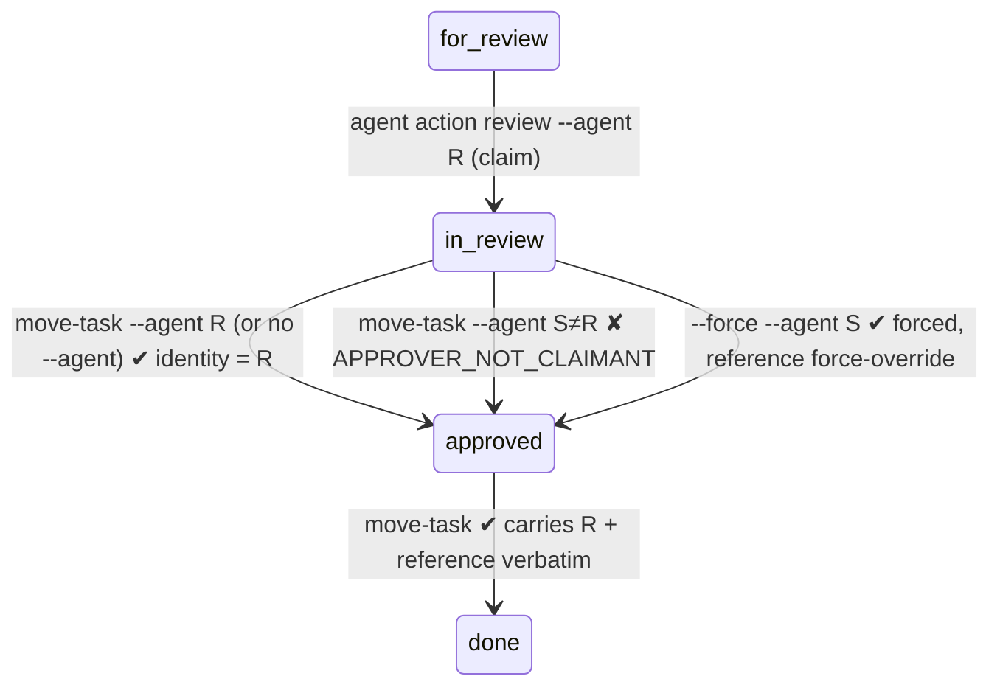

# Data model: approval honesty

There is no schema change (C-001). The entities below are existing records; only how their values
are chosen changes.

## ReviewClaim (derived, read-only)

- **Source**: `status.events.jsonl`. It is the newest event with `to_lane == in_review`,
  `force == false`, an actor that is not a `migration:` actor, and whose key is not in
  `GENERIC_IMPLEMENTATION_ACTORS`.
- **Value**: the claimant identity (compact `tool:model:profile`), or none.
- **Owner**: `status/review_roles.latest_review_claim_identity` (new, pure).

## ReviewerOfRecord (value object, in-memory)

| Field | Values |
|---|---|
| `identity` | a non-empty asserted identity; never the git `user.name` |
| `reference` | a `review-cycle://` pointer, a validated `--approval-ref`, `force-override`, an arbiter decision reference, or a carried historical reference |
| `kind` | `review` / `forced` / `carried` |

**Invariant**: for one approval, all of these hold the same `identity`:
- event `actor` (tool/model/profile);
- `review_result.reviewer`;
- `evidence.review.reviewer`;
- `policy_metadata.tool`;
- the cycle's `reviewer_agent`;
- the cycle body's "Approved by";
- `--agent` in `reproduction_command`.

`review_result.reference` equals `evidence.review.reference`.

## ReviewCycle (existing artifact)

`tasks/<WP>/review-cycle-N.md`, with frontmatter `cycle_number`, `wp_id`, `mission_slug`,
`reviewer_agent`, `reviewed_at`, `affected_files`, `reproduction_command`, and a body. It has no
verdict field.

**Adoptable** means all four:
1. it is valid;
2. no event references it;
3. its N is greater than every N referenced in the log;
4. its `reviewer_agent` is identity-equal to the reviewer of record.

## Approval state transitions (unchanged lanes; new refusals)

Alt text: from `for_review`, a claim by R moves the work package to `in_review`. From `in_review`,
an approval by R succeeds; an unforced approval by any other identity S is refused with
`APPROVER_NOT_CLAIMANT`; a forced approval by S succeeds but is recorded as forced. From
`approved`, the move to `done` carries R and the approval's reference.
