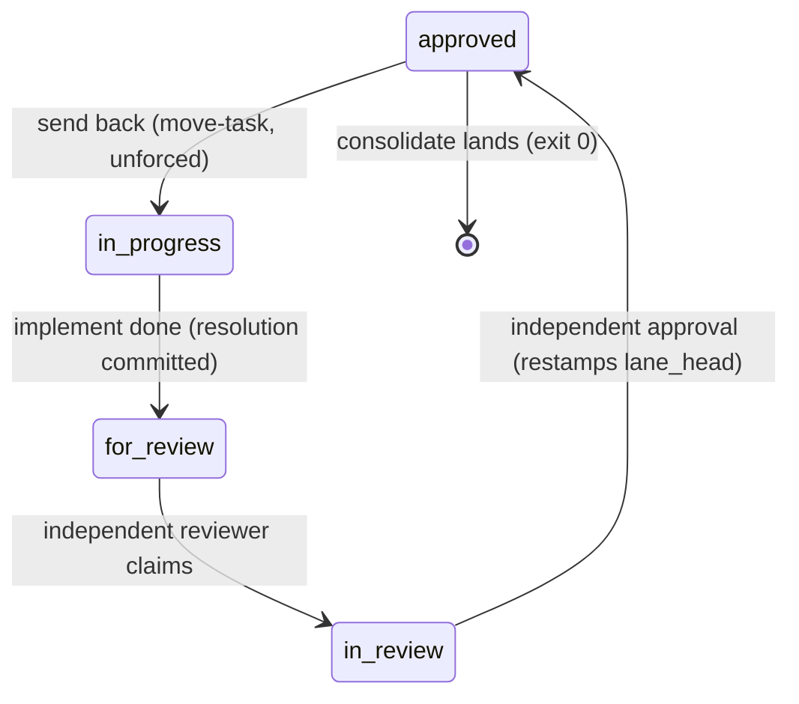

# Data Model: Approved-lane conflict resolution route

## Entities and records

### StaleCheckResult (extended, `lanes/stale_check.py`)

| Field | Type | New? | Meaning |
|---|---|---|---|
| `is_stale` | bool | no | the lane must incorporate other content first |
| `overlapping_files` | list[str] | no | paths both sides changed |
| `remediation` | str | changed | approved code lane: the re-review route (contracts/stale-remedy.md); otherwise as today |
| `halt_reason` | `"conflict" \| "no_lane_checkout" \| "merge_in_progress" \| None` | yes | why the in-run auto-rebase did not refresh the lane |
| `conflicted_paths` | tuple[str, ...] | yes | exactly the paths the auto-rebase classified Manual |
| `sibling_lanes` | tuple[SiblingLane, ...] | yes | lanes consolidated earlier in this run whose approved content overlaps |

**SiblingLane**: `lane_id`, `branch`, `approval_stamp_sha` (the newest stamp of its approved WPs), and `paths` (the overlapping paths that lane contributed).

**Invariants**:
- `sibling_lanes` holds exactly the lanes whose pre-run tips reach a commit that changed an overlapping path. A non-overlapping lane is never included.
- `halt_reason is None` exactly when no auto-rebase was attempted for a reason other than a missing checkout.

### Auto-rebase record (new ref namespace)

- **Ref**: `refs/spec-kitty/auto-rebase/<lane-branch>/<merge-sha>`. Its value is the `<merge-sha>` itself.
- **Writer**: only `lanes/auto_rebase.attempt_auto_rebase`, right after it creates the merge commit.
- **Readers**:
  - `approved_bound.unreviewed_resolution_merges`, which uses it as the FR-004 exemption.
  - `rollback.py`, which deletes the ref after it undoes the move.
- **Deleted by**: a rollback restore of that lane move, and lane cleanup when the lane branch is removed.
- **Never read by**: the reconciliation gate (C-002, C-003).

### ConsolidationState.lane_rebase_moves (lifetime change)

- **Shape**: `dict[branch, [before, after]]`, unchanged.
- **Change**: it is recorded on every auto-rebase merge in the run, not only when the lane later consolidated successfully.
- **Lifetime**: the entry for a lane reported `LANE_MOVED_SINCE_AUTO_REBASE` survives the re-baseline. That outcome makes the report not re-baselineable, so the record is kept.

### ApprovedWpCommitSet (claim, additive field)

- `unreviewed_merges: tuple[UnreviewedMerge, ...]`. Each **UnreviewedMerge** has: `sha`, `lane_id`, `wp_ids`, `own_paths`, `own_blobs: tuple[(path, blob)]`.
- The field is filled where `_drop_unreviewed_merges` drops a merge.
- Existing fields stay byte-identical.

### WpReviewRange (extended, `review/wp_range.py`)

- `merges: tuple[str, ...]`: every merge commit in `base..tip`, collected with full history (no simplification).
- `remerge_available: bool`.

## Refusal codes and outcomes

| Code / outcome | Raised by | When | Exit / envelope |
|---|---|---|---|
| `RESOLUTION_MERGE_UNREVIEWED` (new `BoundRefusalCode`) | claim (`_approved_bound_verdict`), `--dry-run`, orchestrator-api pre-check | A merge on an approved code lane meets all of these: it is beyond the claim base, none of its own lane's stamps reach it, it has no auto-rebase record, and it has at least one non-bookkeeping own path | CLI exit 1 before any mutation. Orchestrator-api: `PREFLIGHT_FAILED`, with `data.preflight_error_code(s)` and contract 1.30.0 |
| `LANE_MOVED_SINCE_AUTO_REBASE` (new rollback outcome) | `rollback_to_snapshot` | The lane is not at the recorded `after` | Reported with a recovery hint. The report is not re-baselineable and the record is kept |
| Probe refusal (FR-010) | `git_probes` guard | An effective merge attribute or driver is outside the registered triples, or `merge.default` is set | Raised as `GitProbeError`, so the callers' existing fail-closed path refuses |
| `CANCELED_REACHABLE_VIA_DEPENDENCY` (existing) | canceled axes | The #7497 shape (FR-011) | Unchanged code |

## State transitions used by the route (existing lifecycle, no new lanes)

- **Invariant**: only the unforced `in_review -> approved` by an identity independent from the implementer restamps (#5721, #6715).
- A forced approval or a self-approval does not satisfy the route (N3).
- A `done` WP needs `--force` to be sent back. The remedy says so when it applies.
