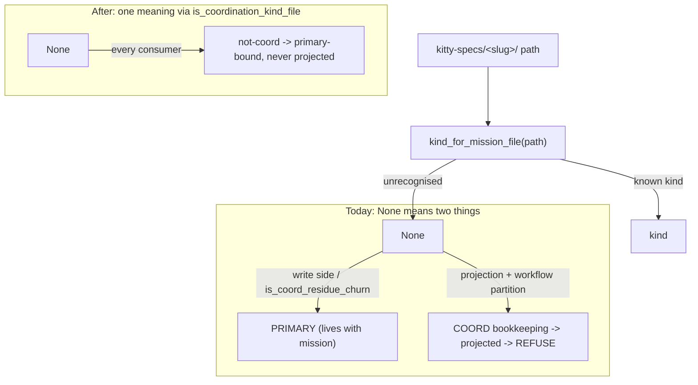

# Implementation Plan: One meaning for an unclassified mission artifact

**Branch**: `fix/artifact-none-single-meaning` | **Date**: 2026-10-16 | **Spec**: [spec.md](./spec.md)
**Input**: Mission specification from `kitty-specs/artifact-none-single-meaning-01M5365S/spec.md`

## Summary

Give an unclassified mission artifact kind (`kind_for_mission_file(...) → None`)
**one meaning** across every consumer, and classify the mission files that are
still unclassified. The load-bearing fix routes the two consumers that today
treat `None` as coordination bookkeeping — the squash projection
(`bookkeeping_projection._post_checkpoint_mission_paths`) and the workflow
commit partition (`workflow._partition_paths_by_primary_kind`) — through the
single canonical authority `coordination.coherence.is_coordination_kind_file`
(`None → not-coord`), which the write side and three other consumers already
use. The complementary fix adds honest classifier entries for ~12 mission files
that currently fall through to `None`, introducing four new PRIMARY
`MissionArtifactKind` members one-per-family.



## Technical Context

**Language/Version**: Python 3.11+
**Primary Dependencies**: standard library only for the change (enum, pathlib, fnmatch); pytest for tests. No new runtime dependency is added, upgraded, or removed — the Supply-Chain Security section does not apply.
**Storage**: N/A (in-memory classification + git blob reads already present)
**Testing**: pytest; red-first regression repros pinned with `@pytest.mark.regression` and an issue ref, driven through the pre-existing entry points (`_post_checkpoint_mission_paths`, `projected_content_matches_target`, `_partition_paths_by_primary_kind`, `kind_for_mission_file`); parametrized classification + partition-invariant tests.
**Target Platform**: the spec-kitty CLI (Linux/macOS dev + CI)
**Project Type**: single project (`src/` + `tests/`)
**Performance Goals**: no change to hot paths; classification stays an O(path-depth) dict lookup, projection stays O(#post-checkpoint commits).
**Constraints**: every touched/added function ≤ complexity 15 (Ruff C901 / Sonar S3776); no new `# noqa` / `# type: ignore` / Sonar suppression; the partition stays total + disjoint (P-1); the inverse basename map stays honest.
**Scale/Scope**: ~1 source module for kinds/classifier (`src/mission_runtime/artifacts.py`), 2 consumer modules for the predicate fix, plus tests + CHANGELOG/docs. Four new enum members.

## Charter Check

*GATE: Must pass before Phase 0 research. Re-check after Phase 1 design.*

- **Single canonical authority** (top governing principle): PASS — the fix *removes* a parallel authority. The two dissenters stop re-deriving a local `None → coord` branch and consume the one `is_coordination_kind_file` authority. All kind/partition facts live only in `src/mission_runtime/artifacts.py` (C-005).
- **Architectural alignment**: PASS — changes stay inside `mission_runtime` (the file→kind authority) and its existing consumers; no new seam.
- **DDD + tiered rigour**: PASS — this is core domain logic (the artifact partition), so it gets red-first repros, a partition invariant, and focused per-kind tests.
- **ATDD / red-first** (Standing Order #4, ADR 2026-07-17-1): PASS — FR-001, FR-002, FR-012 each land an issue-pinned repro RED through the pre-existing entry point before the fix.
- **Terminology**: PASS — "Mission" terminology throughout; no `feature*` introduced.
- **Campsite** (Standing Order #2): the touched functions are already small; fold any Sonar finding on them. No god-surface decomposition needed.

No violations → Complexity Tracking is empty.

## Project Structure

### Documentation (this mission)

```
kitty-specs/artifact-none-single-meaning-01M5365S/
├── plan.md              # This file
├── research.md          # Phase 0 output (grounding synthesis)
├── data-model.md        # Phase 1 output (the classification table = the contract)
├── quickstart.md        # Phase 1 output (how to verify the fix)
├── traces/              # 3 tracer files (coord partition)
└── tasks.md             # Phase 2 output (/spec-kitty.tasks — NOT created here)
```

This mission defines **no API/interface contracts** (it changes an internal
classification taxonomy), so `contracts/` is intentionally absent; `meta.json`
carries `"contracts": "none"` with a rationale so strict `accept` waives it. The
authoritative "contract" of this change — the path→kind→partition table — lives
in `data-model.md`.

### Source Code (repository root)

```
src/
├── mission_runtime/
│   └── artifacts.py                     # MissionArtifactKind (+4 members), classifier maps, partition frozensets, assert_partition_invariant
└── specify_cli/
    ├── consolidation/
    │   └── bookkeeping_projection.py    # _post_checkpoint_mission_paths -> route through is_coordination_kind_file
    ├── cli/commands/agent/
    │   └── workflow.py                  # _partition_paths_by_primary_kind -> route through is_coordination_kind_file
    └── coordination/
        └── coherence.py                 # is_coordination_kind_file (the one authority; read-only reference, likely unchanged)

tests/
├── mission_runtime/                     # classification + partition-invariant + inverse-map tests
├── consolidation/                       # projection selection + squash-proof regression (extend test_projection_excludes_plan_outputs.py)
└── architectural/                       # NFR-002 guard: no local None->coord re-derivation in the two former dissenters
```

**Structure Decision**: single project; the canonical kind/partition source is
`src/mission_runtime/artifacts.py` and the predicate fix lives in the two
consumer modules under `src/specify_cli/`.

## Complexity Tracking

*No Charter Check violations — section intentionally empty.*

## Implementation Concern Map

> Concerns, not work packages. `/spec-kitty.tasks` turns these into WPs and
> `finalize-tasks` collapses them into execution lanes by write-scope.

### IC-01 — New PRIMARY artifact kinds

- **Purpose**: add four `MissionArtifactKind` members (`RESEARCH_OUTPUT`, `OCCURRENCE_MAP`, `MISSION_GOALS`, `RELEASE_RECORD`), each in `_PRIMARY_ARTIFACT_KINDS`, keeping `assert_partition_invariant` (P-1) total and disjoint.
- **Relevant requirements**: FR-004, FR-006, FR-007, FR-008, FR-010, C-002.
- **Affected surfaces**: `src/mission_runtime/artifacts.py` (enum + `_PRIMARY_ARTIFACT_KINDS`); any enum-exhaustiveness consumer the new members touch (verify blast radius: `is_primary_artifact_kind` callers, `resolve_placement_only` E2 kind list, `mission_file_basenames_for_kind`).
- **Sequencing/depends-on**: none (foundation for IC-02).
- **Risks**: an exhaustiveness `match`/switch over `MissionArtifactKind` elsewhere could need a new arm; a new member omitted from a partition fails P-1. Mitigate with the partition-invariant test and a blast-radius sweep before edit.

### IC-02 — Classifier entries for the unclassified files

- **Purpose**: map each unclassified path to its kind — `research/` (dir-anchored) → RESEARCH; `findings.md`/`report.md`/`methodology.md`/`synthesis.md`/`literature-review.md` → RESEARCH_OUTPUT; `gap-analysis.md` + `audit-report.md` → ANALYSIS_REPORT; `occurrence_map.yaml` → OCCURRENCE_MAP; `goals.md` → MISSION_GOALS; `release.md` → RELEASE_RECORD; `meta.json` → PRIMARY_METADATA. Leave the four excluded paths at `None`.
- **Relevant requirements**: FR-003, FR-004, FR-005, FR-006, FR-007, FR-008, FR-009, FR-011, FR-013.
- **Affected surfaces**: `src/mission_runtime/artifacts.py` (`_MISSION_FILE_KIND_BY_BASENAME`, `_COORD_RESIDUE_DIRS`).
- **Sequencing/depends-on**: IC-01 (the kinds must exist).
- **Risks**: `meta.json` addition — confirm no consumer relies on `kind_for_mission_file("meta.json") == None`; the inverse map `mission_file_basenames_for_kind` must stay honest (FR-013). `research/` dir-anchored rule also catches pathological `research/meta.json` — accepted (edge case).

### IC-03 — One meaning for None (predicate fix)

- **Purpose**: route `_post_checkpoint_mission_paths` and `_partition_paths_by_primary_kind` through `is_coordination_kind_file`, so an unclassified path is never projected and is primary-bound — matching the write side. Keep the status/meta basename skip and the `{ISSUE_MATRIX, ACCEPTANCE_MATRIX}` exclusion in the projection.
- **Relevant requirements**: FR-001, FR-002, FR-012, NFR-002, NFR-004.
- **Affected surfaces**: `src/specify_cli/consolidation/bookkeeping_projection.py`, `src/specify_cli/cli/commands/agent/workflow.py`.
- **Sequencing/depends-on**: none — independent of IC-01/IC-02 (the predicate fix needs no new kind). Can land first; it is the load-bearing #5697 fix.
- **Risks**: must preserve coordination carry-forward (`traces/`, `decisions.events.jsonl`, review-cycle) — NFR-004; the projection's one selection-pinning assertion stays green.

### IC-04 — Red-first + classification + invariant tests

- **Purpose**: red-first repros for FR-001/FR-002/FR-012 (issue-pinned, RED before the fix); parametrized classification asserting kind + PRIMARY for every IC-02 path and `None` for the four excluded paths; partition-invariant and inverse-map tests for the new kinds.
- **Relevant requirements**: FR-001, FR-002, FR-003–FR-013, NFR-001, C-004.
- **Affected surfaces**: `tests/consolidation/test_projection_excludes_plan_outputs.py` (extend — do not add a new file), `tests/mission_runtime/`, `tests/consolidation/test_bookkeeping_projection_seam.py`.
- **Sequencing/depends-on**: pairs with IC-02/IC-03 (red before, green after).
- **Risks**: keep repros transitional per the memory rule — after the fix, demote them from `regression` to focused unit tests where they belong.

### IC-05 — NFR-002 architectural guard + docs/CHANGELOG

- **Purpose**: an architectural test asserting the two former dissenters consume the shared authority and retain no local `None → coord` branch (0 residual re-derivations); a `[Unreleased]` CHANGELOG entry and any affected doc (status-model / artifact-placement) update.
- **Relevant requirements**: NFR-002, SC-004.
- **Affected surfaces**: `tests/architectural/`, `docs/changelog/CHANGELOG.md`, `docs/architecture/artifact-placement-seam.md` (if it describes the None semantics).
- **Sequencing/depends-on**: IC-03.
- **Risks**: the guard must be non-vacuous (a concrete floor + self-mutation sensitivity), per Standing Order #5.
