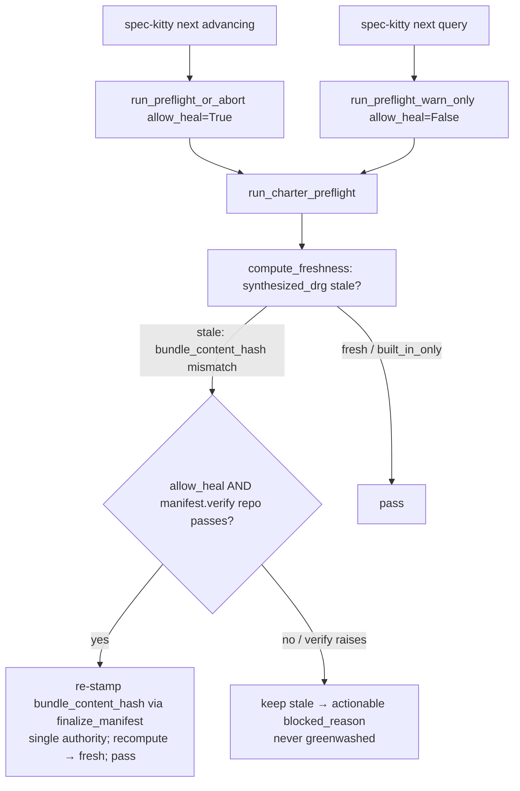

# Implementation Plan: Fix charter preflight blocking `next` on a fresh checkout

**Branch**: `fix/charter-preflight-fresh-checkout` | **Date**: 2026-10-18 | **Spec**: [spec.md](./spec.md)
**Input**: Mission specification from `kitty-specs/charter-preflight-fresh-checkout-01M56P1S/spec.md`

## Summary

`spec-kitty next` on a freshly-cloned owned checkout hard-blocks with
`CHARTER_PREFLIGHT_FAILED: synthesized_drg stale` because the committed synthesis manifest's
`bundle_content_hash` lags a recompute of `charter.yaml`, and the existing heal is gated behind
`preflight.auto_refresh` (default `False`). The fix is "both": (1) a **default-on, lightweight,
in-process re-stamp heal** in the preflight layer that fires only when the drift is *provably
authoring-only* (derived graph/artifacts consistent, verified via the existing
`manifest.verify(repo)`), never for a genuine inconsistency; (2) **close the write-side gap** so the
`charter activate`/`--cascade` recompile of `charter.yaml` (and the fresh-project scaffold) re-stamps
`bundle_content_hash` at the single `charter.bundle.compute_bundle_content_hash` authority; (3) a
**committed-data fix** re-stamping this repo's drifted manifest; and (4) a **red-first per-PR twin**
with a same-fixture positive control, so the regression leaves the nightly-only hiding spot.

## Technical Context

**Language/Version**: Python 3.11+
**Primary Dependencies**: `charter.bundle.compute_bundle_content_hash` (single hash authority), `charter.activation.synthesizer.manifest` (`SynthesisManifest`, `finalize_manifest`, `verify`), `ruamel.yaml`, `pydantic`, `typer` (CLI seam only)
**Storage**: filesystem — `.kittify/charter/charter.yaml`, `.kittify/charter/synthesis-manifest.yaml`, `.kittify/charter-packs/**`; no database
**Testing**: `pytest` — `tests/charter_runtime/` (per-PR twin home), `tests/charter/` + `tests/charter_offering/` (write-side), and the nightly `tests/e2e/test_worktree_owned_root_concurrency.py` kept unchanged; baseline `make test-fast`. No `make test-full`; no regeneration of `.github/ci-shard-timings.json`.
**Target Platform**: Linux/macOS/Windows CLI (installed console script)
**Project Type**: single (CLI package)
**Performance Goals**: preflight warm path < 300 ms, heal path < 1 s (NFR-001); the default heal adds **no** subprocess (in-process re-stamp, distinct from the existing heavy `generate→synthesize→validate` opt-in chain)
**Constraints**: single hash authority only (C-002); enforced layer direction `charter <- specify_cli` holds — heal lives in `specify_cli.charter_runtime.preflight`, re-stamp in `charter.activation` (C-004); heal is concurrency-safe/idempotent (NFR-003) and never greenwashes a genuine inconsistency (NFR-002); no fixture-faking or test-side `synthesize` (C-001); orthogonal to #3504 (C-003); do not conflate with #5419/#6074 (C-005)
**Scale/Scope**: focused bug fix — ~3 read-path files, ~1–2 write-side files, 1 committed data file, plus per-PR test(s)

## Charter Check

*GATE: Must pass before Phase 0 research. Re-check after Phase 1 design.*

- **Single canonical authority** — PASS by design: both the heal re-stamp and the write-side re-stamp route through `charter.bundle.compute_bundle_content_hash` (FR-005, C-002). No second hash recipe.
- **Architectural alignment / layer direction** — PASS: the read-path heal stays in `specify_cli.charter_runtime.preflight`; the write-side re-stamp stays in `charter.activation`; `charter <- specify_cli` is not inverted (C-004). Enforced by `tests/architectural/test_layer_rules.py` (not regenerated, only kept green).
- **ATDD-first / red-first** — PASS: FR-007 per-PR twin is written to fail against the pre-fix product behaviour first (red), then pass. FR-003's "never greenwash" is proven against a genuinely-inconsistent fixture (positive control).
- **Tiered rigour** — charter-runtime preflight is release-gating infrastructure → high rigour: deterministic tests, non-vacuity controls, concurrency safety.
- **Campsite/terminology** — no `feature*`/retired-vocabulary introduction; no retired-surface touch.

No violations to justify in Complexity Tracking.

## Project Structure

### Documentation (this mission)

```
kitty-specs/charter-preflight-fresh-checkout-01M56P1S/
├── plan.md              # This file
├── research.md          # Phase 0 output
├── data-model.md        # Phase 1 output
├── quickstart.md        # Phase 1 output
├── contracts/           # Phase 1 output (behavioural contracts; see meta note)
└── tasks.md             # Phase 2 (/spec-kitty.tasks — NOT created here)
```

### Source Code (repository root)

```
src/specify_cli/charter_runtime/
├── preflight/
│   ├── runner.py              # run_charter_preflight — add default-on safe-heal step (IC-01)
│   ├── hook.py                # run_preflight_or_abort / warn_only — thread allow_heal (IC-01)
│   ├── references_refresh.py  # home for the lightweight re-stamp heal helper (IC-01)
│   └── config.py              # (read-only reference; auto_refresh stays default False)
└── freshness/
    └── computer.py            # synthesized_drg stale definition (observer; NOT mutated — IC-01)

src/charter/
├── bundle.py                              # compute_bundle_content_hash (single authority — unchanged)
└── activation/
    ├── pack_manager.py / activation_engine.py  # activate/cascade path (IC-02)
    ├── synthesizer/manifest.py            # verify(), finalize_manifest (consumed by heal + write-side)
    └── ... charter.yaml recompile seam    # re-stamp bundle_content_hash on write (IC-02)

src/specify_cli/cli/commands/charter/
└── _fresh_project_layer.py                # scaffold already re-stamps; assert/keep parity (IC-02)

.kittify/charter/synthesis-manifest.yaml   # committed data fix — re-stamp (IC-03)

tests/charter_runtime/                      # per-PR red-first twin + positive control (IC-04)
tests/charter/, tests/charter_offering/     # write-side re-stamp coverage (IC-02)
tests/e2e/test_worktree_owned_root_concurrency.py  # nightly acceptance — kept unchanged
```

**Structure Decision**: Single CLI package. The fix spans two layers by design — the read-path heal
in `specify_cli.charter_runtime.preflight`, the write-side re-stamp in `charter.activation` — with the
shared hash authority `charter.bundle.compute_bundle_content_hash` as the only recipe.

## Key Design Decisions



- **D1 — Safe-heal predicate = `manifest.verify(repo)` passes.** The heal fires only when
  `synthesized_drg` is stale *specifically* because `manifest.bundle_content_hash != compute_bundle_content_hash(repo)` AND `charter.activation.synthesizer.manifest.verify(manifest, repo)` succeeds (every listed artifact exists on disk with a matching per-artifact `content_hash`). `verify()` raising `ManifestIntegrityError` ⇒ genuine derived inconsistency ⇒ **do not heal** (FR-003, NFR-002). This reuses an existing authority rather than inventing a consistency check.
- **D2 — Heal lives in the preflight layer, not the freshness computer.** `computer.py` stays a
  side-effect-free observer (its NFR). The re-stamp is a mutation performed in
  `preflight.references_refresh` (helper) invoked from `runner.run_charter_preflight`.
- **D3 — Default-on, but mutation gated by consumer via `allow_heal`.** `run_charter_preflight` grows
  an `allow_heal` parameter. `run_preflight_or_abort` (advancing `next`, `implement`) passes
  `allow_heal=True`; `run_preflight_warn_only` (read-only query `next`) passes `allow_heal=False` so
  query mode never mutates (preserves the read-only contract) — and, being warn-only, it continues
  regardless. The heal is **independent of** `preflight.auto_refresh` (FR-002); the heavy opt-in
  `generate→synthesize→validate` chain is untouched (Out of Scope).
- **D4 — Lightweight re-stamp = `finalize_manifest(model_copy(bundle_content_hash=current))`.** Only
  the derived `bundle_content_hash` (and the manifest self-hash it implies) changes; authored content
  is never rewritten (NFR-002). Written through the manifest chokepoint, atomically.
- **D5 — Concurrency safety (NFR-003).** The re-stamp is idempotent (same inputs → same stamp) and
  wrapped in the existing coordination status/charter write discipline so two concurrent `next` runs on
  one owned root converge; an atomic write (temp + rename) avoids a torn manifest. (Exact lock seam
  confirmed in research.)
- **D6 — Write-side seam.** `commit_plan` only writes `config.yaml`; the `charter.yaml` recompile that
  `activate`/`--cascade` performs (regenerating catalog/activation + graph/provenance) is the site that
  must re-stamp `bundle_content_hash`. The fresh-project scaffold (`_fresh_project_layer.py`) already
  re-stamps; the write-side WP brings the activate/cascade recompile to the same guarantee at the
  single authority (FR-004/FR-005) and pins a test that recompute == stamp post-command.

## Complexity Tracking

*No Charter Check violations — section intentionally empty.*

## Implementation Concern Map

> Concerns are NOT work packages. `/spec-kitty.tasks` translates these into executable WPs.

### IC-01 — Read-path default-on safe-heal on `next`

- **Purpose**: Stop a fresh checkout whose only drift is a lagging `bundle_content_hash` stamp from being terminally blocked, by re-stamping in-process when the derived state is provably consistent.
- **Relevant requirements**: FR-001, FR-002, FR-003, NFR-001, NFR-002, NFR-003
- **Affected surfaces**: `src/specify_cli/charter_runtime/preflight/{runner.py,hook.py,references_refresh.py}`; consumes `charter.activation.synthesizer.manifest.{verify,finalize_manifest}` and `charter.bundle.compute_bundle_content_hash`; `freshness/computer.py` read-only.
- **Sequencing/depends-on**: none (can land first; it is the release-unblocking core).
- **Risks**: Must not mutate in query mode (`allow_heal` gating); must not greenwash a genuine inconsistency (predicate = `verify()` passes); must not add a subprocess (warm-path budget); concurrency-safe atomic write.

### IC-02 — Write-side re-stamp gap (activate/cascade + scaffold)

- **Purpose**: Ensure every `charter.yaml`-mutating writer re-stamps `bundle_content_hash` at the single authority so no committed drift is produced for clones to inherit.
- **Relevant requirements**: FR-004, FR-005
- **Affected surfaces**: `src/charter/activation/` activate/cascade `charter.yaml` recompile seam; `src/specify_cli/cli/commands/charter/_fresh_project_layer.py` (assert/keep parity); tests in `tests/charter/`, `tests/charter_offering/`.
- **Sequencing/depends-on**: none (independent of IC-01; both route through the same hash authority).
- **Risks**: Pin the exact recompile persistence site; preserve authored-content round-trip (never rewrite `charter.md`); do not touch #3504 vendor/pin surfaces.

### IC-03 — Committed-data parity fix (this repo)

- **Purpose**: Re-stamp this repository's committed `.kittify/charter/synthesis-manifest.yaml` so a clean clone has charter parity today (distinct from faking the e2e fixture).
- **Relevant requirements**: FR-006, SC-004
- **Affected surfaces**: `.kittify/charter/synthesis-manifest.yaml`.
- **Sequencing/depends-on**: should land with/after IC-02 so it is produced by the corrected write path where practical (or an explicit `charter synthesize`/re-stamp on this branch), not a hand-edit that drifts again.
- **Risks**: Must match the current committed `charter.yaml` exactly; do not alter authored content.

### IC-04 — Red-first per-PR regression twin

- **Purpose**: Give the regression a cheap, deterministic per-PR home so it cannot hide on the nightly cadence; prove non-vacuity with a same-fixture positive control.
- **Relevant requirements**: FR-007, SC-003
- **Affected surfaces**: `tests/charter_runtime/` (new test module).
- **Sequencing/depends-on**: authored red-first before IC-01's fix; the positive-control half asserts a genuinely-inconsistent derived state still blocks (ties to FR-003).
- **Risks**: Must be deterministic (no wheel build, no concurrency saturation — unlike the nightly e2e); must run on the per-PR module-matrix path for `tests/charter_runtime/`.
