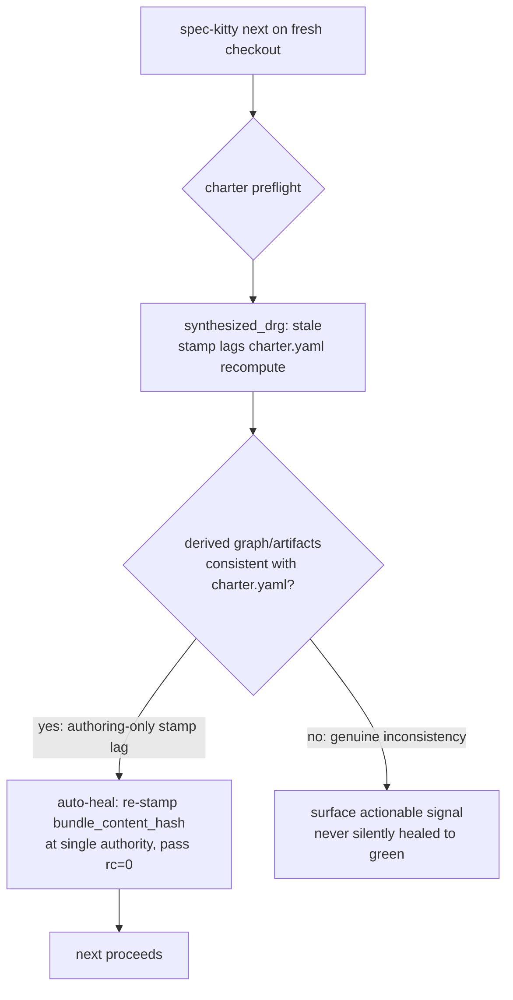

# Mission Specification: Fix charter preflight blocking `next` on a fresh checkout

**Mission Branch**: `fix/charter-preflight-fresh-checkout`
**Created**: 2026-10-18
**Status**: Draft
**Input**: Fix #6366 (P0, release blocker) — a freshly-cloned/built-in owned checkout is hard-blocked by `CHARTER_PREFLIGHT_FAILED: synthesized_drg stale` when running `spec-kitty next`.

## Context & Root Cause *(grounding, confirmed live)*

The nightly red #6366 is mislabeled "performance": it is a release-blocking charter-runtime
regression. `spec-kitty next` on a freshly-cloned owned checkout exits `rc=1` with
`{"error_code":"CHARTER_PREFLIGHT_FAILED","error":"synthesized_drg stale; run \`spec-kitty charter synthesize\`"}`.

Confirmed mechanism (reproduced live on `main`):

- The read path `freshness/computer.py::_synthesized_drg_graph_state` marks `synthesized_drg="stale"`
  when the synthesis manifest's stamped `bundle_content_hash` ≠ a recompute of
  `charter.bundle.compute_bundle_content_hash(charter.yaml)`. This repo's committed manifest stamps
  `sha256:6a188326…` while `charter.yaml` recomputes to `sha256:649ee217…` — a genuine content drift.
  The manifest has `built_in_only: false`, so the FR-006 short-circuit does not fire and the
  comparison runs.
- The drift was introduced by commit `712aee06a9` ("chore(charter): activate charter-offering scenario
  doctrine"), a `spec-kitty charter activate --cascade all` that edited `charter.yaml` **and
  regenerated the derived graph/provenance sidecars** but did **not** re-stamp the manifest's
  `bundle_content_hash`. The pack-rename/revendor suspects (`6d3d4dd336`, `c3fc8aa349`, `904ca4241d`)
  all MATCH parity — they are not the cause. So the write-side defect is specifically that the
  `activate`/cascade write path leaves a stale `bundle_content_hash` behind.
- `spec-kitty next` reaches the terminal exit because the auto-heal machinery that already exists in
  `preflight/runner.py` (the `generate→synthesize→bundle validate` refresh sequence, which re-stamps
  `bundle_content_hash` via `rewrite_manifest`) is gated on `preflight.auto_refresh`, which **defaults
  to `False`** (`preflight/config.py`). With `auto_refresh=False`, `run_preflight_or_abort` never
  attempts a heal, so a committed-drifted `synthesized_drg: stale` becomes a terminal
  `CHARTER_PREFLIGHT_FAILED`.

The fix (operator-decided, two Decision Moments): **auto-heal the read path as the primary resilience
mechanism, AND close the write-side re-stamp gap**, plus correct the committed drift in this repo's own
manifest. The heal must be a lightweight, default-on re-stamp for *provably authoring-only* drift (the
derived graph/artifacts are internally consistent and only the stamp lags), not the heavy opt-in
`generate→synthesize→validate` subprocess chain, and it must never silently coerce a genuinely
inconsistent derived state to green.

## User Scenarios & Testing *(mandatory)*

### User Story 1 - Golden-path operator / CI runs `next` on a fresh checkout (Priority: P1)

A developer (or the CI e2e job) clones the repository into an owned checkout, creates a mission, and
runs `spec-kitty next`. They have never run `spec-kitty charter synthesize`. Today `next` hard-blocks
with `CHARTER_PREFLIGHT_FAILED: synthesized_drg stale`. It must instead run to completion (`rc=0`).

**Why this priority**: This is the release blocker. It blocks every fresh clone of a repository whose
committed charter state carries a lagging `bundle_content_hash` stamp — the golden path for a real
operator and for the nightly e2e.

**Independent Test**: In a clone whose committed manifest `bundle_content_hash` lags its `charter.yaml`
(and whose derived graph/provenance are internally consistent), run `spec-kitty next --mission <m>`;
assert `rc=0` and no `CHARTER_PREFLIGHT_FAILED` in output, with no manual `charter synthesize`.

**Acceptance Scenarios**:

1. **Given** a fresh checkout whose `synthesized_drg` is stale only because the manifest's
   `bundle_content_hash` lags a clean recompute of `charter.yaml`, **When** `spec-kitty next` runs
   (advancing mode), **Then** the preflight auto-heals (re-stamps the manifest at the single hash
   authority), the check passes, and `next` exits `rc=0`.
2. **Given** the same checkout, **When** `spec-kitty next` runs in query (read-only) mode, **Then** it
   does not report a blocking `synthesized_drg` failure and continues.
3. **Given** a checkout whose derived graph/provenance are genuinely inconsistent with `charter.yaml`
   (artifacts changed but the graph was not regenerated), **When** `spec-kitty next` runs, **Then** the
   auto-heal does **not** fire and an actionable (non-terminal where the consumer contract allows,
   actionable `blocked_reason` otherwise) signal is surfaced — never a silently-green pass.

---

### User Story 2 - Doctrine author activates a charter without leaving committed drift (Priority: P2)

A maintainer runs `spec-kitty charter activate <...> --cascade all` (or `synthesize`), which edits
`charter.yaml` and regenerates the derived graph/provenance. The synthesis manifest's
`bundle_content_hash` must be re-stamped in the same operation so the committed charter state has
parity by construction and no downstream clone inherits a stale stamp.

**Why this priority**: This closes the write-side gap that produced the drift. Without it, the next
`activate`/cascade re-introduces the exact drift the auto-heal then has to paper over on every clone.

**Independent Test**: Run `charter activate`/`synthesize` on a fixture charter, then assert
`compute_bundle_content_hash(repo)` equals the stamped `manifest.bundle_content_hash` immediately
after the command, with no intervening heal.

**Acceptance Scenarios**:

1. **Given** a charter whose `charter.yaml` is about to change via `charter activate --cascade`,
   **When** the command completes, **Then** the written manifest's `bundle_content_hash` equals a fresh
   `compute_bundle_content_hash` of the post-write `charter.yaml`.
2. **Given** any charter.yaml-mutating writer in the activation/synthesis path, **When** it persists the
   manifest, **Then** the stamp is computed through the single `compute_bundle_content_hash` authority
   (no second hash recipe).

---

### User Story 3 - Maintainer keeps the regression visible on the per-PR cadence (Priority: P3)

A maintainer needs this regression to surface on the per-PR module-matrix path, not only on the
nightly `@performance`+`@e2e` lane where it hid for days. The committed drift in this repository's own
`synthesis-manifest.yaml` must also be corrected so a clean clone has parity today.

**Why this priority**: The nightly-only home is why #6366 hid. A cheap deterministic per-PR twin makes
a future re-break fail fast; correcting the committed drift restores parity for current clones.

**Independent Test**: The per-PR twin runs in a module-matrix shard (not the nightly e2e), is
deterministic (no wheel build, no concurrency saturation), fails (red) against the pre-fix product
behaviour, and passes (green) after the fix. Separately, `compute_bundle_content_hash` of the repo's
`charter.yaml` equals the committed `synthesis-manifest.yaml` stamp after the data fix.

**Acceptance Scenarios**:

1. **Given** the per-PR twin exists, **When** it runs against the pre-fix product behaviour, **Then** it
   is red (proving non-vacuity), and after the fix it is green.
2. **Given** this repository's committed charter state after the data fix, **When**
   `compute_bundle_content_hash` is recomputed, **Then** it equals the committed manifest stamp (zero
   committed drift), and `compute_freshness(repo).synthesized_drg.state` is a PASS state.

### Edge Cases

- **Missing `charter.yaml`** (`compute_bundle_content_hash` returns `None`): must not be treated as
  authoring-only drift — the heal must not fire; the existing `missing`/`invalid` handling and
  remediation stand.
- **`built_in_only: true` manifest**: already short-circuits before the hash comparison (FR-006); the
  heal path must not alter that PASS behaviour.
- **Stamp lag AND genuine derived inconsistency at once**: the inconsistency wins — no silent heal.
- **Read-only query mode**: the heal is a mutation (it re-stamps the manifest); query mode must stay
  warn-and-continue and must not mutate on a read-only invocation. (The plan resolves whether the heal
  runs in advancing mode only, or also writes in query mode; default: advancing only, query continues
  warn-only without mutation.)
- **Concurrent `next` invocations against one owned root** (the e2e's shape): a re-stamp heal must be
  idempotent/safe under the existing coordination locking — two concurrent heals converge to the same
  stamp.
- **`preflight.enabled: false`**: unchanged — preflight is skipped entirely.

## Requirements *(mandatory)*

### Functional Requirements

| ID | Title | User Story | Priority | Status | Delivery | No-op passable? |
|----|-------|------------|----------|--------|----------|-----------------|
| FR-001 | `next` auto-heals authoring-only `synthesized_drg` stamp lag | As a golden-path operator, I want `spec-kitty next` on a fresh checkout whose only charter drift is a lagging `bundle_content_hash` stamp (derived graph/artifacts consistent) to self-heal and exit `rc=0`, so I am not hard-blocked by a terminal `CHARTER_PREFLIGHT_FAILED`. | High | Open | [build] | no |
| FR-002 | Heal fires by default, independent of the opt-in `auto_refresh` flag | As an operator, I want the authoring-only re-stamp heal to run on `next` without having to set `preflight.auto_refresh: true`, so the golden path is unblocked out of the box. | High | Open | [build] | no |
| FR-003 | Genuine derived inconsistency is never silently healed | As a maintainer, I want a checkout whose derived graph/provenance genuinely diverge from `charter.yaml` (not just a stamp lag) to still surface an actionable signal rather than be re-stamped to a false green, so the heal cannot hide real drift. | High | Open | [build] | no |
| FR-004 | Every `charter.yaml` writer re-stamps `bundle_content_hash` | As a doctrine author, I want `charter activate`/`--cascade`/`synthesize` (and the fresh-project scaffold) to re-stamp `bundle_content_hash` at write time, so no committed drift is left behind for clones to inherit. | High | Open | [build] | no |
| FR-005 | Single hash authority for both heal and write-side re-stamp | As a maintainer, I want both the heal re-stamp and the write-side re-stamp to route through the one `charter.bundle.compute_bundle_content_hash` recipe, so a future pack rename or revendor cannot re-break parity by introducing a second recipe. | High | Open | [ratchet] | no |
| FR-006 | Correct the committed drift in this repo's manifest | As a maintainer, I want this repository's committed `.kittify/charter/synthesis-manifest.yaml` re-stamped to match its current `charter.yaml`, so a clean clone has charter parity today (distinct from faking the e2e fixture). | High | Open | [build] | no |
| FR-007 | Per-PR deterministic regression twin | As a maintainer, I want a cheap, deterministic, per-PR test asserting that a fresh built-in/cloned owned checkout runs `next` at `rc=0` (paired with a same-fixture positive control proving the probe can observe a genuine block), so this regression cannot hide on the nightly cadence again. | High | Open | [build] | no |

### Non-Functional Requirements

| ID | Title | Requirement | Category | Priority | Status |
|----|-------|-------------|----------|----------|--------|
| NFR-001 | Preflight hot-path budget preserved | The default heal adds no subprocess on the `next` hot path (lightweight in-process re-stamp, not the `generate→synthesize→validate` chain); the warm preflight path stays within its existing budget (< 300 ms) and the heal path stays within the cold budget (< 1 s). | Performance | High | Open |
| NFR-002 | Non-destructive, never greenwashing | The heal never drops or rewrites authored charter content (it only re-stamps the derived `bundle_content_hash`) and never coerces a genuinely-inconsistent derived state to `passed=True`. | Reliability | High | Open |
| NFR-003 | Concurrency-safe heal | Under concurrent `next` invocations on one owned root, the re-stamp heal is idempotent/convergent and respects the existing coordination locking — no corrupted manifest, no interleaved partial write. | Reliability | Medium | Open |

### Constraints

| ID | Title | Constraint | Category | Priority | Status |
|----|-------|------------|----------|----------|--------|
| C-001 | No fixture-faking or test-side synthesize | The fix must not make the failing e2e pass by running `charter synthesize` in its fixture, nor by re-stamping the *test fixture's* manifest to dodge the product bug. The product behaviour must change. | Technical | High | Open |
| C-002 | Single hash authority only | No second `bundle_content_hash` recipe may be introduced; the heal and all writers use `charter.bundle.compute_bundle_content_hash`. | Technical | High | Open |
| C-003 | Orthogonal to #3504 | Do not touch the pack vendor/pin/revendor surfaces of `feat/builtin-revendor-pin-gate` (#3504); this mission branches off latest `main` and is independent. | Technical | High | Open |
| C-004 | Charter layer direction preserved | The read-path heal lives in `specify_cli.charter_runtime.preflight`; the write-side re-stamp lives in `charter.activation`. The enforced import direction (`charter <- specify_cli`) is not inverted. | Technical | High | Open |
| C-005 | Do not conflate with prior escalations | #5419/#6074 were prior "performance" escalations of the same suite with a DIFFERENT cause (budget drift / owned-checkout concurrency); this mission must not re-open or re-touch those. | Technical | Medium | Open |

### Key Entities *(include if the mission involves data)*

- **Synthesis manifest** (`.kittify/charter/synthesis-manifest.yaml`): carries `bundle_content_hash`,
  `built_in_only`, and the per-artifact `content_hash` entries. The authority the freshness reader
  compares against.
- **Charter bundle** (`.kittify/charter/charter.yaml`): the single file hashed by
  `compute_bundle_content_hash`; the authored + derived charter content.
- **Freshness sub-state `synthesized_drg`**: `fresh` / `built_in_only` (PASS) vs `stale` / `missing` /
  `invalid` (block), produced by `compute_freshness`.

## Success Criteria *(mandatory)*

### Measurable Outcomes

- **SC-001**: A freshly-cloned owned checkout carrying only committed charter state (derived graph
  consistent, stamp lagging) runs `spec-kitty next` at `rc=0` with zero manual `charter synthesize`
  invocations. — [build] · no-op passable: no
- **SC-002**: Immediately after any `charter activate`/`--cascade`/`synthesize` run,
  `compute_bundle_content_hash(repo)` equals the stamped `manifest.bundle_content_hash` (zero committed
  drift introduced). — [build] · no-op passable: no
- **SC-003**: The per-PR regression twin is red against the pre-fix product behaviour and green after
  the fix; it runs on the per-PR module-matrix path (not the nightly e2e lane). — [build] · no-op passable: no
- **SC-004**: After the committed-data fix, `compute_freshness(repo).synthesized_drg.state` is a PASS
  state and the recomputed bundle hash equals the committed manifest stamp. — [ratchet] · no-op passable: no

## Assumptions

- The concrete drift this mission must survive is *authoring-only* (the `activate` that broke parity
  regenerated the derived graph/provenance; only the manifest stamp lagged), so a re-stamp heal is
  sound for it. The plan defines the exact predicate distinguishing "stamp lags, derived consistent"
  (healable) from "derived genuinely inconsistent" (not healable).
- The per-PR twin's home is a `charter_runtime`/`runtime` module-matrix shard; the nightly e2e
  (`tests/e2e/test_worktree_owned_root_concurrency.py`) is retained unchanged as the saturation
  acceptance authority (#3343 tracks its governed CI home; not opened here).
- `.github/ci-shard-timings.json` is CI-owned and must not be regenerated locally in this mission.

## Out of Scope

- Re-enabling or changing `preflight.auto_refresh` default policy beyond what FR-002 requires for the
  lightweight heal (the heavy `generate→synthesize→validate` opt-in sequence is untouched).
- The pack vendor/pin/revendor work of #3504.
- Any change to #5419/#6074 budget/concurrency surfaces.
- Opening or relocating the nightly e2e's CI home (#3343) — referenced as related only.
