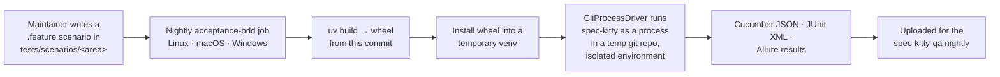

# Mission Specification: CLI Acceptance Scenarios & Cucumber-JVM Nightly

**Mission Branch**: `cli-acceptance-bdd-nightly-01M4NZRJ`
**Created**: 2026-10-11
**Status**: Draft
**Input**: User description: "Acceptance scenarios and a black-box Cucumber-JVM nightly for the CLI (refs #6053). Maintainers can write Gherkin acceptance scenarios for the CLI in this repository and see them run every night, against a wheel built from the commit, on Linux, macOS and Windows. Governed by ADR docs/adr/4.x/2026-10-11-3-acceptance-testing-and-bdd-support.md (Accepted), narrowed by an owner ruling on 2026-10-11: promises, the promise index and turning promises into scenarios belong to spec-kitty-qa, not core."

## Overview

Spec Kitty promises behaviour to its users (for example, "re-running `init` keeps
project state"), but core has no `.feature` files and no behaviour-driven runner that
drives the CLI the way a user does. This mission gives maintainers a **black-box
acceptance surface**: Gherkin scenarios kept in the repository next to the code they
describe, and a **nightly JVM runner** that installs a wheel built from the commit and
exercises the CLI as an external process on Linux, macOS and Windows.

The governing decision is ADR `docs/adr/4.x/2026-10-11-3-acceptance-testing-and-bdd-support.md`
(Accepted, 2026-10-11). An **owner ruling on 2026-10-11 narrows it**: promises, the
promise index, and the act of turning a promise into a scenario belong to **spec-kitty-qa**,
not core. Core keeps the scenarios, the runner, and the nightly. The **first deliverable of
this mission is an amendment to that ADR** recording the ruling and its consequences.

### Black-box run flow (product intent)

## User Scenarios & Testing *(mandatory)*

### User Story 1 - Maintainer writes a scenario and sees it verified nightly cross-OS (Priority: P1)

A maintainer describes a promised CLI behaviour as a Gherkin `.feature` file under
`tests/scenarios/<area>/`. Without touching per-PR CI or installing a JDK, the next
nightly builds a wheel from the commit, installs it into a throwaway environment, drives
the CLI as a black box, and reports pass/fail on all three operating systems.

**Why this priority**: This is the mission's core value — a promise is worthless to a
release unless something checks it the way a user would, on every supported platform. The
runner and the first scenarios together are the minimum viable product.

**Independent Test**: Add a `.feature` scenario whose steps already have bindings, run the
`acceptance-jvm` runner against a freshly built wheel in an isolated temp repo, and confirm
the scenario executes and reports a Cucumber/JUnit result — delivering the "write it, see it
run" loop end to end.

**Acceptance Scenarios**:

1. **Given** `tests/scenarios/init/` contains a bound, untagged scenario, **When** the
   nightly gating run executes with filter `not @wip and not @manual`, **Then** the scenario
   runs against a wheel built by `uv build` and installed into a temporary venv, and a
   Cucumber JSON, JUnit XML and Allure result are produced.
2. **Given** a scenario drives `spec-kitty init` in a per-scenario temporary git repository,
   **When** the step invokes the CLI through the `SpecKittyDriver` port, **Then** the driver
   returns exit code, output, parsed `--json` and the working tree, and no step imports
   Python or touches the maintainer's real home or global Spec Kitty state.

---

### User Story 2 - Unbound and defect scenarios land without gating a release (Priority: P2)

A maintainer reproduces a CLI defect as a `@defect:<issue>` scenario, or lands a scenario
whose steps are not yet bound as `@wip`, so the work shares history with its fix but does not
block a release while it is incomplete.

**Why this priority**: It keeps the acceptance surface honest and usable mid-flight — a
reproduction or an in-progress scenario can live in the repo without turning the gating
nightly red. Valuable, but the gating loop (Story 1) must exist first.

**Independent Test**: Tag a scenario `@wip` with an owner and since-date, confirm the gating
run excludes it and the separate non-gating run executes it; tag another `@manual` and confirm
the gating run also excludes it — proving the only tags core acts on are `@wip` and `@manual`.

**Acceptance Scenarios**:

1. **Given** a scenario tagged `@wip`, **When** the gating nightly run executes, **Then** it
   is excluded from the gating run and executed only by the separate non-gating `@wip` run.
2. **Given** a scenario tagged `@manual`, **When** the gating nightly run executes, **Then**
   it is excluded, so a heavy or on-demand scenario does not slow the nightly.
3. **Given** a scenario carrying any of `@promise:<id>`, `@defect:<issue>` or `@qa:SC-A-NNN`,
   **When** core runs it, **Then** core attaches no meaning to those tags beyond passing them
   through — no promise-index lookup, no per-PR tag check, no sync.

---

### User Story 3 - QA consumes the nightly results (Priority: P3)

The spec-kitty-qa acceptance nightly consumes the Cucumber JSON, JUnit XML and Allure results
this nightly uploads, to run its promise trace lint and build its Allure report.

**Why this priority**: It closes the QA handoff, but the cross-repo consumption lives in
spec-kitty-qa; core's obligation is only to *produce and upload* the results.

**Independent Test**: Confirm the nightly uploads the three named result artifacts after a run,
and that the artifacts are well-formed Cucumber JSON / JUnit XML / Allure results.

**Acceptance Scenarios**:

1. **Given** an `acceptance-bdd` nightly run finished on an OS leg, **When** the job completes,
   **Then** it uploads Cucumber JSON, JUnit XML and Allure results as named artifacts for the
   spec-kitty-qa nightly to fetch.

---

### Edge Cases

- **Output noise across OSes**: line endings and absolute paths differ on Windows vs. POSIX —
  the driver normalises line endings and compares real paths so a cosmetic difference does not
  fail a scenario, while a genuine behaviour change still does.
- **Leaked child processes**: a CLI invocation that spawns descendants must not outlive the
  step — the driver kills descendant processes and enforces a timeout.
- **A heavy scenario added later**: tagged `@manual` so it stays out of the gating run and runs
  on demand; core gives `@manual` no other meaning.
- **`init` inside the scenario's temp git repo**: `init` must not create commits or re-init git
  — asserted against the unchanged repository HEAD.
- **A scenario whose steps are not yet bound**: lands `@wip` with owner and since-date; it never
  gates the nightly.
- **The promise index is absent from core**: scenarios still run; no core check depends on a
  promise index, token sync, or per-PR tag validation.

## Requirements *(mandatory)*

### Functional Requirements

| ID | Title | User Story | Priority | Status | Delivery | No-op passable? |
|----|-------|------------|----------|--------|----------|-----------------|
| FR-001 | ADR amendment records the owner ruling | As a maintainer, I want the ADR amended so the narrowed scope (promises/index/promise→scenario conversion belong to spec-kitty-qa; core keeps scenarios/runner/nightly; both ci-router groups non-gating; promise-index.json, the sync token and the per-PR promise-tag check are dropped from core) is the recorded decision. | High | Open | [build] | no |
| FR-002 | Scenario layout `tests/scenarios/<area>/*.feature` | As a maintainer, I want a conventional scenario directory so acceptance scenarios live next to the code they describe, starting with an `init` area. | High | Open | [build] | no |
| FR-003 | Scenario: re-running `init` keeps project state, only restores missing skill roots | As a maintainer, I want the idempotent-restore promise from `init --help` pinned as a scenario so a regression turns the nightly red. | High | Open | [ratchet] | yes — paired on the same fixture with a positive control: a deleted skill root IS restored by the re-run while an already-present skill root and other project state stay byte-identical (proves the probe observes restoration, not nothing). |
| FR-004 | Scenario: `init` never runs git init or commits | As a maintainer, I want the no-git promise from `init --help` pinned as a scenario so a regression that touches git state is caught on every OS. | High | Open | [ratchet] | yes — paired on the same fixture with a positive control: the same run observably creates project files (`.kittify/` and agent surfaces) while the repository HEAD and commit count stay unchanged and no new `.git` is created (proves the harness can see changes, so the unchanged-git assertion is not vacuous). |
| FR-005 | Gradle subproject `acceptance-jvm/` following the `contracts/` precedent | As a maintainer, I want the runner built as a pinned-Gradle subproject (checksum-verified distribution, no committed wrapper jar, generated `verification-metadata.xml`) so it reuses the repo's one governed JVM build pattern. | High | Open | [build] | no |
| FR-006 | Runner executes Cucumber-JVM 7 on the JUnit Platform, reading `../tests/scenarios` in place | As a maintainer, I want the subproject to run the in-repo scenarios without copying them so one scenario source feeds both per-PR routing and the nightly. | High | Open | [build] | no |
| FR-007 | `SpecKittyDriver` port with a `CliProcessDriver` implementation | As a maintainer, I want steps to go only through a driver port whose process implementation drains streams, enforces a timeout, kills descendant processes, normalises line endings and compares real paths, so scenarios are stable and black-box. | High | Open | [build] | no |
| FR-008 | Per-scenario temporary git repo and isolated environment | As a maintainer, I want each scenario to get its own temp git repository with `SPEC_KITTY_HOME`, `HOME`, `USERPROFILE`, the XDG directories and `LOCALAPPDATA` redirected inside it (UTF-8, `NO_COLOR`, fixed `COLUMNS`), so a run cannot touch real or shared state. | High | Open | [build] | no — absence of real-home contact is paired with a positive control: the run observably writes inside its temp dir. |
| FR-009 | CLI under test is a `uv build` wheel in a temporary venv; steps never import Python | As a maintainer, I want the CLI installed from a wheel built from the commit into a throwaway venv — never PyPI, never an editable install — so the nightly tests exactly what ships. | High | Open | [build] | no |
| FR-010 | `acceptance-bdd` nightly job on Linux, macOS and Windows | As a maintainer, I want a nightly job whose gating run filters `not @wip and not @manual` with no retries, plus a separate non-gating run that executes `@wip`, so promised behaviour is verified cross-OS every night. | High | Open | [build] | no |
| FR-011 | Nightly uploads Cucumber JSON, JUnit XML and Allure results | As a QA consumer, I want the nightly to upload the three result formats as named artifacts so the spec-kitty-qa nightly can run its promise trace lint and Allure report. | Medium | Open | [build] | no |
| FR-012 | `ci-router.yml` gains non-gating `scenarios` and `acceptance_jvm` groups | As a contributor, I want `tests/scenarios/**` and `acceptance-jvm/**` routed as their own groups that gate no per-PR job, so no contributor needs a JDK. | High | Open | [build] | no — the "gates no per-PR job" assertion is paired on the same router fixture with a positive control: an existing gating group (e.g. `ci`) still maps to its per-PR job (proves the router test observes gating when present). |
| FR-013 | sdist excludes `acceptance-jvm/**` and `tests/scenarios/**` | As a packager, I want both paths excluded from the sdist and the exclusion asserted in `tests/cross_cutting/packaging/test_packaging_safety.py`, so the published source distribution ships neither the runner nor the scenarios. | High | Open | [build] | no — the exclusion (absence) assertion is paired on the same built-sdist fixture with a positive control: a `src/` package IS present in the sdist (proves the probe can see inclusion). |
| FR-014 | Core attaches no meaning to scenario tags beyond the nightly filter | As a maintainer, I want core to drop `tests/scenarios/promise-index.json`, the `PROMISE_INDEX_SYNC_TOKEN` sync and the per-PR promise-tag check, and to treat `@promise`/`@defect`/`@qa` as inert while only `@wip`/`@manual` affect the nightly filter. | High | Open | [build] | no — the "no per-PR promise-tag gate" absence is paired with a positive control: the nightly filter demonstrably excludes a `@wip`/`@manual` scenario while an untagged scenario runs. |

### Non-Functional Requirements

| ID | Title | Requirement | Category | Priority | Status |
|----|-------|-------------|----------|----------|--------|
| NFR-001 | Cross-OS coverage | The gating nightly executes on exactly 3 OS legs — Linux, macOS, Windows — and a red on any one leg fails that leg's run. | Reliability | High | Open |
| NFR-002 | Run hermeticity | A scenario run performs 0 reads or writes to the real `HOME`/`SPEC_KITTY_HOME`/global Spec Kitty state; all such paths resolve inside the per-scenario temp directory. | Isolation | High | Open |
| NFR-003 | Supply-chain pinning | 100% of the runner's JVM dependencies are pinned in generated `verification-metadata.xml`, the Gradle distribution is checksum-pinned, and 0 wrapper jars are committed. | Security | High | Open |
| NFR-004 | No per-PR JDK cost | 0 per-PR jobs require a JDK or build the `acceptance-jvm` subproject. | Performance | High | Open |
| NFR-005 | Deterministic gating | The gating nightly run uses 0 retries, so a flake is reported rather than masked. | Reliability | Medium | Open |

### Constraints

| ID | Title | Constraint | Category | Priority | Status |
|----|-------|------------|----------|----------|--------|
| C-001 | Black-box steps only | Steps call only the `SpecKittyDriver` port; they never import Python and never use internal Java classes. Published contracts (e.g. `contracts/mission-status/openapi.yaml`) are allowed. | Technical | High | Open |
| C-002 | CLI provenance | The CLI under test is a wheel built from the commit via `uv build` and installed into a temporary venv — never PyPI, never an editable install. | Technical | High | Open |
| C-003 | Promise machinery is out of core scope | Promises, the promise index, and turning a promise into a scenario belong to spec-kitty-qa. Core ships no `promise-index.json`, no `PROMISE_INDEX_SYNC_TOKEN` sync, and no per-PR promise-tag check. | Scope | High | Open |
| C-004 | Packaging boundary | `acceptance-jvm/**` and `tests/scenarios/**` are excluded from the sdist; the wheel ships only `src/` packages and is unchanged. | Technical | High | Open |
| C-005 | No per-PR gating for scenarios or runner | Neither the `scenarios` nor the `acceptance_jvm` ci-router group gates a per-PR job. | Technical | Medium | Open |
| C-006 | Single governed JVM build pattern | The runner follows the `contracts/` Gradle precedent (JDK = Java 25 per the 2026-10-03 amendment of ADR 2026-10-01-2). No second JVM build system is introduced. | Technical | Medium | Open |

### Key Entities

- **Scenario (`.feature`)**: a Gherkin description of a promised CLI behaviour, under
  `tests/scenarios/<area>/`, optionally tagged. The unit a maintainer authors.
- **Tag**: an annotation on a scenario (`@promise:<id>`, `@wip` + `@wip-owner`/`@wip-since`,
  `@defect:<issue>`, `@qa:SC-A-NNN`, `@manual`). In core, only `@wip` and `@manual` have an
  effect: exclusion from the gating nightly run.
- **`SpecKittyDriver` (port)**: the only seam steps use; runs a command and returns exit code,
  output, parsed `--json`, and the working tree.
- **`CliProcessDriver`**: the `ProcessBuilder` implementation of the port (drained streams,
  timeout, descendant-process kill, normalised line endings, real-path comparison).
- **Isolated scenario environment**: a per-scenario temporary git repository plus a fully
  redirected environment that keeps a run off real and shared state.
- **`acceptance-bdd` nightly job**: the three-OS CI job that builds the wheel, runs the gating
  and non-gating scenario runs, and uploads results.

## Success Criteria *(mandatory)*

### Measurable Outcomes

- **SC-001**: A maintainer can add one `.feature` scenario and the next nightly runs it on all
  three operating systems with no change to any per-PR check. — [build] · no-op passable: no
- **SC-002**: A breaking change to a promised CLI behaviour that a bound scenario covers turns
  the nightly red on all three operating systems, not only Linux. — [ratchet] · no-op passable:
  no (the scenario must exercise the real behaviour; positive control: the same scenario is
  green against the unbroken CLI).
- **SC-003**: A contributor with no JDK can open and pass every per-PR check for a scenario-only
  or runner-only change. — [build] · no-op passable: no
- **SC-004**: Every scenario run is hermetic — it leaves the maintainer's real home directory and
  global Spec Kitty state byte-identical. — [build] · no-op passable: no (absence assertion;
  positive control: the run observably creates files inside its temp directory).

## Assumptions

- The three result formats (Cucumber JSON, JUnit XML, Allure) are uploaded as named CI
  artifacts; the cross-repo *consumption* of them is owned by the spec-kitty-qa nightly and is
  out of this mission's scope.
- The runner's JDK is Java 25 and the pinned Gradle version mirrors the `contracts/` subproject.
- The `scenarios` ci-router group routes `tests/scenarios/**` but gates no job — the architectural
  job it gated in the ADR-as-accepted was the per-PR promise-tag check, which this mission drops.
- The two seed `init` scenarios are lightweight, so they land bound and untagged (in the gating
  run); `@manual` is reserved for heavier or on-demand scenarios added later.

## Dependencies

- The existing `contracts/` Gradle subproject, reused as the structural precedent for pinning,
  verification metadata, and the no-wrapper-jar pattern.
- `src/specify_cli/cli/commands/init_help.py`, the source of truth for the two seed scenarios'
  promised behaviours.
- ADR `docs/adr/4.x/2026-10-11-3-acceptance-testing-and-bdd-support.md`, amended by this mission.
- Downstream (out of scope here): spec-kitty-qa ADR-0001/ADR-0002, which own the promise index
  and the acceptance Allure report.
