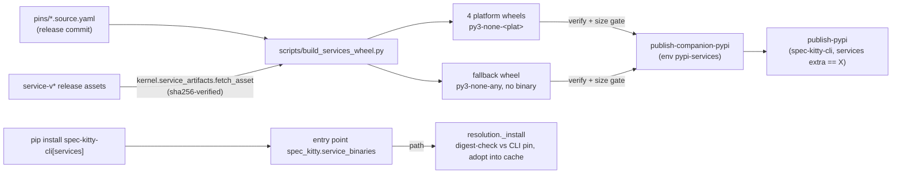

# Implementation Plan: Optional companion services wheel

**Branch**: `companion-services-wheel` | **Date**: 2026-10-31 | **Spec**: [spec.md](spec.md)
**Input**: Mission specification from `kitty-specs/companion-services-wheel-01M694B1/spec.md`
**Research**: [`docs/plans/events-domain-move/companion-wheel-research.md`](../../docs/plans/events-domain-move/companion-wheel-research.md) and [research.md](research.md)

## Summary

Add an optional `spec-kitty-services` companion distribution, built in core's release workflow from the release commit's own pins.
- **Platform wheels:** one wheel per native target (`linux-x64`, `linux-arm64`, `macos-arm64`, `windows-x64`). Each carries the pinned, digest-verified write-service and charter-service binaries for its target, and registers them in the `spec_kitty.service_binaries` slot that `specify_cli.services.resolution` already consults.
- **Fallback wheel:** a binary-free `py3-none-any` wheel makes the CLI's `services` extra installable on every host.
- **Main wheel:** `spec-kitty-cli` stays pure.

The ADR 2026-10-29-1 amendment lands first. The resolution order does not change; its install-slot behaviour is pinned by new tests.



## Technical Context

**Language/Version**: Python 3.11+ (CLI floor); the companion's build backend and wheel writer use the standard library only.
**Primary Dependencies**: none new. The build script reuses `kernel.service_pin`, `kernel.service_hosts` and `kernel.service_artifacts` (`fetch_asset`, `verify_asset`, `sha256_file`); the wheel is assembled with `zipfile`, `hashlib`, `base64` and `json`.
**Storage**: files. The pins (`pins/*.source.yaml`), the asset cache (`${XDG_CACHE_HOME}/spec-kitty/services`), and the wheel output directory `dist-services/`.
**Testing**: pytest, red-first. Fixture releases come from `tests/kernel/service_release_fixture.build_release` (`file://` repositories), with no network. New tests live in `tests/cross_cutting/packaging/test_companion_services_wheel.py` (fast) and extend `tests/specify_cli/services/test_resolution.py` and `tests/release/`.
**Target Platform**: wheels for `manylinux_2_39_x86_64`, `manylinux_2_39_aarch64`, `macosx_11_0_arm64`, `win_amd64`, plus `any`. Builds run on `ubuntu-24.04` in the release workflow.
**Project Type**: single project, plus one first-party sub-distribution under `packages/`.
**Performance Goals**: companion tests under 10 s in total (NFR-002). A release build fetches each asset once, from the shared cache.
**Constraints**: the main wheel stays `py3-none-any` with no binary (C-001); no change under the D-9 frozen paths (C-002); one fetch owner (C-003); no new build dependency (C-004); every companion wheel is 95 MB or less (FR-007).
**Scale/Scope**: 2 services × 4 targets, plus 1 fallback wheel per release.

## Charter Check

| Charter rule | Status |
|---|---|
| Single canonical authority | Pass. The pins stay the only source of truth: the companion's manifest is *derived* from them, and a guard compares it back. Host detection reuses `kernel.service_hosts`. One wheel-writer module serves both the in-tree backend and the release script. |
| Architectural alignment / layering | Pass. The companion source sits outside `src/`, so the enforced layer chain and the `pyproject.toml` package set are unchanged. The build script imports `kernel` only, like `scripts/sync_services.py`. |
| Shared Package Boundaries | Pass, with a recorded decision. The companion is first-party, not an external contract package. The `services` extra needs a uv workspace member; see Complexity Tracking. |
| D-9 freeze (`test_events_import_frozen.py`) | Pass. No frozen path is touched. |
| ATDD-first / red-first | Every build concern starts with a failing acceptance test. The resolution-order rows are `[ratchet]`, so they pin behaviour that already exists, each with a positive control. |
| `NO_FULL_HEAVY_SUITES_IN_MISSION` | Targeted runs only: `make test-fast`, `tests/specify_cli/services/`, `tests/kernel/`, `tests/cross_cutting/packaging/`, `tests/ci/test_sync_services.py`, `tests/release/`, and the named architectural gates. |
| Supply chain (`DIRECTIVE_051`) | No third-party dependency is added. The extra names a first-party package of the exact same version. The companion is built from digest-verified assets and never rebuilt; publishing uses Trusted Publishing with a dedicated environment. |
| Terminology (Mission, not Feature) | Pass. |

## Project Structure

### Documentation (this mission)

```
kitty-specs/companion-services-wheel-01M694B1/
├── spec.md
├── plan.md
├── research.md
├── data-model.md
├── quickstart.md
├── contracts/
│   ├── companion-manifest.schema.json
│   └── companion-wheel.md
└── tasks.md                # /spec-kitty.tasks
```

### Source Code (repository root)

```
packages/spec-kitty-services/
├── pyproject.toml                    # name, version == CLI version, entry points, in-tree backend
├── README.md
├── _backend/spec_kitty_services_backend.py   # PEP 517 hooks (stdlib): fallback wheel, editable, sdist
└── spec_kitty_services/
    ├── __init__.py                   # providers: write_service(), charter_service()
    └── wheel.py                      # deterministic stdlib wheel writer + manifest (shared)
scripts/build_services_wheel.py       # release builder: pins -> fetch/verify -> wheels; --verify
tests/cross_cutting/packaging/test_companion_services_wheel.py
tests/specify_cli/services/test_resolution.py     # + install-slot ratchet tests
pyproject.toml                        # services extra, uv workspace member, sdist exclude packages/**
.github/workflows/release.yml         # sync_services step, build-companion-wheels, publish-companion-pypi
RELEASE_CHECKLIST.md
docs/adr/4.x/2026-10-29-1-...md       # Amendment 2026-10-31
CLAUDE.md                             # one clarifying sentence on first-party workspace members
```

**Structure Decision**: one first-party sub-distribution under `packages/`. It is outside `src/` (so `test_pyproject_shape.py` does not treat it as first-party CLI code) and excluded from the CLI sdist.

## Complexity Tracking

| Violation | Why Needed | Simpler Alternative Rejected Because |
|-----------|------------|-------------------------------------|
| (Ruled A by the operator, 2026-10-31.) `[tool.uv.workspace]` member plus a `[tool.uv.sources] spec-kitty-services = { workspace = true }` entry (the CLAUDE.md bullet says no committed `[tool.uv.sources]`) | The exact `services` extra must resolve in `uv.lock`, and the companion of version X never exists on PyPI when commit X is locked. | Dropping the extra reverses ruling 2. A version range breaks the exact version lock (ruling 3). Decision Moment `01M694GPQYVGRKCF3B582FWQ1Y`, recommended A. |
| In-tree PEP 517 backend for the companion | `uv sync --all-extras` installs the workspace member, so it needs a build backend. A stdlib in-tree backend keeps C-004 (no new build dependency) and shares one wheel writer with the release script. | Hatchling would add a second wheel builder for the same distribution (two authorities for the wheel layout). |

## Implementation Concern Map

### IC-01 — Decision record

- **Purpose**: amend ADR 2026-10-29-1 D-4 with the companion wheel (all 12 rulings, plus the workspace-member decision), and add the matching clarification to CLAUDE.md's Shared Package Boundary bullet.
- **Relevant requirements**: FR-001
- **Affected surfaces**: `docs/adr/4.x/2026-10-29-1-the-events-domain-and-its-java-services-live-in-spec-kitty-events.md`, `CLAUDE.md`, `docs/plans/events-domain-move/plan.md` (§3.4 status line).
- **Sequencing/depends-on**: none. It comes first.
- **Risks**: the ADR's frontmatter or format gates (docs lint). Do not touch the frozen architecture page.

### IC-02 — Companion package and wheel writer

- **Purpose**: the `spec_kitty_services` providers (skew guard, host guard, file guard), the deterministic wheel writer and manifest, and the in-tree backend for the fallback/editable/sdist builds.
- **Relevant requirements**: FR-002, FR-003, FR-006, NFR-001, C-004, C-005
- **Affected surfaces**: `packages/spec-kitty-services/**`
- **Sequencing/depends-on**: IC-01
- **Risks**: the provider must import nothing at module load that could fail (`kernel` is imported lazily, and a failure means "offer nothing"). The RECORD format and executable bits must be right for pip.

### IC-03 — Release builder and size/digest gates

- **Purpose**: `scripts/build_services_wheel.py` reads the pins, fetches every native asset of the write and charter services through `fetch_asset`, writes the platform wheels and the fallback wheel, enforces the 95/60 MB gate, and verifies the written wheels against the pins (`--verify`).
- **Relevant requirements**: FR-004, FR-005, FR-007, FR-010 (companion half), NFR-003, C-003, C-007
- **Affected surfaces**: `scripts/build_services_wheel.py`, `tests/cross_cutting/packaging/test_companion_services_wheel.py`
- **Sequencing/depends-on**: IC-02
- **Risks**: a test that builds wheels must not reach the network (`file://` fixtures only). The size gate is tested with an injected threshold, not 95 MB of bytes.

### IC-04 — CLI packaging wiring

- **Purpose**: the `services` extra, the uv workspace member and `uv.lock`, the sdist exclusion of `packages/**`, and the main-wheel and sdist guard extended to companion files.
- **Relevant requirements**: FR-008, FR-010 (main half), C-001, C-005
- **Affected surfaces**: `pyproject.toml`, `uv.lock`, `tests/cross_cutting/packaging/test_packaging_safety.py`, a version-lock guard test (companion version == CLI version == extra pin), and `scripts/release/validate_release.py` (the same three-place check at release time, with its tests in `tests/release/`).
- **Sequencing/depends-on**: IC-02
- **Risks**: `uv lock` churn must stay limited to the new member. The `test_pyproject_shape.py` gates must still pass. The release `check_exact_install.py` must still pass with the extra declared.

### IC-05 — Resolution install-slot ratchet

- **Purpose**: pin the install slot's position and digest check: it is preferred over a warm cache, explicit beats it, a jar can come from it, and a wrong digest refuses even with a warm cache. Plus an end-to-end test where a built companion is "installed" and resolved.
- **Relevant requirements**: FR-011, US1, US2
- **Affected surfaces**: `tests/specify_cli/services/test_resolution.py`, `tests/cross_cutting/packaging/test_companion_services_wheel.py`
- **Sequencing/depends-on**: IC-02 for the end-to-end test; the slot ratchet has no dependency.
- **Risks**: none in production code (no behaviour change expected). If a ratchet test fails, that is a real finding: stop and report.

### IC-06 — Release workflow and checklist

- **Purpose**: `sync_services.py --service all` and then `--check` after the packs check (direct script calls, not the composite action, so the "wire it now" ratchet keeps its meaning). Add `build-companion-wheels` and `publish-companion-pypi` (environment `pypi-services`), and make `publish-pypi` wait for the companion. Add the service and companion steps to RELEASE_CHECKLIST.md.
- **Relevant requirements**: FR-009, FR-012
- **Affected surfaces**: `.github/workflows/release.yml`, `RELEASE_CHECKLIST.md`, `tests/release/`
- **Sequencing/depends-on**: IC-03, IC-04
- **Risks**: existing release-shape tests (`tests/release/test_release_ci_ownership.py`, `tests/architectural/_workflow_jobs.py`) may pin job sets. The operator must create the PyPI pending publisher and the `pypi-services` environment before the first real publish; that is a PR prerequisite.
