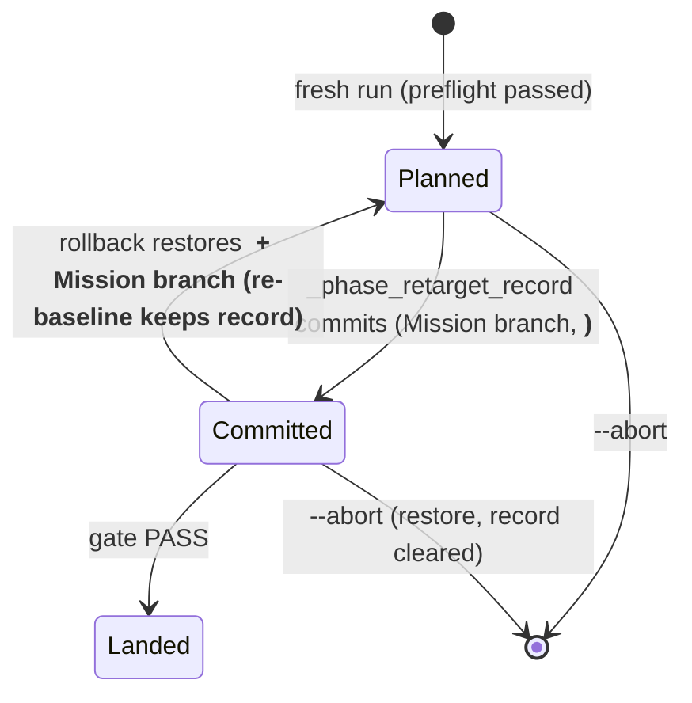

# Data model

## `meta.json` (Mission record), additions
- `target_branch: str`: rewritten to `<b>` by a retarget.
- `retarget_history: list[{from: str, to: str, actor: str, at: ISO-8601 str, reason: str}]`: bounded (`HISTORY_CAP`), newest last. Optional key (`MissionMetaOptional`).
  - The Mission-branch copy and the `<b>` copy carry identical content, so the meta driver's two-way landing yields `target_branch == <b>`.

## `ConsolidationState` (run record `.kittify/runtime/merge/<mission_id>/state.json`), addition
- `retarget: {from, to, actor, at, reason, committed: bool} | None`. Defaults to `None` in `from_dict` (older records).
  - Created with `committed=False` on a fresh retarget run, before the claim.
  - Set to `committed=True` by `_phase_retarget_record` right after its commits.
  - A full-restore re-baseline keeps it, with `committed=False`.
  - `--abort` clears the whole record.

## State transitions of a retarget

