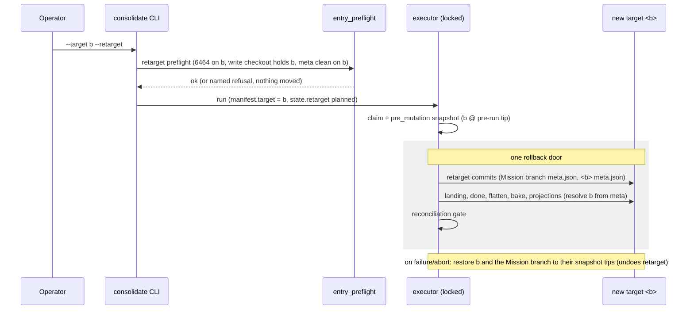

# Implementation Plan: Consolidate retarget adopts the override target

**Branch**: `kitty/mission-consolidate-retarget-01M7M5JA` (lands on `issue-7692-consolidate-retarget`) | **Date**: 2026-11-17 | **Spec**: [spec.md](spec.md)
**Input**: Mission specification from `kitty-specs/consolidate-retarget-01M7M5JA/spec.md`

## Summary

`spec-kitty consolidate --target <b> --retarget` makes `<b>` the Mission's recorded target as the run's first change, so every write the run makes lands on `<b>`.

- **Preflight.** The guards that a plain `--target` refuses on (`TARGET_OVERRIDE_RECORDED_TARGET_UNWRITABLE`, and the #5385 probe of the *old* record) are replaced, for a retarget only, by the same guards judged against the new target:
  - #6464 protection on `<b>`;
  - the write-checkout hold for `<b>`;
  - a clean, tracked `meta.json` on `<b>`.
- **Before the snapshot.** The run's effective target is `<b>` in memory before the pre-mutation snapshot. That is already true for any `--target`, so the snapshot captures `<b>`'s pre-run tip.
- **Commit.** Inside the one rollback door, before `_phase_merge_lanes`, a new phase `_phase_retarget_record` rewrites `meta.json` (`target_branch`, plus a bounded `retarget_history` entry) at every copy the landing reads: the Mission branch, when its tree carries `meta.json` (the meta driver's two-way landing takes `target_branch` from that side), and the primary tree on `<b>`, through `commit_merge_bookkeeping(destination_ref_override=<b>)`. Both post tips are recorded by `_records_post_mutation_tips`. `lanes.json` is not rewritten (D4).
- **Downstream.** Every later write reads the rewritten record through the existing seams. This is exactly the "Mission created for `develop`" arm that #7688's controls already prove lands cleanly (C-005: no per-write threading).
- **Undo and resume.** `ConsolidationState.retarget` persists `{from, to, commit_sha}`. The rollback authority undoes the commit by restoring `<b>`'s snapshot tip. `--resume` sees the persisted record and skips the phase.



## Technical Context

**Language/Version**: Python 3.11+
**Primary Dependencies**: typer, rich, git CLI; in-repo `specify_cli.consolidation`, `specify_cli.git.bookkeeping_commit`, `specify_cli.mission_metadata`, `specify_cli.lanes.persistence`
**Storage**: Files in git: `kitty-specs/<slug>/meta.json`, `kitty-specs/<slug>/lanes.json`; run record `.kittify/runtime/merge/<mission_id>/state.json`
**Testing**: pytest. Red-first end-to-end tests through the real `spec-kitty consolidate` CLI over real git (`tests/terminus/`, reusing the #5783 fixtures `build_lanes_mission` / `build_coord_mission`); unit tests for the verdicts and the record phase (`tests/consolidation/`); orchestrator-api tests (`tests/orchestrator_api/`).
**Target Platform**: Linux/macOS/Windows CLI (git ≥ 2.38 for squash paths already required)
**Project Type**: single (CLI)
**Performance Goals**: no measurable change to a non-retarget run; a retarget adds one meta commit.
**Constraints**: C-001..C-007 from spec. ruff/mypy clean, complexity ≤ 15 per function, no new architectural gate.
**Scale/Scope**: about 12 source modules touched (mostly small), 1 new phase function, 1 new state field, 1 new meta key, 2 new error codes (`RETARGET_RECORD_UNWRITABLE`, `RETARGET_RESUME_MISMATCH`).

## Charter Check

| Principle / Standing Order | Assessment |
|---|---|
| Single canonical authority | One rollback authority (`rollback_to_snapshot`) undoes the retarget; one protection set (`ProtectionPolicy`); one commit seam (`commit_merge_bookkeeping`); one target resolver (`resolve_merge_target_branch`). No new parallel path. PASS |
| Architectural alignment | Lives entirely in `specify_cli` (top layer); no layer-rule change. PASS |
| ATDD-first / red-first (SO #4) | The end-to-end retarget arms are written first and witnessed red (today: refused `TARGET_OVERRIDE_RECORDED_TARGET_UNWRITABLE`). PASS (planned) |
| Adversarial squad (SO #1) | Plan-point squad run on this draft; findings and dispositions are in `research.md`. |
| Campsite (SO #2) | `entry_preflight._refuse_protected_target_override_or_continue` and `forecast._refuse_protected_target_override_in_forecast` gain a branch. Extract a shared `target_override_verdict(...)` helper in `preflight.py` (behaviour-preserving, own tests) BEFORE adding the retarget arm, so the three call sites stop duplicating the `or` chain. |
| Gate discipline (SO #5) | No new architectural gate (C-004). `test_single_rollback_authority.py` `_SPAN_PHASES` is EDITED to include `_phase_retarget_record`. Existing gates to run: `test_single_rollback_authority.py`, `test_guard_capability_call_sites.py`, `test_no_dead_symbols.py`, `test_no_legacy_terminology.py`, `test_ruff_format_enforcement.py`. |
| Terminology | "Mission", "consolidate", "landing", "recorded target", "retarget". "Merge" is used only for git merges. PASS |
| Tests-run policy | `make test-fast`, plus the targeted `tests/terminus`, `tests/consolidation`, `tests/orchestrator_api`, `tests/specify_cli/orchestrator_api`, `tests/coordination` and the named arch gates. No `make test-full`. |

## Engineering Alignment (plan-time decisions)

The operator rulings Q1–Q5 are in spec.md. The decisions below are engineering choices within them, revised after the post-plan squad (see `research.md` § Post-plan squad). **(flag)** marks an item reported to the operator that does not block.

1. **D1 — Preflight composition (campsite first).**
   - Extract a pure `target_override_verdict(main_repo, slug, *, recorded, effective, retarget=False) -> Refused | None` in `preflight.py`. Call it from all three sites: the entry preflight, the forecast, and orchestrator-api with `retarget=False`. Each site keeps its own rendering and exception type, so the orchestrator-api envelope does not change.
   - With `retarget=False` it is today's chain: #6464, then the #5783 `refuse_unwritable_recorded_target`.
   - With `retarget=True` it is #6464 on `<b>` (unchanged), then `retarget_record_refusal(main_repo, slug, new)`, code `RETARGET_RECORD_UNWRITABLE`. That check reuses the bake's `_primary_checkout_refusal`, promoted with its body unchanged (the bake re-imports it), and covers:
     - the root checkout is on `<b>` and not detached;
     - `meta.json` is tracked on `<b>`, clean, and not skip-worktree;
     - the Mission directory is present on `<b>`.
   - A retarget never consults the #5783 guard.
2. **D2 — #5385 on a retarget: re-point the probe, never skip it (squad A5).**
   - `refuse_protected_status_target(..., retarget_to=<b>)` builds the same `done` request.
   - When the door's resolved destination is the OLD recorded target (a coordination-less topology), it asks `BookkeepingTransaction.preflight_refusal` with `destination_ref=<b>`, through a new keyword on `status_write_refusal`.
   - Under coord the destination is the coordination branch and stays as it is.
   - The verdict is therefore `WorkflowMutationPolicy`'s (C-001).
   - Consequence (flag): a Mission recorded for a protected `main` CAN be retargeted to an unprotected `develop`, because `main` receives nothing. A test pins this.
3. **D3 — Ordering in the run.**
   - The CLI threads `retarget` / `retarget_reason` beside `target_override`.
   - `lanes_manifest.target_branch = <b>`, as today.
   - A fresh `ConsolidationState` gets `retarget = {"from", "to", "actor", "at", "reason", "committed": False}` before the claim.
   - **The claim's status surface follows the effective target (squad A2).** `status_surface_tip` gains an optional `retarget=(from, to)` mapping: a resolved ref equal to `from` reads as `to`. Without it, an explicit-`lanes` run snapshots, unsettles and projects against the old target.
   - `_phase_retarget_record(run)` is the first statement inside the rollback `try`, before `_phase_merge_lanes`.
     - `target_baseline_sha` is captured later, so no re-anchor is needed.
     - The window `pre_mutation_target_sha..T` gains only `kitty-specs/<slug>/` bookkeeping paths. The primary-tree bake is the precedent for this.
4. **D4 — Where the record is committed (squad A1, witnessed by the spike).**
   - **Why the target copy alone fails:** the mission→target landing merges `meta.json` with the meta driver in two-way mode, where `target_branch` is MISSION-authoritative (`consolidation/drivers.py`). A retarget written only on `<b>` is reverted by the landing. Spike on the lanes fixture: `done` then refused `STATUS_WRITE_CHECKOUT_NOT_ON_WRITE_BRANCH ... write branch 'main'`.
   - **The fix:** the record is written at every `meta.json` the landing reads:
     - (a) **the Mission branch**, when its tree carries `kitty-specs/<slug>/meta.json`, through the bake's mission-branch write mechanism (`_write_mission_number_to_branch`'s worktree path), generalised to a meta mutate callback;
     - (b) **the primary tree on `<b>`** (the root checkout), through `commit_merge_bookkeeping(destination_ref_override=<b>)`.
   - **Shared mechanics:** both use `locked_update_meta_capturing` (extracted from `_locked_assign_mission_number`) and the shared CAS undo (`_undo_primary_bake`, renamed `undo_meta_write`).
   - **No semantic changes:** the driver is unchanged (C-002). `lanes.json` is NOT rewritten (squad R6/A6): the run reseeds the target in memory, nothing reads `lanes.json` after the landing, and it has no merge driver.
   - **Recording:** the phase is decorated with `run_state._records_post_mutation_tips`, which records the post tips of the target and the Mission branch (both run-movable and snapshotted). `note_advance_intent` is not usable, because it needs `new_sha` before the move (squad A3).
   - **Message:** `chore(<slug>): retarget <from> -> <to>`.
   - **Refused commit:** CAS-undo the file bytes, then `typer.Exit(1)` into the door.
5. **D5 — Provenance.**
   - `target_branch = <b>`, plus `retarget_history: [{"from", "to", "actor", "at", "reason"}]`, appended through a private `_append_bounded(meta, key, entry)` that `record_acceptance` also adopts (squad R3).
   - `actor` comes from `done_bookkeeping._resolve_merge_actor()`.
   - `reason` defaults to `"operator retarget via spec-kitty consolidate --target <b> --retarget"`.
   - The key is added to `MissionMetaOptional`.
   - Both sides carry identical content, so the two-way merge is `<b>` whichever side wins.
6. **D6 — Resume.**
   - `ConsolidationState.retarget` is loaded with a default of `None`.
   - The phase is skipped when `state.retarget["committed"]` is true. The phase persists that right after the commits.
   - A kill between the commits and that persist is caught earlier by `_refuse_unexplained_branch_moves` (`UNEXPLAINED_BRANCH_MOVE`; remedy `--abort --release-branch`). This is the bake's residual, documented in the ADR amendment and not claimed as handled (squad A3).
   - `--resume --target X --retarget` with an X other than the persisted `to` refuses with `RETARGET_RESUME_MISMATCH` before anything moves.
   - A bare `--resume` with a persisted retarget is judged as a retarget: the entry preflight reads `state.retarget`.
7. **D7 — Abort and failure.**
   - `rollback_to_snapshot` restores `<b>` and the Mission branch, which undoes both record commits. No new restore call is added.
   - On a full-restore re-baseline the retarget record is KEPT with `committed=False` (squad A4), so a bare `--resume` or a re-run re-applies it as a retarget.
   - `--abort` clears the record as today.
   - `test_single_rollback_authority.py` gains `_phase_retarget_record` in `_SPAN_PHASES`. The phase lives in `phase_advance.py`, which is already in `EXECUTOR_FAMILY` (squad R5).
8. **D8 — Dry-run.**
   - `forecast` uses the same verdict with `retarget=True` and adds `"retarget": {"from", "to"}` to the JSON. It writes nothing.
   - It reports the same codes as the real run: `RETARGET_RECORD_UNWRITABLE`, `PROTECTED_BRANCH_REFUSED` and the #5385 code.
9. **D9 — orchestrator-api.**
   - No flag and no contract-version change.
   - The shared #7688 `next_step` text gains "or re-run `spec-kitty consolidate --target <b> --retarget`".
   - Tests assert that text and an unchanged `CONTRACT_VERSION`, and re-pin any golden that carries the old text.
10. **D10 — Topology scope (flag; C-006).**
    - Supported: explicit `lanes` and `lanes_with_coord` Missions (the #5783 fixtures).
    - Refused with `RETARGET_RECORD_UNWRITABLE` (D1): a Mission whose `meta.json` is not on `<b>`. That is a default-topology Mission before its landing (its record lives on its topic branch) and a `single_branch` commit-to-target Mission.
    - Default-topology support goes to a follow-up issue.
11. **D11 — CLI validation.**
    - `--retarget` without `--target`: exit 2.
    - `--retarget-reason` without `--retarget`: exit 2.
    - `--target <recorded> --retarget`: no retarget record and no commit (FR-012).

## Project Structure

### Documentation (this mission)

```
kitty-specs/consolidate-retarget-01M7M5JA/
├── spec.md, plan.md, research.md, data-model.md, quickstart.md
├── contracts/cli-retarget.md      # CLI flags, codes, dry-run JSON shape
├── research/                      # discovery squad notes
└── tasks.md, tasks/               # /spec-kitty.tasks
```

### Source Code (repository root)

```
src/specify_cli/
├── cli/commands/consolidate.py            # --retarget, --retarget-reason, validation, threading
├── consolidation/
│   ├── preflight.py                       # retarget_record_refusal, target_override_verdict (campsite), codes, next_step text
│   ├── entry_preflight.py                 # retarget arm in the override guard; skip old-record #5385 probe for a retarget
│   ├── forecast.py                        # retarget arm + "retarget" JSON
│   ├── executor.py                        # thread retarget; call _phase_retarget_record first in the door
│   ├── phase_advance.py                   # _phase_retarget_record (beside _phase_merge_lanes)
│   ├── phase_claim.py / status_surface.py # claim status surface follows the effective target on a retarget
│   ├── mission_number/bake.py             # extract shared meta write/undo + checkout refusal
│   ├── state.py                           # ConsolidationState.retarget (+ from_dict default)
│   ├── resolve.py                         # fresh record carries retarget; resume mismatch refusal
│   └── rollback.py                        # rebaseline keeps retarget with committed=False
├── mission_metadata.py                    # MissionMetaOptional.retarget_history; _append_bounded; locked_update_meta_capturing
├── coordination/status_transition.py      # status_write_refusal(destination_ref=...) for the re-pointed #5385 probe
└── orchestrator_api/consolidation.py      # (text only via shared next_step)

docs/
├── adr/3.x|4.x/2026-09-19-1-*.md          # Amendment 2026-11-17: retarget in the run record
├── guides/how-to/missions/merge-mission.md
└── changelog/unreleased/7692-consolidate-retarget.added.md

tests/
├── terminus/test_consolidate_retarget.py (new, red-first end-to-end)
├── terminus/test_target_override_recorded_target_unwritable.py (remedy names --retarget)
├── consolidation/test_retarget_verdict.py, test_retarget_record.py, test_state_snapshot_fields.py
└── orchestrator_api/test_consolidate_mission_protected_target.py (retarget text)
```

## Complexity Tracking

No charter violations.

## Implementation Concern Map

### IC-01 — Preflight verdicts (campsite then retarget arm)

- **Purpose**: Judge a retarget against the new target before anything moves, and keep a plain `--target` refusal unchanged.
- **Relevant requirements**: FR-002, FR-008, FR-011, FR-012, NFR-001
- **Affected surfaces**: `consolidation/preflight.py`, `consolidation/entry_preflight.py`, `consolidation/forecast.py`
- **Sequencing/depends-on**: none (campsite extraction first, behaviour-preserving)
- **Risks**: the three call sites drift; skipping #5385 for a retarget must not skip it for a plain `--target`.

### IC-02 — CLI surface and threading

- **Purpose**: `--retarget` / `--retarget-reason` flags, validation, and threading into the executor and forecast.
- **Relevant requirements**: FR-001, FR-005, FR-009, FR-012
- **Affected surfaces**: `cli/commands/consolidate.py`, `consolidation/executor.py` signature, `forecast.py`
- **Sequencing/depends-on**: IC-01
- **Risks**: `consolidate.py` is long; keep options in the existing options dataclass.

### IC-03 — Run record and the retarget phase

- **Purpose**: Persist the retarget, commit the record as the first mutation inside the rollback door, and make resume and abort honour it.
- **Relevant requirements**: FR-003, FR-004, FR-006, FR-007, NFR-002
- **Affected surfaces**: `consolidation/state.py`, `resolve.py`, `executor.py`, `phase_advance.py`, `phase_claim.py`, `status_surface.py`, `rollback.py` (re-baseline), `mission_metadata.py`, `mission_number/bake.py` (extraction), `tests/consolidation/test_single_rollback_authority.py` (`_SPAN_PHASES`)
- **Sequencing/depends-on**: IC-02
- **Risks**: the rollback authority and resume record are high-rigour. The phase must record its post tips (`_records_post_mutation_tips`), or the next run reads `UNEXPLAINED_BRANCH_MOVE`. The meta driver's two-way landing must see `<b>` on the Mission-branch side (D4). The claim's status surface must follow the effective target (D3).

### IC-04 — End-to-end acceptance (red-first)

- **Purpose**: Prove FR-003/006/007/008 through the real CLI on lanes and coord.
- **Relevant requirements**: FR-001..FR-012, SC-001..SC-004
- **Affected surfaces**: `tests/terminus/test_consolidate_retarget.py`
- **Sequencing/depends-on**: written FIRST (red), turned green by IC-01..IC-03
- **Risks**: the injected-failure arm uses a `-c` wrapper modelled on `rollback_harness._HARD_KILL` that makes `executor._phase_merge_lanes` raise after the retarget commit. The observables per S4 row are in `research.md` (Post-plan squad, renata). The fixtures produce no gate-matrix or tombstone rows; those are covered by seam-level tests that read the target from `meta.json`, and SC-001 is worded as 'the observed rows'.

### IC-05 — Docs, ADR amendment, changelog

- **Purpose**: Record the run-record change (ADR 2026-09-19-1 amendment), update the merge-mission how-to, and add a changelog fragment.
- **Relevant requirements**: C-007
- **Affected surfaces**: `docs/adr/...2026-09-19-1...`, `docs/guides/how-to/missions/merge-mission.md`, `docs/changelog/unreleased/`
- **Sequencing/depends-on**: IC-03
- **Risks**: the changelog style and spelling checkers.
