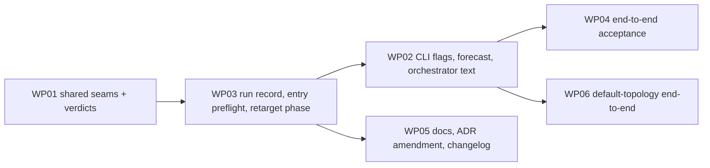

# Work Packages: Consolidate retarget adopts the override target

**Inputs**: Design documents from `kitty-specs/consolidate-retarget-01M7M5JA/`
**Prerequisites**: plan.md, spec.md, research.md (with squad dispositions), data-model.md, contracts/cli-retarget.md, quickstart.md

**Tests**: Required. The spec mandates red-first tests (ATDD-first, charter SO #4). Each code WP writes its unit tests red-first; WP04 holds the end-to-end acceptance suite through the real `spec-kitty consolidate` CLI.

**Organization**: Fine-grained subtasks (`Txxx`) roll up into work packages (`WPxx`). Each WP is independently deliverable and testable.

## Subtask Format: `[Txxx] [P?] Description`

- **[P]** means the subtask can proceed in parallel with other subtasks (different files).
- Subtasks are reference rows: record completion with `spec-kitty agent tasks mark-status <Txxx> --status done`.

## Dependency graph

## Subtask Index

| ID | Description | WP | Parallel |
|----|-------------|----|----------|
| T001 | Extract the shared meta-write mechanics from the mission-number bake into `consolidation/meta_write.py` (checkout refusal, capturing locked write, CAS undo, scratch-worktree branch commit), behaviour-preserving | WP01 | |
| T002 | Extract the pure `target_override_verdict` (campsite) in `preflight.py` | WP01 | |
| T003 | Add `retarget_record_refusal` + `RETARGET_RECORD_UNWRITABLE` / `RETARGET_RESUME_MISMATCH` codes; retarget arm of the verdict | WP01 | |
| T004 | Re-pointable #5385 probe: `status_write_refusal(destination_ref=...)` + `refuse_protected_status_target(retarget_to=...)` | WP01 | [P] |
| T005 | Remedy text of `refuse_unwritable_recorded_target` names `--retarget` | WP01 | |
| T006 | Unit tests for T001–T005 (red-first) + `_load_meta_census` update | WP01 | |
| T007 | CLI flags `--retarget` / `--retarget-reason`, validation (exit 2), threading | WP02 | |
| T008 | Entry preflight: the retarget arm through `target_override_verdict`; #5385 re-pointed for a retarget; persisted-retarget awareness on `--resume`; `RETARGET_RESUME_MISMATCH` | WP03 | |
| T009 | Forecast: the retarget arm + `retarget` JSON object; same codes | WP02 | [P] |
| T010 | orchestrator-api: route through `target_override_verdict(retarget=False)`, keep the exception types and envelope; assert the text and `CONTRACT_VERSION` | WP02 | [P] |
| T011 | Unit and CLI tests for T007–T010 | WP02 | |
| T012 | `ConsolidationState.retarget` field (+ `from_dict` default) and creation on a fresh run in `resolve.py` | WP03 | |
| T013 | `_phase_retarget_record` in `phase_advance.py` (Mission-branch copy + `<b>` copy, `_records_post_mutation_tips`, CAS undo, `committed` persist) | WP03 | |
| T014 | Executor wiring: thread `retarget`, call the phase first in the rollback door; claim status surface follows the effective target | WP03 | |
| T015 | Re-baseline keeps the retarget with `committed=False`; `--abort` clears it | WP03 | |
| T016 | `meta.json` provenance: `retarget_history` in `MissionMetaOptional`, `_append_bounded` (`record_acceptance` adopts it) | WP03 | [P] |
| T017 | Unit tests (phase, state, re-baseline, status surface) + `_SPAN_PHASES` gate update | WP03 | |
| T018 | End-to-end red-first suite, lanes + coord: success observables per S4 row | WP04 | |
| T019 | End-to-end failure / abort / re-run / resume arms | WP04 | |
| T020 | End-to-end protection, FR-011, CLI-validation, divergent-`<b>`, dry-run parity arms | WP04 | |
| T021 | Re-pin the #5783 file: the plain-`--target` remedy names `--retarget` | WP04 | |
| T022 | ADR 2026-09-19-1 amendment (retarget in the run record; kill-window residual) | WP05 | |
| T023 | Merge-mission how-to: the `--target` / `--retarget` section | WP05 | [P] |
| T024 | Changelog fragment | WP05 | [P] |
| T025 | Default `lanes_with_coord` retarget end-to-end | WP06 | |
| T026 | Default `single_branch` retarget end-to-end | WP06 | |
| T027 | Default-shape failure and plain-override controls | WP06 | |

---

## Work Package WP01: Shared seams and retarget verdicts (Priority: P1)

**Goal**: Behaviour-preserving extraction of the bake's meta-write mechanics and of the duplicated override verdict, then the pure retarget verdicts and the re-pointable #5385 probe.
**Independent Test**: The new unit tests in `tests/consolidation/test_retarget_verdict.py` and `tests/consolidation/test_meta_write.py` pass; the existing `tests/specify_cli/test_remaining_meta_writers.py`, `tests/consolidation/test_unwritable_recorded_target_verdict.py` and the bake tests stay green.
**Prompt**: `tasks/WP01-shared-seams-and-retarget-verdicts.md`
**Requirement Refs**: FR-002, FR-008, FR-011, NFR-004, C-001, C-002, C-005

### Included Subtasks

T001 Extract the shared meta-write mechanics into `consolidation/meta_write.py` (WP01)
T002 Extract the pure `target_override_verdict` in `preflight.py` (WP01)
T003 Add `retarget_record_refusal` and the two new codes; retarget arm of the verdict (WP01)
T004 Re-pointable #5385 probe (WP01)
T005 Remedy text names `--retarget` (WP01)
T006 Unit tests + `_load_meta_census` update (WP01)

### Dependencies

- None (starting package).

### Risks & Mitigations

- The bake is fail-open and the retarget is fail-closed: share mechanics only, never policy.
- Tests patch `bake._primary_checkout_refusal`: keep that module attribute bound and called through the module global.

---

## Work Package WP02: CLI flags, forecast, orchestrator-api (Priority: P1)

**Goal**: Expose `--retarget` / `--retarget-reason`, thread them into the executor (WP03's signature), and forecast a retarget with the same codes as the real run. orchestrator-api keeps refusing, through the shared verdict.
**Independent Test**: CLI validation exits 2; the forecast unit tests show the retarget arm admitting and refusing, with the `retarget` JSON object; the orchestrator-api test asserts the remedy text and an unchanged `CONTRACT_VERSION`.
**Prompt**: `tasks/WP02-cli-flags-forecast-orchestrator.md`
**Requirement Refs**: FR-001, FR-005, FR-009, FR-010, FR-012

### Included Subtasks

T007 CLI flags, validation, threading (WP02)
T009 Forecast retarget arm + JSON (WP02)
T010 orchestrator-api through the shared verdict; text + version asserts (WP02)
T011 Unit and CLI tests (WP02)

### Dependencies

- Depends on WP03 (the executor accepts `retarget` / `retarget_reason`).

### Risks & Mitigations

- `consolidate.py` is long: add the options to the existing options object, and extract helpers to stay at complexity ≤ 15.

---

## Work Package WP03: Run record, entry preflight and the retarget phase (Priority: P1)

**Goal**: Judge a retarget in the real run's entry preflight, persist it in the run record, commit the rewritten record as the first mutation inside the one rollback door (on the Mission branch copy and on `<b>`), and make re-baseline, resume and abort honour it.
**Independent Test**: Unit tests for the phase (both copies written; idempotent on resume; CAS undo on a refused commit), for state round-trip and defaults, for the re-baseline, and for the claim's status surface; `test_single_rollback_authority.py` passes with the phase in `_SPAN_PHASES`.
**Prompt**: `tasks/WP03-run-record-and-retarget-phase.md`
**Requirement Refs**: FR-002, FR-003, FR-004, FR-006, FR-007, FR-008, FR-011, FR-012, NFR-001, NFR-002, C-003, C-005

### Included Subtasks

T008 Entry preflight retarget arm, resume awareness, `RETARGET_RESUME_MISMATCH` (WP03)
T012 `ConsolidationState.retarget` + fresh-run creation (WP03)
T013 `_phase_retarget_record` (WP03)
T014 Executor wiring + claim status surface (WP03)
T015 Re-baseline keeps the retarget; abort clears it (WP03)
T016 `retarget_history` provenance + `_append_bounded` (WP03)
T017 Unit tests + `_SPAN_PHASES` gate update (WP03)

### Dependencies

- Depends on WP01.

### Risks & Mitigations

- High-rigour surfaces (rollback authority, resume record). Every branch move inside the phase must be recorded (decorator, `advance_branch_ref` intents), or the next run refuses `UNEXPLAINED_BRANCH_MOVE`.

---

## Work Package WP04: End-to-end acceptance (Priority: P1)

**Goal**: Prove the spec through the real CLI on lanes and coord (the #5783 fixtures), red-first.
**Independent Test**: `tests/terminus/test_consolidate_retarget.py` is green on the integrated lane. Red is witnessed by running the same file against the merge-base before WP02/WP03, and the counts are recorded in the WP history.
**Prompt**: `tasks/WP04-end-to-end-acceptance.md`
**Requirement Refs**: FR-001, FR-002, FR-003, FR-004, FR-006, FR-007, FR-008, FR-009, FR-011, FR-012, NFR-001, NFR-002, NFR-003

### Included Subtasks

T018 Success observables per S4 row (WP04)
T019 Failure / abort / re-run / resume arms (WP04)
T020 Protection, FR-011, CLI-validation, divergent-`<b>`, dry-run parity arms (WP04)
T021 Re-pin the #5783 file (WP04)

### Dependencies

- Depends on WP02 (and through it WP03, WP01).

### Risks & Mitigations

- NFR-003 (≤ 60 s added): parametrise lanes/coord only where the topology matters.

---

## Work Package WP05: Docs, ADR amendment, changelog (Priority: P2)

**Goal**: Record the run-record change and document the operator flow.
**Independent Test**: `python -m scripts.docs.check_changelog_style` and `python -m scripts.docs.check_spelling --pass unreleased` report 0 errors.
**Prompt**: `tasks/WP05-docs-adr-changelog.md`
**Requirement Refs**: C-007

### Included Subtasks

T022 ADR amendment (WP05)
T023 Merge-mission how-to (WP05)
T024 Changelog fragment (WP05)

### Dependencies

- Depends on WP03.

---

## Work Package WP06: Default-topology retarget end-to-end (Priority: P1)

**Goal**: Prove `--retarget` on default-topology Missions (operator ruling 2026-11-17: in scope, no follow-up). Cover both settlement outcomes through the real CLI.
**Independent Test**: `tests/integration/test_default_mission_consolidate_retarget.py` is green, and red is recorded against the planning base.
**Prompt**: `tasks/WP06-default-topology-retarget-e2e.md`
**Requirement Refs**: FR-003, FR-004, FR-006, C-006, SC-001

### Included Subtasks

T025 Default `lanes_with_coord` retarget (WP06)
T026 Default `single_branch` retarget (WP06)
T027 Failure and plain-override controls (WP06)

### Dependencies

- Depends on WP02.

### Risks & Mitigations

- Fixture cost: share module-scoped builds.
- An unknown single_branch landing shape: report it, do not guess.
