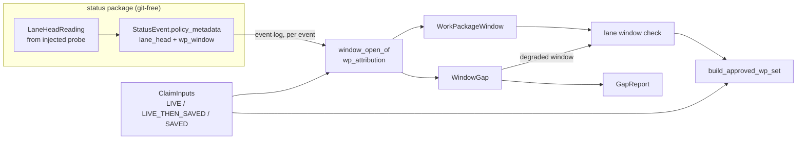

# Data Model: Consolidation window provenance

**Mission**: `consolidation-window-provenance-01M6Y84D` · **Phase**: 1 · **Date**: 2026-11-08
Terms follow the spec's Domain Language table. The wire contract for the event key is in [`contracts/status-event-wp-window.md`](contracts/status-event-wp-window.md). The names below are design names. An implementer may change spelling, but must keep the meaning, the invariants and the shapes.



## 1. `LaneHeadReading` (status package, value object)

What the injected probe observed for one work package at one transition. It replaces the probe's bare `str | None` return. `probe_lane_head` remains as a thin `sha`-only adapter.

| Field | Type | Meaning |
|---|---|---|
| `sha` | `str \| None` | 40-hex lane head (`single_branch` with a minted Mission branch: that branch's head). |
| `applicable` | `bool` | `False` for a planning lane, a work package not in `lanes.json`, or no `lanes.json`. Nothing is windowed then. |
| `cause` | `CaptureCause \| None` | Set exactly when `applicable` and `sha is None`. |
| `detail` | `str` | Short human text (branch name, git stderr head). Empty when `sha` is set. |

`CaptureCause` (closed set): `lane_branch_missing`, `git_error`, `probe_error`.

**Invariants**: exactly one of {`sha` set; `applicable is False`; `cause` set}. The probe never raises (C-1). Taking the reading is the only git access per move (NFR-006). The reading is defined at `status/lane_head.py` top level, with no import of `mission_runtime`, `specify_cli.lanes` or `core.git_ops` (cold-import boundary).

## 2. `wp_window` policy-metadata key (event payload extension)

Written by `transition_pipeline._stamped_policy_metadata` from the reading.

| Condition on the transition | `lane_head` | `wp_window` |
|---|---|---|
| any move, reading has `sha` | `sha` (unchanged behaviour) | — |
| non-migration move **into `claimed` or `in_progress`**, reading has `sha` | `sha` | `{"schema_version": 1, "open_sha": sha}` |
| same move, reading `applicable` with `cause` | absent (unchanged) | `{"schema_version": 1, "gap": {"reason": "capture_failed", "cause": <cause>, "detail": <detail>}}` |
| same move, reading not applicable | absent | absent |
| migration actor (`migration:` prefix) | unchanged | **never written** |
| any other `to_lane` (incl. `blocked`) | unchanged | absent |

**Invariants**
- `WP-1`: on the same event, `wp_window.open_sha` equals `lane_head` (one reading).
- `WP-2`: `open_sha` and `gap` are mutually exclusive, and exactly one is present.
- `WP-3`: the key is additive. No existing key changes value or presence, and an event that does not qualify is byte-identical to today.
- `WP-4`: the move is never refused or delayed by the key (NFR-006).
- `WP-5`: `open_sha` is branch-relative provenance, valid for one consolidation attempt (ADR `2026-11-07-1-dossier-commit-shas-are-branch-relative-provenance`), and classified `BRANCH_RELATIVE` in `DOSSIER_SHA_FIELDS`.

## 3. `WindowOpen` / `WindowGap` (consolidation, reader result)

`window_open_of(events, wp_id, *, on_lane: Callable[[str], bool]) -> WindowOpen | WindowGap`, in `consolidation/wp_attribution.py`, the one home of the window rules.

**Reader rule**: find the work package's **first** non-migration event with `to_lane ∈ {claimed, in_progress}`. Later entries are never consulted: a recorded rework must not stand in for an unrecorded first claim.

| Outcome | When |
|---|---|
| `WindowGap(reason=NOT_RECORDED)` | That event has no `wp_window` key (written before the upgrade, or by a writer that drops it). Also when the work package never entered `claimed` / `in_progress` but is approved (forced path). |
| `WindowGap(reason=CAPTURE_FAILED, cause, detail)` | The key carries `gap`. |
| `WindowGap(reason=NOT_ON_LANE, sha)` | The key carries `open_sha`, but `on_lane(sha)` is false (rewritten lane). |
| `WindowOpen(sha)` | The key carries `open_sha` and it is on the lane. |
| `WindowGap(reason=NOT_RECORDED)` + malformed note | The key exists but violates the contract (unknown `schema_version`, both or neither branch, non-hex SHA). The value is treated as absent; never trusted, never fatal. |

`WindowGapReason` (closed enum): `NOT_RECORDED`, `CAPTURE_FAILED`, `NOT_ON_LANE`. These are the gap report's reason strings "not recorded", "capture failed", "not on lane".

`on_lane` is supplied by the caller from `ClaimInputs` (the frozen lane tip), so the classifier performs no git read of its own.

## 4. `WorkPackageWindow` (consolidation, value object)

The span of lane history one approved work package is accountable for.

| Field | Type | Meaning |
|---|---|---|
| `wp_id` | `str` | Work package. |
| `lane_id` | `str` | Lane the work package is frozen to (ADR `2026-10-04-2-started-work-package-lane-membership-is-frozen`). |
| `open_edge` | `str` | Exclusive lower edge: the window-open SHA, or the **claim base** when degraded. |
| `approval_stamp` | `str` | Inclusive upper edge: the newest approval stamp (existing rule, `approved_bound.approval_stamp`). |
| `gap` | `WindowGap \| None` | `None` = judged by its recorded window; set = degraded (fallback), listed in the gap report. |

It generalises `write_branch_bound.ApprovalWindow` (`open_stamp: str | None`) to lanes. The degraded case is the same semantics, "opens at the claim base (A-8)".

**Lifecycle (per work package, read from the event log)**

```
(no window) --first non-migration move into claimed|in_progress--> OPENED(recorded | gap)
OPENED --approval (newest wins; rework keeps the first opening)--> CLOSED at approval stamp
blocked before any opening: opens nothing (approval-window opener rule)
migration events: never open, never close
approved -> done restamp: never read
```

**Invariants**
- `WW-1`: commits covered = `reach(approval_stamp) − reach(open_edge)`, both relative to the claim base. That is 2 history queries per window (NFR-007).
- `WW-2`: a lane commit is refused with `LANE_MOVED_AFTER_APPROVAL` iff it is in none of the lane's covered sets and in none of the existing exempt anchors (dependency-lane tips, target base, other lanes' approval stamps). The refusal names the commit and the work package approved before it (`write_branch_bound._preceding_wp`).
- `WW-3`: if every window on a lane is degraded, the union of covered sets equals today's approval-stamp bound, so the verdict equals today's (US3-1, US3-2).
- `WW-4`: a missing approval stamp is not a window gap. `APPROVAL_STAMP_MISSING` / `APPROVAL_STAMP_NOT_ON_LANE` keep their meaning and remedies (C-010).
- `WW-5`: planning lanes and canceled work packages get no `WorkPackageWindow`. Canceled work packages keep the mixed-lane rules (variant "canceled-content windows").

## 5. `GapReport` (consolidation output)

| Field | Type | Meaning |
|---|---|---|
| `entries` | `tuple[GapEntry, ...]` | One per approved work package judged by the fallback, sorted by `(lane_id, wp_id)`. |

`GapEntry`: `wp_id`, `lane_id`, `reason` (`not recorded` / `capture failed` / `not on lane`), `cause` (only for capture failed), `detail`.

**Surfaces**: fresh run, resume and forecast. Human output is one block, "Window gaps (judged by the approval-stamp bound)", with one line per entry. JSON output has `window_gaps: [ {wp_id, lane_id, reason, cause?, detail?} ]` in the dry-run payload and in consolidate's JSON output. `orchestrator-api` envelope: unchanged (spec Assumption). `single_branch` Missions list work packages whose opening is not recorded, although their verdict comes from today's derived window (spec Assumption).

The report rides on the claim as an additive, defaulted field of `ApprovedWpCommitSet` (`window_gaps: tuple[GapEntry, ...] = ()`), appended last so positional construction is unaffected. The claim stays one type (C-006).

## 6. `ClaimInputs` (consolidation, value object)

One value per run, built by one constructor. It is consumed by claim building and by the gate.

| Field | Type | `LIVE` (forecast) | `LIVE_THEN_SAVED` (fresh run) | `SAVED` (resume) |
|---|---|---|---|---|
| `source` | `ClaimInputSource` | `LIVE` | `LIVE_THEN_SAVED` | `SAVED` |
| `target_base` | `str \| None` | live target tip | live target tip, saved as `pre_mutation_target_sha` | `pre_mutation_target_sha` |
| `coord_base` | `str` | live `mission_branch` (Phase 2: today's quirk kept) | live coordination tip, saved as `pre_mutation_coord_sha` | `pre_mutation_coord_sha` (fail-closed anchor checks first) |
| `lane_tips` | `Mapping[str, str]` | live lane tips | live, saved as `pre_interrupt_lane_tips` | `pre_interrupt_lane_tips` (CAS-checked, `lane_tip_cas_ok`) |
| `dependency_anchors` | `Mapping[str, tuple[str, ...]]` | live dependency-lane tips | live, saved (via `lane_tips`) | frozen from `lane_tips`; read by the closed world from Phase 4 (FR-015) |
| `dependency_refs` / `dependency_pins` | `tuple[str, ...]` / `Mapping[str, str]` | declared + recorded | declared, pinned once | `dependency_ref_pins` |
| `excluded_canceled_wp_ids` | `frozenset[str]` | **empty (Phase 2 quirk)** → fresh-run derivation (Phase 4, FR-013) | `run.excluded_canceled_wp_ids` | saved |
| `strategy` | `str` | requested | requested, saved | `ConsolidationState.strategy` |
| `status_dir` | `Path` | `_forecast_claim_status_dir` | `run.feature_dir` | `run.feature_dir` |

**Invariants**
- `CI-1`: one constructor, with one small resolver per source (each ≤ 15 complexity). No call site assembles claim inputs itself.
- `CI-2`: on an unmutated state, `LIVE` and `LIVE_THEN_SAVED` produce field-equal values except `source`, once Phase 4 aligns the excluded set (FR-013). Until then the inequality is pinned as a strict `xfail`.
- `CI-3`: `SAVED` never falls back to a live read for a value it has saved. A missing saved value keeps today's behaviour; the dependency anchors of a pre-upgrade record are named in the ADR as a degraded anchor.
- `CI-4`: `ClaimInputs` is run-level provenance (`state.json` tier). It never writes to the event log and never touches the rollback snapshot (C-009).

## 7. Relationships

- A Mission has many lanes; a lane has many work packages (frozen membership); an approved work package on a code lane has exactly one `WorkPackageWindow` per consolidation attempt.
- A `WorkPackageWindow` is derived from: the event log (`wp_window`, approval stamp) + `ClaimInputs` (claim base, frozen lane tip for `on_lane`).
- A `GapEntry` exists iff its work package's `WorkPackageWindow.gap` is set.
