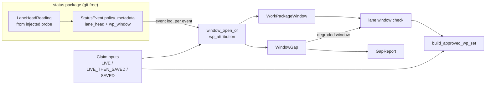

# Data Model: Consolidation window provenance

**Mission**: `consolidation-window-provenance-01M6Y84D` · **Phase**: 1 · **Date**: 2026-11-08
Terms follow the spec's Domain Language table. The wire contract for the event key is in [`contracts/status-event-wp-window.md`](contracts/status-event-wp-window.md). The names below are design names. An implementer may change spelling, but must keep the meaning, the invariants and the shapes.



## 1. `LaneHeadReading` (status package, value object)

What the injected probe observed for one work package at one transition. It replaces the probe's bare `str | None` return. `probe_lane_head` remains as a thin `sha`-only adapter.

| Field | Type | Meaning |
|---|---|---|
| `sha` | `str \| None` | 40-hex lane head (`single_branch` with a minted Mission branch: that branch's head). |
| `applicable` | `bool` | `False` for a planning lane, a work package not in `lanes.json`, or no `lanes.json`. Nothing is windowed then. |
| `cause` | `CaptureCause \| None` | Set exactly when `applicable` and `sha is None`. |
| `detail` | `str` | Short human text (branch name, git stderr head). Empty when `sha` is set. |

`CaptureCause` (closed set): `lane_branch_missing`, `git_error`, `probe_error`. The writer maps `lane_branch_missing` to its own gap reason on the event (§2), not to `capture_failed`, because a missing lane branch is the normal state before `implement` creates the lane (`lane_head.py:150-158`).

**Invariants**: exactly one of {`sha` set; `applicable is False`; `cause` set}. The probe never raises (C-1). Taking the reading is the only git access per move (NFR-006). The reading is defined at `status/lane_head.py` top level, with no import of `mission_runtime`, `specify_cli.lanes` or `core.git_ops` (cold-import boundary).

## 2. `wp_window` policy-metadata key (event payload extension)

Written by `transition_pipeline._stamped_policy_metadata` from the reading.

| Condition on the transition | `lane_head` | `wp_window` |
|---|---|---|
| any move, reading has `sha` | `sha` (unchanged behaviour) | — |
| non-migration move **into `claimed` or `in_progress`**, reading has `sha` | `sha` | `{"schema_version": 1, "open_sha": sha}` |
| same move, reading `applicable` with `cause = lane_branch_missing` | absent (unchanged) | `{"schema_version": 1, "gap": {"reason": "lane_branch_missing", "detail": <detail>}}` |
| same move, reading `applicable` with `cause ∈ {git_error, probe_error}` | absent (unchanged) | `{"schema_version": 1, "gap": {"reason": "capture_failed", "cause": <cause>, "detail": <detail>}}` |
| same move, reading not applicable | absent | absent |
| migration actor (`migration:` prefix) | unchanged | **never written** |
| any other `to_lane` (incl. `blocked`) | unchanged | absent |

**Invariants**
- `WP-1`: on the same event, `wp_window.open_sha` equals `lane_head` (one reading).
- `WP-2`: `open_sha` and `gap` are mutually exclusive, and exactly one is present.
- `WP-3`: the key is additive. No existing key changes value or presence, and an event that does not qualify is byte-identical to today.
- `WP-4`: the move is never refused or delayed by the key (NFR-006).
- `WP-5`: `open_sha` is branch-relative provenance, valid for one consolidation attempt (ADR `2026-11-07-1-dossier-commit-shas-are-branch-relative-provenance`), and classified `BRANCH_RELATIVE` in `DOSSIER_SHA_FIELDS`.

## 3. `WindowOpen` / `WindowGap` (consolidation, reader result)

`window_open_of(events, wp_id, *, on_lane: Callable[[str], bool], is_ancestor: Callable[[str, str], bool]) -> WindowOpen | WindowGap`, in `consolidation/wp_attribution.py`, the one home of the window rules. Both predicates are bound by the caller to the **one** lane tip the approved bound resolves for that lane (FR-022), on every path: claim, forecast, resume, gate rebuild and `approved_bound_refusal`. The classifier performs no git read.

**Window opener (FR-021, operator ruling `01M6YAG16WDVMM37HCJCHAC5YW`)**, computed by the shared selector `window_opener_events(events, wp_id, *, cycle=True)`:

1. **Cycle start.** Ignore migration events. The cycle starts after the work package's last move with `to_lane == planned` whose `from_lane` is **not** a review lane (`for_review`, `in_review`, `approved`, `done`); the genesis seed counts. A review rejection to `planned` is rework and does not start a cycle (interpretation recorded in the spec Assumptions). The boundary is found in event-log order (`read_events`).
2. **Candidates.** The cycle's non-migration events with `to_lane ∈ {claimed, in_progress}`, in event-log order. `blocked` is never a candidate.
3. **Skip.** Drop leading candidates whose `wp_window.gap.reason == lane_branch_missing` (they prove no lane commit existed at that instant).
4. **Bind.** If the first remaining candidate carries no usable value (no key, `capture_failed`, malformed), the result is that gap: an unrecorded opener is never replaced by a later recorded one. Otherwise, among the remaining candidates carrying `open_sha`, choose the one whose SHA `is_ancestor` of every other's (topology order); when the SHAs do not form such a chain, choose the first in event-log order. SHA-less candidates after a SHA-bearing one are ignored.
5. **No candidate left** after a skip → `WindowGap(LANE_BRANCH_MISSING)`; no candidate at all → `WindowGap(NOT_RECORDED)`.

`cycle=False` is today's first-claim rule (first non-migration candidate ever, no skip, log order); `approval_window_open_stamp` keeps it for the `single_branch` derivation when no window is recorded (FR-011), so the opener rule lives in one selector.

| Outcome | When |
|---|---|
| `WindowGap(reason=NOT_RECORDED)` | The bound opener has no `wp_window` key (written before the upgrade, or by a writer that drops it). Also when the work package never entered `claimed` / `in_progress` but is approved (forced path). |
| `WindowGap(reason=CAPTURE_FAILED, cause, detail)` | The bound opener's key carries `gap.reason == capture_failed`. |
| `WindowGap(reason=LANE_BRANCH_MISSING, detail)` | Every candidate of the cycle recorded `gap.reason == lane_branch_missing`. |
| `WindowGap(reason=NOT_ON_LANE, sha)` | The bound opener carries `open_sha`, but `on_lane(sha)` is false: not an ancestor of the lane tip (rewritten lane) **or not resolvable in this clone** (another clone, garbage-collected). Never a probe error (FR-022). |
| `WindowOpen(sha)` | The key carries `open_sha` and it is on the lane. |
| `WindowGap(reason=NOT_RECORDED)` + malformed note | The key exists but violates the contract (unknown `schema_version`, both or neither branch, non-hex SHA). The value is treated as absent; never trusted, never fatal. |

`WindowGapReason` (closed enum): `NOT_RECORDED`, `CAPTURE_FAILED`, `LANE_BRANCH_MISSING`, `NOT_ON_LANE`. These are the gap report's reason strings "not recorded", "capture failed", "lane branch missing", "not on lane".

`on_lane(sha)` = `resolves(sha) and is_ancestor(sha, lane_tip)` (`approved_bound.resolves_commit` for the first part), with `lane_tip` the one tip the bound resolved (`ClaimInputs.lane_tips` on a resume).

## 4. `WorkPackageWindow` (consolidation, value object)

The span of lane history one approved work package is accountable for.

| Field | Type | Meaning |
|---|---|---|
| `wp_id` | `str` | Work package. |
| `lane_id` | `str` | Lane the work package is frozen to (ADR `2026-10-04-2-started-work-package-lane-membership-is-frozen`). |
| `open_edge` | `str` | Exclusive lower edge: the window-open SHA, or the **claim base** when degraded. |
| `approval_stamp` | `str` | Inclusive upper edge: the newest approval stamp (existing rule, `approved_bound.approval_stamp`). |
| `gap` | `WindowGap \| None` | `None` = judged by its recorded window; set = degraded (fallback), listed in the gap report. |

It generalises `write_branch_bound.ApprovalWindow` (`open_stamp: str | None`) to lanes. The degraded case is the same semantics, "opens at the claim base (A-8)".

**Lifecycle (per work package, read from the event log)**

```
(no window) --window opener (FR-021) of the current cycle--> OPENED(recorded | gap)
OPENED --approval (newest wins; review rework keeps the opening)--> CLOSED at approval stamp
any state --move to planned from a non-review lane (rewind)--> new cycle: (no window)
review rejection to planned or in_progress: rework, same cycle
leading lane_branch_missing openers: skipped
blocked before any opening: opens nothing (approval-window opener rule)
migration events: never open, never close, never start a cycle
approved -> done restamp: never read
```

**Invariants**
- `WW-1`: commits covered = `reach(approval_stamp) − reach(open_edge)`, both relative to the claim base. The cost budget is O(windows + exemption anchors) history queries plus a constant per refused commit; the exempt set is computed once per lane and shared by tier 1 (stamp check) and tier 2 (window check) (NFR-007).
- `WW-2`: on a lane with at least one `WindowOpen`, the order is today's: `stamp_refusal` first (`APPROVAL_STAMP_MISSING` / `APPROVAL_STAMP_NOT_ON_LANE`); then a lane commit is refused with `LANE_MOVED_AFTER_APPROVAL` iff it is in none of the lane's covered sets and in none of the **exemption anchors**, after `content_commits` drops merges and bookkeeping-only commits exactly as today. The refusal names the commit and the work package approved before it (`write_branch_bound._preceding_wp`).
- `WW-2a` (exemption anchors, operator ruling `01M6YAFYHT0RMVZB03THW1WWSE`): the closed-world anchors (dependency-lane tips of lanes not fully canceled, target pre-consolidation tip) plus the approval stamps of **other** bounded lanes. The lane's own approval stamps are **not** anchors on the window path (`reconciliation.py:2254-2268` passes them today; the windows replace them). Consequence, accepted by the ruling: a commit on lane A that a dependent lane B merged before B's approval is exempt on A (dependency-chain exception, pinned by a fixture).
- `WW-3`: if every approved work package on a lane has a gap, the lane is judged by today's `check_lane` unchanged, with today's anchors (own stamps included), so the verdict **and** refusal text equal today's by construction (FR-023, US3-1, US3-2, US3-5). Set equality alone is not enough, because today's `BoundRefusal` lists all approved work packages while the window refusal names one.
- `WW-4`: a missing approval stamp is not a window gap. `APPROVAL_STAMP_MISSING` / `APPROVAL_STAMP_NOT_ON_LANE` keep their meaning and remedies (C-010).
- `WW-5`: planning lanes and canceled work packages get no `WorkPackageWindow`. Canceled work packages keep the mixed-lane rules (variant "canceled-content windows").
- `WW-6` (named residual): two work packages claimed in parallel on one lane, or one claimed early and parked without returning to `planned`, open early; the window also covers the other work package's commits and any stray commit between. Pinned as a strict `xfail` and named in the ADR.
- `WW-7` (mixed lane, weaker check): a gap work package's degraded window `(claim base, stamp]` covers a stray commit between an earlier recorded work package's approval and its own opening; the run passes and the gap report names it (US3-4). A gap work package **followed** by a recorded one with a stray between them is newly refused (NFR-002 (a)).

## 5. `GapReport` (consolidation output)

| Field | Type | Meaning |
|---|---|---|
| `entries` | `tuple[GapEntry, ...]` | One per approved work package judged by the fallback, sorted by `(lane_id, wp_id)`. |

`GapEntry`: `wp_id`, `lane_id`, `reason` (`not recorded` / `capture failed` / `lane branch missing` / `not on lane`), `cause` (only for capture failed), `detail`.

**Surfaces**: fresh run, resume and forecast. Human output is one block, "Window gaps (judged by the approval-stamp bound)", with one line per entry. JSON output has `window_gaps: [ {wp_id, lane_id, reason, cause?, detail?} ]` in the dry-run payload and in consolidate's JSON output. `orchestrator-api` envelope: unchanged (spec Assumption). `single_branch` Missions list work packages whose opening is not recorded, although their verdict comes from today's derived window (spec Assumption).

The report rides on the claim as an additive, defaulted field of `ApprovedWpCommitSet` (`window_gaps: tuple[GapEntry, ...] = ()`), appended last so positional construction is unaffected. The claim stays one type (C-006).

## 6. `ClaimInputs` (consolidation, value object)

One value per run, built by one constructor. It is consumed by claim building and by the gate.

| Field | Type | `LIVE` (forecast) | `LIVE_THEN_SAVED` (fresh run) | `SAVED` (resume) |
|---|---|---|---|---|
| `source` | `ClaimInputSource` | `LIVE` | `LIVE_THEN_SAVED` | `SAVED` |
| `target_base` | `str \| None` | live target tip | live target tip, saved as `pre_mutation_target_sha` | `pre_mutation_target_sha` |
| `coord_base` | `str` | live `mission_branch` name (Phase 2: today's quirk kept) → resolved SHA (Phase 4, IC-16) | live coordination tip, saved as `pre_mutation_coord_sha` | `pre_mutation_coord_sha` (fail-closed anchor checks first) |
| `lane_tips` | `Mapping[str, str]` | live lane tips | live, saved as `pre_interrupt_lane_tips` | `pre_interrupt_lane_tips` (CAS-checked, `lane_tip_cas_ok`) |
| `dependency_anchors` | `Mapping[str, str]` (created dependency-lane branch -> tip SHA, the key space of `pre_interrupt_lane_tips`) | live dependency-lane tips | live, saved (via `lane_tips`) | frozen from `lane_tips`; from Phase 4 the **one** anchor set read by all four consumers: mixed-lane resolver, approved bound, fully-canceled lane, attestation (FR-015) |
| `dependency_refs` / `dependency_pins` | `tuple[str, ...]` / `Mapping[str, str]` | declared + recorded | declared, pinned once | `dependency_ref_pins` |
| `excluded_canceled_wp_ids` | `frozenset[str]` | **empty (Phase 2 quirk)** → the fresh run's derivation, `acceptably_canceled_wp_ids` (Phase 4, FR-013) | `run.excluded_canceled_wp_ids` | recomputed each run from the event log (not persisted in `state.json`; the current excluded set, also used to filter dependency lanes) |
| `strategy` | `str` | requested | requested, saved | `ConsolidationState.strategy` |
| `status_dir` | `Path` | the status read door (`_forecast_claim_status_dir`, `resolve_status_read`); equal to the fresh run's write accessor on every topology the corpus builds, so Phase 4 kept it (WP17). Residual: before the first status seed the door falls back to the write checkout (strict `xfail` `test_pre_seed_forecast_status_dir_and_coord_base_equal_fresh_run`) | `run.feature_dir` | `run.feature_dir` |

**Invariants**
- `CI-1`: one constructor, with one small resolver per source (each ≤ 15 complexity). No call site assembles claim inputs itself.
- `CI-2`: on an unmutated state, `LIVE` and `LIVE_THEN_SAVED` produce field-equal values except `source`, once Phase 4 aligns the excluded set and the coordination base (FR-013); the status directory already matched, except before the first status seed (a named residual). Equality compares refs by resolved SHA and `status_dir` by resolved path and event-log digest. Until then each remaining inequality is its own strict `xfail`.
- `CI-3`: `SAVED` never falls back to a live read for a value it has saved. A missing saved value keeps today's behaviour. Degraded anchors (named in the ADR): a pre-upgrade record; a record whose status surface did not resolve at capture (no tips frozen, H5 off). After a full-restore re-baseline (#6770) the next run captures afresh by design.
- `CI-5`: the approved-reviewed attestation check reads `dependency_anchors` from the run's `ClaimInputs` when one exists (`SAVED` on a resume); on a fresh run it reads live tips, which are the values the claim freezes on an unmutated state.
- `CI-4`: `ClaimInputs` is run-level provenance (`state.json` tier). It never writes to the event log and never touches the rollback snapshot (C-009).

## 7. Relationships

- A Mission has many lanes; a lane has many work packages (frozen membership); an approved work package on a code lane has exactly one `WorkPackageWindow` per consolidation attempt.
- A `WorkPackageWindow` is derived from: the event log (`wp_window`, approval stamp) + `ClaimInputs` (claim base, frozen lane tip for `on_lane`).
- A `GapEntry` exists iff its work package's `WorkPackageWindow.gap` is set.
