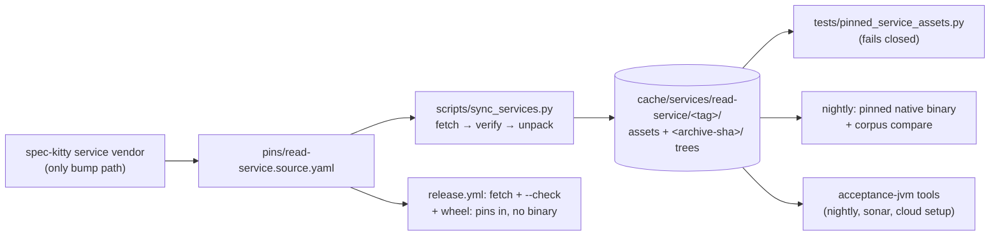

# Implementation Plan: Events service cut-over in core

**Branch**: `issue-6915-events-service-cutover` | **Date**: 2026-11-01 | **Spec**: [spec.md](spec.md)
**Input**: Mission specification from `kitty-specs/events-service-cutover-01M6B0AE/spec.md`; code grounding in [research/code-grounding.md](research/code-grounding.md).

## Summary

Pin spec-kitty-events `service-v0.1.0-rc.1` as `pins/read-service.source.yaml` through `spec-kitty service vendor`, teach the existing fetch tooling (`scripts/sync_services.py`) two small things (fetch the extras only; unpack a verified extras archive and report its path), point every conformance, golden, oracle and acceptance-jvm consumer at those pinned assets, wire the sync-services action into the CI jobs that need them (plus a nightly corpus compare on the pinned native binary and a release pin check), then delete `services/`, the moving `contracts/` tree, the three workflows, the freeze gate and every configuration and test entry that existed only for them.

## Engineering Alignment

Brief-derived (non-interactive dispatch; the operator brief answers the planning questions):
- **Riskiest scenario:** a conformance test silently skipping, or silently reading a stale tree, after the copies are gone. Answer: one reader, digest-keyed extraction, fail closed with a remedy.
- **Invariant:** a pinned asset is read only after its archive bytes match the pin; extraction happens from the verified cache only; nothing writes outside the cache.
- **Lifecycle:** pin bump (vendor) → fetch/verify (sync-services) → unpack (sync-services) → read (tests/scripts/workflows). A pin bump changes the archive digest, so it changes the extraction directory; stale trees are never read.
- **No events:** the Mission adds no status event or produce-seam behaviour.

## Technical Context

**Language/Version**: Python 3.11+ (tests and scripts; CI uses 3.12), GitHub Actions YAML, GNU Make.
**Primary Dependencies**: existing only — `kernel.service_pin`, `kernel.service_artifacts`, `kernel.service_hosts`, `specify_cli.services.vendor`, stdlib `tarfile` (`filter="data"`), PyYAML, pytest. No dependency is added, upgraded or removed (supply-chain controls of `DIRECTIVE_051`: not triggered).
**Storage**: files — the pin YAML in `pins/`; the asset cache `${XDG_CACHE_HOME:-~/.cache}/spec-kitty/services/<service>/<tag>/`.
**Testing**: pytest. ATDD-first: a failing acceptance test per slice committed before its implementation. Targeted runs per the CLAUDE.md test policy.
**Target Platform**: Linux CI runners (ubuntu-24.04) for the conformance jobs and the nightly; developer hosts Linux/macOS/Windows for `make dev-setup` (extras only, platform-independent).
**Project Type**: single (repository-level infrastructure).
**Performance Goals**: development fetch ≤ 1 MB cold (NFR-002); conformance jobs pay a cache restore keyed on `pins/*.source.yaml`.
**Constraints**: wheel stays pure (NFR-001); read service CI-only (C-002); one bump path (C-001); no companion wheel (C-003); no events-side change (C-005).
**Scale/Scope**: ~110 referencing files; ~2,900 lines of build-pin tests and ~25 tool tests deleted; ~12 tests repointed; 3 workflows deleted, ~8 edited.

## Charter Check

| Charter rule | How the plan meets it |
|---|---|
| Single canonical authority | One owner for the events domain (spec-kitty-events); one bump path (`service vendor`); one fetch/unpack owner (`scripts/sync_services.py`); one test reader of pinned assets. |
| Architectural alignment / Shared Package Boundaries | Consumes the `service-v*` release as a pinned artifact (ADR `2026-10-29-1` D-3, D-6); the client side stays (D-7); no `kernel` growth (dead-symbol gate requires `src/` callers). |
| ATDD-first | Each slice opens with a red acceptance test: pin gate case + absence test + release-step test + wiring ratchet. |
| Gate discipline (SO #5) | The freeze gate is deleted per its own exit clause; every other gate is re-pointed; no allowlist grows; two shrink. |
| Canonical sources (SO #6) | Pin via `spec-kitty service vendor`; workflow uses the existing composite action; mission artifacts through the CLI. |
| Git/workflow (SO #7) | Topic branch, draft PR, operator merges; `consolidate` is local only. |
| Test policy / `NO_FULL_HEAVY_SUITES_IN_MISSION` | `make test-fast` + owning dirs + named gate files; no `make test-full`, no bare `tests/architectural/`. |
| Terminology canon | Mission, consolidate (local), "pinned asset" not "artifact"; no new "sync" vocabulary beyond existing target names. |
| Pre-existing failure rule | Any red unrelated to the diff is verified on `origin/main` and filed as an issue before being treated as baseline. |

No violations; Complexity Tracking is empty.

## Project Structure

### Documentation (this mission)

```
kitty-specs/events-service-cutover-01M6B0AE/
├── spec.md
├── plan.md
├── research.md            # decisions D-1..D-8
├── research/code-grounding.md
├── data-model.md          # pin, cache and extraction layout
├── quickstart.md          # maintainer walkthrough
├── contracts/sync-services-cli.md
└── tasks.md, tasks/       # /spec-kitty.tasks
```

### Source Code (repository root)

```
pins/read-service.source.yaml            # new (vendored)
scripts/sync_services.py                 # --extras-only, unpack, --extras-path
tests/pinned_service_assets.py           # the one test-side reader (fails closed)
tests/contract/_mission_status_*.py      # repointed constants
tests/contract/test_mission_*.py         # repointed constants
tests/glossary/test_torn_tail_repair_goldens.py
tests/architectural/test_scenario_contract.py
tests/ci/test_*                           # wiring/routing/fleet tests updated; build-pin tests deleted
scripts/ci/mission_status_corpus_compare.py   # --tools-root
scripts/ci/acceptance_jvm_gradle_pin_check.py # new thin wrapper over the pinned tool
.github/workflows/{ci-router,ci-nightly,module-tests?,sonar,release,ci-fleet-verdict}.yml
.github/actions/sync-services/action.yml # extras-only input
Makefile, pyproject.toml, NOTICE, .gitattributes, .github/CODEOWNERS, .github/ci-module-registry.yml
tests/release/ci_retirement_scrub.json
RELEASE_CHECKLIST.md, CLAUDE.md, AGENTS.md, .kittify/charter/charter.md, pins/README.md, docs/…
deleted: services/, contracts/{mission-status,mission-write,_shared,tools,lint,gradle,README.md,build.gradle,settings.gradle},
         .github/workflows/{mission-status-api,contracts,contracts-release}.yml,
         tests/architectural/test_events_import_frozen.py, scripts/ci/mission_status_gate_checks.py,
         tests/ci/test_{mission_status_api_build,mission_status_gate_checks,contracts_workflows,mission_status_routing}.py,
         tests/contract/test_<25 tools>.py, test_mission_status_examples.py, test_mission_status_contract_1_1.py
```

**Structure Decision**: no new package or module; the fetch tooling stays in `scripts/sync_services.py` (imports only `kernel`), the test reader is one module under `tests/`.

## Design



Alt text: the vendor command writes the pin; the fetch tooling verifies and unpacks the pinned assets into the cache; tests, the nightly compare, acceptance-jvm and the release workflow all read from that verified cache.

## Implementation Concern Map

### IC-01 — Pin and fetch tooling

- **Purpose**: vendor the read-service pin and give the fetch tooling the two capabilities its consumers need (extras-only, verified unpack + path query).
- **Relevant requirements**: FR-001, FR-002, FR-003, FR-008 (helper side), NFR-001, NFR-002, C-001, C-002
- **Affected surfaces**: `pins/read-service.source.yaml`, `scripts/sync_services.py`, `.github/actions/sync-services/action.yml`, `Makefile`, `tests/ci/test_sync_services.py`, `tests/ci/test_service_pins_gate.py`
- **Sequencing/depends-on**: none
- **Risks**: `vendor` refusal (stop and report); tar member safety (use `filter="data"` + explicit refusals); keep `--check` side-effect free.

### IC-02 — Repoint consumers at the pinned assets

- **Purpose**: every test and script that read `services/` or `contracts/` reads the pinned extras instead, failing closed when absent.
- **Relevant requirements**: FR-006, FR-007, FR-008, FR-010 (script side)
- **Affected surfaces**: `tests/pinned_service_assets.py` (new), `tests/contract/_mission_status_{conformance,artifact_goldens,payloads,detail}.py`, `tests/contract/test_mission_status_{conformance,artifact_goldens,payloads,detail,drift,ops,project,reality,artifacts}.py`, `test_mission_write_contract.py`, `tests/glossary/test_torn_tail_repair_goldens.py`, `tests/architectural/test_scenario_contract.py`, `scripts/ci/mission_status_corpus_compare.py`, `scripts/ci/acceptance_jvm_gradle_pin_check.py`
- **Sequencing/depends-on**: IC-01
- **Risks**: schema files read directly (`schemas/<X>.yaml`) and example files read by name must switch to schema-by-title and `examples` lists in the bundle; verify each test's assertion still means what it meant (raw `Project.yaml` at `test_mission_status_project.py:701`).

### IC-03 — CI wiring

- **Purpose**: the CI jobs that run the repointed suites fetch the pinned extras; the nightly compare runs on the pinned binary; acceptance-jvm jobs run the pinned tools; a pin gate verifies the pin online.
- **Relevant requirements**: FR-005, FR-009, FR-010
- **Affected surfaces**: `.github/workflows/ci-router.yml`, `ci-nightly.yml`, `module-tests.yml` (glossary torn-tail shard), `sonar.yml`, `scripts/dev/cloud-session-setup.sh`, `.github/ci-module-registry.yml`, `tests/release/ci_retirement_scrub.json`, `tests/ci/*` wiring tests
- **Sequencing/depends-on**: IC-01, IC-02
- **Risks**: router/registry tests pin job shapes and action-pinning rules; `ci-router.yml` is hot (35 commits/90 d) — rebase late.

### IC-04 — Remove the copies and their coupling

- **Purpose**: delete `services/`, the moving `contracts/` tree, the three workflows, the freeze gate, the build-pin and tool tests, and every entry that only served them.
- **Relevant requirements**: FR-011, FR-012, FR-013, C-004
- **Affected surfaces**: listed in research/code-grounding.md §1 and §4
- **Sequencing/depends-on**: IC-02, IC-03 (nothing may still read the copies)
- **Risks**: a missed reference (guarded by an acceptance test that greps workflows/config for `services/`); `test_gate_selection_authority` must stay non-vacuous (pins-only case).

### IC-05 — Release pin check

- **Purpose**: a release fetches and checks the service pins beside the packs check and proves the wheel holds pins and no binary.
- **Relevant requirements**: FR-014, FR-015, NFR-001
- **Affected surfaces**: `.github/workflows/release.yml`, `RELEASE_CHECKLIST.md`, a release-workflow test
- **Sequencing/depends-on**: IC-01
- **Risks**: textual overlap with PR #6949 (`release.yml`, checklist): keep the hunk to one step pair and one assertion.

### IC-06 — Governance and documentation pointers

- **Purpose**: guidance matches the code: core pins the read service, `services/` is gone, sources live in spec-kitty-events.
- **Relevant requirements**: FR-016, FR-017
- **Affected surfaces**: `CLAUDE.md`, `AGENTS.md`, `.kittify/charter/charter.md`, `pins/README.md`, `docs/plans/events-domain-move/plan.md`, `docs/development/reference/*`, `acceptance-jvm/README.md`, the ADR (only if its conventions call for a status note), `docs/changelog/CHANGELOG.md`
- **Sequencing/depends-on**: IC-04
- **Risks**: terminology guard; charter wins over this file (flag drift, do not silently pick).
