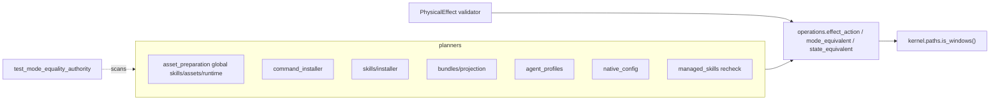

# Implementation Plan: Host-aware mode predicate for tool-surface planners

**Branch**: `kitty/mission-host-aware-mode-predicate-01M7X6B1` → `issue-4927-host-aware-mode-predicate` (PR to `main`) | **Date**: 2026-11-20 | **Spec**: [spec.md](spec.md)
**Input**: Mission specification from `kitty-specs/host-aware-mode-predicate-01M7X6B1/spec.md`

## Summary

On Windows, NTFS synthesizes modes: directories always read 0o777, and files read 0o666 when writable or 0o444 when read-only. `chmod` only toggles the read-only bit, and is a no-op on directories. Planners stamp fixed POSIX modes (0o755 / 0o644) and decide "chmod vs unchanged" with a raw `before.mode != after.mode`, so they re-plan a chmod that can never take effect.

The approach:
- Add ONE host-aware predicate beside `FileState` in `src/specify_cli/tool_surface/operations.py`. Every planner's action ladder and every observed-vs-planned recheck routes through it.
- Make the effect validator (`PhysicalEffect.__post_init__`) use the same action function, so planner and validator cannot disagree.
- Retire `windows_dir_mode_only_divergence`.
- Close the class with an AST ratchet gate (#4810).

## Technical Context

**Language/Version**: Python 3.11+ (repository floor; local venv 3.11.15)
**Primary Dependencies**: stdlib only (`os`, `stat`, `ast` for the gate); `kernel.paths.is_windows` host seam; pytest for tests
**Storage**: N/A (file-system node states only)
**Testing**: pytest. Red-first acceptance tests use a shared NTFS-emulation fixture (patches `os.stat`/`os.lstat`/`os.fstat`/`os.chmod`/`os.fchmod` and `kernel.paths.is_windows`), unit tests for the predicate on both hosts, and an AST architectural gate with self- and live-mutation controls.
**Target Platform**: Linux, macOS, Windows 10+ (Windows behaviour is emulated on Linux CI)
**Project Type**: single (CLI package `src/specify_cli`)
**Performance Goals**: the predicate is O(1) per comparison; no measurable startup regression (NFR-001: at most 5% median)
**Constraints**: host detection only via `kernel.paths.is_windows` read at call time (C-001); no new layer edge (C-002); POSIX comparisons stay exact
**Scale/Scope**: about 14 comparison sites in `skills/`, `tool_surface/` and `runtime/`, plus 1 campsite in `charter/activation/charter_yaml_io.py`; 1 new gate file; about 6 test modules touched

## Charter Check

- **Single canonical authority**: PASS. One predicate replaces the raw comparisons, the duplicate `_action` in `asset_preparation`, and the parallel relaxation `windows_dir_mode_only_divergence`, which is deleted rather than aliased.
- **Architectural alignment / layering**: PASS. The predicate lives in `specify_cli.tool_surface.operations`, which every planner already imports for `FileState`, and it imports `kernel.paths` (the root layer). The `charter` campsite imports only `kernel.paths`.
- **ATDD-first / red-first (C-011, C-004)**: PASS by plan. Each WP opens with a separate red commit.
- **Architectural gate discipline (Standing Order #5)**: PASS. The gate starts at its final, adjudicated size. Its exemptions are permanent classifications (observed-vs-observed guards, planned-vs-planned conflict checks), each with a rationale, not a draining debt allowlist, so no `_baselines.yaml` entry is needed (ADR `2026-09-30-1`: a gate with no draining allowlist needs no baseline). It has a stale-exemption check, a floor, and self- and live-mutation controls.
- **Campsite (Standing Order #2)**: `charter_yaml_io.py:222` uses inline `os.name`, so it moves to the seam. The gap in `test_os_detection_ban` (it does not catch the `!=` idiom) is filed as a follow-up, not widened here (locality).
- **No heavy suites**: PASS. Only targeted files and named gate files are run.
- **Terminology**: Mission, not Feature. "permission repair" / "chmod" are used consistently.

No violations; Complexity Tracking is empty.

## Project Structure

### Documentation (this mission)

```
kitty-specs/host-aware-mode-predicate-01M7X6B1/
├── spec.md
├── plan.md
├── research.md
├── data-model.md
├── quickstart.md
└── tasks/
```

No `contracts/`: the Mission defines no external interface (see `meta.json` `contracts: none`).

### Source Code (repository root)

```
src/specify_cli/tool_surface/operations.py        # predicate + effect_action + validator
src/specify_cli/runtime/asset_preparation.py      # delete local _action; use effect_action
src/specify_cli/skills/command_installer.py       # ladder -> effect_action; delete windows_dir_mode_only_divergence
src/specify_cli/skills/installer.py               # project ladder, command-parent receipts, apply-side symlink chmod
src/specify_cli/skills/manifest.py                # apply-side conditional chmod
src/specify_cli/tool_surface/providers/managed_skills.py
src/specify_cli/tool_surface/providers/agent_profiles.py
src/specify_cli/tool_surface/providers/native_config.py
src/specify_cli/tool_surface/bundles/projection.py
src/charter/activation/charter_yaml_io.py         # campsite: is_windows seam
tests/specify_cli/tool_surface/ntfs_emulation.py  # shared fixture (new)
tests/specify_cli/tool_surface/test_mode_equivalence.py (new)
tests/specify_cli/runtime/test_global_mode_convergence_windows.py (new)
tests/architectural/test_mode_equality_authority.py (new)
```

**Structure Decision**: single project; the predicate sits beside `FileState` (its only operand type) to avoid any new import edge.



## Implementation Concern Map

### IC-01 — Shared predicate and action authority

- **Purpose**: define `modes_equivalent`, `mode_equivalent`, `state_equivalent` and the public `effect_action`, and make the effect validator use them, so there is exactly one rule.
- **Relevant requirements**: FR-001, FR-002, FR-008 (validator only), NFR-001, C-001, C-002
- **Affected surfaces**: `tool_surface/operations.py`
- **Sequencing/depends-on**: none
- **Risks**: the host-aware validator raises on Windows for any remaining raw chmod planner, so IC-02 and IC-03 must land in the same release (they do: same Mission). There is a fallback (a tolerant validator) if review objects.

### IC-02 — Global planners converge (the reported leak)

- **Purpose**: make `runtime/asset_preparation.py` (global runtime, commands and skills, i.e. `global_bootstrap` and the startup sync) decide actions through IC-01.
- **Relevant requirements**: FR-002, FR-003, FR-004, FR-005 (global read-only drift), SC-001, SC-002, SC-004
- **Affected surfaces**: `runtime/asset_preparation.py`, the NTFS emulation fixture, new convergence tests
- **Sequencing/depends-on**: IC-01
- **Risks**: the emulation must cover the observers (`lstat`) and the writers (`chmod`, `fchmod`); `os.DirEntry.stat` is not patched (no planner uses it for modes).

### IC-03 — Project and provider planners, rechecks and latent sites

- **Purpose**: route the remaining observed-vs-planned decisions and rechecks through IC-01, and retire `windows_dir_mode_only_divergence`.
- **Relevant requirements**: FR-005, FR-006, FR-007, FR-009, FR-011, C-006
- **Affected surfaces**:
  - `skills/command_installer.py` (the `effect` ladder; the helper is deleted);
  - `skills/installer.py` (the project ladder, `_command_parent_receipts`, the symlink apply chmod);
  - `skills/manifest.py`;
  - `tool_surface/providers/managed_skills.py`;
  - `tool_surface/providers/agent_profiles.py` (`_sibling_created_planned_dir`);
  - `tool_surface/providers/native_config.py` (`_directory_postcondition_holds`);
  - `tool_surface/bundles/projection.py` (`_stage_effect`, the stamp substitutions in `_recheck_selected`, the finalize postcondition);
  - `charter/activation/charter_yaml_io.py`;
  - the re-pinned tests `test_managed_skills_host_aware.py` and `test_installer.py`.
- **Sequencing/depends-on**: IC-01
- **Risks**:
  - Project-skill semantics change: Windows file modes go from ignored to write-bit compared (disclosed in the changelog, C-006).
  - The projection stamp-substitution sites need the observed mode carried through when equivalent, so the existing `same_observation` stays exact for every other field.

### IC-04 — Ratchet gate

- **Purpose**: fail CI when any scanned planner decides mode equivalence outside IC-01.
- **Relevant requirements**: FR-010, NFR-004, SC-003
- **Affected surfaces**: `tests/architectural/test_mode_equality_authority.py`
- **Sequencing/depends-on**: IC-02, IC-03 (the gate is red until every site has moved; it lands last, starting empty of debt)
- **Risks**: the AST shapes may over-match; the exemption table plus the stale-entry check keep it honest.

### IC-05 — Changelog

- **Purpose**: record the Windows convergence fix and the project-skill semantic change.
- **Relevant requirements**: C-006
- **Affected surfaces**: `docs/changelog/unreleased/4927.fixed.md`
- **Sequencing/depends-on**: IC-03
- **Risks**: none.
