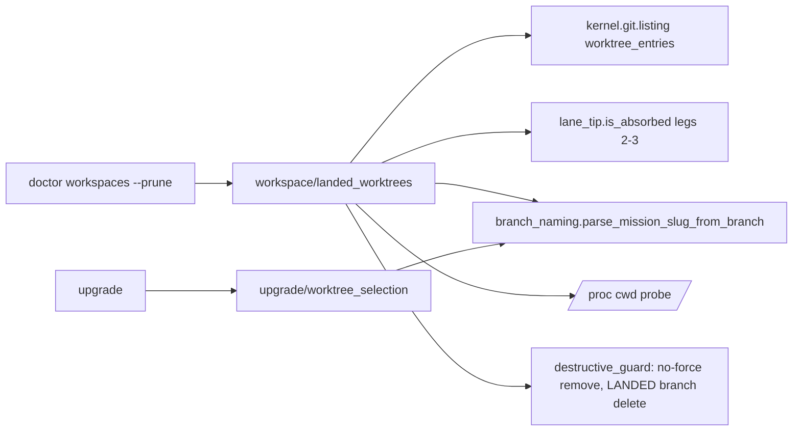

# Implementation Plan: Landed worktree cleanup and upgrade worktree scope

**Branch**: `issue-7173-landed-worktree-cleanup` | **Date**: 2026-11-04 | **Spec**: [spec.md](spec.md)
**Input**: Mission specification from `kitty-specs/landed-worktree-cleanup-01M6KZNP/spec.md`

## Summary

`spec-kitty doctor workspaces` gains a landed-worktree report and a `--prune` option. Every registered worktree gets a verdict from an offline proof that reuses the lane-tip absorption legs (ancestor, merge-tree no-op) against the local `origin/<primary>` ref, plus a clean check, a `/proc` running-process check and the Mission-ownership predicate. `--prune` removes only proven-landed worktrees through the destructive guard, which gains a no-force removal mode and a `LANDED` branch-delete intent that keeps the tip under `refs/spec-kitty/discarded/<branch>`. `spec-kitty upgrade` stops writing into non-Mission worktrees unless named with `--include-worktree <path>` or `--all-worktrees`, and names every worktree and its disposition in its normal preview and output. The landing runbook gains a removal step; the landing skill change goes upstream to `spec-kitty-open-packs`.

## Technical Context

**Language/Version**: Python 3.11+ (repository floor), git >= 2.38 for the merge-tree leg (fail closed below it)
**Primary Dependencies**: typer, rich (existing); no new dependency
**Storage**: git refs only (`refs/spec-kitty/discarded/<branch>` for a pruned branch whose commits exist nowhere else)
**Testing**: pytest; integration tests on real temporary git repositories (`git_repo` marker) for every safety case; unit tests for the porcelain parser, the verdict function and the disposition function; the existing architectural routing gate extended
**Target Platform**: Linux and macOS developer machines, Windows best-effort (process proof unavailable there and on macOS: report-only)
**Project Type**: single (CLI)
**Performance Goals**: report over 50 worktrees < 10 s (NFR-003)
**Constraints**: offline (no fetch, no hosted lookup, C-001); never `--force` (C-002); reuse the guard, `is_absorbed`, `NothingIsResidue` and the branch-naming authority (C-003)
**Scale/Scope**: ~6 source modules touched, 1 runbook, 1 upstream skill PR

### Engineering Alignment (confirmed through Decision Moments)

| Decision | Ruling |
|----------|--------|
| Cleanup location | Prune command + runbook/skill steps; post-consolidate report deferred |
| Command surface | `doctor workspaces --prune`; `--fix` keeps its husk-only contract |
| Upgrade default | Skip non-Mission worktrees; `--include-worktree <path>` (repeatable) and `--all-worktrees` |
| Landed proof | Offline only, against local `origin/<primary>` |
| Branch deletion | Yes, after the same proof |
| Process proof | `/proc/<pid>/cwd`; unavailable means report-only |
| Removal mode | Guard gains a no-force mode (plan.guard.worktree_remove_mode) |
| Unique-commit branches | New `LANDED` intent, tip kept under `refs/spec-kitty/discarded/` (plan.guard.landed_branch_delete) |

## Charter Check

| Principle / order | Status | Note |
|-------------------|--------|------|
| Single canonical authority | Pass | Removal and branch deletion stay in `git/destructive_guard.py`; absorption stays in `lanes/lane_tip.py`; Mission ownership stays in `lanes/branch_naming.py`; dirty predicate is the guard's |
| Architectural alignment | Pass | `kernel <- specify_cli` direction kept; the porcelain parser lands in `kernel/git/listing.py` (git plumbing only) |
| ATDD-first / red-first | Pass | Each WP starts from a failing acceptance test reproducing the spec scenario |
| No hosted surfaces | Pass | No remote contact; remote-contact gate unchanged |
| Destructive-op routing gate (no allowlist) | Pass with a pinned change | The `operator_intent` pin gains exactly one caller (the prune); no allowlist entry |
| Terminology | Pass | "Mission", never "feature"; "landed" defined in data-model.md |
| Packs edited upstream | Pass | Skill change authored in `spec-kitty-open-packs`; core only bumps the pin later |

No violations; Complexity Tracking not needed.

## Project Structure

### Documentation (this mission)

```
kitty-specs/landed-worktree-cleanup-01M6KZNP/
├── spec.md
├── plan.md
├── research.md
├── data-model.md
├── quickstart.md
├── contracts/
│   ├── doctor-workspaces-cli.md
│   └── upgrade-worktree-selection-cli.md
└── tasks/
```

### Source Code (repository root)

```
src/kernel/git/listing.py                         # + WorktreeEntry, parse_worktree_porcelain, worktree_entries
src/specify_cli/status/doctor_husks.py            # registered_worktree_paths routed through the parser (tidy-first)
src/specify_cli/git/destructive_guard.py          # + force=False removal mode, + LANDED_INTENT
src/specify_cli/workspace/landed_worktrees.py     # NEW: verdicts, process probe, prune orchestration
src/specify_cli/cli/commands/_landed_worktree_doctor.py  # NEW: report/prune rendering (+ --json)
src/specify_cli/cli/commands/doctor.py            # workspaces shell: --prune flag
src/specify_cli/upgrade/worktree_selection.py     # NEW: selection + dispositions
src/specify_cli/upgrade/runner.py                 # uses selection instead of _worktrees_to_upgrade
src/specify_cli/cli/commands/upgrade.py           # flags, preview/output rendering, plan JSON
tests/kernel/git/, tests/specify_cli/git/, tests/specify_cli/workspace/, tests/upgrade/, tests/architectural/test_destructive_op_routing.py
docs/development/how-to/pr-landing.md, docs/reference CLI pages, docs/changelog/unreleased/
```

**Structure Decision**: single project; new modules sit beside the authorities they reuse.



## Implementation Concern Map

### IC-01 — Worktree enumeration primitive (tidy-first)

- **Purpose**: One parser for `git worktree list --porcelain` (path, HEAD, branch, detached, locked, prunable, bare) instead of another hand-rolled one.
- **Relevant requirements**: FR-001, FR-012
- **Affected surfaces**: `src/kernel/git/listing.py`, `src/specify_cli/status/doctor_husks.py`
- **Sequencing/depends-on**: none
- **Risks**: Behaviour-preserving reroute of `registered_worktree_paths`; existing husk tests must stay green unchanged.

### IC-02 — Guard extensions

- **Purpose**: A no-force removal mode and a `LANDED` branch-delete intent that records the tip before deleting a branch whose commits exist nowhere else.
- **Relevant requirements**: FR-003, FR-004, NFR-001, C-002
- **Affected surfaces**: `src/specify_cli/git/destructive_guard.py`, `tests/architectural/test_destructive_op_routing.py`
- **Sequencing/depends-on**: none
- **Risks**: The routing gate pins intent callers; the new caller must be added to the pin in the same change, never via an allowlist.

### IC-03 — Landed-worktree assessment and prune

- **Purpose**: Compute each worktree's verdict offline and remove only proven-landed ones.
- **Relevant requirements**: FR-001..FR-006, FR-012, NFR-001..NFR-003, C-001, C-003, C-004
- **Affected surfaces**: `src/specify_cli/workspace/landed_worktrees.py`, `src/specify_cli/cli/commands/_landed_worktree_doctor.py`, `src/specify_cli/cli/commands/doctor.py`
- **Sequencing/depends-on**: IC-01, IC-02
- **Risks**: Data loss is the failure mode; every refusal case needs a test beside a landed positive control on the same fixture. Re-verify cleanliness and tip right before removal (TOCTOU).

### IC-04 — Upgrade worktree selection

- **Purpose**: Non-Mission worktrees are skipped unless opted in; every worktree is named with its disposition.
- **Relevant requirements**: FR-007..FR-010
- **Affected surfaces**: `src/specify_cli/upgrade/worktree_selection.py`, `src/specify_cli/upgrade/runner.py`, `src/specify_cli/cli/commands/upgrade.py`, `tests/upgrade/test_upgrade_worktree_commit.py`
- **Sequencing/depends-on**: none
- **Risks**: In-flight PRs #7094/#7116 touch `upgrade.py`; keep the diff local. Existing tests that relied on the old default must opt in explicitly.

### IC-05 — Documentation and changelog

- **Purpose**: The runbook owns removal; CLI reference documents `--prune` and the upgrade flags; changelog fragment.
- **Relevant requirements**: FR-011
- **Affected surfaces**: `docs/development/how-to/pr-landing.md`, CLI reference pages, `docs/changelog/unreleased/`
- **Sequencing/depends-on**: IC-03, IC-04
- **Risks**: The skill/procedure change is a separate open-packs PR, not part of this Mission's diff.
