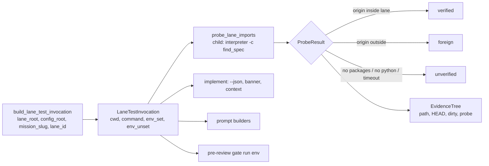
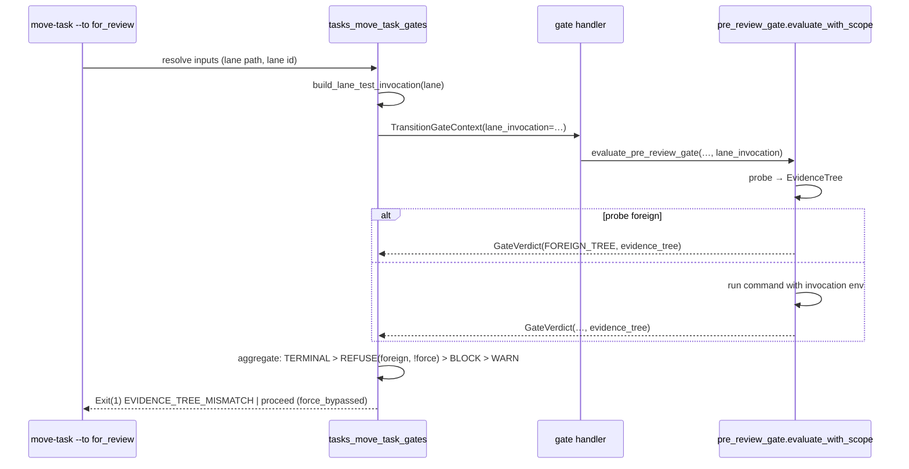

# Implementation Plan: Lane worktrees run and verify lane code

**Branch**: `kitty/mission-lane-code-verification-01M76AC0` (lands on `fix/7547-lane-code-verification`) | **Date**: 2026-11-12 | **Spec**: [spec.md](spec.md)
**Input**: Mission specification from `kitty-specs/lane-code-verification-01M76AC0/spec.md`

## Summary

One leaf module, `specify_cli.lanes.lane_invocation`, builds the **lane test invocation**
(working directory, declared `review.test_command`, environment) and **probes** it: a
child process started with exactly that working directory and environment reports where
the lane's top-level source packages would load from. `implement` prints, returns and
persists the invocation with its probe result; the core-owned implement and review prompt
builders state it; the pre-review gate runs its test command through the same invocation
(both the declared-command path and the WP override tier), records an **evidence tree**
(path, HEAD, dirty flag, probe) on every verdict, and returns a new `foreign_tree` outcome
that refuses the `for_review` move with `EVIDENCE_TREE_MISMATCH` unless `--force` is given.
Design rulings: decisions `01M7733YYK1615ERKAY41C2M7C` (block, `--force` bypasses) and
`01M7734HC608E8NG5FE016CSP9` (hybrid builder + probe).

## Technical Context

**Language/Version**: Python 3.11+
**Primary Dependencies**: typer, rich, ruamel.yaml (existing); `kernel.git` for git facts; no new dependency
**Storage**: files: the lane workspace context JSON (`.kittify/workspaces/…`) gains one optional key; `status.events.jsonl` `policy_metadata.pre_review_gate` gains `evidence_tree`
**Testing**: pytest; red-first tests through `spec-kitty implement` (CliRunner), `move-task --to for_review`, and the prompt builders; unit tests for the builder, probe and path containment; real `git worktree` fixtures plus a `python -m venv --without-pip` fixture for the repointed-install case
**Target Platform**: Linux, macOS, Windows 10+ (POSIX shell needed only where the gate already needs it)
**Project Type**: single (CLI)
**Performance Goals**: probe adds ≤ 2 s to `implement` on a typical project; probe timeout 15 s (NFR-001)
**Constraints**: no new config key (C-002); no `packs/` edit (C-001); git reads via `kernel.git`, no raw OS-detection idioms (C-007); evidence tree kept out of `scope_source_identity` (C-008); complexity ≤ 15 (NFR-003)
**Scale/Scope**: ~1 new module (~250 lines), edits in 7 existing modules, 1 ADR amendment, 1 changelog fragment

## Charter Check

| Charter rule | Status | Note |
|---|---|---|
| Single canonical authority | Pass | One builder serves implement, prompts and gate; `_UV_ENV_LEAK_KEYS` moves into it (no second strip list); `review.test_command` stays the only command authority. |
| Architectural alignment / layers | Pass | New module is a leaf in `specify_cli.lanes`; `review` importing `lanes` stays inside `specify_cli`; git via `kernel.git`. |
| ATDD-first / Standing Order 4 | Pass | Each slice opens with a red test through the existing entry point, committed before the fix; tidy-first enablers precede. |
| Standing Order 2 (campsite) | Pass | Enabler: lift the strip list into the new module and give `_run_raw_command` an explicit `env` parameter (behaviour-preserving). |
| Standing Order 5 (gates) | Pass | No new architectural gate or allowlist; the new outcome is pinned in `test_verdict_aggregation.py`. |
| Do not weaken the gate (C-003) | Pass | New refusal only adds; existing outcomes, skip path and baseline identity unchanged (FR-011 ratchet). |
| ADR governance | Action | Amend ADR `2026-08-13-6` in place (Amendment 2026-11-12): evidence-tree mismatch is a provenance refusal, `--force`-bypassable, distinct from pack-trust; carve-out from the "gate faults never refuse" rule applies only to a proven foreign tree. |
| Terminology canon | Pass | "Mission", "repository root checkout", "lane"; no `feature` aliases. |
| No full heavy suites | Pass | Targeted test dirs + named architectural gate files only. |

## Project Structure

### Documentation (this mission)

```
kitty-specs/lane-code-verification-01M76AC0/
├── spec.md, plan.md, research.md, data-model.md, quickstart.md
├── contracts/  (lane-test-invocation.md, pre-review-evidence-tree.md)
├── research/   (code-grounding.md, foldable-issues.md)
├── decisions/  traces/  checklists/
└── tasks.md, tasks/ (created by /spec-kitty.tasks)
```

### Source Code (repository root)

```
src/specify_cli/lanes/lane_invocation.py           NEW  builder, probe, evidence tree, path containment
src/specify_cli/lanes/implement_support.py         EDIT build + probe at allocation; result + context field
src/specify_cli/workspace/context.py               EDIT WorkspaceContext.lane_test_invocation (optional)
src/specify_cli/cli/commands/implement.py          EDIT --json key + banner block
src/specify_cli/cli/commands/agent/workflow_executor.py  EDIT prompt blocks (implement + review)
src/specify_cli/review/pre_review_gate.py          EDIT env parameter, probe before run, FOREIGN_TREE, evidence on verdict
src/specify_cli/review/verdict_aggregation.py      EDIT REFUSE tier (provenance), force-bypassable
src/specify_cli/review/gate_registry.py            EDIT TransitionGateContext.lane_invocation → handler
src/specify_cli/cli/commands/agent/tasks_move_task_gates.py  EDIT build invocation, metadata, refusal effect
docs/adr/3.x/2026-08-13-6-gate-outcomes-carry-severity-operator-strategy-decides-effect.md  EDIT amendment
docs/changelog/unreleased/<id>.fixed.md            NEW
tests/lanes/test_lane_invocation.py                NEW
tests/review/… , tests/specify_cli/cli/commands/… , tests/agent/…   NEW/EDIT targeted tests
```

## Design

### The invocation and probe (IC-01)



- `env_unset` = `PYTHONPATH`, `UV_PROJECT_ENVIRONMENT`, `VIRTUAL_ENV` (the list lifted from
  `pre_review_gate._UV_ENV_LEAK_KEYS`).
- `env_set` = `lane_test_env(mission_slug, lane_id)` when both are known, plus
  `PYTHONPATH=<lane>/src` when `<lane>/src` holds at least one top-level package
  (directory with `__init__.py`) and the lane has no `.venv` of its own.
- `command` = the declared `review.test_command` template read through
  `review.baseline._get_test_command(config_root)` (verbatim, `{output_file}` left for the
  gate to substitute); `None` when unset.
- Probe interpreter: `<lane>/.venv` interpreter when present, else the first `python3` /
  `python` on the invocation's `PATH`, else `sys.executable`. The child runs
  `-c` with `importlib.util.find_spec(name)` for each probed package (no module code
  executes), prints JSON `{name: origin}`, timeout 15 s. Packages probed: the top-level
  packages under `<lane>/src`. None → `unverified` ("no source-layout packages to probe").
- Containment: `origin_inside(origin, root)` compares `os.path.normcase(os.path.realpath(…))`
  forms with a path-segment boundary (NFR-004).

### Gate wiring (IC-03)



- `_run_raw_command(…, env=None)`: `None` keeps today's `_gate_run_env()` (baseline capture
  unchanged); the gate's head run passes `invocation.environ(_gate_run_env())`.
- `run_scoped_tests_at_head(…, env_override)` (override tier): same environment; the
  `sys.executable` fallback now inherits the lane `PYTHONPATH` and no redirect variables
  (#5985 item 2).
- `GateVerdict.evidence_tree: EvidenceTree | None`; recorded as
  `policy_metadata.pre_review_gate.evidence_tree`.
- `aggregate_verdicts`: new `AggregateDecision.REFUSE` for `FOREIGN_TREE` when not `force`;
  with `force` it proceeds and the effect records `force_bypassed: true`. Refusal renders
  "`EVIDENCE_TREE_MISMATCH`: the pre-review gate's run would load <pkg> from <origin>, outside
  <lane>" with the remedy, exit 1, `transition_applied: false`.
- Fail-open preserved: a probe that raises or times out is `unverified`, never `foreign`.

## Complexity Tracking

No charter violations.

## Implementation Concern Map

### IC-01 — Lane test invocation and probe

- **Purpose**: One builder and one probe that every surface shares, so "how to test this lane" and "which code that loads" are decided once.
- **Relevant requirements**: FR-002, FR-003, FR-004, FR-010, NFR-001, NFR-004, C-002, C-007
- **Affected surfaces**: `src/specify_cli/lanes/lane_invocation.py` (new), `src/specify_cli/review/pre_review_gate.py` (strip list moves; enabler)
- **Sequencing/depends-on**: none
- **Risks**: probe interpreter choice for consumer projects; Windows path forms; `find_spec` on namespace packages (handle `submodule_search_locations`).

### IC-02 — Implement and prompts carry the invocation

- **Purpose**: `implement` prints, returns and persists the invocation with its probe result, and the implement/review prompts state it.
- **Relevant requirements**: FR-001, FR-005, NFR-002
- **Affected surfaces**: `lanes/implement_support.py`, `workspace/context.py`, `cli/commands/implement.py`, `cli/commands/agent/workflow_executor.py`
- **Sequencing/depends-on**: IC-01
- **Risks**: open PR #7562 touches `implement_support.py` (`_claim_dirty_paths`); keep hunks away from it. `build_implement_prompt_lines` is at complexity 9: add via an extracted renderer. Implement CLI tests live in a nightly-only directory; run them explicitly.

### IC-03 — Gate runs through the invocation and refuses foreign evidence

- **Purpose**: The pre-review gate uses the same invocation on both paths, records the evidence tree, and refuses a proven foreign tree.
- **Relevant requirements**: FR-006, FR-007, FR-008, FR-009, FR-010, FR-011, C-003, C-004, C-008
- **Affected surfaces**: `review/pre_review_gate.py`, `review/verdict_aggregation.py`, `review/gate_registry.py`, `cli/commands/agent/tasks_move_task_gates.py`, ADR `2026-08-13-6`, `tests/review/test_verdict_aggregation.py`
- **Sequencing/depends-on**: IC-01
- **Risks**: existing gate tests that relied on inherited `PYTHONPATH` in the declared path; the new aggregation tier must keep TERMINAL precedence; JSON envelope of the refusal must keep `pre_review_gate` metadata shape plus the new key.

### IC-04 — Close-out: docs, changelog, follow-up issues

- **Purpose**: Changelog fragment, ADR amendment cross-links, and the two follow-up issues (orchestrator-api gate gap; lane packs).
- **Relevant requirements**: C-004, C-005
- **Affected surfaces**: `docs/changelog/unreleased/`, `docs/adr/3.x/…2026-08-13-6…`
- **Sequencing/depends-on**: IC-02, IC-03
- **Risks**: none.
