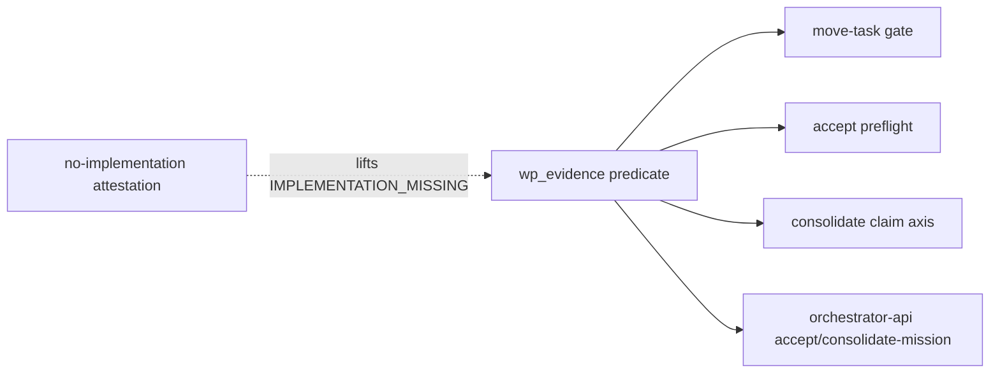

# Implementation Plan: Lane evidence and review independence

**Branch**: `issue-6715-lane-evidence-independence` | **Date**: 2026-10-27 | **Spec**: [spec.md](spec.md)
**Input**: Mission specification from `kitty-specs/lane-evidence-independence-01M5YHXF/spec.md`

## Summary

Issue #6715: on lanes and coordination Missions a claimed but never-implemented work package can
be self-approved, accepted and consolidated as `done` at exit 0. #5939 closed this for
single_branch only. This plan generalises the #5939 single_branch evidence + independence axis
into ONE topology-neutral predicate and applies it at every landing surface: `move-task`,
`accept`, `consolidate`, `orchestrator-api accept-mission` and `consolidate-mission`. An operator
attestation lifts only the missing-implementation refusal for a no-deliverable work package.
Root cause and red baseline: [research.md](research.md).

## Engineering Alignment (confirmed through the operator brief and decisions)

- **Evidence** = the tree diff of the WP's evidence window, restricted to its owned files and
  excluding bookkeeping paths, is non-empty. Code lane window: `planning_commit_sha..<lane
  branch>`. Planning lane and single_branch window: `planning_commit_sha..<landing branch>`
  (single_branch keeps its existing `planning_commit..mission_branch`). Unreadable range ⇒
  `IMPLEMENTATION_UNREADABLE`; no planning commit ⇒ `EVIDENCE_WINDOW_UNCOMPUTABLE`.
- **Independence** = `preflight._independent_reviewer_confirmed` unchanged (#5939 identity
  `tool:model:profile`; role ignored because it is lane-stamped). Strict at accept/consolidate
  (unknown identity refuses); at `move-task` the gate refuses only a positively-same identity on
  an unforced approval.
- **Force**: `move-task --force` bypasses evidence and independence at the move (decision
  `01M5YHYFRJPTE0SQ9V7SWGK26J`); accept and consolidate ignore force and `--lenient`.
- **Attestation**: `--attest-no-implementation <WP> --attest-reason "<why>"` on `accept` and
  `consolidate`; a forced operator self-transition with
  `policy_metadata.attestation = "no_implementation"`. It lifts `IMPLEMENTATION_MISSING` for that
  WP only; it is never an approval, an approval stamp or the approving actor.
- **Codes**: neutral codes for lanes/coord/planning lanes; single_branch keeps emitting the
  `SINGLE_BRANCH_*` codes, which are documented aliases (same meaning) and mapped through one
  alias table so tools can key on either.

## Technical Context

**Language/Version**: Python 3.11+
**Primary Dependencies**: typer, rich, ruamel.yaml (existing); git CLI via `kernel.git` /
`consolidation.git_probes`; no new dependency (supply-chain checks: not applicable, nothing added).
**Storage**: `status.events.jsonl` (append-only; attestation is a normal forced transition, no
schema change), `lanes.json` (`planning_commit_sha`, read only).
**Testing**: pytest; red-first CLI-driven integration fixtures modelled on
`tests/integration/test_5939_single_branch_autowalk_guards.py`; unit tests for the predicate and
attestation; Cucumber-JVM scenario under `tests/scenarios/mission/` on JDK 25.
**Target Platform**: Linux, macOS, Windows (pure git + Python).
**Project Type**: single project (CLI).
**Performance Goals**: ≤ 1 git tree diff per lane per command (NFR-001).
**Constraints**: `approved_bound` unchanged (C-001); no new event field (C-002); one predicate
(C-003); complexity ≤ 15; diff-cover ≥ 90%.
**Scale/Scope**: ~6 source modules touched, 1 new module, 1 ADR amendment.

## Charter Check

| Gate | Status |
|------|--------|
| Single canonical authority | PASS: one predicate module (`consolidation/wp_evidence.py`); single_branch helpers move into it instead of being copied |
| Architectural alignment | PASS: lives in `specify_cli.consolidation` (already imported by the CLI command layer and orchestrator-api); no layer rule changes |
| ATDD-first / red-first | PASS: each WP commits its failing CLI-level test first; baseline red recorded in research.md |
| Terminology canon | PASS: Mission, work package; no `feature` aliases; "routing"/"primary" not used bare |
| Test policy (`NO_FULL_HEAVY_SUITES_IN_MISSION`) | PASS: targeted dirs + `make test-fast` + named gate files only |
| Standing Order #5 (non-vacuous gate) | PASS: positive control on the same fixture for every refusal |
| Git discipline | PASS: topic branch, draft PR, operator merges |

Post-design re-check: PASS (no new authority, no new dependency, no layer move).

## Project Structure

### Documentation (this mission)

```
kitty-specs/lane-evidence-independence-01M5YHXF/
├── spec.md
├── plan.md
├── research.md
├── data-model.md
├── quickstart.md
├── contracts/refusal-codes.md
└── tasks.md            # /spec-kitty.tasks
```

### Source Code (repository root)

```
src/specify_cli/consolidation/wp_evidence.py          # NEW: shared predicate, codes, alias table
src/specify_cli/consolidation/reconciliation.py       # claim-builder axis generalised (lanes/coord/planning + single_branch)
src/specify_cli/consolidation/no_implementation_attestation.py  # NEW: validate + record attestation
src/specify_cli/consolidation/preflight.py            # attestation excluded from the approving-actor read
src/specify_cli/consolidation/executor.py             # record attestation before the claim; output note
src/specify_cli/cli/commands/consolidate.py           # --attest-no-implementation flag
src/specify_cli/cli/commands/accept.py                # preflight refusal + attestation flag
src/specify_cli/cli/commands/agent/tasks_move_task.py # move gate: evidence (all lanes) + independence
src/specify_cli/orchestrator_api/consolidation.py     # consolidate-mission + accept-mission refusals
docs/adr/4.x/2026-10-04-5-approval-stamp-bounds-the-approved-claim.md  # amendment
docs/changelog/CHANGELOG.md                           # [Unreleased]
tests/scenarios/mission/*.feature                     # FR-009
```

## Implementation Concern Map

| IC | Concern | Requirements |
|----|---------|--------------|
| IC-01 | Shared evidence + independence predicate and codes; consolidate claim axis; orchestrator-api refusals | FR-004, FR-005, FR-007, NFR-001, NFR-002, C-001..C-003 |
| IC-02 | No-implementation attestation (record, exclusions, consolidate output); accept preflight; move-task gate | FR-001, FR-002, FR-003, FR-006, C-004 |
| IC-03 | ADR amendment, changelog, scenario | FR-008, FR-009 |



## Risks

- **Fixture blast radius**: existing lanes/coord tests that claim and approve under one identity,
  or approve with no owned-file commit, will now refuse at accept/consolidate. Each such test is
  judged (DIRECTIVE_041): re-pin with a distinct reviewer / a real owned commit, never weaken the
  gate.
- **Legacy Missions without `planning_commit_sha`** refuse with `EVIDENCE_WINDOW_UNCOMPUTABLE`;
  the remedy (`finalize-tasks`) is in the message.
- **Owned-file accuracy** becomes load-bearing on every topology (already true for single_branch).
