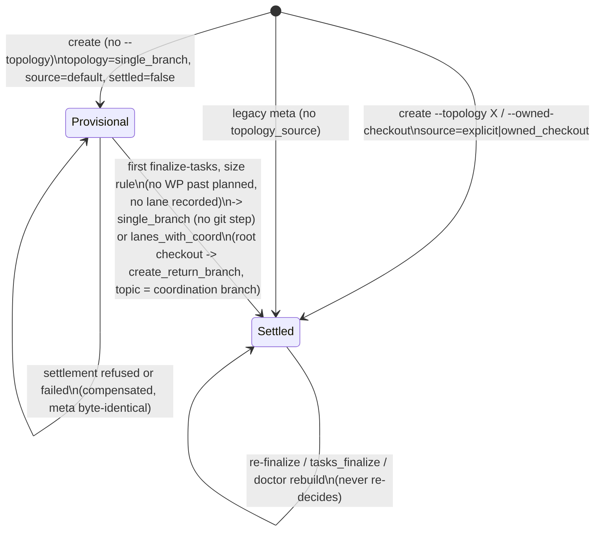

# Data Model: Lane and worktree model hardening

The entities, persisted keys, value objects and refusal codes the Mission adds or reuses. Python value objects are frozen dataclasses unless stated otherwise. "New" means added by this Mission; "reused" means an existing name whose meaning is unchanged.

## 1. `meta.json` keys (PRIMARY metadata)

| Key | Type | New? | Written by | Meaning |
|---|---|---|---|---|
| `topology` | `single_branch \| lanes \| coord \| lanes_with_coord` | reused | create; settlement | The stored topology. For a provisional Mission it is `single_branch` (research R-6, DM `01M6R0BDYC29D6XMDY72R22CP9`). A default settlement writes `single_branch` or `lanes_with_coord`; `lanes` and `coord` come only from an explicit `--topology` (DM `01M6R0B954ZPQN5NV4R1ZRE7NY`). |
| `topology_source` | `explicit \| owned_checkout \| default` | **new** (additive; `validate_meta` ignores unknown keys) | create | How the topology was chosen. **Absent = legacy = settled** (FR-057, C-011). |
| `topology_settled` | `bool` | **new** | create (`false` only when `topology_source == default`; omitted otherwise); settlement sets `true` | Provisional vs settled. Absent with `topology_source == default` is invalid and refuses; absent otherwise means settled. |
| `topology_decision` | object | **new** | settlement (once) | `{rule: "wp_count_le_2" \| "code_lanes_le_1" \| "lanes_with_coord", wp_count: int, code_lane_count: int, from: "single_branch", to: "single_branch" \| "lanes_with_coord", target_protected: bool, decided_at: ISO-8601}`. `target_protected` is informational: it no longer changes the outcome. Write-once; re-finalize never changes it. |
| `mission_branch` | `str` | reused | create (always, for `topology_source == default`: the topic branch `kitty/mission-<slug>-<mid8>`) | The write branch for `single_branch` (and for a provisional Mission), and the consolidation base for an explicit `lanes`. Kept at promotion (FR-061: the PRIMARY partition of a default Mission; same ref as `coordination_branch`). Previously removed at promotion to `lanes_with_coord`. |
| `coordination_branch` | `str` | reused | settlement to `lanes_with_coord` (the topic ref name, A-1) | The coordination home (ruling 2). After a default settlement it is the topic branch on every target: lanes are cut from it, lane consolidation lands into it, and it lands on the target at consolidate. |
| `create_return_branch` | `str` | **new** | create (only when `topology_source == default` and create switched the write checkout onto the topic branch) | The branch the write checkout was on before create switched it. Settlement to `lanes_with_coord` moves the repository root checkout back to it before the coordination worktree checks out the topic branch (git forbids one branch in two worktrees). Kept after settlement for audit; never read once `topology_settled` is `true`. |
| `commit_to_target` | `bool` | reused | create, explicit `single_branch` only (FR-060) | Unbounded residual (FR-078). |
| `retain_branches` / `retain_worktrees` | `bool` | reused | create | Retention precedence unchanged (C-017). |

There is **no `single_branch` bound marker**. The S8 bound is gated on the stored `single_branch` topology plus `lands_mission_branch` (a recorded `mission_branch` that differs from the target). Refuse-plus-attest covers legacy approvals (R-8).

### Provisional to settled state machine



## 2. Status read contract (S1)

```python
class StatusReadSource(StrEnum):
    WRITE_CHECKOUT = "write_checkout"          # single_branch, lanes, provisional; also the declared pre-seed fallback
    COORD_WORKTREE = "coord_worktree"          # coord / lanes_with_coord, worktree materialized
    COORD_BRANCH_REF = "coord_branch_ref"      # coord / lanes_with_coord, worktree empty or absent
    CONSOLIDATED_TARGET = "consolidated_target"

@dataclass(frozen=True)
class StatusReadSurface:
    topology: MissionTopology
    source: StatusReadSource
    mission_dir_name: str           # kitty-specs/<dir>
    path: Path | None               # set for WRITE_CHECKOUT, COORD_WORKTREE, CONSOLIDATED_TARGET; must exist
    repo_root: Path                 # normalized main repository root (never a lane root)
    ref: str | None                 # refs/heads/<coord> for COORD_BRANCH_REF
    fallback_reason: str | None     # set only for the declared pre-seed WRITE_CHECKOUT fallback
```

- **Invariants**: `path` is never inside a registered lane checkout, and it exists whenever it is set. Exactly one of `path` and `ref` drives the read. `fallback_reason` is set only when the topology is a coordination one and `source == WRITE_CHECKOUT`.
- **`RefRead`**: `ABSENT` or `PRESENT(data: bytes)`. Any git failure or a missing object raises `StatusSurfaceRefUnreadable`.
- **Read functions** (the only consumers of a surface): `read_status_events(surface)`, `read_status_stream(surface)`, `materialize_status(surface)` (read only; writers use the write seam).

## 3. for_review gate decision (S2)

`GateDecision` (`lanes/for_review_gate.py`) gains `reason_code: str | None`. Its values are `LANE_BRANCH_MISSING` and `LANE_NO_COMMIT_BEYOND_BASE` (internal names; see §7). The existing `passed`, `reason`, `lane_id`, `lane_branch` and `base_ref` fields are unchanged.

## 4. Lane checkout and migration report (S3/S6)

- **`LaneCheckoutRequest`**: `repo_root`, `mission_slug`, `mission_dir_name`, `lane_id`, `branch`, `create_branch_from: str | None`, `route: allocation_fresh | allocation_legacy | recovery | lifecycle_sync | review | recreate`.
- **`LaneCheckoutMigrationItem`**: `worktree: Path`, `lane_id`, `outcome`, `event_ids_only_in_lane: tuple[str, ...]`, `reason: str`. `outcome` is one of:
  - `excluded`: a clean worktree, now sparse;
  - `flagged_redundant`: a dirty copy whose every event id is on the resolved surface; flagged and excluded, the file stays on disk;
  - `refused_lane_only_events`: the worktree is untouched and its ids are listed;
  - `skipped_mid_operation`: MERGE_HEAD, REBASE or CHERRY_PICK present;
  - `already_excluded`: a re-run no-op.
- **Doctor finding** `LANE_STATUS_AUTHORED`: `{lane_branch, mission, paths: [status.events.jsonl | status.json], merge_base}`. The comparison is against `merge-base(lane, consolidation base)`, so coordination bytes merged into the lane do not count.

## 5. Approval window (S8)

```python
@dataclass(frozen=True)
class ApprovalWindow:
    wp_id: str
    open_stamp: str | None       # O_k: lane_head on the first governed (non-migration) entry to claimed/in_progress
    approval_stamp: str          # S_k: lane_head on the newest approval (or approved-reviewed attestation)
    degraded: bool               # True when open_stamp is None -> window (claim_base, S_k] (A-8, logged)
```

- **Membership**: a content commit `c` is covered when `reachable(c, S_k) and not reachable(c, O_k or claim_base)` for some approved `k`. Merge commits and bookkeeping paths (`_is_bookkeeping`) are excluded. Commits reachable from the claim base or an anchor are exempt.
- **Refusal value**: the existing `BoundRefusal(code, lane_id="lane-planning", branch=<mission_branch>, wp_ids=(<preceding approved WP>,), commits=(<sha>,))`.

## 6. Lane cleanup (S5)

```python
class LaneCleanupOutcome(StrEnum):
    REMOVED = "removed"
    KEPT = "kept"                          # the remover could not prove removal safe
    RETAINED_BY_POLICY = "retained_by_policy"

@dataclass(frozen=True)
class LaneCleanupItem:
    lane_id: str
    worktree: Path | None
    branch: str
    expected_tip: str | None               # claim-validated lane tip

@dataclass(frozen=True)
class LaneCleanupResult:
    item: LaneCleanupItem
    outcome: LaneCleanupOutcome
    code: str | None                       # guard code when KEPT
    remedy: str | None
    command: str | None                    # e.g. "spec-kitty doctor workspaces --prune"
    recreate: str | None                   # e.g. "git branch <b> refs/spec-kitty/discarded/<b>"

@dataclass(frozen=True)
class LaneCleanupReport:
    results: tuple[LaneCleanupResult, ...]

class LaneRemover(Protocol):
    def remove(self, item: LaneCleanupItem, *, landing: LandingProof) -> LaneCleanupResult: ...
```

- **`LandingProof`**: `LocalTargetAtPass(target_ref, passed_sha)` (consolidate, O3-local) or `RemoteRef(remote, ref)` (`accept --mode pr`, `--push`).
- **`ConsolidationState`** gains `cleanup_started: bool = False` (additive, read with a default). It is set before the first lane leg and makes `--resume` go straight to cleanup.

## 7. Refusal and error codes

| Code | New / reused | Fires when | Surface |
|---|---|---|---|
| `StatusSurfaceRefUnreadable` (code `STATUS_SURFACE_REF_UNREADABLE`) | **new** | A ref read hits a missing object, an unreadable ref or a git failure (not an absent file on a readable ref) | Every status reader; non-zero exit |
| `CoordinationBranchDeleted` | reused | The coordination branch is gone (DEL) | Every status reader |
| `LANE_BRANCH_MISSING` (`GateDecision.reason_code`) | **new, internal** | `refs/heads/<lane>` is absent at `in_progress -> for_review` | `status emit` (CLI error), `move-task`, `orchestrator-api transition` (`TRANSITION_REJECTED`; text only) |
| `LANE_NO_COMMIT_BEYOND_BASE` (`reason_code`) | **new, internal name** for the existing refusal | No commit on the lane branch beyond its base | same three surfaces |
| `STATUS_WRITE_TARGETS_LANE_CHECKOUT` | **new** | A status write's target resolves inside a registry-classified lane checkout | The status write seam (`BookkeepingTransaction`, `emit`) |
| `LANE_STATUS_AUTHORED` | **new** (doctor finding) | A live lane branch's status files differ from its merge-base | `doctor` |
| `WRITE_CHECKOUT_OCCUPIED` / `WRITE_CHECKOUT_DIRTY` | reused | Settlement or a create switch needs an occupied or dirty write checkout (#5676) | `finalize-tasks`, `create` |
| `TOPOLOGY_SETTLEMENT_REFUSED` | **new** | Settlement cannot complete (a precondition failed, `create_return_branch` is missing or checked out in another worktree, the coordination worktree cannot be materialized, a git step failed). It is compensated: the root checkout is back on the topic branch and the Mission stays provisional. | `finalize-tasks` (`--json` `error_code`) |
| `PROTECTED_BRANCH_REFUSED` | reused | Unchanged (a `lanes` Mission on a protected target at consolidate) | `consolidate` |
| `LANE_MOVED_AFTER_APPROVAL` | reused | `single_branch`: a content commit is outside every approved window, or after the newest approval | `consolidate`, `orchestrator-api consolidate-mission` (`PREFLIGHT_FAILED` + `preflight_error_codes`) |
| `APPROVAL_STAMP_MISSING` | reused | `single_branch`: an approved WP has no stamp (legacy); lifted by `--attest-approved-reviewed` | same |
| `APPROVAL_STAMP_NOT_ON_LANE` | reused | `single_branch`: the Mission branch was rewritten after approval | same |
| Guard codes in `LaneCleanupResult.code` (`MERGE_UNSAFE_WORKTREE_DIRTY`, `WORKTREE_REMOVE_REFUSED_BY_GIT`, `WORKTREE_PARTIALLY_REMOVED`, `BRANCH_HAS_UNIQUE_COMMITS`; after #7275: `PROCESS_IN_WORKTREE`, `PROCESS_PROOF_UNAVAILABLE`, `WORKTREE_TIP_MOVED`, `BRANCH_TIP_MOVED`, `BRANCH_CHECKED_OUT`, `NOT_LANDED_ON_NAMED_REMOTE`, `BRANCH_IS_PRIMARY`) | reused | The remover could not prove removal safe | Consolidate "Kept" block; orchestrator envelope per-lane outcome |
| `COORD_MOVED_AFTER_LANDING` (exit 75), `PROJECTION_TEARDOWN_ABORTED`, `COORD_LATE_PROJECTION_REFUSED` | reused, unchanged | Coordination teardown (S10's) | `consolidate` |

The internal names in this table are final unless review renames them. A rename must happen before IC-17 writes them into skills.
