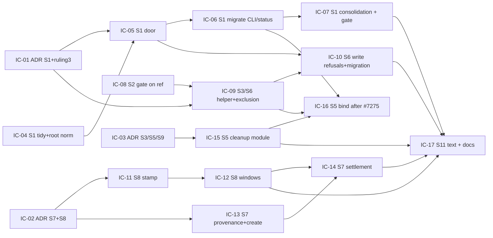

# Implementation Plan: Lane and worktree model hardening

**Branch**: `issue-7276-lane-worktree-hardening` (planning base = consolidation target; Mission topology `lanes`) | **Date**: 2026-11-06 | **Spec**: [spec.md](./spec.md)
**Input**: Mission specification from `kitty-specs/lane-worktree-model-hardening-01M6QY1M/spec.md`, the 17 resolved Decision Moments (`spec-kitty agent decision list --mission lane-worktree-model-hardening-01M6QY1M`), and the six discovery briefs (A status surface, B lane lifecycle, C topology, D `single_branch` bound, E cleanup, F doctrine and write-service ADRs).

Profile: architect-alphonso. Every planning question was answered by the rulings, the escalation answers and assumptions A-1 to A-12. Four design points the rulings did not settle (OQ-1 to OQ-4) went to the operator and, with two later decisions (`primary_partition_default`, `pr_bound_fallback`), are resolved; see [Resolved planning decisions](#resolved-planning-decisions).

## Summary

The Mission applies the 2026-11-06 operator rulings to the lane, worktree and coordination model in nine slices (S1, S2, S3, S5, S6, S7, S8, S9, S11). The technical approach:

- **S1, one status read contract.** A single read door, `resolve_status_read(...) -> StatusReadSurface`, returns a declared source per topology (write checkout, coordination worktree, coordination branch ref, consolidated target). Every reader moves onto it, behind an empty-allowlist call-site gate. The ref reader tells an absent file from a bad ref.
- **S2, for_review on the ref.** The shared gate counts `base..refs/heads/<lane>` from the repository root checkout and refuses distinctly when the lane branch is missing.
- **S3 and S6, lane checkouts.** One lane-checkout helper creates every lane checkout. It installs the lane-tip hook, the local excludes and the status sparse exclusion on every topology with code lanes. Spec Kitty write paths refuse a lane target. A clone-local migration and a doctor probe bring existing lane worktrees in line and never drop an event. The ADR `2026-04-03-1` amendment governs the lease, which is a follow-up Mission.
- **S8, approval windows for `single_branch`.** The write-branch head is stamped on every lifecycle transition of a `single_branch` Mission. At claim and gate, each content commit on the Mission branch must lie in some approved WP's window `(O_k, S_k]`. The existing codes are reused and refuse-plus-attest applies.
- **S7, topology settled at the first finalize.** `create` without `--topology` mints only the Mission topic branch and records a provisional topology. The first `finalize-tasks` settles it by size, once and atomically, to `single_branch` or, on any target, `lanes_with_coord` with the topic branch as the coordination branch. It materializes it with compensation on failure. Plain `lanes` and `coord` are explicit-only.
- **S5, cleanup as the last consolidation step.** One lane-cleanup module removes lanes through a remover port. A lane that cannot be removed is reported, never raised. The port is bound to the #7264 proof entry once #7275 merges, and `accept --mode pr` and the prune backstop then use it.
- **S9 and S11, records and text.** S9 is ADRs only. S11 is text that ships only with the behaviour it describes.

## Technical Context

**Language/Version**: Python 3.11+ (`pyproject.toml` version `4.0.0rc8`).
**Primary Dependencies**: typer, rich, ruamel.yaml (existing). Tests: pytest, pytest-xdist; types: mypy (strict for new code). `spec_kitty_events` (status reducer, unchanged) and git ≥ 2.38 (already required for `merge-tree --write-tree`). **No new dependency is added** (see research.md R-12).
**Storage**: Files and git objects only: `kitty-specs/<mission>/meta.json`, `lanes.json`, `status.events.jsonl`, `.kittify/runtime/merge/<mission_id>/state.json`, `refs/heads/*`, `refs/spec-kitty/{lane-tip,wp-base,discarded}/*`, and per-worktree sparse-checkout configuration (clone-local).
**Testing**: ATDD red-first through the pre-existing entry point (the real CLI or `orchestrator-api` verb) on real git fixtures (`tests/integration/coord_topology_fixture.py`, `tests/specify_cli/lanes/test_for_review_gate_parity.py`). Unit tests for pure helpers. Architectural gates are non-vacuous: an empty allowlist, a scan floor and planted-violation self-tests. Per-WP blast radius = `make test-fast` + the touched modules' test files + each owning subsystem directory + the named gate files (never a bare `tests/architectural/` sweep, `NO_FULL_HEAVY_SUITES_IN_MISSION`).
**Target Platform**: Linux, macOS, Windows 10+ CLI. NFR-008: the S2 gate, the S6 exclusion and migration, and the S5 kept-report pass on the Linux and Windows CI lanes. Off Linux a lane is never removed without a process proof.
**Project Type**: single Python project (`src/` layered `kernel <- charter <- {glossary, runtime, mission_runtime} <- specify_cli`).
**Performance Goals**: typical CLI operations stay under 2 s. NFR-001: at most one batched git object-read subprocess per Mission per command for ref-sourced status. NFR-006: each added or amended architectural gate takes 5 s or less on full `src/`. NFR-007: the S8 claim check adds 2 s or less for 10 WPs and 200 commits.
**Constraints**: cyclomatic complexity ≤ 15 per function (ruff C901 / Sonar S3776). No new `# noqa` or `# type: ignore`. `ruff check`, `ruff format --check --force-exclude <files>` and mypy clean. Diff coverage ≥ 90% (`ci-aggregate.yml`). Repeated literals (≥ 3 uses) become module constants. No empty exception handlers. Every destructive git op goes through `git/destructive_guard.py` (C-004). Exactly one minor orchestrator-api contract bump (`CONTRACT_VERSION` `1.23.0 -> 1.24.0`, `src/specify_cli/orchestrator_api/envelope.py:192`). Migrations follow the ledger rules (C-014).
**Scale/Scope**: about 25 direct status-resolver calls in 18 files plus 25 `read_dir(STATUS_STATE)` calls to migrate (AST count, brief A). Three lane-teardown copies collapse into one. About 55 stored-topology readers stay unchanged (they read `meta.json` per call). 6 core command skills and 1 CLI message. 3 docs pages plus CLAUDE.md. 1 open-packs patch (31 edits, 17 files) and 2 spec-kitty-events ADR drafts handed off.

## Charter Check

*Gate: passes. Re-checked after Phase 1 design: passes, with the two items under Complexity Tracking.*

| Charter rule | How the plan satisfies it |
|---|---|
| **Single canonical authority** (DIRECTIVE_044) | One status read door (S1), one lane-checkout helper (S3/S6), one lane-cleanup module (S5), one write-branch answer `write_branch_for` (S8 tidy), one `--topology` help constant (S7), one decide-once settlement phase (S7). Each comes with a gate or a single-source test. No second authority is added beside an existing one: the S1 gate **amends** `test_single_mission_surface_resolver.py`, `_surface_resolution_scan.py`, `test_no_read_side_bypass.py` and `test_read_surface_placement_guard.py`, and does not sit beside them. |
| **Architectural alignment** | `mission_runtime` stays inside its outbound ledger. The read door lives in `specify_cli/status/` and `coordination/` (adapter layer). The lane-head probe keeps function-local imports (`test_cold_import_status_boundary.py`). Remover port: a Protocol in `consolidation/lane_cleanup.py`, bound in the adapter layer. No `pyproject.toml` package change. |
| **ATDD-first** (C-011) | Every implementation concern names its red-first acceptance tests below. Each is committed before the implementation commit and is red on the planning base. ADR-only concerns name their confirmation tests instead. |
| **Standing order 2: tidy-first campsite cleaning** | Each code concern opens with a behaviour-preserving tidy step (listed per concern): the `_resolve_status_surface` name clash, stale docstrings, the five overlapping `single_branch` predicates collapsed onto `write_branch_for`, `_maps_to_code_lane` renamed, `check_lane` stamp-resolution split, `--topology` help constant, protected-mint switch core extraction, lane-cleanup module extraction, `lane_sparse_checkout_patterns` taking the Mission dir name. |
| **Standing order 3: tracer files** | `traces/{approach,design-decisions,tooling-friction}.md` exist and are appended at this phase. |
| **Standing order 4: red-first, never retry-to-green** | Red-first is stated per concern. The S5 resume crash window (FR-035) is unverified: its test is written first and the fix follows only if it is red. |
| **Standing order 5: non-vacuous gates** (C-013) | Three gates, each with an empty allowlist, a scan floor, a caller floor and planted violations: `test_status_read_single_door.py` (S1), `test_lane_checkout_single_seam.py` (S3), the S5 routing pins in `test_destructive_op_routing.py` (amended after #7275). The S11 text guard is a grep gate with planted strings. No transient allowlist is introduced. |
| **Standing order 6: canonical sources** | Templates come from the charter chain. Pack doctrine is delivered as a patch for `spec-kitty-open-packs`, never by editing `packs/` (C-002). Generated agent directories are never edited. |
| **Standing order 7: git discipline** | Topic branch and PR to `main`. `consolidate` is local only. Cross-repo hand-offs (open-packs, spec-kitty-events) are files for the operator. |
| **Standing order 8: Mission hygiene** | Every issue (#7277–#7285) gets an issue-matrix row. Reviewer and implementer are different agents. The ownership map below has no overlapping file except the declared, sequenced hunks. |
| **Standing order 9: red-main** | No P0 repro is declined. Out-of-matrix reds are attributed per the CLAUDE.md gotcha list. |
| **Terminology** (C-001) | "Mission", never "feature"; `consolidate` for lane consolidation; senses named for *primary* (repository root checkout, PRIMARY partition), *merge* (lane consolidation vs branch integration), *routing* (placement) and *residue* (write-seam vs audit-engine vs read-side). `test_no_legacy_terminology.py` runs on every concern touching prose. |
| **Contract discipline** (C-012) | S8 adds no orchestrator-api code. S2 keeps the `TRANSITION_REJECTED` envelope shape (the distinct reason travels in `reason` text and an internal `reason_code`). One minor bump (1.24.0), owned by IC-15, which also carries the topology fields of IC-13/IC-14 (DM `01M6R0BJQ6Q1MV6492EH6HB66H`). `topology_source` and `create_return_branch` are additive meta keys. |
| **Migration ledger** (C-014) | One new clone-local migration (`clone_local_effect=True`, idempotent, an `order_manifest.txt` entry with `# tie:` if needed). No shipped migration is edited. |
| **Supply chain** (`supply-chain-install-safety`, `dependency-hygiene`) | No dependency is added or bumped. `uv.lock` is untouched. |

## Project Structure

### Documentation (this Mission)

```
kitty-specs/lane-worktree-model-hardening-01M6QY1M/
├── spec.md, plan.md, research.md, data-model.md, quickstart.md
├── contracts/                     # CLI/JSON contract deltas (this phase)
├── decisions/                     # 17 resolved Decision Moments
├── upstream/                      # hand-offs: open-packs patch (IC-17), events ADR drafts (sibling session), ADR 2026-11-06-1 amendment draft (IC-03)
├── traces/                        # tracer files
└── tasks.md, tasks/               # /spec-kitty.tasks output (not created here)
```

### Source Code (repository root)

```
src/specify_cli/
├── status/            aggregate.py, store.py, lane_head.py, read_surface.py (new: S1 door + value objects)
├── coordination/      surface_resolver.py, status_service.py, transaction.py, workspace.py, status_transition.py
├── missions/          _read_path_resolver.py
├── lanes/             for_review_gate.py, _git.py, worktree_allocator.py, lane_checkout.py (new: S3 helper),
│                      lifecycle_sync.py, single_branch_landing.py, compute_and_persist.py, stale_check.py
├── consolidation/     approved_bound.py, write_branch_bound.py (new: S8 tier 2), reconciliation.py,
│                      lane_cleanup.py (new: S5 module + LaneRemover port), phase_teardown.py, executor.py,
│                      run_state.py, state.py, done_bookkeeping.py, forecast.py, phase_advance.py, preflight.py,
│                      entry_preflight.py, coord_strand.py
├── cli/commands/      agent/{status,mission_create,mission_finalize*,tasks_shared,tasks_move_task,tasks_mark_status,
│                      workflow,mission_finalize_planning_pin}.py, implement_phases.py, implement_claim.py, events.py,
│                      retrospect.py, agent_retrospect.py, accept.py, consolidate.py, lifecycle.py, mission_type.py,
│                      _landed_worktree_doctor.py, _sparse_checkout_doctor.py
├── core/              mission_creation.py, mission_creation_meta.py, mission_creation_protected_mint.py
├── orchestrator_api/  consolidation.py, design_phase.py, envelope.py
├── workspace/         landed_worktrees.py
├── acceptance/        __init__.py
├── upgrade/migrations/ m_<next>_lane_checkout_status_exclusion.py (new), order_manifest.txt
├── meta_keys.py, mission_metadata.py
src/mission_runtime/   resolution.py, context.py (docstring)
src/charter/offering/skills/  spec-kitty-implement-review, spec-kitty-git-workflow, spec-kitty-program-orchestrate,
                              spec-kitty-mission-review, spk-gate-consolidate, spk-run-blocked-recovery (SKILL.md)
tests/
├── architectural/     test_status_read_single_door.py (new), test_lane_checkout_single_seam.py (new),
│                      amended: test_single_mission_surface_resolver.py, _surface_resolution_scan.py,
│                      test_no_read_side_bypass.py, test_read_surface_placement_guard.py, test_destructive_op_routing.py
├── status/ coordination/ lanes/ specify_cli/lanes/ consolidation/ orchestrator_api/ integration/ doctor/
│   migration/ specify_cli/cli/commands/agent/ specify_cli/upgrade/
docs/adr/4.x/          new ADRs (S1, S7, S9 C-1..C-3); amendments appended to 3.x/4.x ADRs
docs/architecture/     execution-lanes.md, git-worktrees.md;  docs/context/topology.md;  docs/api/orchestrator-api.md
docs/changelog/unreleased/  one fragment per issue (<id>.<section>.md)
```

**Structure Decision**: the single existing project. New code goes into the owning subsystem package, and new modules are created only where an extraction collapses duplicates (`lane_cleanup.py`, `lane_checkout.py`) or keeps a function family under the complexity ceiling (`read_surface.py`, `write_branch_bound.py`).

## Complexity Tracking

| Item | Why needed | Simpler alternative rejected because |
|---|---|---|
| Amending four standing architectural gates that name `resolve_status_surface_with_anchor` as canonical (IC-07) | The S1 door demotes that body. A new gate beside the old ones would make two authorities. | A side-by-side gate leaves the old blessing live, and the old and new gates contradict each other. |
| The S7 settlement transition performs git operations outside `StatusSurfaceGuard` coverage (IC-14) | Deferred materialization needs a branch-role change and, for `lanes_with_coord`, a repository root checkout move followed by a coordination worktree materialization at finalize. There is one such path for every target. | Materializing at create is what ruling S7-escalation forbids. Its own compensation and the NFR-003 fault-injection test cover the gap. |

## Implementation Concern Map

> Concerns are not work packages. `/spec-kitty.tasks` turns them into WPs. The recommended mapping is one WP per concern (17). IC-04 and IC-05 may merge if #6884 has landed before tasks, which gives 16.



**In-flight PR rebase plan.** All five PRs are owned outside this Mission. Each one is waited for or rebased onto, never stacked on.
- **#6884** (`issue-6466-lane-status-shadow`): its branch is dirty against `main`. Ask its owner to rebase and land it first, or carry its 9 tests plus `_canonical_status_read_root` forward as IC-04's first commit with attribution. IC-04 gates on this.
- **#7255** (finalize pin, ADR `2026-10-04-5` Amendment 2026-11-05): IC-02's S8 amendment and IC-14's finalize phases rebase after it.
- **#7248** (flat-fixture `single_branch`): IC-11 lands after it and reverses its fixture comment deliberately.
- **#7274** (S10 late window): IC-15 shares `phase_teardown.py` and `run_state.py` and lands after it or rebases onto it.
- **#7275** (S4 guard + ADR `2026-11-06-1`): IC-16 starts only after it merges. IC-15 does not wait.

### IC-01 — ADR: status read contract and the restated ruling 3 (S1 #7277, S6 #7281)

- **Purpose**: govern the S1 read contract and the per-topology lane exclusion before code changes behaviour (FR-007, FR-046).
- **Relevant requirements**: FR-007, FR-046, FR-061; rulings 3 (restated), 8.
- **Owns**: `docs/adr/4.x/2026-11-06-N-one-status-read-contract.md` (new, Proposed). It reverses `coord-artifact-single-home-01M3V4BE#FR-017`/`#C-002` and amends `docs/adr/3.x/2026-06-19-1-coord-empty-surface-fallback.md` by an appended section. Also an appended amendment section on `docs/adr/3.x/2026-07-29-1-lane-base-recorded-planning-commit.md` that keeps Assert A'. It also records the placement contract change of DM `01M6R0QJVPVZG2QT8MWQD4NXJR` (FR-061): for `topology_source: default` the PRIMARY partition resolves to the Mission topic branch until `consolidate`; explicit `--topology` Missions keep PRIMARY on `target_branch`.
- **Confirmation tests named**: the IC-05 matrix test, the IC-07 single-door gate, and the IC-09 every-route exclusion test.
- **Size**: S. **Depends-on**: none. **Governs**: IC-04 to IC-07, IC-09, IC-10. **PR overlap**: cites #6884's contract `status-read-root.md`.

### IC-02 — ADR: topology settled at the first finalize and the S8 window amendment (S7 #7282, S8 #7283)

- **Purpose**: record the #5100 reversal, the PRIMARY placement rule and the `single_branch` bound before any is built (FR-050, FR-061, FR-077).
- **Owns**: `docs/adr/4.x/2026-11-06-N-topology-is-settled-once-at-first-finalize.md` (new, Proposed). It supersedes #5100 item 2 (issue comment 5870360497) and amends `docs/adr/3.x/2026-06-22-1-mission-topology-ssot.md` D2 by an appended section. It records the size rule, the A-3 mapping (`lanes_with_coord` on every target, the topic branch as the coordination branch, `lanes`/`coord` explicit-only; DM `01M6R0B954ZPQN5NV4R1ZRE7NY`), the root-checkout move before the coordination worktree checks out the topic branch, deferred materialization, the provisional representation (research R-6), the PRIMARY placement rule for default Missions (FR-061, DM `01M6R0QJVPVZG2QT8MWQD4NXJR`: topic branch until consolidate lands it), `topology_source`, decide-once, compensation and C-010. Also an appended amendment section on `docs/adr/4.x/2026-10-04-5-approval-stamp-bounds-the-approved-claim.md`: per-WP windows, the tier-1 and tier-2 rules, refuse-plus-attest, the missing-`O_k` degrade, and the commit-to-target, commit-during-review and contested-window residuals.
- **Size**: S-M. **Depends-on**: #7255 merged (same ADR file). **Governs**: IC-11 to IC-14.

### IC-03 — ADR set: short-lived checkouts, cleanup amendment draft, worktree-free coordination write (S3 #7279, S5 #7280, S9 #7284)

- **Owns**:
  - an appended amendment on `docs/adr/3.x/2026-04-03-1-execution-lanes-own-worktrees-and-mission-branches.md` (FR-020: lease unit = workflow action, release commits or refuses, tip recorded before guarded removal, attached checkouts, re-entry, harness cwd, review lock out of the checkout, auto-rebase without a held checkout, migration, confirmation criteria citing IC-08 and IC-09 tests);
  - `kitty-specs/lane-worktree-model-hardening-01M6QY1M/upstream/adr-2026-11-06-1-amendment-draft.md` (FR-038; the ADR lives on #7275). It records the O3-local landing proof, "probe unavailable means keep and report", the residue vs never-`--force` rule, the scratch exemption, lane-tip and tombstone ops as guarded, and the deferred sites;
  - three new Proposed core ADRs `docs/adr/4.x/2026-11-06-N-{coordination-branch-written-by-commit, gates-over-worktree-less-coordination, committed-ledger-is-the-coordination-blob}.md` (C-1, C-2, C-3), with open choices as options plus a recommendation (A-12);
  - an appended D-6 amendment on `docs/adr/4.x/2026-10-22-1-the-java-write-service-is-the-canonical-event-writer.md` (step 4a), cross-linking spec-kitty-events ADR 0007 and ADR 0008.
- **Does not own**: the ADR 0007/0008 drafts. A sibling session writes them under `upstream/spec-kitty-events/`, and IC-03 links them and maps D-6 bullets to records (SC-010).
- **Size**: M. **Depends-on**: none (C-2 cites the #7265 pass of #7274 by reference). **Governs**: IC-09, IC-15, IC-16.

### IC-04 — S1 tidy-first, root normalization and the typed ref reader (S1 #7277)

- **Purpose**: make every root-taking status entry re-anchor a lane root, and split "absent file" from "bad ref" (FR-002, FR-004).
- **Tidy (behaviour-preserving, first commits)**:
  - rename the alias `resolve_status_surface_with_anchor as _resolve_status_surface` (`cli/commands/implement_phases.py:368`);
  - fix the stale docstrings at `mission_runtime/resolution.py:2480-2485, 2972-2975` and `coordination/status_service.py:320`;
  - add the characterization matrix (topology × CoordState × owned × cwd) pinned at today's values.
- **Owns**: `missions/_read_path_resolver.py` (`_canonical_status_read_root` lifted to one helper called by `resolve_status_surface_with_anchor`, `candidate_feature_dir_for_mission`, `resolve_surface_dir_or_typed_error`, `MissionStatus.load` and `committed_authority.primary_surface_dir`); `coordination/status_service.py` (`read_event_log`/`read_event_stream_log` return a typed absent-vs-unreadable result); `cli/commands/implement_phases.py` (the rename only); docstring hunks in `mission_runtime/resolution.py`; `tests/status/test_status_read_matrix.py` (new).
- **Red-first**: `test_lane_root_reads_write_checkout_state` (lane copy at `planned`, write checkout at `in_progress`, three entry points each return the write checkout); `test_ref_reader_bad_ref_raises_typed_error`; `test_ref_reader_absent_file_reads_empty`; positive control `test_repository_root_input_unchanged`.
- **Size**: M. **Depends-on**: #6884 landed or carried. **ADR**: IC-01 (ruling 8 already binds).

### IC-05 — S1 read door and declared sources (S1 #7277)

- **Purpose**: one entry point returning `StatusReadSurface` (FR-001, FR-003, FR-061, NFR-001).
- **Owns**: `status/read_surface.py` (new: `StatusReadSurface`, `StatusReadSource`, `resolve_status_read`, `read_status_events`, `read_status_stream`, `materialize_status`, the batched `git cat-file --batch` reader; it and the placement seam carry the FR-061 PRIMARY placement of default Missions as one change, DM `01M6R0QJVPVZG2QT8MWQD4NXJR`); `coordination/surface_resolver.py` (the body delegates; the `_empty_coord_surface` loud fallback is removed per IC-01).
- **Red-first**: `test_unmaterialized_coord_reads_branch_events` (3 committed coordination events, stale write checkout copy, worktree absent); `test_empty_coord_worktree_reads_branch`; `test_preseed_window_declares_write_checkout_source`; `test_owned_checkout_unmaterialized_reads_ref_not_raises`; `test_ref_read_spawns_one_subprocess` (NFR-001); `test_never_returns_nonexistent_path`.
- **Size**: M. **Depends-on**: IC-01, IC-04.

### IC-06 — S1 migrate status, CLI and mission_runtime readers (S1 #7277)

- **Owns**: `status/aggregate.py` (`MissionStatus` holds a surface; `materialize` moves to the write dir); `cli/commands/agent/status.py`; `cli/commands/events.py`; `cli/commands/retrospect.py`; `cli/commands/agent_retrospect.py`; `retrospective/gate.py`; `cli/commands/agent/tasks_shared.py`; `cli/commands/agent/tasks_mark_status.py`; `cli/commands/implement_claim.py`; `cli/commands/implement_phases.py` (`claim_preflight` call); `cli/commands/agent/mission_finalize_planning_pin.py` (`:70` only); `cli/commands/accept.py` (`_coord_status_feature_dir` only); `cli/commands/agent/issue_verdict.py`; `task_utils/support.py`; `migration/wp_status_backfill.py`; `migration/backfill_runtime_state.py`; `mission_runtime/resolution.py` (`_resolve_status_surface_dir*`, `STATUS_STATE` `read_dir` arm).
- **Red-first**: the cross-cwd parity matrix `test_status_readers_agree_across_cwd_and_coord_state` (SC-001, 0 divergent cells); `test_agent_status_materialize_never_writes_read_only_path`.
- **Size**: M. **Depends-on**: IC-05. **PR overlap**: #7255 (`mission_finalize_planning_pin.py`, rebase only).

### IC-07 — S1 migrate consolidation readers and add the single-door gate (S1 #7277)

- **Owns**: `consolidation/{done_bookkeeping,forecast,phase_advance,preflight,entry_preflight,coord_strand}.py` (`done_bookkeeping:610`'s raw `git show` goes through the ref reader); `coordination/transaction.py` (`preflight_refusal` read only); `tests/architectural/test_status_read_single_door.py` (new; empty allowlist, scanned-file floor ≥ 1250, caller floor frozen at the measured count, planted arms: direct call, aliased import, attribute call, `STATUS_STATE` through a local alias, hand-joined events path, retired names absent); amendments to `test_single_mission_surface_resolver.py`, `_surface_resolution_scan.py`, `test_no_read_side_bypass.py` and `test_read_surface_placement_guard.py`.
- **Red-first**: `test_unmaterialized_preflight_reports_real_lanes`; gate self-mutation arms are red before the live scan goes green.
- **Size**: M. **Depends-on**: IC-06. **PR overlap**: #7274 (consolidation module neighbours, rebase only).

### IC-08 — S2: the for_review gate reads the lane branch ref (S2 #7278)

- **Tidy**: add `lane_branch_has_commit_beyond_base(repo_root, base_ref, branch)` beside the checkout form in `lanes/_git.py` (`--end-of-options`); extract `_code_lane_identity(manifest, lane)` in `for_review_gate.py`.
- **Owns**: `lanes/_git.py`, `lanes/for_review_gate.py` (`GateDecision` gains internal `reason_code`; the branch comes from `lane_created_branch`; `worktree.exists()` is dropped; the refusal text is reworded).
- **Red-first** (extend `tests/specify_cli/lanes/test_for_review_gate_parity.py`): `test_transition_passes_with_checkout_removed`, `test_status_emit_passes_with_checkout_removed`, `test_move_task_parity_checkout_absent`, `test_no_commit_refusal_names_branch_not_worktree`, `test_missing_lane_branch_refuses_distinct_reason`, `test_reads_ref_not_lagging_checkout_head`, `test_dash_prefixed_ref_not_option`.
- **Size**: S. **Depends-on**: none. **ADR**: none needed (ruling 5 enabler; recorded in IC-03's S3 amendment).

### IC-09 — S3/S6: one lane-checkout helper, status exclusion on every lane checkout (S3 #7279, S6 #7281)

- **Tidy**: `lane_sparse_checkout_patterns` takes the resolved Mission dir name (the slug+mid8 wrapper kept); `_register_sparse_checkout_if_coord` is renamed.
- **Owns**: `lanes/lane_checkout.py` (new: `open_lane_checkout(...)`, the only lane `git worktree add`; it installs the lane-tip hook, the `.spec-kitty/` exclude and sparse on every topology with code lanes); `lanes/worktree_allocator.py` (FRESH, FRESH_LEGACY, CRASH_RECOVERY routes); `lanes/lifecycle_sync.py` (`:139`); `cli/commands/agent/workflow.py` (`_create_review_worktree`); `coordination/workspace.py` (patterns); `workspace/landed_worktrees.py` (printed recreate command, `:636-638` hunk only); `tests/architectural/test_lane_checkout_single_seam.py` (new).
- **Red-first**: `test_lanes_topology_allocation_has_no_status_files_on_disk` (and branch tree still carries the fork-time blob); `test_review_checkout_has_no_status_files`; `test_lifecycle_sync_recreate_has_no_status_files` (flips `tests/integration/test_lane_lifecycle_sync.py:124` deliberately); `test_lane_tip_hook_fires_in_helper_checkout`; gate planted raw `worktree add`.
- **Size**: M. **Depends-on**: IC-01, IC-08 (S2 before S3's helper). **ADR**: IC-01, IC-03.

### IC-10 — S6: lanes never change status; migrate existing lane worktrees; doctor probe (S6 #7281)

- **Owns**: `coordination/transaction.py` (`coordination_transaction_append` requires a registry-classified coordination worktree, `:1025-1030`); `coordination/status_service.py` (`_validate_write_contract`; in sequence after IC-04's hunk); `cli/commands/agent/tasks_move_task.py` (`_drop_lane_coord_residue` and deliverable auto-commit leave status files unstaged on every topology); `upgrade/migrations/m_<next>_lane_checkout_status_exclusion.py` (new, `clone_local_effect=True`, `target_version` = the next release) + `order_manifest.txt` entry; `cli/commands/_sparse_checkout_doctor.py` (the lane-authored status probe vs merge-base, FR-045).
- **Red-first**: `test_status_write_into_lane_checkout_refuses` with positive control `test_same_write_to_coord_worktree_succeeds`; `test_deliverable_autocommit_never_stages_status_files` (paired with a deliverable file); `test_migration_excludes_clean_lane_worktree`; `test_migration_flags_redundant_dirty_copy`; `test_migration_refuses_lane_only_event_ids_untouched`; `test_migration_skips_mid_rebase`; `test_migration_second_run_changes_nothing` (NFR-005); `test_doctor_probe_ignores_merged_in_coord_bytes`.
- **Size**: M. **Depends-on**: IC-05 (salvage compares against the resolved surface), IC-09.

### IC-11 — S8: stamp the write-branch head; warnings (S8 #7283)

- **Tidy**: `write_branch_for(manifest, meta)` in `lanes/single_branch_landing.py`, collapsing `minted_mission_branch`, `single_branch_evidence_window`'s branch and `expected_consolidate_checkout` onto one answer; an owned-aware stored-topology helper callable without a manifest; rename `_maps_to_code_lane -> _approval_is_bounded`; split `check_lane`'s stamp resolution into public `stamp_refusal(...)`.
- **Owns**: `status/lane_head.py` (`single_branch` arm keyed on the **stored** topology, never on `is_planning_lane`); `lanes/single_branch_landing.py`; `consolidation/approved_bound.py`.
- **Red-first**: `test_single_branch_probe_stamps_mission_branch_head`; positive control `test_lanes_planning_lane_wp_stays_unstamped`; `test_move_task_approved_records_lane_head_single_branch`; `test_unstamped_single_branch_approval_warns`.
- **Size**: M. **Depends-on**: IC-02, #7248 merged.

### IC-12 — S8: per-WP approval windows at claim and gate (S8 #7283)

- **Owns**: `consolidation/write_branch_bound.py` (new: `check_write_branch(...)`, tier 1 + tier 2, missing-`O_k` degrade and log); `consolidation/reconciliation.py` (`_approved_bound_verdict` `single_branch` arm when `lands_mission_branch`; `lane_tips_moved_refusal` takes a `lane_id -> branch` map).
- **Red-first** (minted `single_branch` repository through `spec-kitty consolidate`): `test_late_commit_after_last_approval_refuses`; `test_commit_between_two_approvals_refuses_naming_preceding_wp`; `test_overlapping_review_passes`; `test_rework_after_later_approval_passes`; `test_reapproval_lifts_refusal`; `test_own_bookkeeping_commits_never_refuse`; `test_target_merge_into_mission_branch_never_refuses`; `test_unstamped_approval_refuses_then_attest_lifts`; `test_rebased_mission_branch_refuses_stamp_not_on_lane`; `test_gate_recheck_mid_run_commit_rolls_back`; `test_orchestrator_preflight_failed_carries_reused_code` (FR-076); strict-xfail `test_commit_to_target_unbounded_residual` (FR-078); `test_bound_cost_10wp_200_commits` (NFR-007).
- **Size**: M-L. **Depends-on**: IC-11. **ADR**: IC-02.

### IC-13 — S7 tidy-first, provenance and topic-branch-only create (S7 #7282)

- **Tidy**: one `TOPOLOGY_HELP` constant used by `mission_create.py:866`, `lifecycle.py:162` and `design_phase.py:173`; extract the protected-mint "switch the write checkout" core with the #5676 occupancy and dirty refusals (red-first bug fix); pure `count_code_lanes(...)` in `lanes/compute_and_persist.py`; a `restamp_*` sibling of `flatten_coordination_metadata` in `mission_metadata.py`, ratchet-registered (it promotes `mission_branch` to `coordination_branch` under the same name).
- **Owns**: `meta_keys.py` (`TOPOLOGY_SOURCE_KEY`, `TOPOLOGY_DECISION_KEY`, `CREATE_RETURN_BRANCH_KEY`); `cli/commands/agent/mission_create.py` (`_resolve_default_topology_phase` returns `(topology, source)`; the default arm becomes provisional); `core/mission_creation.py`, `core/mission_creation_meta.py`, `core/mission_creation_protected_mint.py`; `cli/commands/lifecycle.py`; `orchestrator_api/design_phase.py` (help + specify envelope fields `topology_source` / `topology_provisional` under contract 1.24.0); `mission_metadata.py`; `lanes/compute_and_persist.py`; `mission_runtime/context.py` (docstring).
- **Red-first**: `test_create_without_topology_mints_only_topic_branch` (protected and unprotected targets: 1 new branch, 0 worktrees, no coordination branch); positive control `test_explicit_topology_coord_still_creates_coord_branch`; `test_owned_checkout_unchanged`; `test_commit_to_target_still_requires_explicit_single_branch` (FR-060); `test_create_json_marks_provisional`; `test_create_records_return_branch` (the branch the write checkout was on, also when it is not the target); `test_create_target_never_resolves_to_another_missions_topic_branch` (research R-6 risk); `test_occupied_write_checkout_refuses_switch` (#5676).
- **Size**: M. **Depends-on**: IC-02. Must not reach a release before IC-12 and IC-14 (C-010): IC-13's create change and IC-14 ship together.

### IC-14 — S7 settlement at the first finalize, with compensation (S7 #7282)

- **Owns**: `cli/commands/agent/mission_finalize.py` (`_decide_topology_by_size` phase before the frozen preflight `:1449`; `_apply_topology_settlement` before `_emit_tasks_started` `:1462`); `cli/commands/agent/mission_finalize_lanes.py` (takes the decided topology); `cli/commands/agent/mission_finalize_commit.py` (re-stamped `meta.json` attributable); `lanes/topology_settlement.py` (new: transition plan + git steps + compensation); `mission_runtime/resolution.py` (`single_branch_write_ref` provisional arm, sequenced after IC-06); `cli/commands/agent/tasks_finalize.py` and `migration/mission_state.py` (no-redecide pins only).
- **Scope (one settlement path, DM `01M6R0B954ZPQN5NV4R1ZRE7NY`)**: the decision yields `single_branch` (no git step) or `lanes_with_coord` on every target. The only git-moving path is: commit the Mission dir on the topic branch; move the repository root checkout to `create_return_branch`; re-stamp `meta.json` (`coordination_branch` = topic ref, `mission_branch` kept as the PRIMARY partition, FR-061); materialize the coordination worktree on the topic branch; write `lanes.json`. There is no landing onto the target, no fast-forward or merge step and no protection-dependent arm, so the earlier `lanes` settlement path and its conflict compensation are gone.
- **First commit (DM `01M6R0QJVPVZG2QT8MWQD4NXJR`, FR-061)**: `test_default_mission_primary_placement_topic_branch_pinned`, which pins that a default Mission's PRIMARY reads and writes go to the topic branch before and after settlement, and that `consolidate` lands them on the target. A positive control pins that an explicit `--topology lanes_with_coord` create keeps PRIMARY on `target_branch`. No escalation is needed.
- **Red-first**: `test_two_wp_settles_single_branch_events_readable`; `test_three_lanes_protected_settles_lanes_with_coord_topic_is_coord`; `test_three_lanes_unprotected_settles_lanes_with_coord_topic_is_coord` (no commit lands on the target; lane branches later fork from the topic branch); `test_settlement_moves_root_checkout_before_coord_worktree` (root checkout on `create_return_branch`, coordination worktree on the topic branch); `test_settlement_refuses_missing_or_busy_return_branch`; `test_explicit_lanes_and_coord_still_materialize_at_create` (positive control: `lanes`/`coord` are explicit-only, never a settlement outcome); `test_five_wp_one_code_lane_settles_single_branch`; `test_explicit_topology_wins`; `test_refinalize_never_redecides`; `test_legacy_mission_without_source_never_changes` (FR-057, with a provisional control); `test_validate_only_previews_and_writes_nothing`; `test_finalize_json_reports_decision` (also through `orchestrator-api tasks`, contract 1.24.0); `test_settlement_refuses_occupied_or_dirty_write_checkout`; `test_settlement_fault_injection_restores_byte_identical` (NFR-003, one arm per git step, including the root checkout restored onto the topic branch); `test_canceled_wps_not_counted_planning_wps_counted`.
- **Size**: M-L (down from L: one settlement path; `/spec-kitty.tasks` may still split decision and transition). **Depends-on**: IC-12 (C-010), IC-13, #7255. **ADR**: IC-02.

### IC-15 — S5: one lane-cleanup module behind a remover port; keep and report (S5 #7280)

- **Tidy**: extract `consolidation/lane_cleanup.py` (`plan_lane_cleanup` pure; `apply(items, remover: LaneRemover) -> LaneCleanupReport`) from `phase_teardown.py:868-1031` and `orchestrator_api/consolidation.py:391-447`, with the main-today remover calling the current guarded primitives exactly as now; a red-first test pins the `_created_lane_branch` vs `code_lane_branch_name` drift.
- **Owns**: `consolidation/lane_cleanup.py` (new); `consolidation/phase_teardown.py` (order: coordination triple, then lane legs, then record clear); `consolidation/executor.py`; `consolidation/run_state.py` + `consolidation/state.py` (`cleanup_started` marker; PASS anchor carried over cleanup's own commits); `cli/commands/consolidate.py` (Kept/Retained rendering); `orchestrator_api/consolidation.py` (shared module; per-lane outcomes); `orchestrator_api/envelope.py` (`CONTRACT_VERSION` 1.24.0, the Mission's one bump, which also carries IC-13's and IC-14's topology fields, DM `01M6R0BJQ6Q1MV6492EH6HB66H`); `docs/api/orchestrator-api.md` (documents `lane_cleanup` and the topology fields); `cli/commands/mission_type.py` (`--discard` on the module).
- **Red-first**: `test_dirtied_lane_after_preflight_kept_exit_0_record_cleared` (SC-005, NFR-004); `test_orchestrator_and_executor_same_lane_outcome`; `test_retained_by_policy_distinct_from_kept`; `test_missing_branch_keeps_lane_tip_ref` (FR-034); `test_resume_after_kill_in_cleanup_skips_regate` (FR-035, written first); `test_abort_after_partial_cleanup_never_restores_lane_branches`; `test_coord_teardown_refusal_exit_codes_unchanged`.
- **Size**: L. **Depends-on**: #7274 (rebase), IC-03 (amendment draft informs vocabulary). Independent of #7275 (port only).

### IC-16 — S5 binding after #7275: guard entry, pr-mode cleanup, prune backstop (S5 #7280)

- **Owns**: the `LaneRemover` binding to `guarded_landed_removal` with the O3-local proof (target at `reconciliation_passed_target_sha`) in `consolidation/lane_cleanup.py` (binding module hunk) and `git/destructive_guard.py` (O3-local variant, coordinated with the #7275 owner); `acceptance/__init__.py` (pr-mode cleanup step; raw `git worktree remove` advice removed); `workspace/landed_worktrees.py` and `cli/commands/_landed_worktree_doctor.py` (Mission-lane prune candidates); `tests/architectural/test_destructive_op_routing.py` pins.
- **Red-first**: `test_pr_mode_removes_absorbed_lanes_before_pr_merge` (SC-006); `test_pr_mode_keeps_unpushed_lane_reported`; `test_no_raw_worktree_remove_advice`; `test_prune_candidates_consolidated_mission_lane` with control `test_active_record_keeps_lane_report_only`; `test_detached_mid_rebase_lane_kept_worktree_tip_moved`; `test_branch_advanced_after_claim_kept`; `test_never_force_pin`; `test_probe_unavailable_keeps_and_reports` (A-11).
- **Size**: M-L. **Depends-on**: #7275 merged, IC-15, IC-06 (`accept.py`), IC-09 (`landed_worktrees.py`).

### IC-17 — S11 core text, docs and changelog (S11 #7285, FR-059 docs)

- **Owns**: `src/charter/offering/skills/{spec-kitty-implement-review,spec-kitty-git-workflow,spec-kitty-program-orchestrate,spec-kitty-mission-review,spk-gate-consolidate,spk-run-blocked-recovery}/SKILL.md` (K1-K9); `lanes/stale_check.py` (`_stale_remediation` prints a `spec-kitty` command, after the A-10 re-entry path is verified); `tests/charter_offering/test_command_skill_text_guard.py` (new; FR-093 planted strings); `upstream/open-packs-doctrine.patch` + hand-off steps (FR-092; rows whose behaviour ships); `docs/architecture/execution-lanes.md`, `docs/architecture/git-worktrees.md`, `docs/context/topology.md` (size default, topic branch, the coordination branch shares the Mission branch name), CLAUDE.md "Execution Workspace Strategy" and "Consolidation" paragraphs; `docs/changelog/unreleased/{7277,7278,7279,7280,7281,7282,7283,7284,7285}.<section>.md`.
- **Red-first**: `test_stale_remediation_has_no_git_merge_or_worktrees_cd`; the skill guard (no `spec-kitty merge`, no manual stale-lane recipe, no hand status-commit advice, no lease text); `test_pack_patch_applies_to_pinned_tree` (`git apply --check` against the `packs/built-in.source.yaml` pin).
- **Size**: M. **Depends-on**: IC-07, IC-08, IC-10, IC-12, IC-14, IC-15 (FR-093). Sentences about IC-16 behaviour are withheld until IC-16 lands, or are added in IC-16's PR.

### Ownership map (shared files, declared and sequenced)

| File | Owners (hunk) | Sequence |
|---|---|---|
| `coordination/status_service.py` | IC-04 (ref reader, docstring), IC-10 (`_validate_write_contract`) | IC-04 → IC-10 |
| `mission_runtime/resolution.py` | IC-04 (docstrings), IC-06 (status-dir arms), IC-14 (`single_branch_write_ref` provisional arm) | IC-04 → IC-06 → IC-14 |
| `coordination/transaction.py` | IC-07 (`preflight_refusal` read), IC-10 (write label) | IC-07 ‖ IC-10, different functions |
| `cli/commands/implement_phases.py` | IC-04 (rename), IC-06 (call migration) | IC-04 → IC-06 |
| `workspace/landed_worktrees.py` | IC-09 (recreate command), IC-16 (prune candidates) | IC-09 → IC-16 |
| `orchestrator_api/design_phase.py` | IC-13 (help, specify fields); IC-14 reads through `finalize_tasks` only | IC-13 → IC-14 |
| `orchestrator_api/envelope.py`, `docs/api/orchestrator-api.md` | IC-15 (the 1.24.0 bump and the doc page); IC-13/IC-14 add their field rows to the same page | IC-15 owns the bump; whichever lands first sets 1.24.0, and no release ships a 1.24.0 without all three |
| `cli/commands/accept.py` | IC-06 (reader); IC-16 edits `acceptance/__init__.py` only | IC-06 → IC-16 |
| `consolidation/lane_cleanup.py` | IC-15 (module), IC-16 (binding) | IC-15 → IC-16 |

Every other file listed under "Owns" has exactly one owner. `lanes/auto_rebase.py` is deliberately untouched: the union merger and the deletion refusals stay (C-008; retiring the merger is out of scope).

## Resolved planning decisions

The four open questions of the first plan draft (OQ-1 to OQ-4) and the two follow-on points they exposed were answered by the operator on 2026-11-06 and are recorded as resolved Decision Moments (`spec-kitty agent decision list --mission lane-worktree-model-hardening-01M6QY1M`, slot keys `plan.*`). research.md R-6 carries the detail.

1. **OQ-1, PRIMARY placement of a promoted Mission** (`01M6R0B3YX291STRVVQ0HQCJD5`, as recommended), superseded by decision 5 below.
2. **OQ-2, the multi-lane arm on an unprotected target** (`01M6R0B954ZPQN5NV4R1ZRE7NY`, **not** as recommended). Lanes come from the topic branch, and the topic branch is the coordination branch: the coordination designation is a configurable target (`coordination_branch` in `meta.json`, default name from `mission_branch_name`). A Mission whose size rule picks lanes settles to `lanes_with_coord` on **any** target. Lanes are cut from the topic branch, lane consolidation lands into it, and it lands on the target at consolidate. Nothing lands on the target at settlement and there is no fast-forward or merge step. Plain `lanes` and `coord` are explicit-only. Settlement first moves the repository root checkout off the topic branch, back to the branch recorded at create (`create_return_branch`), and only then materializes the coordination worktree; compensation restores the root checkout. IC-14 shrinks to one settlement path.
3. **OQ-3, provisional representation** (`01M6R0BDYC29D6XMDY72R22CP9`, as recommended). `topology: single_branch` + `mission_branch: <topic>` + `topology_source: default` + `topology_settled: false`. `create --json` reports `single_branch` with `topology_provisional: true` until finalize.
4. **OQ-4, one contract bump** (`01M6R0BJQ6Q1MV6492EH6HB66H`, as recommended). One additive orchestrator-api `1.23.0 -> 1.24.0` bump carries `topology_source` / `topology_provisional` (`specify`), `topology_decision` (`tasks`, the finalize pass-through) and the S5 `lane_cleanup` report. IC-15 owns the bump.
5. **PRIMARY partition of a default Mission** (`01M6R0QJVPVZG2QT8MWQD4NXJR`, `primary_partition_default`). For `topology_source: default` the PRIMARY partition resolves to the Mission topic branch (`meta.mission_branch`, also its coordination branch after a multi-lane settlement) until `consolidate` lands it on the target. `target_branch` stays the landing branch; explicit `--topology` Missions keep today's placement. A placement contract change recorded by the IC-01 and IC-02 ADRs (FR-061) and carried by the IC-05 read door and the placement seam as one change. It replaces the IC-14 "pin the explicit placement and escalate" rule and settles the former OQ-1 vs OQ-2 open point.
6. **`--pr-bound` fallback** (`01M6R0QQM5FCPY736008AD4W6V`, `pr_bound_fallback`). The coordination-unreachable fallback to plain `lanes` is dropped for default Missions. Multi-lane settlement always yields `lanes_with_coord`; plain `lanes` stays explicit-only (A-5).

Two related hazards are recorded in research.md and need no ruling now: `create` run from a checkout that sits on another provisional Mission's topic branch (R-6 risk), and the S7 widening of the `single_branch` population (C-010).
