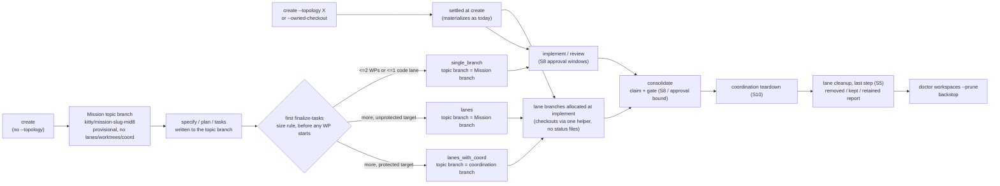

# Mission Specification: Lane and worktree model hardening

**Mission Branch**: `kitty/mission-lane-worktree-model-hardening-01M6QY1M` (topology `lanes`, consolidating into the topic branch `issue-7276-lane-worktree-hardening`)  
**Created**: 2026-11-06  
**Status**: Draft  
**Input**: User description: "Apply the 2026-11-06 operator rulings on the lane, worktree and coordination model (epic #7276): one status read contract (S1 #7277), the for_review gate on the lane branch (S2 #7278), short-lived lane checkouts as an ADR plus one checkout helper (S3 #7279), cleanup as the last consolidation step (S5 #7280), lane checkouts that never show status files (S6 #7281), topology settled at finalize-tasks by Mission size (S7 #7282), per-WP approval windows for `single_branch` (S8 #7283), the worktree-free coordination write ADR set (S9 #7284) and the doctrine and command-skill text that teaches all of it (S11 #7285)."

The binding rulings are the twelve resolved Decision Moments of this Mission (`spec-kitty agent decision list --mission lane-worktree-model-hardening-01M6QY1M`). Rulings 1, 3, 6 and S8 back-compat are read as refined by the escalation answers of the same day. Slices S4 (#7264, destructive-operation authority) and S10 (#7265, late-window design pass) are owned elsewhere; this Mission consumes them and does not redesign them.

**Why this Mission.** The lane, worktree and coordination model is the largest single source of friction in the tracker and tracer files. The same Mission state reads differently depending on which checkout a command runs from. Gates depend on checkouts that may not exist. `single_branch` work can land after approval without any bound. Checkouts and branches outlive the Mission with no owner. This Mission shortens the path from an approved work package to a verified landing and removes these failure modes. It does not weaken any existing gate.

## User Scenarios & Testing *(mandatory)*

Actors: the **operator** (a human running Spec Kitty), the **implementing agent** and the **reviewing agent** (agent harnesses driving the CLI), and the **external orchestrator** (a tool calling `spec-kitty orchestrator-api`).

### User Story 1 - Every command reads one Mission state (S1 #7277) (Priority: P1)

- **Actor:** an operator or agent running any status-reading command (`agent tasks status`, `next`, `consolidate`, `accept`, `implement`, `retrospect`, `orchestrator-api`).
- **Trigger:** the command runs while the coordination worktree is absent or empty, or from inside a lane checkout or the coordination worktree.
- **Outcome:** every command reads the same WP states from the resolved status surface.
- **Exception:** the coordination branch ref is unreadable, so the command fails closed with a typed error and never reports "no events".

**Why this priority**: four different answers for one state (#6466, #7198) are the root of wrong verdicts at exit 0. Every other slice relies on one read contract.

**Independent Test**: build a `lanes_with_coord` Mission with three committed coordination events, a stale repository root copy and a stale lane copy. Remove the coordination worktree. Run each status reader from the repository root, the lane checkout and the coordination path, and compare the results.

**Acceptance Scenarios**:

1. **Given** a coordination Mission whose coordination worktree is absent, **When** any status reader runs, **Then** it reports the three committed events, never an empty history or the repository root checkout's copy.
2. **Given** a `lanes` Mission whose lane copy says `planned` while the write checkout says `in_progress`, **When** a reader runs from inside the lane checkout, **Then** it reports `in_progress`.
3. **Given** a coordination branch ref that cannot be read, **When** a reader runs, **Then** it exits non-zero with a typed "unreadable status surface" error, **And** an absent log file on a readable ref still reads as an empty history.

---

### User Story 2 - Hand off for review without a lane checkout (S2 #7278) (Priority: P1)

- **Actor:** implementing agent or external orchestrator.
- **Trigger:** `in_progress -> for_review` through `agent status emit`, `orchestrator-api transition` or `move-task`, after the lane checkout was removed.
- **Outcome:** the move passes when the lane branch carries commits beyond its base.
- **Exception:** the lane branch ref is missing, so the move refuses with its own reason naming the branch.

**Why this priority**: today the gate requires a live checkout, which invites `--force`. This also blocks short-lived checkouts (ruling 5).

**Independent Test**: commit on a lane, remove its checkout, then drive all three surfaces.

**Acceptance Scenarios**:

1. **Given** a lane branch with one commit beyond its base and no lane checkout, **When** the WP is moved to `for_review` on any of the three surfaces, **Then** the move succeeds on all three.
2. **Given** no commit beyond the base, **When** the move is attempted, **Then** it refuses and the reason names the branch and base without mentioning a worktree.
3. **Given** the lane branch ref was deleted, **When** the move is attempted, **Then** it refuses with the distinct "lane branch missing" reason and never passes vacuously.
4. **Given** the lane branch was advanced from another checkout while the predicted checkout lags, **When** the gate runs, **Then** it reads the branch ref, not any checkout's `HEAD`.

---

### User Story 3 - Small Missions stay small; topology is chosen once at finalize (S7 #7282) (Priority: P1)

- **Actor:** operator running `specify` / `agent mission create` and then `finalize-tasks`.
- **Trigger:** a Mission is created without `--topology`.
- **Outcome:**
  - `create` mints one Mission topic branch and nothing else: no lanes, no worktrees, no coordination branch.
  - The first `finalize-tasks` settles the topology by size and only then materializes it.
- **Exception:** the write checkout is occupied or dirty when settlement needs it, so settlement refuses and the Mission stays provisional with nothing changed.

**Why this priority**: tracer files record many scaffolds hand-removed after `specify` chose a coordination topology on a protected branch. Shrinking a lane or coordination topology into `single_branch` is the most expensive transition; growing from one topic branch is cheap (operator rationale).

**Independent Test**: create Missions on a protected and an unprotected target without `--topology`, finalize them with 2 WPs, with 5 WPs in 3 lanes, and with 5 WPs collapsing to one lane, then inspect branches, worktrees and `meta.json`.

**Acceptance Scenarios**:

1. **Given** no `--topology`, **When** `create` runs on a protected target, **Then** exactly one new branch exists, no worktree or coordination branch exists, and `meta.json` records a default, provisional topology.
2. **Given** that Mission with 2 WPs, **When** `finalize-tasks` runs, **Then** it settles to `single_branch`, the topic branch is the Mission branch, and every pre-finalize status event is still readable.
3. **Given** 5 WPs in 3 code lanes on a protected target, **When** `finalize-tasks` runs, **Then** it settles to `lanes_with_coord` and the topic branch becomes the coordination branch. On an unprotected target it settles to `lanes`.
4. **Given** `--topology lanes` at create with 1 WP, **When** finalize runs, **Then** the topology stays `lanes` (an explicit topology wins).
5. **Given** a settled Mission, **When** finalize runs again with more WPs, **Then** the topology does not change.
6. **Given** a Mission created before this release (no `topology_source`), **When** finalize runs, **Then** its topology never changes.

---

### User Story 4 - No unreviewed content lands on a `single_branch` Mission (S8 #7283) (Priority: P1)

- **Actor:** operator running `spec-kitty consolidate` or `orchestrator-api consolidate-mission`.
- **Trigger:** content was committed on the Mission branch after a WP's approval and outside every later WP's review window.
- **Outcome:** consolidation refuses `LANE_MOVED_AFTER_APPROVAL`, naming the commit and the preceding WP, before any branch moves.
- **Exception:** for a Mission approved before this release, every unstamped approval refuses `APPROVAL_STAMP_MISSING` until the operator attests it per WP.

**Why this priority**: S7 routes most small Missions to `single_branch`, which is unbounded today. S8 must land before or with S7 (ruling 1).

**Independent Test**: on a `single_branch` Mission with a minted Mission branch, run the window scenarios (late commit after the last approval; a late commit between two approvals; overlapping review; rework after a later approval) through `consolidate`.

**Acceptance Scenarios**:

1. **Given** WP01 approved and then a content commit `X`, **When** consolidate runs, **Then** it refuses `LANE_MOVED_AFTER_APPROVAL` naming `X`, the target is unchanged and the exit code is 1.
2. **Given** WP01 approved, then `X`, then WP02 claimed after `X` and approved, **When** consolidate runs, **Then** it refuses naming `X` (per-WP window, not only the last stamp).
3. **Given** WP02 committed while WP01 was under review and both were approved, **When** consolidate runs, **Then** it passes (no false refusal).
4. **Given** the scenario-2 refusal, **When** WP01 is sent back and approved again, **Then** the next run passes.
5. **Given** an in-flight Mission whose approvals carry no stamp, **When** consolidate runs, **Then** it refuses `APPROVAL_STAMP_MISSING`, **And** `--attest-approved-reviewed WP01 --attest-reason "..."` lifts the refusal for WP01.
6. **Given** a commit added to the Mission branch between claim and gate, **When** the gate re-checks, **Then** it refuses and the target is restored by the one rollback authority.

---

### User Story 5 - Lane checkouts never show or change status (S6 #7281) (Priority: P1)

- **Actor:** implementing agent working in a lane checkout, on any topology with code lanes.
- **Trigger:** a lane checkout is created by allocation, recovery, lifecycle sync, review or a printed recreate command.
- **Outcome:**
  - The checkout has no `status.events.jsonl` or `status.json` on disk.
  - Spec Kitty never writes or commits them in a lane.
  - No reader reads them.
- **Exception:** an existing lane worktree holds status rows that exist nowhere else. The migration leaves that worktree untouched and reports the event ids; it never drops them.

**Why this priority**: lane copies are pure carrying cost and the source of #6466. The restated ruling 3 keeps the inherited blob in lane history, so it does not trip consolidation or ADR `2026-07-29-1` Assert A'.

**Independent Test**: allocate a `lanes` Mission lane, recreate it through every creation route, and run the migration over a fixture with clean, redundant-dirty and unique-dirty lane copies.

**Acceptance Scenarios**:

1. **Given** a `lanes` Mission, **When** a lane checkout is allocated, **Then** no Mission status file is on disk in it, **And** the lane branch tree still carries the fork-time blob.
2. **Given** a status write whose target resolves inside a registered lane checkout, **When** it is attempted, **Then** it refuses, **And** the same write aimed at the coordination worktree still succeeds.
3. **Given** a lane worktree with a dirty status copy whose events are all on the resolved surface, **When** the migration runs, **Then** the exclusion is applied and the copy is flagged.
4. **Given** a dirty copy with an event id missing from the surface, **When** the migration runs, **Then** that worktree is left untouched and the report names the event id, **And** a second migration run changes nothing.

---

### User Story 6 - Consolidation ends with cleanup, and a kept lane is a report, not a crash (S5 #7280) (Priority: P2)

- **Actor:** operator running `consolidate`, `accept --mode pr`, `orchestrator-api consolidate-mission` or `mission close --discard`.
- **Trigger:** the landing is verified (consolidate) or the acceptance is committed (pr mode).
- **Outcome:**
  - Lane worktrees and lane branches are removed as the final step, through one cleanup module, without waiting for an asynchronous PR merge.
  - The retention policy is honoured.
- **Exception:** a lane cannot be removed safely (dirty, process inside it, tip moved, proof unavailable). It is kept and reported with its code, remedy and command, and the command still exits 0 after a verified landing.

**Why this priority**: today no step owns removal after a PR landing (#7173), and a refusal after a verified landing surfaces as a traceback.

**Independent Test**: dirty one lane worktree after preflight, run consolidate, and compare the outcome across the executor and orchestrator-api paths. Run `accept --mode pr` before the PR merges.

**Acceptance Scenarios**:

1. **Given** a lane worktree dirtied after preflight, **When** consolidate lands, **Then** it exits 0, prints "Kept" with the code and a working remedy, clears the consolidation record and keeps the worktree.
2. **Given** the same fixture, **When** `orchestrator-api consolidate-mission` runs, **Then** its envelope reports the same per-lane outcome.
3. **Given** a Mission with `retain_worktrees`, **When** consolidate lands, **Then** its lanes are reported "retained by policy", distinct from "kept".
4. **Given** a lane branch already missing, **When** cleanup runs, **Then** its lane-tip ref survives.
5. **Given** a committed `accept --mode pr` whose lane tips are absorbed by the pushed PR head, **When** acceptance finishes, **Then** those lane worktrees and branches are removed before the PR merges, unpushed lanes are kept and reported, and no raw `git worktree remove` advice is printed.

---

### User Story 7 - Short-lived lane checkouts are decided and prepared (S3 #7279) (Priority: P2)

- **Actor:** maintainers reading the governing ADR; the CLI creating lane checkouts.
- **Trigger:** a lane checkout is needed.
- **Outcome:**
  - ADR `2026-04-03-1` Core Decision 3 is amended so that a lane branch is long-lived and a lane checkout belongs to one workflow action; releasing a checkout commits or refuses.
  - Every lane checkout is created by one helper.
- **Exception:** none at runtime. The lease implementation is a follow-up Mission.

**Why this priority**: it unblocks ruling 5 and gives S6 its single creation seam. The runtime lease is deliberately deferred.

**Independent Test**: an architectural gate finds no lane `git worktree add` outside the helper, and the helper's checkouts carry the lane-tip hook and the status exclusion.

**Acceptance Scenarios**:

1. **Given** each lane-checkout creation route, **When** it runs, **Then** the checkout comes from the one helper and the lane-tip hook fires on a commit in it.
2. **Given** a planted raw lane `git worktree add` in a scanned source, **When** the gate runs, **Then** it reports the violation.

---

### User Story 8 - The worktree-free coordination write is decided before it is built (S9 #7284) (Priority: P3)

- **Actor:** maintainers of the core CLI and of `spec-kitty-events`.
- **Trigger:** write-service migration step 4 (#6117) approaches.
- **Outcome:** five decision records and one amendment state how the coordination branch is written by commit, read, gated and published without a coordination worktree.
- **Exception:** none. The records are Proposed until the operator accepts them, and options the rulings leave open stay open with a recommendation.

**Why this priority**: ADRs only (ruling 4). The `mission-write` contract must gain the coordination-ref surface before its 1.0.0 release.

**Independent Test**: a reviewer maps each ADR `2026-10-22-1` D-6 obligation to one drafted record.

**Acceptance Scenarios**:

1. **Given** the drafted set, **When** a reviewer checks D-6, **Then** every bullet maps to exactly one record, and each record names its confirmation tests.

---

### User Story 9 - Agents are taught the model that ships (S11 #7285) (Priority: P3)

- **Actor:** implementing and reviewing agents reading command skills and pack doctrine.
- **Trigger:** a stale lane, a status question, cleanup, or a recovery code (`DESTROYED_LANE`, `LANE_WORK_TIP_UNKNOWN`).
- **Outcome:** agents read status through the CLI, use one worktree vocabulary, say `consolidate`, and follow the command the CLI prints.
- **Exception:** text for behaviour this Mission does not ship (the lease) is withheld.

**Why this priority**: doctrine currently teaches manual `git merge` inside lane worktrees and never says where status lives (research §3.7).

**Independent Test**: grep tests over the core skills and the CLI stale-lane message; the pack patch applies cleanly to the pinned open-packs tree.

**Acceptance Scenarios**:

1. **Given** a stale lane, **When** the CLI reports it, **Then** the remedy is a `spec-kitty` command, with no `cd .worktrees/` and no `git merge`.
2. **Given** the core command skills, **When** the guard runs, **Then** it finds no `spec-kitty merge`, no manual stale-lane recipe and no hand status-commit advice.

---

### Edge Cases

- **Explicit-topology create window.** A coordination branch exists, but its first status event is not written yet. The read contract falls back to the write checkout, by a declared rule and never silently.
- **Registry unreadable during root normalisation.** The read fails closed rather than reading a lane copy.
- **Settlement after a WP was claimed** (an out-of-order re-finalize). There is no settlement; the topology stays.
- **Settlement interrupted** after a git step (for example, after the write checkout switch). Compensation restores the provisional state byte for byte.
- **A size-rule tie.** Exactly 2 WPs with 2 code lanes gives `single_branch` (the WP-count arm wins). 0 code lanes gives `single_branch`.
- **Canceled WPs** do not count toward the WP count. Planning-artifact WPs do count.
- **`--pr-bound` on a protected target** where coordination is not reachable. The existing reachability rule is reused at settlement; see Assumption A-5.
- **`single_branch` Mission branch rebased onto the target after approval.** Consolidate refuses `APPROVAL_STAMP_NOT_ON_LANE`, and attestation is the remedy.
- **Missing open stamp `O_k`.** The window degrades to `(claim base, S_k]` and is logged as a residual.
- **Tool commits after approval.** `spec-kitty upgrade` committing agent directories on the Mission branch is a true positive. The refusal text says how to recover.
- **Lane worktree mid-merge or mid-rebase.** The migration skips it and the cleanup keeps it, reporting why.
- **Non-Linux platforms** where the process probe is unavailable. Once the remover is bound to the destructive guard, lanes are kept and reported, never removed blind.
- **`--abort` after a partial cleanup.** It never tries to restore deleted lane branches. The recovery hint points at the discarded record.
- **PR closed and its remote branch deleted** after pr-mode cleanup. The lane is recoverable from the discarded-tip record.
- **A coordination teardown refusal.** Its non-zero exit codes are unchanged (S10 owns them); the lane legs still report.
- **A lane branch whose history carries auto-rebase union merges** of status files. The doctor probe compares against the merge-base, so merged-in coordination bytes do not count as lane-authored changes.

## Requirements *(mandatory)*

### Functional Requirements

**S1 #7277: one status read contract**

| ID | Title | User Story | Priority | Status | Delivery | No-op passable? |
|----|-------|------------|----------|--------|----------|-----------------|
| FR-001 | One read entry point per topology | As an operator, I want every status read to resolve through one entry point that returns a declared source so that every command reports the same WP states. The source is: the write checkout for `single_branch`, `lanes` and provisional Missions; the coordination branch for `coord` / `lanes_with_coord` (its worktree file when materialized, the committed branch otherwise); and the repository root checkout of the target once consolidated. | High | Open | [build] | no |
| FR-002 | Root normalised at every entry; never a lane root or missing path | As an agent running from a lane checkout, I want every root-taking status entry point to re-anchor a lane root to the repository root (finishing #6884), and never return a lane directory or a path that does not exist, so that a lane copy is never read as truth. | High | Open | [build] | no: positive control: a repository-root input is returned unchanged on the same fixture |
| FR-003 | Absent or empty coordination worktree reads the branch | As an operator, I want a Mission whose coordination branch exists but whose worktree is absent or empty to read the committed branch, so that status survives short-lived checkouts. When the branch holds no log yet, the read falls back to the write checkout under a declared rule. Owned checkouts follow the same rule instead of raising. | High | Open | [build] | no |
| FR-004 | Bad ref is not an absent file | As an operator, I want the branch reader to raise a typed error for a missing or unreadable ref and to return an empty history only for an absent file on a readable ref, so that a broken ref never reads as genesis. | High | Open | [build] | no |
| FR-005 | Every reader on the entry point | As a maintainer, I want every status reader in the CLI on the one entry point, with the retired names removed, so that no adapter can drift. That covers the direct resolver calls, the placement status-state reads and the command-local helpers. | High | Open | [build] | no |
| FR-006 | Empty-allowlist call-site gate | As a maintainer, I want an architectural gate that fails on any status read outside the entry point, so that the contract cannot erode. It must catch a direct call, an aliased import, an attribute call, an aliased status kind and a hand-joined events path. It has an empty allowlist, a scanned-file floor, a caller floor and planted-violation self-tests, and it amends (not bypasses) the existing gates that bless the old body. | High | Open | [build] | no |
| FR-007 | Read-contract ADR | As a maintainer, I want an ADR or amendment that records the contract and explicitly reverses `coord-artifact-single-home-01M3V4BE#FR-017` and `coord-artifact-single-home-01M3V4BE#C-002` (the loud repository-root fallback for an empty coordination surface), so that the behaviour change is governed. | High | Open | [build] | no |

**S2 #7278: for_review gate on the lane branch**

| ID | Title | User Story | Priority | Status | Delivery | No-op passable? |
|----|-------|------------|----------|--------|----------|-----------------|
| FR-010 | Count commits on the lane branch | As an implementing agent, I want the shared for_review gate to count commits on `refs/heads/<lane>` beyond its base from the repository root, so that the verdict never depends on a checkout. | High | Open | [build] | no |
| FR-011 | Pass with the lane checkout absent | As an implementing agent, I want the gate to pass with the lane checkout absent when the lane branch carries a commit beyond its base, so that I never need `--force`. | High | Open | [build] | no: positive control: same fixture without a commit refuses |
| FR-012 | Distinct refusal for a missing branch | As an operator, I want a missing lane branch ref to refuse with its own reason naming the branch, so that it is never confused with "no commits" and never passes vacuously. | High | Open | [build] | no |
| FR-013 | Surface parity | As an external orchestrator, I want `agent status emit`, `orchestrator-api transition` and `move-task` to give the same verdict for the same lane state with the checkout absent, so that no surface is a workaround for another. | High | Open | [build] | no |
| FR-014 | Honest refusal text and option-safe refs | As an operator, I want the "no commits" refusal to name the branch and base without asking me to commit in a lane worktree, and a ref beginning with `-` never to be read as an option, so that the remedy is true and the probe is safe. | Medium | Open | [build] | no |

**S3 #7279: short-lived lane checkouts (decision and seam)**

| ID | Title | User Story | Priority | Status | Delivery | No-op passable? |
|----|-------|------------|----------|--------|----------|-----------------|
| FR-020 | ADR `2026-04-03-1` amendment | As a maintainer, I want Core Decision 3 amended so that a lane branch is long-lived and a lane checkout is held for one workflow action. The amendment must also record: the acquire and release points; that releasing commits or refuses; that the tip is recorded before a guarded removal; attached checkouts; re-entry; harness working directories across turns; the review lock outside the checkout; auto-rebase without a held checkout; migration; and confirmation criteria. The lease implementation is recorded as a follow-up, so that ruling 5 is governed before it is built. | High | Open | [build] | no |
| FR-021 | One lane-checkout helper | As a maintainer, I want every lane checkout created by one helper, so that every route gets the same setup. The routes are: allocation (fresh, legacy, recovery), lifecycle-sync recreate, review checkout and printed recreate commands. The helper installs the lane-tip hook, the local excludes and the status exclusion. | High | Open | [build] | no |
| FR-022 | Single-seam gate for lane checkouts | As a maintainer, I want an architectural gate that fails on any lane `git worktree add` outside the helper, with planted-violation self-tests, so that the seam holds. | Medium | Open | [build] | no |

**S5 #7280: cleanup as the last consolidation step**

| ID | Title | User Story | Priority | Status | Delivery | No-op passable? |
|----|-------|------------|----------|--------|----------|-----------------|
| FR-030 | One lane-cleanup module behind a remover port | As a maintainer, I want the consolidate executor, `orchestrator-api consolidate-mission` and `mission close --discard` to share one lane-cleanup module that removes through a remover port, so that the three copies of lane teardown and their branch-name drift become one. | High | Open | [build] | no |
| FR-031 | Cleanup is the last step | As an operator, I want coordination teardown first, then the lane legs, then the consolidation record cleared, with nothing mutating afterwards, so that a coordination refusal leaves lanes in place as evidence. | High | Open | [build] | no |
| FR-032 | Kept lanes are reported, never a traceback | As an operator, I want any lane the remover cannot remove after a verified landing reported with its lane, code, remedy and command, the record cleared and exit 0, so that a safe landing never looks like a failure. | High | Open | [build] | no |
| FR-033 | Retention policy honoured and named | As an operator, I want `retain_branches` / `retain_worktrees` and the CLI flags to keep their precedence, and retained lanes reported as "retained by policy" separately from "kept", so that I can tell intent from refusal. | Medium | Open | [ratchet] | yes: paired with the same fixture without retention, where lanes are removed |
| FR-034 | Lane-tip ref cleared only after a confirmed delete | As an operator, I want a lane-tip ref cleared only once its branch deletion is confirmed, so that the last reference to an unabsorbed lane survives a missing branch. | High | Open | [build] | no |
| FR-035 | Resume after a crash inside cleanup | As an operator, I want a `--resume` after a kill following cleanup's own commits to complete without re-running the gate against deleted lane branches, proven by a red-first test written before any fix, so that an interrupted cleanup is not a dead end. | Medium | Open | [build] | no |
| FR-036 | `accept --mode pr` cleans up without waiting for the merge | As an operator landing through a pull request, I want a committed pr-mode acceptance to remove, through the same module, each lane whose tip the pushed PR head absorbs, keep and report the rest, and stop printing raw `git worktree remove` / `git branch -d` advice, so that nothing waits for the asynchronous merge. | High | Open | [build] | no |
| FR-037 | Port bound to the destructive guard | As a maintainer, I want the remover port bound, once #7275 merges, to the #7264 proof entry in `git/destructive_guard.py`, with the local landing proof (the target at the gate-passed tip) and updated routing pins, so that ruling 7 holds for cleanup. | High | Open | [build] | no |
| FR-038 | ADR `2026-11-06-1` amendment draft | As a maintainer, I want an amendment drafted in this Mission. It extends the scope to consolidation cleanup, pr-mode cleanup and the prune backstop for Mission lanes, and adds: the local landing proof; "probe unavailable means keep and report"; the residue versus never-`--force` rule; a named tool-owned scratch exemption; lane-tip and tombstone ops as guarded; and the deferred sites. It is drafted here so that the operator can land it with or after #7275. | High | Open | [build] | no |
| FR-039 | Prune backstop covers consolidated Mission lanes | As an operator, I want `doctor workspaces --prune` to treat a lane of a consolidated or pr-accepted Mission as a removal candidate under the same proofs, when no consolidation record is active and no retention is declared, so that the remedy printed for a kept lane actually works. | Medium | Open | [build] | no: positive control: an active record keeps the lane report-only |
| FR-039a | Per-lane outcomes in the orchestrator envelope | As an external orchestrator, I want `consolidate-mission` to return per-lane removed, kept and retained outcomes under one minor contract version bump, so that I can act on kept lanes. | Medium | Open | [build] | no |

**S6 #7281: lane checkouts never show status files**

| ID | Title | User Story | Priority | Status | Delivery | No-op passable? |
|----|-------|------------|----------|--------|----------|-----------------|
| FR-040 | Status exclusion on every lane checkout | As an implementing agent, I want every lane checkout on every topology with code lanes, `lanes` included, to exclude the Mission's status files from disk at creation (through FR-021), so that I never see a stale copy. | High | Open | [build] | no |
| FR-041 | Status writes never target a lane checkout | As an operator, I want the status write seam to refuse any write whose target is inside a registered lane checkout, classified by the worktree registry and not by path shape, so that the `.worktrees/` labelling hole is closed. | High | Open | [build] | no: positive control: the same write to the coordination worktree succeeds |
| FR-042 | Spec Kitty lane commits never change status files | As an operator, I want the deliverable auto-commit and every Spec Kitty-owned lane commit to leave the Mission status files unstaged on every topology, so that lanes never change them. | High | Open | [ratchet] | yes: paired with a deliverable file staged in the same commit fixture |
| FR-043 | Readers never read lane copies | As an operator, I want no reader to read a lane checkout's status files, so that ruling 8 holds. | High | Open | [folded] | no: folded into FR-002 and FR-005 |
| FR-044 | Migrate existing lane worktrees | As an operator upgrading, I want a re-runnable migration that brings existing lane worktrees in line, so that no status event is lost on the way. It applies the exclusion to clean worktrees. It flags and excludes a dirty copy whose events are all on the resolved surface. It leaves untouched a worktree whose copy holds events found nowhere else, and reports their ids. It skips worktrees that are mid-merge or mid-rebase. It never drops an event. | High | Open | [build] | no |
| FR-045 | Doctor probe for lane-authored status changes | As a maintainer, I want a doctor finding that lists every live lane branch whose status files differ from its merge-base with the branch it consolidates into, so that retiring the auto-rebase status merger can later be proven safe. The merger and the lane-side deletion refusals stay in this Mission. | Medium | Open | [build] | no |
| FR-046 | Per-topology exclusion rule recorded | As a maintainer, I want an amendment to ADR `2026-07-29-1` (or a short new ADR) that states the restated ruling 3 for every lane topology and keeps Assert A', so that the rule is governed. The restated ruling: checkouts never show status files, lanes never change them, readers never read them, and the fork-time blob stays in lane history. | Medium | Open | [build] | no |

**S7 #7282: topology settled at finalize-tasks by Mission size**

| ID | Title | User Story | Priority | Status | Delivery | No-op passable? |
|----|-------|------------|----------|--------|----------|-----------------|
| FR-050 | Topology ADR | As a maintainer, I want an ADR that supersedes #5100 item 2 and amends ADR `2026-06-22-1` Decision 2 to "stored at create, settled once at the first finalize, read thereafter", so that the reversal is governed. It must state: the size rule; the protected-target mapping (A-3); deferred materialization; `topology_source`; decide-once; and the S8 dependency. | High | Open | [build] | no |
| FR-051 | Create without a topology mints only a topic branch | As an operator, I want `create` without `--topology` to mint exactly one Mission topic branch and nothing else, whatever the target's protection, and to record `topology_source: default` with a provisional topology, so that nothing is built that might have to be torn down. Nothing else means no lane, no lane or coordination worktree and no coordination branch. | High | Open | [build] | no: positive control: explicit `--topology coord` on the same repository still creates its coordination branch |
| FR-052 | An explicit topology wins and materializes at create | As an operator, I want `--topology` (`topology_source: explicit`) and `--owned-checkout` (`owned_checkout`) to behave as today, so that explicit intent is never second-guessed. | High | Open | [ratchet] | yes: paired with FR-051 on the same repository |
| FR-053 | Size rule | As an operator, I want a provisional Mission settled by size: `single_branch` when it has at most 2 non-canceled WPs or at most one code lane; otherwise `lanes` on an unprotected target and `lanes_with_coord` on a protected target, so that small work stays cheap. | High | Open | [build] | no |
| FR-054 | Settled once, before any WP starts | As an operator, I want the topology settled only at the first finalize, before finalize's first status write and before any WP is claimed, so that no lane or WP is ever re-homed. Re-finalize, the legacy tasks-finalize repair path and doctor rebuilds never re-decide, and growth after settlement keeps the settled topology. | High | Open | [build] | no |
| FR-055 | Materialization after settlement, nothing stranded | As an operator, I want settlement to give the topic branch its settled role, write the lane manifest, and let lane branches and worktrees be created only by the allocation path after settlement, so that every planning artifact and status event written before settlement stays readable through the resolved surface. The topic branch becomes the Mission branch for `single_branch` / `lanes`, or the coordination branch for `lanes_with_coord`, under the same ref name. | High | Open | [build] | no |
| FR-056 | Atomic settlement with occupancy refusal | As an operator, I want settlement to refuse when it needs a write checkout that is occupied by another in-progress WP or is dirty (#5676), and on any failure to leave the Mission provisional with `meta.json` and branch tips unchanged, so that a failed finalize costs nothing. | High | Open | [build] | no |
| FR-057 | Legacy Missions count as settled | As an operator with existing Missions, I want a Mission with no `topology_source` treated as settled and never re-decided, so that upgrading changes no in-flight Mission's shape. | High | Open | [ratchet] | yes: paired with FR-053 on a provisional Mission in the same fixture |
| FR-058 | Preview and report the decision | As an operator, I want `finalize-tasks --validate-only` to preview the decision without writing anything, `finalize-tasks --json` to report the decision (rule, WP count, code-lane count, provisional and settled topology), and `create --json` to mark a provisional topology, so that the decision is visible and scriptable. | Medium | Open | [build] | no |
| FR-059 | Help text and docs describe the size default | As an operator, I want the `--topology` help for `create`, `specify` and `orchestrator-api specify` to come from one shared text, and `docs/context/topology.md`, `docs/architecture/execution-lanes.md` and CLAUDE.md to describe the size default and the topic branch, never explicit-only, so that I am told what actually happens. The docs must also state that the coordination branch shares the Mission branch's name. | Medium | Open | [build] | no |
| FR-060 | `--commit-to-target` still needs an explicit `single_branch` | As an operator, I want `--commit-to-target` to keep requiring `--topology single_branch`, so that a provisional Mission never writes straight to its target. | Medium | Open | [ratchet] | yes: paired with an explicit `single_branch` create that accepts it |

**S8 #7283: per-WP approval windows for `single_branch`**

| ID | Title | User Story | Priority | Status | Delivery | No-op passable? |
|----|-------|------------|----------|--------|----------|-----------------|
| FR-070 | Stamp approvals with the write-branch head | As a reviewer, I want every lifecycle transition of a WP in a Mission whose stored topology is `single_branch` to carry the Mission write branch's head as its lane-head stamp (gated on the stored topology, never on the planning-lane shape), so that approvals bound the content. A `lanes` Mission's planning lane stays unstamped. | High | Open | [build] | no: positive control: a `lanes` planning-lane WP returns no stamp on the same run |
| FR-071 | Content after the last approval refuses | As an operator, I want consolidate to refuse `LANE_MOVED_AFTER_APPROVAL` at claim time when the Mission branch carries content committed after the newest approval stamp, so that late content never lands under the verified banner. | High | Open | [build] | no |
| FR-072 | Every content commit inside an approval window | As an operator, I want each content commit between the claim base and the Mission branch tip to lie in at least one approved WP's window `(O_k, S_k]`, so that content slipped in between two approvals is caught. Otherwise consolidate refuses `LANE_MOVED_AFTER_APPROVAL`, naming the commit and the preceding WP. `O_k` is the stamp on the WP's first governed claim and `S_k` the stamp on its newest approval. Overlapping windows are accepted. | High | Open | [build] | no |
| FR-073 | Gate re-check reads the Mission branch | As an operator, I want the gate re-check to compare the Mission branch's live tip against its claim-time tip (never the planning-lane alias that resolves to the target) and restore through the one rollback authority, so that a commit landing mid-run is refused. The run's own bookkeeping commits never refuse. | High | Open | [build] | no |
| FR-074 | Back-compat by refuse plus attest | As an operator upgrading with in-flight `single_branch` Missions, I want each unstamped approval to refuse `APPROVAL_STAMP_MISSING`, with `--attest-approved-reviewed <WP> --attest-reason` lifting it per WP, and a rebased Mission branch to refuse `APPROVAL_STAMP_NOT_ON_LANE`, so that the lanes precedent applies unchanged. | High | Open | [build] | no |
| FR-075 | Warnings at approval time | As a reviewer, I want `move-task` and `agent status emit` to print the existing unstamped-approval and forced-approval warnings for `single_branch` Missions, so that I learn of a weak approval before consolidation. | Medium | Open | [build] | no |
| FR-076 | No contract change for S8 | As an external orchestrator, I want S8 refusals through `consolidate-mission` to arrive as today's `PREFLIGHT_FAILED` with the reused codes in `preflight_error_codes`, so that my integration needs no change. | High | Open | [ratchet] | yes: paired with the FR-071 fixture asserting the code appears |
| FR-077 | ADR `2026-10-04-5` amendment | As a maintainer, I want an amendment that narrows the "planning lanes and `single_branch`" residual to per-WP windows, so that the remaining residuals are explicit. It records: the commit-to-target and direct-on-target unbounded residual; the missing-`O_k` degrade; the commit-during-review residual; and refuse-plus-attest. | High | Open | [build] | no |
| FR-078 | Commit-to-target stays unbounded and pinned | As a maintainer, I want a Mission whose write branch is its target to keep today's behaviour, pinned by a strict expected-failure test that names the residual, so that the gap is visible rather than silently assumed closed. | Medium | Open | [ratchet] | yes: paired with FR-071 on a minted Mission in the same suite |

**S9 #7284: worktree-free coordination write (ADRs only)**

| ID | Title | User Story | Priority | Status | Delivery | No-op passable? |
|----|-------|------------|----------|--------|----------|-----------------|
| FR-080 | Core ADR C-1: the coordination branch is written by commit | As a maintainer, I want a Proposed ADR stating that the coordination branch stays the lifecycle home and is written by commit with no coordination worktree, so that step 4 has a governed target. It must cover every coordination-partition kind (events, notes, trace, issue matrix, decision artefacts), `status.json`, the ref read contract, the retired refusal codes and the drain-and-remove migration under the destructive guard. Open choices are presented as options with a recommendation. | Medium | Open | [build] | no |
| FR-081 | Core ADR C-2: gates over a worktree-less coordination branch | As a maintainer, I want a Proposed ADR recording that ref-reading gates are unchanged and that the late window reads a pinned ref, citing S10's pass and not re-deciding it, so that consolidation stays sound without a coordination checkout. It must also cover the fence between service writes and consolidation, and how resume and rollback lose the coordination checkout role. | Medium | Open | [build] | no |
| FR-082 | Core ADR C-3: the committed ledger is the coordination-branch blob | As a maintainer, I want a Proposed ADR that amends the publication seam and the read API pull to read git objects for coordination Missions, and gives the `events tail` cursor a source ref, so that consumers have one committed ledger. | Medium | Open | [build] | no |
| FR-083 | D-6 amendment | As a maintainer, I want ADR `2026-10-22-1` D-6 amended to name the records that discharge it and to add step 4a (coordination writes by commit; coordination worktree retired), so that the obligation is traceable. | Medium | Open | [build] | no |
| FR-084 | `spec-kitty-events` ADR drafts 0007 and 0008 | As a `spec-kitty-events` maintainer, I want drafts of ADR 0007 and ADR 0008 in that repository's conventions, delivered as files in this Mission, so that I can land them in my repository. ADR 0007: the write service commits a unit to a branch ref with compare-and-swap, including the `mission-write` contract changes due before 1.0.0. ADR 0008: the read service reads the coordination ledger from git objects. | Medium | Open | [build] | no |

**S11 #7285: doctrine and command skills**

| ID | Title | User Story | Priority | Status | Delivery | No-op passable? |
|----|-------|------------|----------|--------|----------|-----------------|
| FR-090 | Core command skills teach the shipped model | As an agent, I want the core command skills to teach the shipped model, so that I follow what the CLI does. That means: `consolidate`, not `merge`; status read through the CLI; no manual stale-lane recipe; no hand status commits; cleanup as consolidation's last step; the lane-branch commit count; and pointers for `DESTROYED_LANE` / `LANE_WORK_TIP_UNKNOWN`. | Medium | Open | [build] | no |
| FR-091 | Stale-lane remedy is a CLI command | As an agent, I want the CLI's stale-lane remediation to print a `spec-kitty` command, never `cd .worktrees/...` and never `git merge`, so that doctrine and CLI agree. | Medium | Open | [build] | no |
| FR-092 | Pack doctrine patch for `spec-kitty-open-packs` | As an open-packs maintainer, I want a patch against the pinned tree, delivered as a file in this Mission with hand-off steps (pin bump, `make sync-packs`, `charter pack regenerate-graph`), so that I can land it upstream. It carries the status-surface rule, the worktree vocabulary and glossary terms, the `consolidate` wording, a `lane-recovery` tactic, and the rows whose behaviour this Mission ships. | Medium | Open | [build] | no |
| FR-093 | Text never ships before its behaviour | As a maintainer, I want every new skill, pack, help or doc sentence that describes behaviour to be traceable to the FR that delivers it, and a guard test that fails on lease-behaviour text, manual stale-lane recipes, `spec-kitty merge`, or advice to hand-commit status in the core skills, so that doctrine never lies. | Medium | Open | [build] | no |

### Non-Functional Requirements

| ID | Title | Requirement | Category | Priority | Status |
|----|-------|-------------|----------|----------|--------|
| NFR-001 | Ref-read cost | A status read served from the coordination branch spawns at most one git object-read subprocess per Mission per command (batched), measured by a subprocess-count test. | Performance | High | Open |
| NFR-002 | No lost status events | Across migration (FR-044), settlement (FR-055) and cleanup (FR-030 to FR-036) fixtures, 100% of event ids present before the operation are present on the resolved surface afterwards or listed in the operation's report. | Reliability | High | Open |
| NFR-003 | Settlement atomicity | Fault injection at every git step of settlement leaves `meta.json` byte-identical and every branch tip unchanged in 100% of injected points. | Reliability | High | Open |
| NFR-004 | Exit status after a verified landing | In 100% of kept-lane and retained-lane scenarios, `consolidate` exits 0 and leaves no consolidation record behind. | Reliability | High | Open |
| NFR-005 | Migration idempotence | A second run of every migration and doctor fix added by this Mission changes 0 files, refs and sparse configurations. | Reliability | High | Open |
| NFR-006 | Gate speed | Each architectural gate added or amended by this Mission completes in at most 5 s locally on the full `src/` tree. | Performance | Medium | Open |
| NFR-007 | Approval-bound cost | The S8 claim-time check adds at most 2 s to `consolidate` for a Mission with 10 WPs and 200 commits on the Mission branch. | Performance | Medium | Open |
| NFR-008 | Cross-platform | The S2 gate, the S6 exclusion and migration, and the S5 kept-report path pass on the Linux and Windows CI lanes. Off Linux, a lane is never removed without a process proof. | Portability | High | Open |
| NFR-009 | Diff coverage | Changed lines reach at least 90% coverage (the `ci-aggregate.yml` diff-cover gate). | Maintainability | High | Open |
| NFR-010 | Complexity | No new or changed function exceeds cyclomatic complexity 15 (ruff C901 / Sonar S3776). | Maintainability | High | Open |

### Constraints

| ID | Title | Constraint | Category | Priority | Status |
|----|-------|------------|----------|----------|--------|
| C-001 | Terminology canon | Say "Mission", never "feature"; say `consolidate`, not merge, for lane consolidation; name the sense whenever "primary", "merge", "routing" or "residue" is used. | Business | High | Open |
| C-002 | Out-of-repo sources | Do not edit `packs/built-in/`, `packs/internal/` or generated agent directories. Pack doctrine is delivered as a patch for `spec-kitty-open-packs` (FR-092). | Technical | High | Open |
| C-003 | `spec-kitty-events` is read-only here | ADR 0007 and ADR 0008 are delivered as draft files in this Mission; nothing is pushed to that repository. | Technical | High | Open |
| C-004 | One destructive authority | Every worktree removal, branch deletion and ref deletion this Mission adds or moves goes through `git/destructive_guard.py` (ruling 7). No new raw `git worktree remove`, `branch -D` or `--force`. | Technical | High | Open |
| C-005 | S4 and S10 are consumed, not designed | Do not redesign the #7264 proof list or the #7265 late-window pass; cite them and build on their merged outputs. | Business | High | Open |
| C-006 | No dirty refusal on the shared for_review gate | Adding a dirty-checkout refusal to `agent status emit` / `orchestrator-api transition` is a contract change that was not ruled; the checkout-present checks stay in `move-task`. | Technical | High | Open |
| C-007 | Lease implementation is out of scope | Lease state, review-lock relocation and release-on-transition wiring are a follow-up Mission (FR-020 records them). | Business | High | Open |
| C-008 | Lane history is never rewritten | No lane-side deletion commit of status files; the fork-time status blob stays in lane history; the auto-rebase deletion refusals stay. | Technical | High | Open |
| C-009 | Never drop a status event | Migration, settlement and cleanup report lane-only or unprojected events; they never discard them. | Technical | High | Open |
| C-010 | S8 before or with S7 | No user-reachable S7 settlement ships in a release without the S8 bound. | Business | High | Open |
| C-011 | Decide once | The topology is settled at most once per Mission, before any WP starts; Missions without `topology_source` are settled. | Technical | High | Open |
| C-012 | Contract discipline | S8 adds no orchestrator-api error code. The S5 envelope change is one minor contract bump. The `topology_source` meta key is additive. | Technical | High | Open |
| C-013 | Non-vacuous gates | Every new or amended architectural gate has an empty allowlist, a scan floor and planted-violation self-tests (tactic `architectural-gate-non-vacuity`). | Technical | High | Open |
| C-014 | Migration ledger rules | New migrations get an `order_manifest.txt` entry, the correct `clone_local_effect` (sparse configuration is clone-local), an idempotent `apply()`, and no edit to a shipped migration. | Technical | High | Open |
| C-015 | Code quality gates | `ruff check`, `ruff format --check` and `mypy` clean with no new suppressions; changelog fragments in `docs/changelog/unreleased/`. | Technical | High | Open |
| C-016 | ADR conventions | Core ADRs use `docs/adr/4.x/YYYY-MM-DD-N-*.md` with the ADR template and are Proposed until the operator accepts. Amendments are appended sections. Index rows are left to the bot. The ADR `2026-11-06-1` amendment is drafted in this Mission because that ADR lives on #7275. | Business | Medium | Open |
| C-017 | Retention precedence unchanged | Explicit CLI flag, then `meta.json` retention, then the default (remove); fail-closed toward retention. | Technical | Medium | Open |

### Rules and Invariants

1. **One source per read.** A status read has exactly one declared source. It is never a lane checkout, never a path that does not exist, and never a silent fallback.
2. **Lanes carry no live status.** A lane checkout never shows the Mission's status files, Spec Kitty never changes them in a lane, and no reader reads them. The inherited blob in lane history is inert.
3. **The ref decides gates.** The for_review gate, the approval bound, the claim and attribution read refs. None of them requires a checkout to exist.
4. **Topology is decided once.** It is explicit at create, or settled at the first finalize before any WP starts. It never changes afterwards.
5. **Nothing before settlement.** Without an explicit topology, no lane, lane worktree, coordination branch or coordination worktree exists before settlement.
6. **No approval without a bound.** Every content commit that consolidates through a minted Mission branch is inside some approved WP's window. The only exception is the recorded commit-to-target residual.
7. **Cleanup never fails a verified landing.** After the landing is verified, a lane that cannot be removed is reported, and the exit code stays 0. Coordination teardown codes are unchanged.
8. **Text follows behaviour.** No doctrine, skill, help or doc sentence describes behaviour before the release that ships it.

### Key Entities

- **Resolved status surface.** The one place a Mission's status is read from and written to. It has a topology, a source kind (write checkout, coordination worktree, coordination branch ref, consolidated target) and an anchor.
- **Topology record.** The `topology` and `topology_source` fields (`explicit`, `owned_checkout` or `default`) in `meta.json`, plus the provisional or settled state and the settlement decision (rule, WP count, code-lane count).
- **Approval window.** For WP *k*, the commit range `(O_k, S_k]` between its first governed claim stamp and its newest approval stamp on the Mission branch.
- **Lane cleanup item and report.** The lane, its worktree, its branch and the expected tip, with one outcome: removed, kept (code, remedy, command) or retained by policy.
- **Lane-checkout migration report.** Per lane worktree: excluded, flagged-redundant, refused (with the lane-only event ids) or skipped (mid-operation).

## Success Criteria *(mandatory)*

### Measurable Outcomes

- **SC-001**: For one Mission, every status-reading command reports identical WP states. This holds in each coordination state (worktree present, empty or absent) and from each working directory (repository root checkout, lane checkout, coordination path). The matrix test has 0 divergent cells. — [build] · no-op passable: no
- **SC-002**: The status-read call-site gate reports 0 violations with an empty allowlist and detects 100% of its planted violations. — [build] · no-op passable: no
- **SC-003**: With the lane checkout absent and a lane commit present, `in_progress -> for_review` succeeds on all 3 surfaces. With the lane branch missing, it refuses with the distinct reason on all 3. — [build] · no-op passable: no
- **SC-004**: A lane checkout created by any route, on any topology, contains 0 Mission status files, and 100% of lane-checkout creation sites go through one helper. — [build] · no-op passable: no
- **SC-005**: After a verified landing in which one lane cannot be removed, `consolidate` exits 0, prints one kept entry with a working remedy and leaves 0 consolidation records. — [build] · no-op passable: no
- **SC-006**: After a committed `accept --mode pr`, 0 lane worktrees remain whose tips the pushed PR head absorbs, before the PR merges. — [build] · no-op passable: no
- **SC-007**: A Mission created without `--topology` has exactly 1 new branch and 0 worktrees until finalize. After finalize, a 2-WP Mission is `single_branch`, and a 3-lane Mission is `lanes` or `lanes_with_coord` according to the target's protection. — [build] · no-op passable: no
- **SC-008**: In the S8 scenario set, 100% of late or out-of-window content commits on a `single_branch` Mission branch are refused before landing, with 0 false refusals in the no-false-refusal scenarios. — [build] · no-op passable: no
- **SC-009**: Migrating existing lane worktrees loses 0 status events, and a second run changes nothing. — [build] · no-op passable: no
- **SC-010**: Each ADR `2026-10-22-1` D-6 obligation maps to exactly one of the 5 drafted records plus the amendment, and each record names its confirmation tests. — [build] · no-op passable: no
- **SC-011**: The core skills and CLI remediation contain 0 occurrences of manual stale-lane recipes, `spec-kitty merge` or lease-behaviour text, and the pack patch applies cleanly to the pinned open-packs tree. — [build] · no-op passable: no
- **SC-012**: S8 adds 0 orchestrator-api error codes, and the Mission ships exactly 1 minor orchestrator-api contract bump (for FR-039a). — [ratchet] · no-op passable: yes (paired with the SC-008 fixture asserting the reused code is emitted)

## Domain Language

| Term | Meaning in this Mission | Do not confuse with |
|------|-------------------------|---------------------|
| **Resolved status surface** | The one source a status read or write resolves to, per topology. For `single_branch`, `lanes` and provisional Missions it is the write checkout. For coordination topologies it is the coordination branch: its worktree file when materialized, otherwise the committed ref. After consolidation it is the target. A lane checkout is never a status surface (#6466, #6884). | "the primary checkout" (name the sense: repository root checkout or PRIMARY partition) |
| **Lane branch** | `kitty/mission-<slug>-lane-<id>`. The durable carrier of an execution lane's commits. It is long-lived. | lane checkout; "lane" as a WP state (`planned` … `done`) |
| **Lane checkout** (lane worktree) | A Spec Kitty-created checkout of a lane branch under `.worktrees/`. It is disposable: gates never require it, and after the S3 follow-up it is held for one workflow action. | lane branch |
| **Harness isolation worktree** | A checkout an agent harness creates for itself (for example `isolation: "worktree"`). Spec Kitty neither creates nor tracks it. It is never a status surface and never a place to run status writes. | lane checkout |
| **Coordination worktree** | A checkout of the coordination branch. It stays for now; S9 decides its retirement. | coordination branch |
| **Write checkout** | For `single_branch` (and provisional Missions), the repository root checkout or a validated owned checkout, holding the Mission branch. | lane checkout |
| **Mission topic branch** | The one branch `create` mints when no topology is given: `kitty/mission-<slug>-<mid8>`, the same name as the Mission branch and the coordination branch. Settlement gives it its role without renaming it. | target branch; the Mission's PR topic branch (`issue-NNNN-*`) |
| **Provisional topology** | A default topology before the first finalize (`topology_source: default`). Only the topic branch exists. | settled topology |
| **Settled topology** | A topology that is explicit at create, or decided once at the first finalize by the size rule. It is never changed afterwards. Legacy Missions without `topology_source` count as settled. | — |
| **Approval window** | `(O_k, S_k]` on the Mission branch: from WP *k*'s first governed claim stamp to its newest approval stamp. A content commit must lie in some approved WP's window. | approval stamp (one point); claim base |
| **Kept vs retained lane** | Kept: the remover could not prove removal safe, so the lane is reported with a code and remedy. Retained: the Mission's retention policy asked for it to stay. | — |
| **Remover port** | The single interface the lane-cleanup module removes through. It is bound to the #7264 proof entry once #7275 merges. | the destructive guard itself |

## Topology Lifecycle

## Assumptions

- **A-1 (topic branch name).** The Mission topic branch uses the existing Mission and coordination branch name `kitty/mission-<slug>-<mid8>`. Settlement therefore assigns a role and never renames or re-mints a branch (discovery brief C).
- **A-2 (where pre-settlement work lives).** Planning artifacts and status events written before settlement are committed to the topic branch, never to the target. The plan decides how the topic branch is held before settlement and how planning-partition artifacts on it are read once a coordination topology settles. The options are the write checkout, as the protected `single_branch` mint does today, or a write by commit. The spec requires only FR-055 and FR-056.
- **A-3 (protected target, the "lanes otherwise" arm).** Create no longer mints a coordination branch, and a `lanes` Mission whose status lives on a protected target is refused at consolidate (`PROTECTED_BRANCH_REFUSED`). The size rule's "lanes otherwise" therefore settles to `lanes_with_coord` on a protected target, with the topic branch promoted to the coordination branch (ruling 2), and to `lanes` on an unprotected target. `coord` (coordination, no lanes) is no longer a default outcome, because a Mission with at most one code lane settles to `single_branch`. It remains available explicitly. The rejected alternative was `lanes` with status on the topic branch held in the write checkout. It would occupy the repository root checkout for the whole Mission (#5550, #5676).
- **A-4 (`single_branch` always has a minted Mission branch).** A default `single_branch` Mission consolidates its topic branch onto the target, on protected and unprotected targets alike. That puts every size-default `single_branch` Mission inside the S8 bound. Only an explicit `--commit-to-target` falls in the unbounded residual.
- **A-5 (`--pr-bound`).** The existing coordination-reachability decision is reused unchanged at settlement in place of create.
- **A-6 (size counting).** "WPs" counts non-canceled WPs of every kind, planning-artifact WPs included. "Lanes" counts code lanes (excluding `lane-planning`). 0 code lanes settles to `single_branch`.
- **A-7 (when lanes appear).** "Lanes and worktrees are created once the topology is settled" means: the lane manifest is written at settlement, and lane branches and lane checkouts are created by the existing allocation path (`implement`), never before settlement. Nothing is pre-allocated at finalize, which matches the S3 direction.
- **A-8 (missing `O_k`).** A WP with no claim stamp degrades to the window `(claim base, S_k]` and is logged as a residual, rather than refused with a new code.
- **A-9 (S6 write check).** "Lanes never change them (a write check refuses)" is delivered at every Spec Kitty write path (FR-041, FR-042). Hand-authored lane commits are detected by the doctor probe (FR-045). A git pre-commit hook is not added.
- **A-10 (stale-lane re-entry).** Re-running `spec-kitty agent action implement <WP>` refreshes a stale lane through auto-rebase. The plan verifies this path before FR-091 names it.
- **A-11 (S5 off Linux).** Once bound (FR-037), "probe unavailable means keep and report" means that consolidation on macOS and Windows keeps lane worktrees and reports them. Branch cleanup is unaffected.
- **A-12 (S9 open choices).** Questions the rulings leave open stay open in the Proposed ADRs as options with a recommendation, never decided by this Mission. Examples: artefact partition, `status.json`, the write fence, the cursor reason, JGit or subprocess.

## Dependencies

- **#6884** (`issue-6466-lane-status-shadow`): lane root never a status surface. Rebase and land it before S1's root normalisation, keeping its tests. It is stale against main.
- **#7275** (`issue-7211-safe-landed-prune`, S4, supersedes #7237, #7239 and #7240): FR-036, FR-037 and FR-039 bind to its proof entry and edit its routing pins, so they land after it merges. FR-030 to FR-035 and FR-038 do not wait.
- **#7274** (`issue-7198-late-window-one-pass`, S10): shares `phase_teardown.py` with FR-031. S5's reorder lands after it, or is rebased onto it. C-2 (FR-081) cites the #7265 pass.
- **#7255** (`issue-7210-finalize-derived-pin`): touches finalize-tasks and ADR `2026-10-04-5`. S7's finalize phases and S8's amendment (FR-077) land after it.
- **#7248** (`issue-7224-flat-fixture-single-branch`): its fixture comment says `single_branch` is never stamped, which S8 reverses. S8 lands after it and adds a minted `single_branch` fixture.
- **Write-service migration step 4 (#6117):** S9 is ADRs only. Implementation follows step 4.
- **Internal ordering:** S1 before S6's reader claims; S2 before the S3 amendment's confirmation criteria; FR-021 before FR-040; S8 before or with S7 (C-010); the S11 text after the slice each sentence describes (FR-093).
- **Hand-offs outside this repository:** the open-packs patch (FR-092) and the `spec-kitty-events` ADR drafts (FR-084) are landed by the operator. The pack pin bump in core follows them.

## Out of Scope

- **S4 (#7264):** the proof list and `git/destructive_guard.py` itself.
- **S10 (#7265):** the late-window design pass and its fixes (#7228, #7226).
- **The S3 lease implementation:** lease records, review-lock relocation, release-on-transition wiring, `lifecycle_sync` in temporary worktrees and lease prompts.
- **Retiring the auto-rebase status union merger.** It is gated on FR-045 reporting clean.
- **A dirty-checkout refusal or an owned-file evidence check** on `agent status emit` / `orchestrator-api transition` (C-006).
- **Origin freshness for the for_review gate** (a stale local lane ref in multi-clone flows).
- **Implementing the S9 records** (write by commit, the read service over git objects, contract changes). These are records only.
- **Changing coordination teardown exit codes** (exit 1 or 75), which belong to S10.
- **A consolidate mission-step prompt.** Ruling 6 is taught in accept, the wrap-up procedure and the skills.
- **Re-shaping a settled Mission after growth** (`single_branch` to `lanes`), and the reverse migration tool.
- **Bounding commit-to-target or direct-on-target `single_branch` Missions** (recorded residual, FR-078).
- **Other destructive sites** (allocation recut). They are listed in the FR-038 draft's deferred section.
