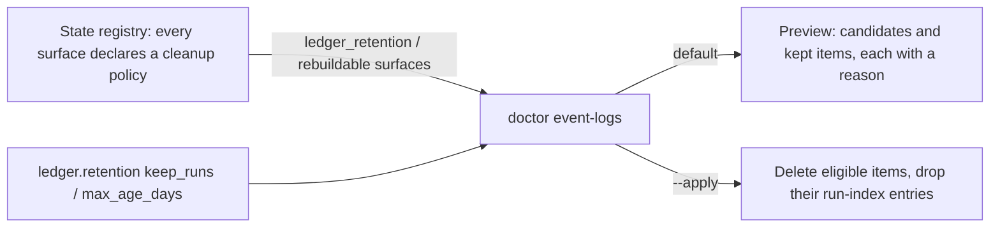

# Mission Specification: Local event-log retention

**Mission Branch**: `issue-6610-local-event-log-retention`
**Created**: 2026-10-27
**Status**: Draft
**Input**: Remediation M11 — #5212 (per-surface cleanup policy) then #6610 (local event-log retention, ADR 2026-10-13-2 D-3), with #6610 reading its policy from the #5212 field so cleanup eligibility has one owning policy.

## Intent Summary (confirmed 2026-10-27)

An operator, or an agent acting for one, runs one diagnostic command to see which local, gitignored run journals, per-Mission event logs and caches are past their retention, and adds an explicit apply flag to delete exactly those. What the command may clean is read from one place: the cleanup policy every state surface declares in the state registry. Committed ledgers are never pruned; an open Mission, a Mission this checkout cannot find, and anything still locked are always kept.

Operator rulings: `keep_runs=20`, `max_age_days=30`, delete only when both are exceeded, preview by default (2026-10-23, #6610); command name `doctor event-logs` with `--apply`, rebuildable caches in scope, unknown Missions protected and reported, and the policy shape below (2026-10-27, this Mission). Grounding: `research.md`.

## User Scenarios & Testing *(mandatory)*

### User Story 1 - Every state surface says how it is cleaned (Priority: P1)

A maintainer reading the state registry, or a tool reading its JSON form, can see for every state surface whether it is never pruned, pruned under the ledger retention policy, a rebuildable cache, cleaned by its owning command, cleaned by hand, or a retired tombstone, and which command cleans it.

**Why this priority**: It is the single policy the cleanup command reads (#5212); without it, cleanup eligibility would be a second, hand-kept list.

**Independent Test**: Load the registry; every surface carries a policy, the serialized form includes it, and a surface added without one fails the test suite.

**Acceptance Scenarios**:

1. **Given** the registry, **When** each surface is serialized, **Then** each serialized entry carries a cleanup policy with a retention rule and a cleanup command (or none).
2. **Given** a tracked surface such as the canonical status log, **When** its policy is read, **Then** the rule is "never pruned".
3. **Given** any surface declared prunable or rebuildable, **When** its git class is read, **Then** it is ignored by git.

---

### User Story 2 - Preview what retention would remove (Priority: P1)

An operator whose `.kittify/runtime/runs/` has grown runs the cleanup command with no flags. It lists every item it would delete and every item it keeps, each with its reason, and changes nothing.

**Why this priority**: Dry-run-first is the binding shape of ADR 2026-10-13-2 D-3 and the operator ruling.

**Independent Test**: Run the command against a fixture with old and new runs of completed and open Missions; the file tree is byte-identical before and after, and the report names each candidate and kept item.

**Acceptance Scenarios**:

1. **Given** 25 runs of completed Missions all older than 30 days, **When** the operator previews, **Then** the 5 oldest are listed as candidates, the newest 20 as kept ("within keep_runs"), and nothing is deleted.
2. **Given** a run of an open Mission older than 30 days and outside the newest 20, **When** the operator previews, **Then** it is kept with the reason "Mission is open".
3. **Given** a glossary log naming a Mission not present in this checkout, **When** the operator previews, **Then** it is kept with the reason "Mission not found".

---

### User Story 3 - Apply the cleanup (Priority: P1)

The operator re-runs the command with `--apply`. Exactly the previewed candidates are deleted, a deleted run's entry disappears from the run index, and the report says what was removed.

**Why this priority**: It is the outcome #6610 asks for: bounded local growth.

**Independent Test**: Apply against the same fixture; only eligible items are gone, the run index no longer names any deleted run, and every tracked file is unchanged.

**Acceptance Scenarios**:

1. **Given** an eligible run whose Mission has a run-index entry, **When** the operator applies, **Then** the run directory is gone and the index no longer has that entry.
2. **Given** a run whose run lock is held by another process, **When** the operator applies, **Then** the run is kept with the reason "lock held".
3. **Given** derived views exist, **When** the operator applies, **Then** they are deleted (they are rebuilt on the next read).
4. **Given** the Op index (`kitty-ops/ops-index.jsonl`) exists, **When** the operator applies, **Then** it is untouched: `invocations list` trusts a partial index, so it is out of scope (operator ruling 2026-10-28).

### Edge Cases

- `ledger.retention` missing → defaults 20 / 30 apply.
- `ledger.retention.keep_runs` negative, non-integer, or a boolean, or `max_age_days` likewise → refuse with a config error (exit 2) before anything is read or deleted, also in preview.
- A run's Mission is the one its run-index entry records (`next` records none in `state.json`); a run with no index entry falls back to its own snapshot's `mission_id` / `mission_slug` (older writers), id only when an id is recorded. A run that neither names, whose entries disagree, or whose id or log stem maps to more than one Mission directory → kept, "Mission not found".
- A run present on disk but absent from the run index → judged by the same rules (its snapshot decides its Mission); no index entry to drop.
- A run of a Mission whose WPs are all done but which is not merged, and whose own journal has no `MissionRunCompleted` → kept, "Mission is open" (operator ruling 2026-10-28).
- An index entry naming a missing run directory → left untouched (out of scope; not a retention candidate).
- `_cli.events.jsonl` and `_renderer.events.jsonl` (no Mission) → never candidates.
- Lock files of any kind → never candidates.
- A deletion fails mid-apply (permissions) → reported per item; the command exits 1; other items still processed.
- Not inside a Spec Kitty project → the doctor family's usual project-root error (exit 2).

## Domain Language

| Term | Meaning | Avoid |
|---|---|---|
| Cleanup policy | A surface's declared retention rule plus the command that cleans it | "retention config" for the per-surface field |
| Retention rule | One of `never`, `ledger_retention`, `rebuildable`, `owner_lifecycle`, `manual`, `retired` | free-text rules |
| Committed tier / local tier | ADR 2026-10-13-2 D-3's two retention tiers | "durable vs temp" |
| Mission (open / completed) | Completed = merged or derived lifecycle state recently-completed / archived; open otherwise | "feature" |
| Work is over | A run: its Mission is merged or the run recorded `MissionRunCompleted`. A per-Mission log: its Mission is completed | "stale" |
| Candidate / kept item | An item the command would delete / will not delete, each with a reason | "orphan" for unknown-Mission items |

## Requirements *(mandatory)*

### Functional Requirements

| ID | Title | User Story | Priority | Status | Delivery | No-op passable? |
|----|-------|------------|----------|--------|----------|-----------------|
| FR-001 | Policy field on every surface | As a maintainer, I want every state surface to carry a cleanup policy (retention rule + cleanup command), emitted in its serialized form, so that a reader sees how each surface is cleaned. | High | Open | [build] | no |
| FR-002 | Policy is mandatory | As a maintainer, I want a surface declared without a cleanup policy to fail the test suite so that no surface drifts out of the policy. | High | Open | [build] | no |
| FR-003 | Committed tier is never prunable | As an operator, I want only gitignored surfaces to be declared `ledger_retention` or `rebuildable`, and every tracked ledger to be `never`, enforced by a test, so that no policy can reach the committed tier. | High | Open | [build] | no — paired with a self-mutation case that flips a tracked surface to `ledger_retention` and must fail |
| FR-004 | Local-tier surfaces declared | As an operator, I want the run-journal family and per-Mission glossary logs declared `ledger_retention`, and the derived views declared `rebuildable`, each naming `spec-kitty doctor event-logs --apply`, so that the command's scope matches ADR D-3. The Op index is `manual` (operator ruling 2026-10-28: `invocations list` trusts a partial index, so deleting it hides history; a rebuild belongs to the invocations owner). | High | Open | [build] | no |
| FR-005 | Retention config | As an operator, I want `ledger.retention.keep_runs` (default 20) and `ledger.retention.max_age_days` (default 30) read from `.kittify/config.yaml`, with an invalid value refusing with exit 2 and deleting nothing, so that the limits are mine to tune and a typo never deletes data. | High | Open | [build] | no |
| FR-006 | Preview by default | As an operator, I want `spec-kitty doctor event-logs` without `--apply` to report and change nothing, so that I see the effect first. | High | Open | [build] | no — fixture tree hashed before/after alongside FR-007's apply deleting from the same fixture |
| FR-007 | Run and log eligibility | As an operator, I want a run or per-Mission log to be a candidate only when it is outside the newest `keep_runs` of its kind, older than `max_age_days`, its Mission is found, its work is over (a run: its Mission is merged or the run itself recorded `MissionRunCompleted`; a per-Mission log: its Mission is completed), and no lock is held on it, so that nothing in use or recent is lost. | High | Open | [build] | no |
| FR-008 | Unknown Mission is protected | As an operator, I want a run or log whose Mission is not found in this checkout kept and reported as "Mission not found", so that a Mission on another branch is never pruned. | High | Open | [build] | no |
| FR-009 | Run index stays consistent | As an operator, I want deleting a run to also remove its run-index entry under the index lock, so that `spec-kitty next` never resolves a run that is gone. | High | Open | [build] | no |
| FR-010 | Rebuildable caches | As an operator, I want the derived views to be candidates regardless of the limits, unless locked, so that rebuildable data can always be reclaimed. | Medium | Open | [build] | no |
| FR-011 | Never-delete set | As an operator, I want lock files, the non-Mission glossary logs and every tracked file never to be candidates, so that mutual exclusion and the committed record survive. | High | Open | [build] | no |
| FR-012 | Report and exit codes | As an operator or CI script, I want the human and `--json` report to list every candidate and kept item with its surface and reason, and the command to exit 0 for a preview or a clean apply, 1 if any deletion failed, 2 on a config, usage or internal (`retention_policy_drift`) error, so that I can act on and script it. | High | Open | [build] | no |
| FR-013 | One owning policy | As a maintainer, I want the command to choose its surfaces only through the registry's cleanup policy (no second list), pinned by a test, so that eligibility has one owner. | High | Open | [build] | no — the test changes a surface's rule and asserts the command's scope follows |

### Non-Functional Requirements

| ID | Title | Requirement | Category | Priority | Status |
|----|-------|-------------|----------|----------|--------|
| NFR-001 | Preview speed | A preview over 1,000 run directories completes in under 2 seconds on a developer machine. | Performance | Medium | Open |
| NFR-002 | Code quality | Touched files have zero ruff, ruff-format and mypy findings, with no new suppressions; every function stays at complexity 15 or below. | Maintainability | High | Open |
| NFR-003 | Coverage | Changed lines reach at least 90% diff coverage. | Maintainability | High | Open |

### Constraints

| ID | Title | Constraint | Category | Priority | Status |
|----|-------|------------|----------|----------|--------|
| C-001 | No new writer | The cleanup adds no event-log writer and no new caller of an event-log door (`event_log_lock`, `append_event_log_lines`, `append_event`); it is reader/doctor-side (ADR 2026-10-22-1). | Technical | High | Open |
| C-002 | Committed tier untouched | No retention setting or command path may delete or rewrite a committed row (ADR 2026-10-13-2 D-3). | Technical | High | Open |
| C-003 | Doctor shim closed | The new subcommand self-registers as a doctor sibling module; `doctor.py` is not edited. | Technical | Medium | Open |
| C-004 | Docs travel with the change | The CLI reference and the changelog `[Unreleased]` section are updated in the same change. | Process | High | Open |
| C-005 | Sibling scope | The #5213 authority classes and the #3970 postcondition report are not built here; the policy field is their future input. | Business | Medium | Open |

### Key Entities

- **Cleanup policy**: per state surface; a retention rule and an optional cleanup command.
- **Retention limits**: `keep_runs`, `max_age_days`, from the project config.
- **Retention item**: a run directory, a per-Mission log or a cache path, with its surface, age, Mission and verdict (candidate or kept, with a reason).

## Success Criteria *(mandatory)*

### Measurable Outcomes

- **SC-001**: 100% of registered state surfaces declare a cleanup policy, and the suite fails when one does not. — [build] · no-op passable: no
- **SC-002**: Against a fixture with open and completed Missions, an apply removes only eligible runs and logs, removes their run-index entries, keeps every log of an open Mission, and leaves every tracked file unchanged (ADR 2026-10-13-2 Confirmation). — [build] · no-op passable: no
- **SC-003**: A preview changes zero files. — [build] · no-op passable: no — paired with SC-002 on the same fixture
- **SC-004**: An operator can tell, for every kept item, why it was kept, from the report alone. — [build] · no-op passable: no

## Assumptions

- The age of a run is the newest modification time of the files in its directory; the age of a log or cache file is its modification time. (A copied project resets modification times to the copy time, which only keeps items longer.)
- `keep_runs` counts per kind: the newest N run directories, and separately the newest N per-Mission logs.
- "Mission has no unfinished step" (ADR D-3) is implied by "Mission is completed": the glossary checkpoint has no closing event, and a completed Mission has no step to resume.
- Automatic (opt-in) cleanup, mentioned by ADR D-3, is out of scope.
