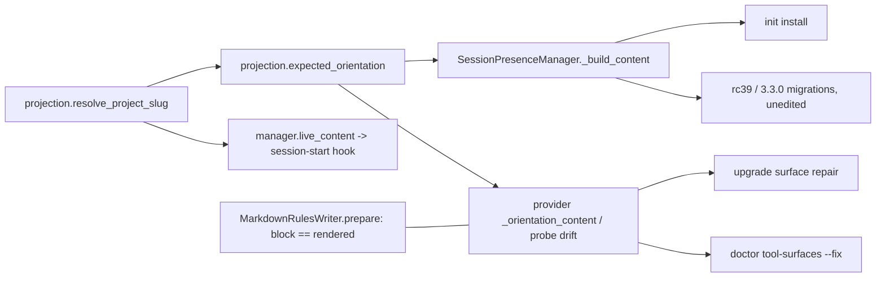

# Implementation Plan: One authority for committed orientation content

**Branch**: `fix/5215-orientation-content-authority` | **Date**: 2026-11-20 | **Spec**: [spec.md](spec.md)
**Input**: Mission specification from `kitty-specs/orientation-content-authority-01M7X5W6/spec.md`

## Summary

The committed orientation block is decided in three places with three answers (the manager's identity slug with live health, the provider's `project_root.name` with hard-coded "healthy", and the dry-run variant), and staleness is version-only in two places (the provider probe and the writer's `prepare` shortcut). A new module `specify_cli/session_presence/projection.py` becomes the single authority for the expected committed content, its drift test and the harness applicability predicate. Every writer and checker calls it; the SessionStart hook keeps a separate live variant with the same slug.

## Engineering Alignment (confirmed)

Design debrief sent to the operator 2026-11-20; the three operator rulings (spec Intent Summary) are binding and recorded as resolved Decision Moments. No new ruling was needed.

## Technical Context

**Language/Version**: Python 3.11+
**Primary Dependencies**: typer, ruamel.yaml (existing); no new dependency (no supply-chain change)
**Storage**: files — agent orientation files (`.claude/CLAUDE.md`, `AGENTS.md`, …) and `.kittify/config.yaml` (read)
**Testing**: pytest; red-first acceptance tests for S1–S4 and convergence, plus the blast-radius files named in research.md
**Target Platform**: CLI on Linux/macOS/Windows
**Project Type**: single
**Performance Goals**: probe adds no `git` subprocess when `project.slug` is recorded, at most one otherwise (NFR-003)
**Constraints**: no new migration, rc39 / 3.3.0 migrations unedited, no layer change (C-001, C-002)
**Scale/Scope**: ~5 source files, 2 work packages

## Charter Check

- Single canonical authority: satisfied — this mission removes two of three content authorities and two of three staleness rules.
- Architectural alignment: `identity` and `session_presence` are both inside `specify_cli`; no layer rule changes.
- ATDD-first / red-first: S1–S4 and convergence tests are written first and fail on the base.
- Standing Order #2 (campsite): `local_presence_content` and the version-only helpers become dead and are deleted, not allowlisted.
- Tier R review: each WP gets a separate reviewer session through the operator.
- Terminology: "Mission" only; no "feature" naming introduced.

## Design



### Authority API (`specify_cli/session_presence/projection.py`)

- `resolve_project_slug(root: Path) -> str` — `load_identity(.kittify/config.yaml).project_slug`, else `slug_from_git_remote(root)`, else `"unknown"`.
- `expected_orientation(root: Path) -> SessionPresenceContent` — installed version (ValueError if unavailable), resolved slug, `health="healthy"`, `available_version=None`.
- `orientation_drift(root: Path, rules_path: str) -> bool` — True when the managed block is present and (a) its stamped version differs from the installed one, or (b) it is a canonical (tool-written) block whose bytes differ from `expected_orientation(root).render()`. A hand-edited block falls under (a) only, so it keeps the preserve semantics.
- `orientation_writer(root, key, configured) -> MarkdownRulesWriter | None` — writer for `key` when the key is configured (or no config), the writer is Markdown-family and `can_write(root)`.

### Caller changes

| Caller | Change |
|--------|--------|
| `identity/project.py` | extract `slug_from_git_remote(root) -> str | None`; `derive_project_slug` behaviour unchanged |
| `session_presence/manager.py` | `_build_content()` → `expected_orientation(root)`; new `live_content()` (old live-health logic + slug from `resolve_project_slug`); `update(dry_run)` uses the same content; `local_presence_content` deleted; install/update select via `orientation_writer` |
| `cli/commands/session_start.py` | call `live_content()` |
| `tool_surface/providers/session_presence.py` | `_orientation_content` → `expected_orientation`; probe uses `orientation_drift`; `_prepare` applicability via `orientation_writer`; version-only helpers removed |
| `session_presence/writers/markdown_rules.py` | `prepare` returns unchanged only when the block equals the rendering |

### Churn analysis (#2265)

Churn came from live health in committed bytes. Deterministic content gives one desired byte string per (version, slug, invocation), so full equality is stable. Blocks with live health or legacy glyphs converge once.

## Implementation Concern Map

- **IC-01 Authority + identity + manager + hook** (WP01): projection module, `slug_from_git_remote`, manager delegation, `live_content`, session-start; tests for slug fallback, deterministic health, hook/file agreement.
- **IC-02 Provider + writer consume the authority** (WP02, depends on WP01): probe drift, `_orientation_content`, applicability, writer equality; S1/S3/S4 + convergence acceptance tests; re-pins of stale tests; dead-symbol allowlist check.

## Project Structure

### Documentation (this mission)

```
kitty-specs/orientation-content-authority-01M7X5W6/
├── spec.md
├── plan.md
├── research.md
├── data-model.md
├── quickstart.md
└── tasks.md   (from /spec-kitty.tasks)
```

### Source Code (repository root)

```
src/specify_cli/identity/project.py
src/specify_cli/session_presence/projection.py        (new)
src/specify_cli/session_presence/manager.py
src/specify_cli/session_presence/writers/markdown_rules.py
src/specify_cli/cli/commands/session_start.py
src/specify_cli/tool_surface/providers/session_presence.py
tests/specify_cli/session_presence/test_orientation_projection_5215.py   (new)
tests/specify_cli/tool_surface/providers/test_session_presence_orientation_5215.py (new)
```

## Risks

1. One-time auto-committed rewrite on the next upgrade for blocks with live health, legacy glyphs or the directory name (intended; changelog).
2. No `project.slug` and no remote → "unknown" instead of the directory name (ruling 2).
3. Existing tests pinning live health through `_build_content` or the version-only shortcut are stale pins; they are re-pinned to `live_content()` / full equality, not deleted.
