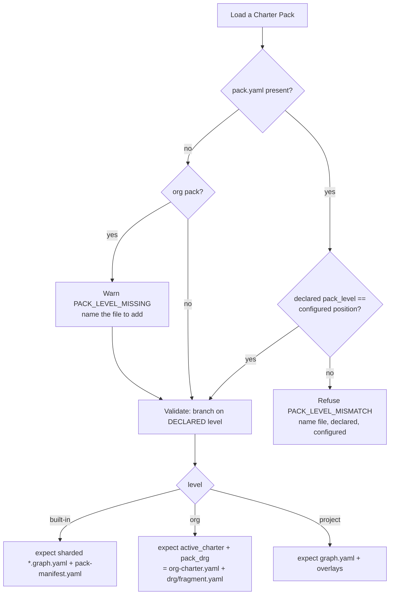

# Mission Specification: Charter Pack level declared in pack.yaml

**Mission Branch**: `issue-6048-pack-level-pack-yaml`
**Created**: 2026-10-11
**Status**: Draft
**Input**: Delivers #6048 (pack_level in pack.yaml) and #6046 (core vendoring tooling gaps) as ONE Charter Pack schema bump; folds ADR `2026-10-11-2`, the already-closed #5961, and #5992 (provenance respelling). Governing ADR: `docs/adr/4.x/2026-10-11-2-a-pack-declares-its-level-in-pack-yaml.md` (folded into this PR).

## Intent Summary *(confirmed; pre-spec discovery complete)*

Pre-spec discovery was completed by grounding (three CodeGraph reconnaissance passes), an adversarial architect review, and explicit operator rulings — the interview was skipped by operator instruction. The confirmed intent:

- **Primary actors**: a **Charter Pack author/maintainer** (declares a pack's identity), a **CLI operator** (loads, validates and regenerates packs), **open-packs vendor tooling / CI** (regenerates and verifies a built-in pack that lives outside core), and the **core maintainer** dogfooding the repo's own `built-in`/`internal` packs.
- **Trigger**: a pack's *level* (built-in / org / project) is never declared — it is inferred from where the pack is wired in and which files it happens to contain — so a mis-placed pack is discovered through a downstream failure instead of refused by name (open-packs#32 registered the built-in pack as an org pack, and `doctor charter-packs` then failed for a missing `drg/fragment.yaml`).
- **Desired outcome**: every pack declares `pack_level` (and, optionally, where its charter and DRG live) in `pack.yaml`; loading refuses a declared level that disagrees with the configured position; the validator branches on the declared level; the pack-tier/provenance vocabulary has one owner and one spelling; and core gains the tooling (`--pack-root`, `requires_core`, a clean-tree drift digest) that lets open-packs vendor the built-in pack.
- **Invariant that must always hold**: there is exactly **one** authority for the three level names — `kernel.pack_tiers` — and no source file re-spells them (empty-allowlist architectural gate).
- **Canonical terms**: level values are `built-in` / `org` / `project` (hyphenated `built-in`, matching the on-disk directory and config key `org`). "tier" and "layer" remain overloaded and are not introduced as the field name (`pack_level`).

### Decisions already made (do not re-open)

1. **`pack_level` reuses the `kernel.pack_tiers` `PackTier` Literal** — no new enum (operator ruling). `kernel.pack_tiers` stays the single spelling authority; `charter` imports it (`kernel < charter`).
2. **The ADR is folded into this PR** and #6049 is closed; the ADR's Decision §2 prose is aligned to "kernel owns the tokens; the descriptor reuses the Literal; no second enum." (The folded ADR filename is `2026-10-11-2-…`, not `-1-`.)
3. **#5992 is folded in**: the 3-tier artifact provenance/layer value is respelled `"builtin"` → `"built-in"` and unified onto `kernel.pack_tiers`. Only the 3-tier provenance vocabulary moves — not the `builtin|pack` skill-origin vocabulary nor the `"builtin:"` command-target prefix. Verified: no consumer data migration is required.
4. **`packs/internal/` gets its own `pack.yaml`** (`pack_level: org`). `org-charter.yaml` remains the pack's active-charter *content*, not its descriptor; the descriptor points at it via `active_charter`, and at `drg/fragment.yaml` via `pack_drg`, so pack layout is not located by hard-coded filename.
5. **`PACK_LEVEL_MISSING` warns now**; the hard refuse lands behind a single constant flipped by a tracked follow-up (no invented release anchor).

## User Scenarios & Testing *(mandatory)*

### User Story 1 - A pack declares its level and a mis-placement is refused by name (Priority: P1)

A pack author writes `pack_level` in `pack.yaml`. When the pack is loaded from a position that disagrees with the declared level, loading refuses with a named code instead of failing later in an unrelated check.

**Why this priority**: this is the core of #6048 and the ADR — it is what makes open-packs' layout safe and what every other pillar builds on.

**Independent Test**: load a pack declaring `pack_level: built-in` from an org-configured position and assert a `PACK_LEVEL_MISMATCH` refusal naming the file, the declared level and the configured one; load a matching pack and assert it loads.

**Acceptance Scenarios**:

1. **Given** a pack with `pack_level: org` registered under `charter_packs.org.packs`, **When** it is loaded, **Then** it loads with no level finding.
2. **Given** a pack with `pack_level: built-in` registered as an org pack, **When** it is loaded, **Then** loading refuses with `PACK_LEVEL_MISMATCH` naming the file, declared `built-in`, configured `org`.
3. **Given** an org pack whose `pack.yaml` omits `pack_level`, **When** it is loaded, **Then** loading WARNS with `PACK_LEVEL_MISSING` naming the file to add (today's default), and does not refuse.

---

### User Story 2 - The validator branches on the declared level and resolves layout from the descriptor (Priority: P1)

`charter pack validate` decides what to expect from the *declared* `pack_level`, not from the files it happens to find. The active-charter and DRG locations come from the descriptor's `active_charter` / `pack_drg` when set, else the per-level convention — through a single resolution seam, so no second filename authority exists.

**Why this priority**: without level-branched validation, declaring a level is cosmetic; the resolution seam is what lets a pack move files without the loader guessing.

**Independent Test**: validate an org pack (declares `active_charter`/`pack_drg`) and assert it checks the pointed-to files; validate a built-in-shaped pack that declares `org` and assert it fails against org expectations, not built-in ones.

**Acceptance Scenarios**:

1. **Given** an org pack declaring `active_charter: org-charter.yaml` and `pack_drg: drg/fragment.yaml`, **When** validated, **Then** the validator resolves and checks those exact files and does not require sharded `*.graph.yaml` or a `pack-manifest.yaml`.
2. **Given** a built-in pack with no `active_charter`/`pack_drg`, **When** validated, **Then** the resolution seam falls back to the built-in convention (sharded `*.graph.yaml` + generated `pack-manifest.yaml`).
3. **Given** an org pack whose `pack_drg` points at a missing file, **When** validated, **Then** validation reports the missing DRG source at the resolved path.

---

### User Story 3 - Core can regenerate and drift-check a pack that lives outside core (Priority: P2)

Open-packs vendor tooling can regenerate the DRG shards and `pack-manifest.yaml` for a built-in pack copy at an arbitrary root, declare core-compatibility with `requires_core`, and compute a drift digest that is stable across a `git archive` export, a working checkout, and an installed copy.

**Why this priority**: these are the #6046 prerequisites that unblock #3504's vendoring; they do not change core's own behaviour, so they rank below the schema itself.

**Independent Test**: run `charter pack regenerate-graph --pack-root <tmp copy>` and `--check` against a non-core root and assert both operate on that root; compute the clean-tree digest over a working tree containing `__pycache__` and over its `git archive` export and assert the two digests are equal.

**Acceptance Scenarios**:

1. **Given** a built-in-shaped pack at a non-core directory, **When** `regenerate-graph --pack-root <dir>` runs, **Then** it writes that directory's shards + `pack-manifest.yaml`, and `--check --pack-root <dir>` reports freshness for that directory.
2. **Given** a `pack.yaml` with `requires_core: ">=4.0,<5.0"`, **When** it is loaded, **Then** it is accepted and the declared range is exposed to a reusable compatibility check; an invalid specifier is refused with a schema error.
3. **Given** a pack tree containing `assets/__pycache__/`, **When** the clean-tree digest is computed over the working tree and over a `git archive` export, **Then** the two digests are identical; `snapshot_sha256` and its two remote-snapshot callers are unchanged.

---

### User Story 4 - One owner and one spelling for the level vocabulary (Priority: P2)

The pack-tier token and the artifact provenance/layer value are unified on the single hyphenated spelling `"built-in"`, owned by `kernel.pack_tiers`. No source file hand-authors the vocabulary.

**Why this priority**: it removes the long-standing `"builtin"`/`"built-in"` split (#5961 closed the token half; #5992 is the provenance half) and is the invariant the single-authority gate protects — but it depends on the schema work landing first.

**Independent Test**: assert the single-authority gate passes with an empty allowlist over the unified spelling; assert `get_provenance()` and every serialized surface emit `"built-in"`.

**Acceptance Scenarios**:

1. **Given** a built-in artifact, **When** its provenance is resolved, **Then** `get_provenance()` returns `"built-in"` and every serialized surface (`charter context --json` `source`, `asset list --json` `tier`, the projection manifest `source_layer`) carries `"built-in"`.
2. **Given** the source tree, **When** the pack-level single-authority gate runs, **Then** no hand-authored level/provenance literal exists outside `kernel.pack_tiers` and the allowlist is empty.
3. **Given** a pre-respell `.kittify/agent_profiles_manifest.json` carrying `"source_layer": "builtin"`, **When** it is read and re-projected, **Then** it parses without error and is rewritten to `"built-in"` (self-healing; no data migration).

---

### User Story 5 - Existing packs carry a descriptor (Priority: P2)

An upgrade migration backfills `pack.yaml` for existing consumer *project* packs; the repo's own `built-in` and `internal` packs declare their level in-repo in this mission.

**Why this priority**: it brings existing installations and the repo's own dogfood packs into compliance so the new rule does not strand them.

**Independent Test**: run the migration against a fixture project pack lacking `pack.yaml` and assert a `pack.yaml` with `pack_level: project` and a minted `pack_id` is written; assert the migration never creates a missing directory and never touches `packs/built-in` or `packs/internal`.

**Acceptance Scenarios**:

1. **Given** a project pack under `.kittify/charter-packs/` with no `pack.yaml`, **When** the upgrade migration runs, **Then** it writes `pack.yaml` with `pack_level: project` and a minted `pack_id`, using config-aware discovery and never `mkdir`.
2. **Given** `packs/built-in/pack.yaml`, **When** the mission lands, **Then** it declares `pack_level: built-in` and remains otherwise minimal (no `requires_core`).
3. **Given** `packs/internal/`, **When** the mission lands, **Then** a new `pack.yaml` declares `pack_level: org`, a pinned `pack_id`, `active_charter: org-charter.yaml`, `pack_drg: drg/fragment.yaml`, and `org-charter.yaml` is unchanged as content.

---

### User Story 6 - The descriptor model and decision are documented (Priority: P3)

The `pack.yaml` descriptor model is documented with a rendered diagram and README prose (for the planned `src/charter/` extraction), and the governing ADR is folded into this PR.

**Why this priority**: documentation and the ADR fold round out the change but do not gate the behaviour.

**Independent Test**: confirm `src/charter/diagrams/pack-descriptor-model.*` and the `src/charter/README.md` embed exist with alt text; confirm the ADR file and index/inventory entries are present and `#6049` is closed.

**Acceptance Scenarios**:

1. **Given** `src/charter/README.md`, **When** read, **Then** it embeds the rendered descriptor-model diagram with descriptive alt text and an `updated:` date, and links the ADR.
2. **Given** the PR, **When** reviewed, **Then** ADR `2026-10-11-2` is present with Decision §2 aligned to reuse-Literal/kernel-authority, and `docs/context/charter.md` + `governance.md` + `CHANGELOG.md` reflect the pack-tier change.

### Edge Cases

- A `pack.yaml` carries a non-boolean / non-string `pack_level` value → schema error naming the field (not silent coercion).
- An org pack declares `active_charter`/`pack_drg` pointing *outside* the pack root (e.g. `../x`) → refused (path must resolve inside the pack).
- `requires_core` is present but not a valid version specifier → `schema_invalid` naming `requires_core`.
- A project pack already has a `pack.yaml` (with or without `pack_level`) when the migration runs → the migration does not clobber an authored descriptor; it only adds the field if absent and never overwrites a differing `pack_id`.
- The configured position cannot be determined (e.g. a pack loaded from neither the built-in root, an org entry, nor the project path) → mismatch check has no left-hand side; the load path must define the position per tier or skip the mismatch check without silently passing a wrong level.
- A pre-respell persisted `source_layer: "builtin"` is read → tolerated as any non-empty string and self-heals on next projection (NFR-001).

## Requirements *(mandatory)*

### Functional Requirements

| ID | Title | User Story | Priority | Status | Delivery | No-op passable? |
|----|-------|------------|----------|--------|----------|-----------------|
| FR-001 | `pack_level` required field | As a pack author, I want `pack.yaml` to require `pack_level` typed by the kernel `PackTier`, so a pack states what it is. | High | Open | [build] | no — a valid level loads, an unknown value is refused, on the same loader fixture |
| FR-002 | `requires_core` optional field | As a vendor tool, I want `pack.yaml` to accept an optional `requires_core` version-specifier range (no longer refused as an extra input), so core-compatibility is declarable. | High | Open | [build] | no — a valid range is accepted and an invalid specifier is refused on the same fixture |
| FR-003 | `active_charter` optional path | As a pack author, I want `pack.yaml` to point at the active-charter file via `active_charter`, so the charter is not located by hard-coded filename. | Medium | Open | [build] | no — a resolvable path validates, an out-of-pack path is refused |
| FR-004 | `pack_drg` optional path | As a pack author, I want `pack.yaml` to point at the DRG source via `pack_drg`, so the DRG is not located by hard-coded filename. | Medium | Open | [build] | no — a resolvable path validates, a missing path is reported |
| FR-005 | `pack_version` level-conditional | As a pack author, I want `pack_version` required only when `pack_level == built-in` and optional otherwise, so org/project packs are not forced to author a version. | Medium | Open | [build] | no — built-in without version is refused, org without version is accepted, same validator |
| FR-006 | `PACK_LEVEL_MISMATCH` refusal | As a CLI operator, I want loading to refuse a declared level that disagrees with the configured position, naming file/declared/configured, so a mis-placement is caught by name. | High | Open | [build] | no — a matching pack loads, a mismatched pack is refused, same load path |
| FR-007 | `PACK_LEVEL_MISSING` warn-then-refuse | As a CLI operator, I want a `pack.yaml` without `pack_level` to WARN now and hard-refuse only behind a single tracked switch, so existing org packs get a deprecation window. | High | Open | [build] | no — warn path fires when absent; refuse path fires when the switch is flipped, both pinned |
| FR-008 | `validate` branches on declared level | As a CLI operator, I want `charter pack validate` to branch on the declared `pack_level`, not files-present, so per-level expectations are explicit. | High | Open | [build] | no — an org pack validates against org expectations and a built-in-shaped pack declaring org fails them |
| FR-009 | Single layout-resolution seam | As a maintainer, I want one seam mapping `(pack_root, descriptor)` → active-charter + DRG paths (descriptor when set, else per-level convention) with existing filename lookups routed through it, so there is no second filename authority. | High | Open | [build] | no — descriptor-set path and convention-fallback path both resolve on the same fixture |
| FR-010 | Project-pack backfill migration | As a consumer, I want an upgrade migration that writes `pack.yaml` (`pack_level: project`, minted `pack_id`) for existing project packs, skipping built-in/internal and never `mkdir`, so installs comply without manual edits. | High | Open | [build] | no — a pack lacking the descriptor gains it; built-in/internal and missing dirs are untouched |
| FR-011 | built-in declares its level | As the core maintainer, I want `packs/built-in/pack.yaml` to declare `pack_level: built-in` and stay minimal, so the shipped pack complies. | High | Open | [build] | no — the field is present and the authored-field gate accepts exactly the new key set |
| FR-012 | internal declares its level | As the core maintainer, I want a new `packs/internal/pack.yaml` (`pack_level: org`, pinned `pack_id`, `active_charter`, `pack_drg`), so the org pack complies and its layout is descriptor-declared. | High | Open | [build] | no — the descriptor loads as an org pack and its `pack_id` is drift-pinned |
| FR-013 | `regenerate-graph --pack-root` | As a vendor tool, I want `charter pack regenerate-graph` to take `--pack-root` for both the write path and `--check`, so a pack outside core can be regenerated/verified. | High | Open | [build] | no — regen/check operate on the given root; the default (no flag) is byte-unchanged |
| FR-014 | `requires_core` compatibility check | As a vendor tool, I want a reusable check that evaluates `requires_core` against a core version, so #3504 can call it, so vendoring can gate on compatibility. | Medium | Open | [build] | no — a satisfied range passes and an unsatisfied range fails on the same checker |
| FR-015 | Clean-tree drift digest | As a vendor tool, I want a new digest over enumerated known-files (LF-normalized), reproducible across `git archive` export / worktree / installed copy and ignoring `__pycache__`, leaving `snapshot_sha256` and its two callers byte-unchanged, so drift detection is noise-free. | High | Open | [build] | no — export and __pycache__-polluted worktree yield equal digests; snapshot_sha256 output is unchanged |
| FR-016 | Provenance respell + unify (#5992) | As a maintainer, I want the 3-tier provenance/layer value respelled `"builtin"` → `"built-in"` and unified on `kernel.pack_tiers`, touching only that vocabulary, so there is one spelling. | High | Open | [build] | no — emitter and every live comparison/serialized surface move together; skill-origin and `"builtin:"` prefix are unchanged |
| FR-017 | Dogfood manifest respell | As the core maintainer, I want the in-repo `.kittify/agent_profiles_manifest.json` updated to `"built-in"`, so the repo's own tree is clean after the respell. | Low | Open | [build] | no — the committed manifest carries the new spelling and a pre-respell copy still parses |
| FR-018 | Update `no_author_edit` field set | As a maintainer, I want `test_pack_manifest_no_author_edit` to expect the new built-in `pack.yaml` key set (`+ pack_level`), so the authored-field gate matches the new contract. | High | Open | [ratchet] | no — the gate accepts exactly the new key set and still rejects a leaked generated field |
| FR-019 | Extend tier/provenance single-authority gate | As a maintainer, I want `test_pack_tier_token_single_authority` extended to cover the now-unified provenance spelling, the NFR-003 carve-out dropped, the empty allowlist kept, and the `kernel.pack_tiers` doctrine comments updated, so the unified vocabulary is protected. | High | Open | [ratchet] | no — a planted hand-authored `"built-in"` provenance restatement is flagged; the allowlist stays empty |
| FR-020 | `pack_level` single-authority test | As a maintainer, I want a new architectural test pinning that every `pack_level` literal derives from `kernel.pack_tiers` (negative/behavioural, empty allowlist), so a re-spelling regresses loudly. | High | Open | [build] | no — a planted re-spelled `pack_level` literal is flagged; a derive-by-reference use passes |
| FR-021 | Fold the ADR; close #6049 | As the owner, I want ADR `2026-10-11-2` folded into this PR with Decision §2 aligned to reuse-Literal/kernel-authority, and #6049 closed, so the PR cites a merged governing ADR. | Medium | Open | [build] | no — the ADR file + index/inventory entries are present and internally consistent with the shipped design |
| FR-022 | Docs + glossary + CHANGELOG | As a reader, I want `docs/context/charter.md` + `governance.md` pack-tier prose updated and a `CHANGELOG.md` entry, so the docs mirror shipped behaviour. | Medium | Open | [build] | no — the prose names `pack_level` and the unified spelling; the changelog entry exists |
| FR-023 | Descriptor-model diagram + README | As a future extractor of `src/charter/`, I want a rendered PlantUML descriptor-model diagram under `src/charter/diagrams/` embedded in `src/charter/README.md` with alt text, so the model is self-documented. | Low | Open | [build] | no — the rendered image and alt-text embed are present and reflect the target schema |

### Non-Functional Requirements

| ID | Title | Requirement | Category | Priority | Status |
|----|-------|-------------|----------|----------|--------|
| NFR-001 | No consumer data migration | Respelling the provenance value requires zero consumer data migration: reading a pre-respell `source_layer: "builtin"` persisted manifest succeeds (0 parse failures) and self-heals to `"built-in"` on the next projection. | Compatibility | High | Open |
| NFR-002 | Single-authority invariant | 0 hand-authored pack-level/tier/provenance literals exist under `src/` outside `kernel.pack_tiers`; the gate's allowlist is empty and its non-vacuity floor holds (≥6 packages, ≥1000 files scanned). | Maintainability | High | Open |
| NFR-003 | Digest determinism | The clean-tree digest is byte-identical across a `git archive` export, a working checkout containing `__pycache__`, and an installed copy, for the same tracked content. | Reliability | High | Open |
| NFR-004 | Install-record path unchanged | `snapshot_sha256`, `write_pack_manifest`, and `_snapshot_manifest_is_intact` produce byte-identical output to before this mission (the remote-snapshot install-record path is untouched). | Compatibility | High | Open |
| NFR-005 | CLI performance | `charter pack validate` and `charter pack regenerate-graph` complete in under 2 seconds for a typical pack. | Performance | Medium | Open |
| NFR-006 | Lint/type cleanliness | `ruff check`, `ruff format --check --force-exclude`, and `mypy --strict` pass with zero issues on changed code; no new blanket `# noqa` / `# type: ignore` / per-file ignores. | Quality | High | Open |

### Constraints

| ID | Title | Constraint | Category | Priority | Status |
|----|-------|------------|----------|----------|--------|
| C-001 | Reuse kernel authority, no new enum | `pack_level` uses the `kernel.pack_tiers` `PackTier` Literal; no new level enum is introduced; `charter` imports `kernel` (kernel < charter), never the reverse. | Technical | High | Open |
| C-002 | Respell scope fence | The provenance respell touches ONLY the 3-tier provenance/layer vocabulary — never the `builtin\|pack` skill-origin vocabulary (`skills/manifest.py`, `registry.py`) nor the `"builtin:"` command-target prefix. | Technical | High | Open |
| C-003 | Migration safety | The backfill migration is config-aware (`get_agent_dirs`-style), never `mkdir`s a missing directory, never touches `packs/built-in` or `packs/internal`, and never clobbers an authored `pack.yaml`. | Technical | High | Open |
| C-004 | Packaging boundary intact | `test_packaging_safety` stays green: only `packs/built-in/` ships; `packs/internal/` never enters the wheel/sdist, including its new `pack.yaml`. | Technical | High | Open |
| C-005 | No full heavy suites in mission | During implement/review/fold/closeout, run only targeted tests + the specific named architectural gate files; never a full `tests/architectural/` / e2e / performance sweep or `make test-full` (CI owns those). | Process | High | Open |
| C-006 | Deferred hard-refuse anchor | The `PACK_LEVEL_MISSING` hard refuse is gated behind a single constant (default = warn) and its flip is a tracked follow-up; this mission invents no release anchor. | Governance | Medium | Open |
| C-007 | Scope fence | Out of scope: the #3504 vendor/lockfile/drift-gate pipeline itself; moving `built-in/` in spec-kitty-open-packs; the authoring flip away from editing `packs/built-in` in core. | Scope | High | Open |

### Key Entities

- **PackDescriptor** (`pack.yaml`): the authored identity + layout of a pack — `pack_id`, `pack_version` (built-in only), `parent_pack`, `name`, `pack_level`, `requires_core?`, `active_charter?`, `pack_drg?`. `extra="forbid"`, `frozen`.
- **PackTier** (`kernel.pack_tiers`): the single authority for the three level names (`built-in` / `org` / `project`) and their precedence; the `pack_level` field type and the unified provenance spelling both derive from it.
- **PackManifest** (`pack-manifest.yaml`): the generated, machine-written sibling (never hand-edited); carries `snapshot_sha256`, `artifact_counts`, `constituents`, `manifest_hash`.
- **Active charter file**: the charter a pack enforces/suggests (`org-charter.yaml` for an org pack), pointed to by `active_charter`.
- **DRG source**: the pack's DRG (`drg/fragment.yaml` for org, sharded `*.graph.yaml` for built-in, `graph.yaml` + overlays for project), pointed to by `pack_drg`.
- **Artifact provenance/layer value**: the resolved source layer of an artifact (`built-in` / `org` / `project`), after this mission spelled identically to the tier token.

## Success Criteria *(mandatory)*

### Measurable Outcomes

- **SC-001**: A pack whose declared `pack_level` disagrees with its configured position is refused at load with `PACK_LEVEL_MISMATCH` naming file/declared/configured, 100% of the time. — [build] · no-op passable: no
- **SC-002**: open-packs can regenerate the shards + `pack-manifest.yaml` for a built-in copy at an arbitrary root via `--pack-root` (exit 0; `--check` reports fresh), with core's default behaviour byte-unchanged. — [build] · no-op passable: no
- **SC-003**: The pack-level vocabulary has exactly one spelling `"built-in"` across tier token and artifact provenance, and the single-authority gate passes with an empty allowlist. — [ratchet] · no-op passable: no
- **SC-004**: Existing project packs gain a valid `pack.yaml` via the migration with zero `mkdir` calls and zero touched `built-in`/`internal` directories. — [build] · no-op passable: no
- **SC-005**: The clean-tree digest is identical for a `git archive` export and a working checkout containing `__pycache__`, while `snapshot_sha256` output is unchanged. — [build] · no-op passable: no

## Assumptions

- The governing ADR `2026-10-11-2` is authored in (unmerged) PR #6049; this mission **folds** its file in and closes #6049 (operator ruling), so the PR cites a file present in its own diff.
- `#5961` is already **closed** (the tier-token half landed as `kernel.pack_tiers`); this mission folds only the **provenance** half (#5992). "pack_level covers #5992" is read as "the unified spelling completes the vocabulary", achieved by respelling provenance — not by a separate consumer data migration.
- The provenance respell needs no consumer data migration (verified: no read-back code compares a persisted layer value to `"builtin"`; the one persisted carrier self-heals).
- The mission runs on the `issue-6048-pack-level-pack-yaml` topic branch off `upstream/main`; the operator opens/merges the PR to `main`.

## Dependencies

- `kernel.pack_tiers` (single level-name authority) — reused, extended to own the unified provenance spelling.
- Existing gates: `test_pack_manifest_no_author_edit`, `test_pack_tier_token_single_authority`, `test_packaging_safety` — updated in-mission.
- `builtin_manifest.py` enumerated-known-files hashing — reused as the basis for the clean-tree digest.

## Out of Scope

- The #3504 vendor / lockfile / drift-gate pipeline itself (this mission only supplies the prerequisites it will call).
- Moving `built-in/` within spec-kitty-open-packs (follows a core release: open-packs#31/#32).
- The authoring flip away from editing `packs/built-in` in core.
- Any change to the `builtin|pack` skill-origin vocabulary or the `"builtin:"` command-target prefix.
