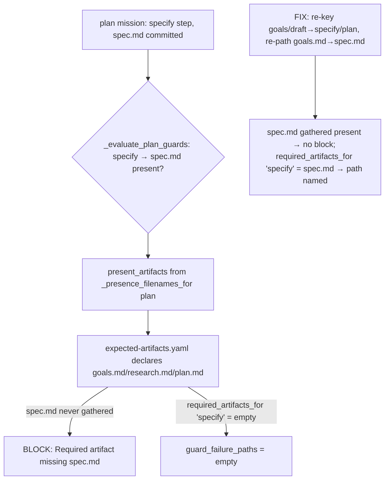

# Mission Specification: Fix plan-mission guard/manifest artifact-vocabulary mismatch

**Mission Branch**: `fix/plan-guard-artifact-vocabulary`
**Created**: 2026-10-18
**Status**: Draft
**Input**: Fix #6388 (P0) — the built-in `plan` mission type cannot advance past `specify`.

## Context & Root Cause *(grounded + reproduced on main @ 4.0.0rc8)*

A built-in `plan` mission is hard-blocked at its first step: `spec-kitty next --agent claude --mission
<plan-mission> --result success` returns `blocked` with `Required artifact missing: spec.md` **even
though `spec.md` is committed**, and `guard_failure_paths` comes back `{}`.

The defect is a **vocabulary mismatch across a manifest boundary** — the guard is correct; the manifest
is the stale outlier:

- `_evaluate_plan_guards` (`src/runtime/next/runtime_bridge_cores.py:824`) dispatches on the runtime
  **action id** and checks the artifacts the plan **step contracts actually produce**: `specify`→`spec.md`,
  `research`→`research.md`, `plan`→`plan.md`, `review`→(terminal). These names are right.
- But `_presence_filenames_for("plan")` (`runtime_bridge_io.py:1072`) sources the presence vocabulary
  from `packs/built-in/missions/plan/expected-artifacts.yaml`, which declares `goals.md`/`research.md`/
  `plan.md` under **phase step-keys** `goals`/`research`/`draft`. `goals.md` is a **phantom** — no plan
  step contract writes it.

Two independent symptoms result:
- **(a) The block:** `gather_artifact_presence` only stats the family-union `{goals.md, research.md,
  plan.md}`, so `spec.md` is never probed → absent from `present_artifacts` → the `specify` guard reads
  it missing regardless of the file on disk.
- **(b) `guard_failure_paths={}`:** that map is step-**keyed** via `required_artifacts_for(step_id,
  "plan")`. Because the manifest has no `specify` key (it uses `goals`), `required_artifacts_for('specify',
  'plan')` returns `[]`, so no path is named. (Proof: `('goals','plan')==['goals.md']` but
  `('specify','plan')==[]`.) The `runtime_bridge_io.py:1394-1402` comment documents this exact hazard as
  "not-yet-wired" — but `_GUARD_TABLES["plan"]` dispatches it live.

**Fix = reconcile the manifest to the runtime action vocabulary (Option A), both axes.** A path-only
rename clears the block but leaves `guard_failure_paths` empty; the step-key rename is what restores it.

Three divergent vocabularies exist for this one mission; the **runtime step-contract action ids
(`specify/research/plan/review`) are canonical** (they are what dispatch and guards use), and the
manifest + the two descriptive `mission.yaml` copies must derive from them.

## User Scenarios & Testing *(mandatory)*

### User Story 1 — A plan mission advances past `specify` (Priority: P1)

An operator runs a built-in `plan` mission, produces and commits a `spec.md`, and advances the runtime
step-gate. Today it hard-blocks at `specify`; it must instead read the present `spec.md` as present and
not block on artifact presence.

**Why this priority**: This is the P0. The entire `plan` mission type (and the class of non-software-dev
built-in types whose guard chains were mirrored from software-dev) cannot run end-to-end via the runtime
step-gate until this is reconciled.

**Independent Test**: Against a real plan mission dir with a committed `spec.md`,
`gather_artifact_presence(..., step_id="specify")` yields `present_artifacts ⊇ {spec.md}` and
`_evaluate_plan_guards` / `evaluate_guards_strict` return `[]` (today they return
`['Required artifact missing: spec.md']`).

**Acceptance Scenarios**:
1. **Given** a plan mission whose `spec.md` is committed, **When** the specify-step artifact guard is
   evaluated through the real `gather_artifact_presence`, **Then** no `Required artifact missing` block
   is produced.
2. **Given** the reconciled manifest, **When** `required_artifacts_for('specify', 'plan')` and
   `('plan', 'plan')` are resolved, **Then** they return `{spec.md}` and `{plan.md}` respectively
   (today both return `[]`).
3. **Given** the reconciled manifest, **When** `_presence_filenames_for('plan')` is computed, **Then**
   it contains `spec.md` (and no longer the phantom `goals.md`).

---

### User Story 2 — A genuine missing-artifact block names the path it read (Priority: P2)

When a plan mission genuinely lacks a required artifact, the blocked decision must name the directory it
checked (`guard_failure_paths` non-empty), restoring the #3883/#4390 "name the path you read" intent the
secondary bug defeats.

**Why this priority**: Diagnosability — an operator currently cannot see which directory was read.

**Independent Test**: For a plan mission at `specify` with `spec.md` **absent**,
`guard_failure_artifact_paths(...)` returns a non-empty map keyed by `spec.md`.

**Acceptance Scenarios**:
1. **Given** a plan mission missing `spec.md`, **When** the specify guard blocks, **Then**
   `guard_failure_paths` is non-empty and names the `spec.md` path.

---

### User Story 3 — The drift can never ship unnoticed again (Priority: P3)

A maintainer needs structural guards so this class of mismatch fails CI, not a downstream project: a
cross-family parity check routed through the real presence gatherer, and a completeness/coherence guard
over built-in mission types.

**Why this priority**: Hardening. Every existing plan guard test injected `present_artifacts`
synthetically, bypassing the manifest-sourced presence set — which is exactly why the bug passed them.

**Independent Test**: The parity test (through real `gather_artifact_presence`) and the coherence guard
are red against the pre-fix manifest and green after.

**Acceptance Scenarios**:
1. **Given** each registered guard family (`software-dev`/`research`/`documentation`/`plan`), **When**
   its step's required artifact IS present on disk and presence is gathered through the real
   `gather_artifact_presence`, **Then** no spurious block is produced.
2. **Given** a built-in mission type whose manifest step-keys diverge from its runtime step-contract
   action ids (or that is missing step contracts), **When** the coherence guard runs, **Then** it fails.

### Edge Cases

- **Other families must not regress**: `software-dev`/`research`/`documentation` presence sets and guard
  outcomes stay byte-identical (research/review already coincided for plan).
- **`extra="forbid"` manifest schema**: only keys/path_patterns/comments change; field shapes,
  `schema_version`, `manifest_version` preserved.
- **`MISSION_GOALS` artifact kind** stays defined (classifies `goals.md`); its removal is a separate
  campsite follow-up, so leaving it keeps `test_artifact_none_classification` and the placement guard
  green.
- **Defect #2 (`profile_hint`) fires upstream** of this guard in the live loop; a vanilla plan mission
  still cannot advance end-to-end until that separate fix (charter#42) lands. Verification here is at the
  `gather_artifact_presence`/guard structural level.
- **`done`/`structure` manifest keys** have no runtime action id; drop or keep harmlessly (no runtime
  consumer).

## Requirements *(mandatory)*

### Functional Requirements

| ID | Title | User Story | Priority | Status | Delivery | No-op passable? |
|----|-------|------------|----------|--------|----------|-----------------|
| FR-001 | Present `spec.md` reads present at plan `specify` | As an operator, I want a committed `spec.md` on a plan mission to be gathered as present so the specify guard does not falsely block. | High | Open | [build] | no |
| FR-002 | Plan manifest uses the runtime action vocabulary | As a maintainer, I want `plan/expected-artifacts.yaml` re-keyed `goals`/`draft`→`specify`/`plan` and re-pathed `goals.md`→`spec.md`, so `_presence_filenames_for('plan')` contains `spec.md` and `required_artifacts_for('specify'/'plan','plan')` resolve `{spec.md}`/`{plan.md}`. | High | Open | [build] | no |
| FR-003 | Genuine plan missing-artifact block names its path | As an operator, I want a real plan missing-artifact block to carry a non-empty `guard_failure_paths` so I can see the directory read. | High | Open | [build] | no |
| FR-004 | Cross-family parity through the real presence gatherer | As a maintainer, I want each registered guard family dispatched through the real `gather_artifact_presence` against an artifact-present on-disk fixture to produce no spurious block. | High | Open | [build] | no |
| FR-005 | Built-in mission-type vocabulary-coherence CI guard | As a maintainer, I want a corpus guard that fails when a shipped built-in mission type's manifest step-keys diverge from its runtime step-contract action ids, or it is missing step contracts. | High | Open | [build] | no |
| FR-006 | Descriptive mission vocabulary reconciled | As a maintainer, I want the two `mission.yaml` copies' `required:`/phase vocabulary and the stale `expected-artifacts.yaml` header comment reconciled to the action vocabulary (no `goals.md` phantom, no false "no plan guard branch" claim). | Medium | Open | [build] | no |

### Non-Functional Requirements

| ID | Title | Requirement | Category | Priority | Status |
|----|-------|-------------|----------|----------|--------|
| NFR-001 | No regression for other families | `software-dev`/`research`/`documentation` presence filename sets and guard outcomes are byte-identical before and after (verified by the existing per-(family,artifact_key) byte-compat characterization, minus the intentional plan rows). | Reliability | High | Open |
| NFR-002 | Manifest stays schema-valid | `plan/expected-artifacts.yaml` continues to validate under the `extra="forbid"` schema; only step-keys, `path_pattern`s, and comments change. | Correctness | High | Open |

### Constraints

| ID | Title | Constraint | Category | Priority | Status |
|----|-------|------------|----------|----------|--------|
| C-001 | Do not touch the guard | `_evaluate_plan_guards` is correct and must not change; the fix is manifest/descriptive-side only. | Technical | High | Open |
| C-002 | One canonical vocabulary | The runtime step-contract action ids (`specify/research/plan/review`) are canonical; the manifest and both `mission.yaml` copies derive from them — never re-introduce a second (phase/`goals.md`) authority. | Technical | High | Open |
| C-003 | Keep `MISSION_GOALS` | Do not remove the `MISSION_GOALS` artifact kind in this mission (separate campsite follow-up); keeping it is harmless and keeps its tests green. | Technical | Medium | Open |
| C-004 | Defect #2 out of scope | The `profile_hint` composition default (defect #2, charter#42) is out of scope and fires upstream; verification is at the gather/guard structural level, not the full live loop. | Technical | High | Open |
| C-005 | Test-run guardrails | Do not run `make test-full`; do not regenerate `.github/ci-shard-timings.json` (CI-owned). | Technical | Medium | Open |

### Key Entities

- **`expected-artifacts.yaml` (plan family)**: declares `required_by_step` (step-key → artifact
  `path_pattern`s); the single source `_presence_filenames_for` and `required_artifacts_for` draw from.
- **Plan step contracts** (`plan-{specify,research,plan,review}.step-contract.yaml`): the authoritative
  producers (`specify`→spec.md, `research`→research.md, `plan`→plan.md).
- **`_evaluate_plan_guards` / `_GUARD_TABLES`**: the live plan guard chain (unchanged).
- **`mission.yaml` (×2 copies)**: descriptive phase/`required:` vocabulary, not load-bearing for the
  guard, reconciled for coherence.

## Success Criteria *(mandatory)*

### Measurable Outcomes

- **SC-001**: A plan mission with a committed `spec.md` produces zero `Required artifact missing: spec.md`
  blocks at the specify artifact guard (through the real presence gatherer). — [build] · no-op passable: no
- **SC-002**: A genuine plan missing-artifact block returns a non-empty `guard_failure_paths` naming the
  read directory. — [build] · no-op passable: no
- **SC-003**: The cross-family parity test and the vocabulary-coherence CI guard are red against the
  pre-fix manifest/vocabulary and green after the fix. — [build] · no-op passable: no
- **SC-004**: `_presence_filenames_for('plan')` contains `spec.md` and not `goals.md`; the non-plan
  families' presence sets are unchanged. — [ratchet] · no-op passable: no

## Assumptions

- The runtime action vocabulary (`specify/research/plan/review`) is canonical because it is what the
  runtime dispatches as `step_id` and what the step contracts and guards use (confirmed e2e by the
  grounding squad).
- `mission.yaml`'s `artifacts.required`/`workflow.phases` are descriptive and not consumed by the
  gather/guard/resolver path (to be re-confirmed by a grep during plan/implement before editing).

## Out of Scope

- Defect #2: the `profile_hint` composition default for plan/specify (charter#42) — fires upstream of
  this guard; full live-loop advance still needs it.
- Removal of the now-orphan `MISSION_GOALS` artifact kind (separate campsite follow-up).
- #3386 (introduced the live plan guard — done), #3883/#4390 (guard-path provenance — context),
  spec-kitty-open-packs#41/#42 (plan step contracts — done), core#6372 (WIP port).
