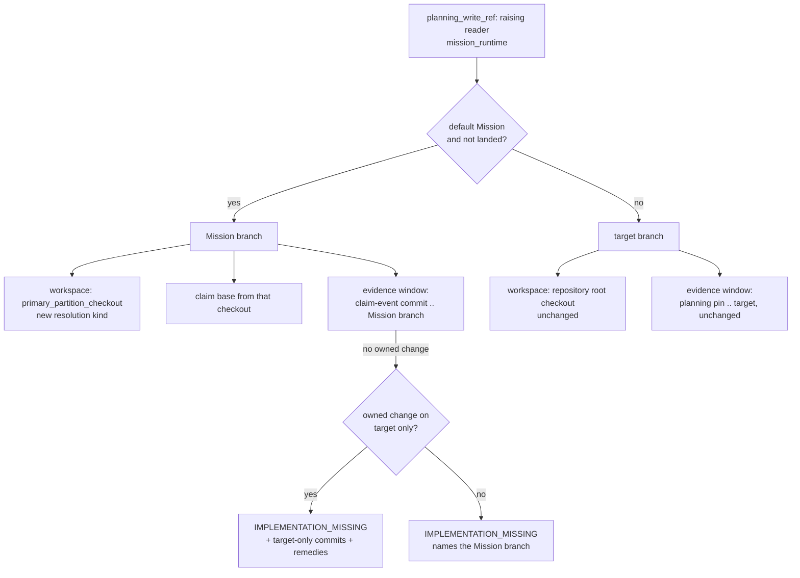

# Implementation Plan: Planning lane writes to the Mission branch before landing

**Branch**: `kitty/mission-planning-lane-write-branch-01M8A725` (lands on `fix/7860-planning-evidence-window`; draft PR to `main`) | **Date**: 2026-11-25 | **Spec**: [spec.md](spec.md)
**Input**: Mission specification from `kitty-specs/planning-lane-write-branch-01M8A725/spec.md`; operator rulings A', "guidance only" and the window-start ruling (2026-11-25, recorded on #7860 and in `decisions/`).

## Summary

Before a default Mission lands, its planning lane is written, reviewed and evidenced on the Mission branch.
- `implement` resolves a planning work package's workspace to the checkout that holds the Mission branch (the coordination worktree) and says so.
- The claim base is recorded from that checkout.
- The implementation-evidence window runs from the commit on the Mission branch that introduced the work package's window-opening (claim) status event to the Mission branch tip.

Every surface reads the same write-branch authority (FR-061) and the same checkout locator (#7372). Explicit topologies, landed Missions, `single_branch` Missions and code lanes are unchanged. In-flight work committed on the target under the old guidance gets a refusal that names the commits and both remedies.



## Technical Context

**Language/Version**: Python 3.11+ (repository floor)
**Primary Dependencies**: typer, rich, ruamel.yaml; git ≥ 2.38 via subprocess; `spec_kitty_events` (status reducer, unchanged)
**Storage**: git refs and history, the Mission's `meta.json`, `lanes.json`, `status.events.jsonl` (no schema change)
**Testing**: pytest. Unit tests per changed module, plus real-git CLI integration tests in `tests/integration/` (an isolated HOME, as in `test_6715_consolidate_lane_evidence.py`). Blast radius: `tests/lanes`, `tests/review`, `tests/status`, `tests/consolidation`, `tests/workspace`, `tests/specify_cli/cli/commands/agent`, `make test-fast`
**Target Platform**: Linux, macOS and Windows CLI (POSIX paths in tests; no platform-specific code)
**Project Type**: single (the `src/` layered packages)
**Performance Goals**: code lanes keep one tree diff per lane; the planning lane of a default Mission takes at most one diff per approved planning work package; the in-flight probe runs only after a refusal (NFR-001)
**Constraints**:
- fail closed, with no silent target fallback (NFR-002);
- ruff, `ruff format --check --force-exclude` and mypy clean, complexity ≤ 15, no suppressions;
- read only, never edited: `review/wp_range.py`, `status/lane_head.py`, `status/wp_window_selector.py` (C-001);
- in `cli/commands/agent/workflow.py`, only the planning message and workspace hunks may change (C-003, #5604)
**Scale/Scope**: about 12–15 source files across `mission_runtime`, `workspace`, `lanes`, `consolidation`, `cli/commands/agent`, `orchestrator_api` and `coordination`; 2 ADR amendments; 3 docs files

## Charter Check

| Principle / order | Status | Note |
|---|---|---|
| Single canonical authority | Pass | One raising write-branch reader (`planning_write_ref`, built on `default_mission_primary_ref`). One checkout locator (`primary_partition_checkout`). The window start reuses `commit_introducing_status_event`. No third resolver (C-004). |
| Architectural alignment / layering | Pass | The new reader lives in `mission_runtime`, below `specify_cli`. It adds no new outbound import (the existing lazy imports are kept). |
| ATDD-first / red-first (SO #4) | Pass | The red reproduction exists (`tests/integration/test_7860_planning_evidence_window.py`, f1ecef5d). Each work package starts with its failing acceptance test. |
| Campsite cleaning (SO #2) | Pass | The "main repository" wording in `workspace/context.py` and `ownership/workspace_strategy.py` (Branch-Intent Terminology) is fixed in the work package that touches them. |
| Architectural gate discipline (SO #5) | Pass | No new gate, and no allowlist added. An AST/monkeypatch pin proves that every surface follows the one authority (FR-005). |
| Git & workflow (SO #7) | Pass | Topic branch, draft PR, the operator merges. Commits are signed. CLI-made commits are compacted and re-signed before the PR (#5197). |
| Terminology canon | Pass | "Mission branch (the coordination branch)" is used in messages. There is no bare `primary` or `merge`, and no "Feature". |
| Test policy (§6) | Pass | Changed-module tests, plus the owning subsystem directories, plus `make test-fast`. No `test-full`. |
| ADR discipline | Pass | Two Proposed amendments (C-006). |

No violations, so Complexity Tracking is empty.

## Project Structure

### Documentation (this mission)

```
kitty-specs/planning-lane-write-branch-01M8A725/
├── spec.md
├── plan.md              # this file
├── research.md          # Phase 0: squad findings + decisions
├── data-model.md        # Phase 1: write-branch decision, window, resolution kind
├── quickstart.md        # Phase 1: how to reproduce and verify
├── contracts/
│   └── planning-write-branch.md   # operator-visible outputs and refusal texts
├── checklists/requirements.md
└── decisions/
```

### Source Code (repository root)

```
src/mission_runtime/
├── resolution.py              # planning_write_ref (raising) beside default_mission_primary_ref
└── claim_commit.py            # reused: commit_introducing_status_event (read only)
src/specify_cli/
├── coordination/planning_commit.py     # reused: primary_partition_checkout
├── workspace/context.py                # the three planning arms → one; new resolution kind
├── cli/commands/implement.py           # planning workspace message (FR-002)
├── cli/commands/agent/workflow.py      # ancestry message (C-003 hunk only)
├── lanes/implement_support.py          # claim base from the resolved checkout
├── lanes/for_review_gate.py            # gate reads the resolved checkout; message
├── orchestrator_api/wp_lifecycle.py    # claim base + workspace_path
├── consolidation/wp_evidence.py        # window start/end, callers, remedies, in-flight probe
├── cli/commands/agent/tasks_move_task.py  # move-task leg of the evidence check
├── consolidation/reconciliation_*.py   # only if FR-012 is red (planning-lane attribution)
├── core/worktree_topology.py, prompt_builder.py, tasks_*.py  # resolution-kind audit
└── ownership/{kind_normalisation,workspace_strategy}.py      # docstrings
docs/adr/4.x/2026-11-06-3-*.md, 2026-10-04-5-*.md   # Proposed amendments
docs/context/{orchestration,topology}.md            # glossary
docs/migrations/                                    # in-flight note
docs/changelog/unreleased/                          # fragment
tests/integration/test_7860_planning_evidence_window.py (+ consolidate E2E)
```

**Structure Decision**: single project. The changes follow the enforced layer chain `kernel <- charter <- mission_runtime <- specify_cli`.

## Complexity Tracking

None.

## Implementation Concern Map

> Implementation concerns are not work packages. `/spec-kitty.tasks` decides the cut. The operator ruled 5 work packages for this Mission.

### IC-01 — One raising write-branch reader

- **Purpose**: give every surface one answer to "which branch does this Mission's planning lane write to", and refuse (never fall back) when `meta.json` cannot be read.
- **Relevant requirements**: FR-005, NFR-002, C-004, FR-008 (ADR 2026-11-06-3 amendment)
- **Affected surfaces**:
  - `src/mission_runtime/resolution.py`: a public `planning_write_ref` on `default_mission_primary_ref` and the landed fact. Placement keeps its non-raising wrapper.
  - The checkout locator is `coordination/planning_commit.py::primary_partition_checkout`.
  - ADR 2026-11-06-3.
- **Sequencing/depends-on**: none
- **Risks**: placement callers must keep their behaviour. The raising variant is used only by the new paths. `review/wp_range.py` keeps its own read (C-001); the drift risk is recorded in the ADR.

### IC-02 — Planning workspace in the Mission-branch checkout

- **Purpose**: `implement` (CLI, `next` and orchestrator API) resolves a default, not-yet-landed Mission's planning work package to the checkout holding the Mission branch, and says so.
- **Relevant requirements**: FR-001, FR-002, FR-006, FR-014 (docstrings), NFR-002
- **Affected surfaces**:
  - `workspace/context.py`: merge the three planning arms. A distinct resolution kind is used for the Mission-branch checkout.
  - The 14 readers of `resolution_kind == "repo_root"`.
  - `cli/commands/implement.py` (message).
  - `cli/commands/agent/workflow.py` (the ancestry message at about :2037, C-003).
  - `orchestrator_api/wp_lifecycle.py` (`workspace_path`).
  - Fail-closed handling of a missing coordination worktree.
- **Sequencing/depends-on**: IC-01
- **Risks**: this has the widest fan-out (25 callers of `resolve_workspace_for_wp`). Overloading `repo_root` would mislead the readers. The `implement()` hunks of #5604 at :1842–1925 must not be touched.

### IC-03 — Claim base and the move-into-review gate

- **Purpose**: the claim base is recorded from the resolved checkout (CLI and orchestrator API), so the `for_review` gate counts the work package's own commits.
- **Relevant requirements**: FR-011, FR-013
- **Affected surfaces**:
  - `lanes/implement_support.py:370`, `orchestrator_api/wp_lifecycle.py:332-344`.
  - `lanes/for_review_gate.py` (the checkout and the message at :246).
  - The staging scope of `BookkeepingTransaction` (shared coordination worktree, FR-013).
- **Sequencing/depends-on**: IC-02
- **Risks**: the claim base is clone-local and idempotent by absence, so an in-flight claim keeps its old base. The gate must not count the Mission's planning history.

### IC-04 — Evidence window start and end, callers and in-flight guidance

- **Purpose**: the planning evidence window of a default, not-yet-landed Mission runs from the commit that introduced the work package's window-opening event to the Mission branch. Every caller agrees, the refusal and remedy texts name the Mission branch, and a target-only owned change is named with both remedies.
- **Relevant requirements**: FR-003, FR-004, FR-007, FR-010, FR-006, NFR-001, NFR-002, FR-008 (ADR 2026-10-04-5 amendment)
- **Affected surfaces**:
  - `consolidation/wp_evidence.py`: `lane_evidence_window` gains `repo_root`, and its result is per work package for this lane; `_scan_lane`, `_REMEDIES`, `absent_lane_window_cause`, docstrings.
  - `cli/commands/agent/tasks_move_task.py` (`_mt_require_lane_evidence`, message :1332).
  - Callers: `accept.py`, `reconciliation_claim.py`, `no_implementation_attestation.py`, `orchestrator_api/consolidation.py`, `entry_preflight.py` (docstring).
  - ADR 2026-10-04-5.
- **Sequencing/depends-on**: IC-01 (and the event-commit primitive, which is reused)
- **Risks**:
  - The "one diff per lane" invariant is relaxed for this lane only.
  - The probe range must be bounded to the owned files, from the merge-base of the planning pin and the target up to the target.
  - The landed control must use a recorded landing.
  - `--attest-no-implementation` must still lift only a real `IMPLEMENTATION_MISSING`.

### IC-05 — Consolidation lands planning work; docs and release note

- **Purpose**: prove end to end that `consolidate` lands Mission-branch planning work with the reconciliation gate passing, in both shapes. Fix the planning-lane attribution if it is red. Update the glossary, docs and changelog, and rework the red test.
- **Relevant requirements**: FR-012, SC-006, FR-009, FR-014, C-005
- **Affected surfaces**:
  - `tests/integration/` (a consolidate E2E; rework `test_7860_planning_evidence_window.py`: workspace assertion, the in-flight refusal, a narrow bookkeeping helper, a pre-existing-owned-file hollow control, and an explicit-topology control).
  - `consolidation/reconciliation_authorship.py:766` and `approved_attestation.py:203`, only if red.
  - `docs/context/orchestration.md:178`, `topology.md:77,155`; `CLAUDE.md` and `AGENTS.md` (one identical clause each); `docs/migrations/`; `docs/changelog/unreleased/`.
- **Sequencing/depends-on**: IC-02, IC-03, IC-04
- **Risks**: the pre-#7816 shape (owned files outside `kitty-specs/` in `lane-planning`) cannot be produced by a fresh finalize, so the fixture must build it through the frozen-membership path or a hand-edited `lanes.json` and explain why.
