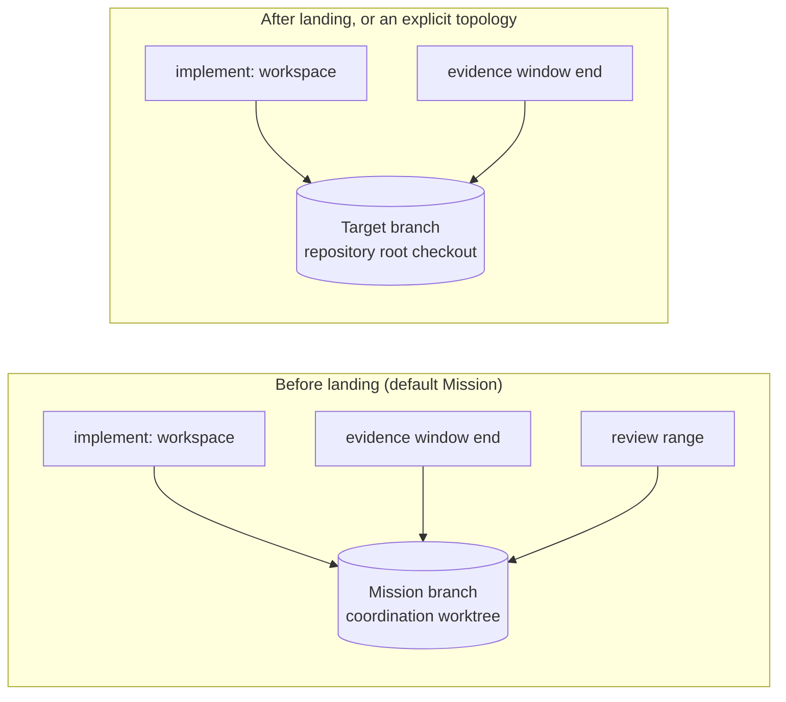

# Mission Specification: Planning lane writes to the Mission branch before landing

**Mission Branch**: `kitty/mission-planning-lane-write-branch-01M8A725`
**Created**: 2026-11-25
**Status**: Draft
**Input**: Issue #7860 and operator rulings A' and "guidance only" (2026-11-25, recorded on #7860): "before landing, `implement` places a default Mission's planning lane in the coordination worktree (topic branch), and the planning lane's evidence window ends there. One write-ref rule consistent with FR-061 and the review range."

## Context

A Mission created without an explicit topology mints one Mission branch. Until the Mission lands, every planning artifact of that Mission is written to that branch. When such a Mission settles into a coordinated topology (`lanes_with_coord`), the Mission branch also becomes its coordination branch. The repository root checkout returns to the target branch, and the Mission branch is checked out in the coordination worktree.

Three surfaces disagree about where a planning-artifact work package's own work belongs:

- the review range reads the Mission branch;
- `implement` sends the agent to the repository root checkout, on the target branch;
- the implementation-evidence check (move into review, `accept`, `consolidate`, the orchestrator API) ends the planning lane's window at the target branch.

Work committed on the Mission branch, next to the Mission's other planning artifacts, is therefore refused with `IMPLEMENTATION_MISSING`. Operators force the move by hand (reproduced in spec-kitty-open-packs, Mission `pack-doctor-alignment`). Work committed where `implement` says is reviewed from a range that does not contain it (#7759).

This Mission makes the Mission branch the single place where a planning work package of such a Mission is written, reviewed and evidenced, until the Mission lands.

## Domain Language

| Term | Meaning here | Avoid |
|------|--------------|-------|
| Mission branch | The branch a default Mission writes its planning artifacts to before it lands (`meta.mission_branch`). In a settled `lanes_with_coord` default Mission it is also the coordination branch. | "topic branch" in user-facing text; bare "primary" (see the `primary` footgun in the Terminology Canon) |
| Default Mission | A Mission created without `--topology` (`topology_source: default`). | "implicit Mission" |
| Planning-artifact work package | A work package in the planning lane (`lane-planning`). | "docs WP" (since #7809, a docs work package that owns paths outside `kitty-specs/` gets a code lane) |
| Evidence window | The commit range in which a work package's owned files must change for it to count as implemented. | "review window" (#7856 uses that term for something else) |
| Landed | The Mission's landing on its target has been recorded. | "merged" (overloaded) |

## User Scenarios & Testing *(mandatory)*

### User Story 1 - Planning work on the Mission branch moves into review (Priority: P1)

An agent implements a planning-artifact work package of a default Mission that settled `lanes_with_coord` and has not landed. It commits the work package's owned files where `implement` points it, then moves the work package into review without `--force`.

**Why this priority**: this is the #7860 reproduction. Every planning work package of such a Mission is refused today, and operators force the move by hand.

**Independent Test**: on a real repository, create a default Mission with three code work packages and one planning work package, finalize it, implement the planning work package, commit its owned file in the named workspace, and move it into review.

**Acceptance Scenarios**:

1. **Given** a default `lanes_with_coord` Mission that has not landed, **When** `implement` claims its planning work package, **Then** the workspace it names is the checkout of the Mission branch (the coordination worktree), and its message says the work is committed on the Mission branch.
2. **Given** the owned file is committed on the Mission branch, **When** the agent runs `move-task --to for_review` without `--force`, **Then** the move succeeds.
3. **Given** the same Mission with that work package approved by an independent reviewer, **When** `accept` and `consolidate` judge the evidence, **Then** neither refuses that work package with `IMPLEMENTATION_MISSING`.

### User Story 2 - A hollow planning work package is still refused (Priority: P1)

An agent moves a planning-artifact work package into review without changing any of its owned files.

**Why this priority**: the fix must not weaken the evidence check (a do-nothing change must not pass).

**Independent Test**: same fixture as User Story 1, with no owned-file commit.

**Acceptance Scenarios**:

1. **Given** no owned change on the Mission branch or the target, **When** the work package is moved into review, **Then** the move is refused with `IMPLEMENTATION_MISSING`, and the refusal names the Mission branch as the window's end and as the place to commit.

### User Story 3 - A Mission already in flight gets a precise remedy (Priority: P2)

Before this change, an agent followed the old `implement` guidance and committed a planning work package's owned files in the repository root checkout, on the target branch. After the upgrade, the evidence window reads the Mission branch.

**Why this priority**: operator ruling "guidance only". In-flight Missions are not migrated, so the refusal must tell the operator exactly what to do.

**Independent Test**: same fixture, with the owned file committed on the target branch only.

**Acceptance Scenarios**:

1. **Given** the owned change exists on the target but not on the Mission branch, **When** the work package is moved into review (or judged by `accept` / `consolidate`), **Then** the refusal is `IMPLEMENTATION_MISSING` and it says that the owned change was found on the target branch only. It names the commit(s) and the remedy: cherry-pick them onto the Mission branch, or, where the work package truly owes no implementation, record `--attest-no-implementation`.

### User Story 4 - Other Missions keep today's behaviour (Priority: P2)

A Mission with an explicit topology, a landed Mission, a `single_branch` default Mission and every code lane keep their current workspace and evidence window.

**Why this priority**: the rule must change only the shape it was ruled for.

**Independent Test**: an explicit `--topology coord` Mission whose planning work is committed in the repository root checkout on the target still moves into review. The existing #6715 lane-evidence suite stays green.

**Acceptance Scenarios**:

1. **Given** a Mission created with an explicit topology, **When** its planning work package is implemented and moved into review, **Then** the workspace is the repository root checkout and the evidence window ends at the target branch, as today.
2. **Given** a default Mission whose landing is recorded, **When** its evidence is judged, **Then** the planning window ends at the target branch.

### Edge Cases

- The coordination worktree of the Mission branch is missing when `implement` runs: `implement` fails closed with a named remedy, or re-materializes the worktree through the existing coordination-worktree path. It never falls back to the target branch silently.
- The Mission branch has been deleted after landing: the landed rule applies (target branch), so no window ends at an absent branch.
- A planning work package of a default Mission that settled `single_branch`: the Mission branch is already checked out in the repository root checkout, and nothing changes.
- A work package with both a target-only owned change and a Mission-branch owned change passes: the Mission branch carries evidence.
- A planning work package claimed before the upgrade and resumed after it: the resume names the Mission-branch workspace, and the in-flight guidance (User Story 3) covers work already on the target.

## Requirements *(mandatory)*

### Functional Requirements

| ID | Title | User Story | Priority | Status | Delivery | No-op passable? |
|----|-------|------------|----------|--------|----------|-----------------|
| FR-001 | Planning workspace is the Mission-branch checkout | As an agent implementing a planning-artifact work package of a default Mission that has not landed, I want `implement` to name the checkout of the Mission branch as my workspace so that my work is committed where the Mission's planning artifacts live. | High | Open | [build] | no |
| FR-002 | Implement message names the Mission branch | As an agent, I want `implement`'s planning-work-package message to name the Mission branch (not "the repository root checkout on the target branch") so that the instruction matches where the work must be committed. | High | Open | [build] | no |
| FR-003 | Planning evidence window ends at the Mission branch | As an operator, I want the implementation-evidence check of a default Mission's planning lane to end its window at the Mission branch before landing, at every caller (move into review, `accept`, `consolidate`, the orchestrator API), so that planning work committed on the Mission branch counts as evidence. | High | Open | [build] | no |
| FR-004 | Hollow planning work packages are still refused | As a reviewer, I want a planning work package with no owned change in its window refused with `IMPLEMENTATION_MISSING`, the refusal naming the Mission branch as the window's end and the place to commit, so that the fix does not weaken the evidence check. | High | Open | [ratchet] | no — paired with FR-003 on the same fixture |
| FR-005 | One write-branch rule | As a maintainer, I want the planning workspace (FR-001) and the planning evidence window (FR-003) to read the same single write-branch authority that already decides where a default Mission's planning artifacts are written, so that the three surfaces cannot drift apart again. | High | Open | [build] | no |
| FR-006 | Unchanged shapes keep today's behaviour | As an operator of an explicit-topology, landed, or `single_branch` Mission, or of a code lane, I want the workspace and the evidence window unchanged (target branch / lane branch, as today). | High | Open | [ratchet] | no — paired with FR-001/FR-003 on an explicit-topology fixture |
| FR-007 | In-flight refusal names the remedy | As an operator of a Mission already in flight whose planning work was committed on the target under the old guidance, I want the `IMPLEMENTATION_MISSING` refusal to say that the owned change exists on the target branch only, name the commit(s), and give the remedy (cherry-pick onto the Mission branch, or `--attest-no-implementation`), so that I can recover without forcing the move. | Medium | Open | [build] | no |
| FR-008 | Proposed ADR amendments | As a maintainer, I want Proposed amendments to ADR 2026-11-06-3 (the planning lane's branch) and ADR 2026-10-04-5 (the evidence window) so that the recorded decisions match the rule. | Medium | Open | [build] | no |
| FR-009 | Release note | As an operator upgrading, I want a changelog fragment that states the rule change and the in-flight remedy. | Medium | Open | [build] | no |

### Non-Functional Requirements

| ID | Title | Requirement | Category | Priority | Status |
|----|-------|-------------|----------|----------|--------|
| NFR-001 | Diff budget | The common path stays at one tree diff per lane (today's NFR-001 of the evidence axis). The in-flight target-only probe (FR-007) runs only when a window already refused, and adds at most one extra diff per refused lane. | Performance | High | Open |
| NFR-002 | Fail closed | Every git read on the new paths that cannot be completed refuses with the existing `IMPLEMENTATION_UNREADABLE` (or a named workspace refusal for FR-001). It never passes and never falls back to the target branch silently: 0 silent fallbacks in the tests. | Reliability | High | Open |
| NFR-003 | Code quality | Every changed file passes ruff, `ruff format --check --force-exclude` and mypy with 0 findings and 0 new suppressions; every changed function stays at complexity ≤ 15. | Maintainability | High | Open |
| NFR-004 | Test coverage | Every new branch is covered by a test in this Mission; changed lines reach ≥ 90 % diff coverage. | Maintainability | High | Open |

### Constraints

| ID | Title | Constraint | Category | Priority | Status |
|----|-------|------------|----------|----------|--------|
| C-001 | Review range untouched | Do not edit the review-range module, the lane-head module or the work-package window selector. Folding the review range onto the shared reader waits until #5604 lands (operator ruling). | Technical | High | Open |
| C-002 | No transition window or migration | In-flight Missions are handled by guidance only (FR-007): no second evidence rule and no migration that moves commits (operator ruling). | Technical | High | Open |
| C-003 | Concurrent Mission #5604 | In the `implement` command module, edit only the planning-work-package message and its workspace resolution; do not touch the `implement()` hunks #5604 adds (the `--incorporate` option and its preflight). | Technical | High | Open |
| C-004 | Single canonical authority | Reuse the existing write-branch authority for a default Mission's planning artifacts. Do not add a second resolver. | Technical | High | Open |
| C-005 | Scope boundaries | Out of scope: pre-review gate coverage (#6851), review-window attribution of canceled work packages (#7856). | Business | Medium | Open |
| C-006 | ADR status | Both ADR amendments are written as Proposed; the operator accepts them by merging. | Business | High | Open |

### Key Entities

- **Mission write branch (planning)**: the branch a Mission's planning artifacts are written to. It is the Mission branch for a default Mission before landing, and the target branch otherwise.
- **Planning evidence window**: `planning commit .. <Mission write branch>` for the planning lane.

## Success Criteria *(mandatory)*

### Measurable Outcomes

- **SC-001**: In the #7860 reproduction (default Mission, three code work packages, one planning work package, owned file committed on the Mission branch), the unforced move into review succeeds: 1 of 1 runs, where 0 of 1 succeed today. — [build] · no-op passable: no
- **SC-002**: A planning work package with no owned change is refused in 100 % of runs, on the same fixture as SC-001. — [ratchet] · no-op passable: no — paired with SC-001
- **SC-003**: `implement` names the Mission-branch checkout for 100 % of planning work packages of default, not-yet-landed `lanes_with_coord` Missions, and the repository root checkout for 100 % of explicit-topology Missions. — [build] · no-op passable: no
- **SC-004**: An in-flight work package whose owned change is on the target only gets a refusal that names the target-only commit and both remedies, in 100 % of runs. — [build] · no-op passable: no
- **SC-005**: Operators no longer need `--force` to move planning work packages of such Missions into review: 0 forced moves in the reproduction. — [folded] · no-op passable: no — satisfied by SC-001

## Assumptions

- Since #7809/#7816, a planning work package that owns paths outside `kitty-specs/` is recorded as a code work package and gets its own lane. The #7860 WP02 shape therefore arose in a Mission finalized before #7816. Its work is already on the Mission branch, so FR-003 fixes it with no action.
- The coordination worktree of a default `lanes_with_coord` Mission exists from settlement until consolidation tears it down. Consolidation lands the Mission branch onto the target, so planning work committed on the Mission branch reaches the target through `consolidate` exactly as status and planning artifacts do today.
- The review range already reads the Mission branch for this shape (operator rulings Q10/Q12, ADR 2026-11-08-2) and needs no change.
