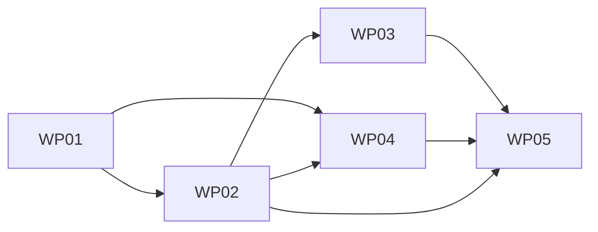

# Tasks: Planning lane writes to the Mission branch before landing

**Mission**: `planning-lane-write-branch-01M8A725` · **Spec**: [spec.md](spec.md) · **Plan**: [plan.md](plan.md)
**Branches**: planning base `fix/7860-planning-evidence-window` · merge target `fix/7860-planning-evidence-window` (draft PR to `main` afterwards)
**Operator rulings (2026-11-25, #7860)**: A' · in-flight guidance only · window start = the claim commit on the Mission branch · 5 work packages.

## Subtask Index

| ID | Description | WP | Parallel |
|----|-------------|----|----------|
| T001 | Red unit tests for the raising planning write-branch reader | WP01 | |
| T002 | `planning_write_ref` in `mission_runtime/resolution.py` (raising) | WP01 | |
| T003 | Planning-lane write target (branch + checkout) on `primary_partition_checkout` | WP01 | |
| T004 | Proposed amendment to ADR 2026-11-06-3 | WP01 | [P] |
| T005 | Red tests for the planning workspace resolution | WP02 | |
| T006 | One planning workspace path in `workspace/context.py`, distinct resolution kind | WP02 | |
| T007 | Audit and update the `resolution_kind == "repo_root"` readers | WP02 | |
| T008 | `implement` messages (CLI banner, agent action, ancestry message within the C-003 hunk) | WP02 | |
| T009 | Docstrings and "main repository" campsite fixes | WP02 | [P] |
| T010 | Red tests for the claim base and the move-into-review gate | WP03 | |
| T011 | Claim base recorded from the resolved checkout (CLI) | WP03 | |
| T012 | Orchestrator API start: workspace, branch and claim base from the one target | WP03 | |
| T013 | `for_review` gate message names the checkout and branch | WP03 | |
| T014 | Ratchet: a status commit in the shared coordination worktree carries only status paths | WP03 | [P] |
| T015 | Red tests for the planning evidence window (start, end, hollow, controls) | WP04 | |
| T016 | Per-work-package planning window in `wp_evidence` | WP04 | |
| T017 | Move-task leg, refusal and remedy texts | WP04 | |
| T018 | In-flight target-only probe and refusal addendum | WP04 | |
| T019 | Per-caller coverage (accept, consolidate claim, orchestrator API, attestation) | WP05 | |
| T020 | Proposed amendment to ADR 2026-10-04-5 | WP04 | [P] |
| T021 | Rework the #7860 red test into the acceptance suite | WP05 | |
| T022 | Consolidate end-to-end in both shapes; fix planning-lane attribution if red | WP05 | |
| T023 | One-authority pin and review-range ratchet | WP05 | [P] |
| T024 | Glossary, AGENTS.md clause (CLAUDE.md is a symlink), migrations note, changelog fragments, moved docstrings | WP05 | [P] |
| T025 | Move-task auto-commit guard for the shared coordination worktree | WP04 | |

## Work Packages

### WP01 — One raising planning write-branch reader

**Goal**: one answer, in one place, to "which branch does this Mission's planning lane write to, and which checkout holds it". It refuses on an unreadable `meta.json`. **Priority**: P1 (foundation). **Independent test**: unit tests over meta fixtures and a real worktree.
**Prompt**: [tasks/WP01-planning-write-ref.md](tasks/WP01-planning-write-ref.md) · **Dependencies**: none

T001 Red unit tests for the raising planning write-branch reader (WP01)
T002 `planning_write_ref` in `mission_runtime/resolution.py` (raising) (WP01)
T003 Planning-lane write target (branch + checkout) on `primary_partition_checkout` (WP01)
T004 Proposed amendment to ADR 2026-11-06-3 (WP01)

Risks: placement callers keep the non-raising reader. Do not edit `review/wp_range.py` (C-001).

### WP02 — Planning workspace in the Mission-branch checkout

**Goal**: `implement` resolves a default, not-yet-landed Mission's planning work package to the coordination worktree on the Mission branch, and says so (FR-001, FR-002, FR-006). **Priority**: P1. **Independent test**: `resolve_workspace_for_wp` and the `implement` output on a real repository.
**Prompt**: [tasks/WP02-planning-workspace.md](tasks/WP02-planning-workspace.md) · **Dependencies**: WP01

T005 Red tests for the planning workspace resolution (WP02)
T006 One planning workspace path in `workspace/context.py`, distinct resolution kind (WP02)
T007 Audit and update the `resolution_kind == "repo_root"` readers (WP02)
T008 `implement` messages (CLI banner, agent action, ancestry message within the C-003 hunk) (WP02)
T009 Docstrings and "main repository" campsite fixes (WP02)

Risks: 25 callers of `resolve_workspace_for_wp`. Do not touch the #5604 `implement()` hunks in `workflow.py` (about :1842–1925).

### WP03 — Claim base and the move-into-review gate

**Goal**: the claim base and the `for_review` gate read the resolved checkout, in the CLI and in the orchestrator API (FR-011, FR-013). **Priority**: P1. **Independent test**: claim, then gate, on a real repository.
**Prompt**: [tasks/WP03-claim-base-and-gate.md](tasks/WP03-claim-base-and-gate.md) · **Dependencies**: WP02

T010 Red tests for the claim base and the move-into-review gate (WP03)
T011 Claim base recorded from the resolved checkout (CLI) (WP03)
T012 Orchestrator API start: workspace, branch and claim base from the one target (WP03)
T013 `for_review` gate message names the checkout and branch (WP03)
T014 Ratchet: a status commit in the shared coordination worktree carries only status paths (WP03)

### WP04 — Planning evidence window: start, end, callers, in-flight guidance

**Goal**: the evidence window of a default, not-yet-landed planning work package runs from its claim commit on the Mission branch to the Mission branch. Every caller agrees. Refusals name the Mission branch, and target-only work gets the named remedy (FR-003, FR-004, FR-006, FR-007, FR-010). **Priority**: P1. **Independent test**: unit tests on real git repositories, plus a move-task CLI test.
**Prompt**: [tasks/WP04-planning-evidence-window.md](tasks/WP04-planning-evidence-window.md) · **Dependencies**: WP01, WP02 (the new resolution kind: T025)

T015 Red tests for the planning evidence window (start, end, hollow, controls) (WP04)
T016 Per-work-package planning window in `wp_evidence` (WP04)
T017 Move-task leg, refusal and remedy texts (WP04)
T018 In-flight target-only probe and refusal addendum (WP04)
T025 Move-task auto-commit guard for the shared coordination worktree (WP04)
T020 Proposed amendment to ADR 2026-10-04-5 (WP04)

Parallel: runs alongside WP03 after WP02. T019 moved to WP05 (session size, post-tasks squad).

### WP05 — Acceptance suite, consolidation, docs and release note

**Goal**: the #7860 reproduction is green end to end, consolidation lands planning work in both shapes, one authority is pinned, and docs and the changelog state the rule (FR-005, FR-009, FR-012, FR-014, SC-001..SC-006). **Priority**: P1. **Independent test**: the integration suite.
**Prompt**: [tasks/WP05-acceptance-consolidation-docs.md](tasks/WP05-acceptance-consolidation-docs.md) · **Dependencies**: WP02, WP03, WP04

T021 Rework the #7860 red test into the acceptance suite (WP05)
T019 Per-caller coverage (accept, consolidate claim, orchestrator API, attestation) (WP05)
T022 Consolidate end-to-end in both shapes; fix planning-lane attribution if red (WP05)
T023 One-authority pin and review-range ratchet (WP05)
T024 Glossary, CLAUDE.md/AGENTS.md clause, migrations note, changelog fragments (WP05)

## Dependency graph

MVP: WP01 + WP02 + WP04. Post-tasks squad (planner-priti, implementer-ivan) findings are folded into the prompts. Together they make the #7860 move into review pass without `--force`.
