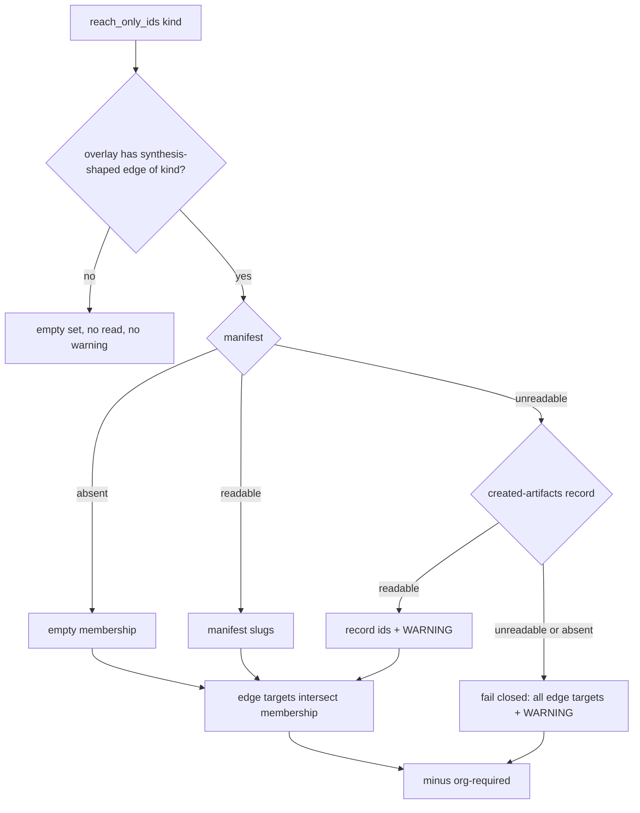

# Implementation Plan: Reach-only membership fails closed (#6454)

**Branch**: `issue-6454-reach-only-fail-closed` | **Date**: 2026-10-26 | **Spec**: [spec.md](spec.md)
**Input**: Mission specification from `kitty-specs/reach-only-fail-closed-01M5WZFY/spec.md`

Branch contract: current branch `issue-6454-reach-only-fail-closed`, planning/base branch
`issue-6454-reach-only-fail-closed`, merge target `issue-6454-reach-only-fail-closed`
(`branch_matches_target: true`). Never `main`.

## Summary

`reach_only_ids` (the single owner of reach-only membership) stops treating an unreadable
synthesis manifest as "nothing is synthesized". It resolves membership in order: manifest
(absent → empty, unchanged); on an unreadable manifest, the created-artifacts record; when
neither is readable, fail closed: every overlay node of the kind that a synthesis-shaped edge
targets is reach-only. Both degraded paths log a WARNING. Findings:
`kitty-specs/reach-only-fail-closed-research-01M5WZCH/research.md` (decisions 1-5).

## Technical Context

**Language/Version**: Python 3.11+
**Primary Dependencies**: ruamel.yaml (record/manifest reads), pydantic (manifest model), stdlib `logging`; no new dependency (supply-chain check: nothing added, upgraded or removed)
**Storage**: project files `.kittify/charter/synthesis-manifest.yaml`, `.kittify/charter/synthesized-artifacts.yaml`, legacy `.kittify/charter/synthesized-tactics.yaml` (read only)
**Testing**: pytest (`fast` marker), red-first through `reach_only_ids`, `_load_action_governance_bundle` and `compiler._direct_root_urns`; `caplog` for the warning
**Target Platform**: the spec-kitty CLI (Linux, macOS, Windows)
**Project Type**: single project (`src/charter/`)
**Performance Goals**: no extra file reads unless the overlay carries a synthesis-shaped edge of the kind (NFR-001)
**Constraints**: complexity at most 15; `__all__` unchanged (no new public names); no suppressions
**Scale/Scope**: one source module, two test modules, one changelog entry

## Charter Check

- Single canonical authority: the decision stays in `reach_only_ids` (C-001); no consumer filtering. Pass.
- ATDD-first: failing tests committed before the fix (C-011 of the charter). Planned.
- Test policy: targeted files plus `tests/charter/`, `tests/charter_offering/`, `make test-fast`; no full heavy suites. Planned.
- `__all__` convention: unchanged; private helpers only. Pass.
- Tiered rigour: core governance logic, so branch tests for every new path. Planned.

No violations.

## Project Structure

### Documentation (this mission)

```
kitty-specs/reach-only-fail-closed-01M5WZFY/
├── spec.md
├── plan.md
├── research.md      # points at the research Mission's findings
├── data-model.md
├── quickstart.md
└── tasks.md         # /spec-kitty.tasks
```

### Source Code (repository root)

```
src/charter/activation/synthesizer/reach_only.py      # membership resolution + warning
tests/charter/synthesizer/test_reach_only_delivery.py # tactic cases (bundle + reach_only_ids)
tests/charter/synthesizer/test_styleguide_reach_only.py # styleguide cases (_direct_root_urns)
docs/changelog/CHANGELOG.md                           # [Unreleased] entry
```

**Structure Decision**: single project; changes confined to the files above.

## Design



- `_manifest_slugs` keeps its lenient contract for the append path (C-002); a new strict reader
  raises a private error on an unreadable (present) manifest and returns empty when absent.
- Record reading reuses `_read_record`; "absent record" (no file that can hold the kind) is
  treated as unreadable.
- Warning: module `_LOGGER.warning(...)`, naming the file(s) and the outcome.

## Implementation Concern Map

### IC-01 — Red-first acceptance tests

- **Purpose**: pin the fail-open as failing tests before the fix.
- **Relevant requirements**: FR-001..FR-006
- **Affected surfaces**: the two test modules above
- **Sequencing/depends-on**: none
- **Risks**: the absent-manifest and org-required cases are ratchets (pass on main); the rest must be red on main.

### IC-02 — Membership resolution and warning

- **Purpose**: implement the fallback and fail-closed paths in `reach_only_ids`.
- **Relevant requirements**: FR-001..FR-006, NFR-001, NFR-002, C-001..C-003
- **Affected surfaces**: `src/charter/activation/synthesizer/reach_only.py`, changelog
- **Sequencing/depends-on**: IC-01
- **Risks**: warning repeats once per call; acceptable, it is a corrupt-file state the operator must fix.
