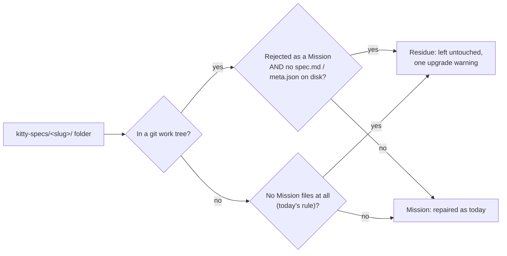

# Mission Specification: Residue-safe migration sweep and fabricated-identity audit

**Mission Branch**: `fix/residue-safe-migration-sweep`  
**Created**: 2026-10-25  
**Status**: Draft  
**Input**: GitHub issues #6669 (P0) and #6668, follow-ups of #6627 / PR #6662, with the operator rulings recorded on both issues on 2026-10-25.

## Overview

A project owner switches branches, or a lane worktree is cleaned up, and a `kitty-specs/<slug>/` folder keeps only untracked leftovers: a stray work package file, a status event log, or a `decisions/` index. The folder is not a Mission. Its tracked Mission files left with the branch. `spec-kitty upgrade` still treats it as one. It writes a baseline `meta.json`, mints a `mission_id` that contradicts the slug's mid8 (a second identity for a real Mission's slug), synthesizes status files, rewrites the leftover work package, and the upgrade auto-commit commits all of it. #6662 closed this for folders holding only `decisions/`, but not for folders holding Mission-shaped leftovers. Projects upgraded before #6662 may already carry such a fabricated identity in their history.

This Mission makes upgrade leave every such folder untouched and report it, and lets `doctor mission-state --audit` point out identities that earlier upgrades already fabricated. It never deletes anything from a user's tree.

## Domain Language

| Term | Meaning | Avoid |
|------|---------|-------|
| **Residue folder** | A `kitty-specs/` child that is not a Mission: it carries no identity and git tracks none of its Mission marker files, and (inside a git work tree) it has no `spec.md` or `meta.json` on disk. | "orphan mission", "ghost mission" |
| **Fabricated identity** | A `mission_id` minted by an upgrade into a residue folder and committed. | "duplicate mission" (it is not a copy of the real Mission) |
| **Write seam** | A shared helper an upgrade migration writes through, which decides residue before writing. | |
| **Successor migration** | The residue-aware migration that replaces the shipped `2.0.6_consistency_sweep` through the supersession table. | "patched 2.0.6" (the shipped module is never edited) |

## User Scenarios & Testing *(mandatory)*

### User Story 1 - Upgrade leaves Mission-shaped residue untouched (Priority: P1)

A project owner runs `spec-kitty upgrade` on a project where a branch switch left `kitty-specs/my-mission-01M5JYRC/` holding only an untracked `tasks/WP01-*.md` or `status.events.jsonl`. The upgrade finishes, prints one warning naming the folder as residue, and writes and commits nothing in it. A real Mission in the same project is repaired exactly as before.

**Why this priority**: this is the P0. Today the upgrade fabricates and auto-commits a second identity for a real Mission's slug.

**Independent Test**: the red-first reproduction from PR #6672 (`tests/integration/migration/test_upgrade_residue_with_mission_files_6669.py`), run through the real `spec-kitty upgrade` CLI, passes with its `p0_repro` marker removed.

**Acceptance Scenarios**:

1. **Given** a git project with a committed Mission and a residue folder holding only an untracked `tasks/WP01-leftover.md` (`lane: doing`), **When** `spec-kitty upgrade --yes` runs, **Then** the residue folder is byte-identical, nothing under it is tracked, and the real Mission's `mission_id` is unchanged.
2. **Given** the same project, but the residue folder holds only an untracked `status.events.jsonl`, **When** the upgrade runs, **Then** the same holds.
3. **Given** a residue folder holding only untracked `decisions/` files (the #6627 shape), **When** the upgrade runs, **Then** the #6627 regression guard still passes.
4. **Given** a residue folder, **When** the upgrade skips it, **Then** the output carries exactly one warning naming that folder as residue.

---

### User Story 2 - Real and legacy Missions keep being repaired (Priority: P1)

A project owner upgrading a legacy project, whether from before identities existed or never committed, still gets every repair the 2.0.6 sweep provides, through its residue-aware successor. Projects that already recorded the 2.0.6 sweep see no re-sweep.

**Why this priority**: a residue rule that is too wide would silently stop repairing real Missions. The ledger would then record the sweep as done and never retry.

**Independent Test**: the successor's tests and the existing 2.0.6 sweep tests show that a legacy Mission with a committed `spec.md`, an uncommitted Mission with `spec.md`, one with an identity-less `meta.json`, and a pre-identity Mission in a non-git project all still get their baseline `meta.json` and repairs.

**Acceptance Scenarios**:

1. **Given** a git project with a legacy Mission whose `spec.md` is committed but which has no `meta.json`, **When** the upgrade runs, **Then** it gets its baseline `meta.json`, and its identity is backfilled by the later lifecycle normalization.
2. **Given** an uncommitted Mission with `spec.md` on disk, **When** the upgrade runs, **Then** it is repaired, not skipped.
3. **Given** a non-git project with a pre-identity Mission holding only `tasks/` and `tasks.md`, **When** the upgrade runs, **Then** it is repaired as today.
4. **Given** a project whose migration ledger already records `2.0.6_consistency_sweep` as `success`, **When** the upgrade runs, **Then** the successor writes nothing to any Mission and is recorded as not needed.
5. **Given** a project where the 2.0.6 sweep has not run yet, **When** the upgrade runs, **Then** the successor runs in 2.0.6's slot (before the 3.0.0 and 3.2.0a4 steps that rely on its baseline `meta.json`) and the shipped 2.0.6 entry is recorded as superseded.

---

### User Story 3 - Doctor points out identities an earlier upgrade fabricated (Priority: P2)

A project owner whose earlier upgrade already committed a fabricated identity runs `spec-kitty doctor mission-state --audit`. The audit reports a warning naming the folder, says why it looks fabricated, and gives the manual remedy (remove that folder's `meta.json` and `status.json` in a commit). It never deletes anything and never blocks CI on its own.

**Why this priority**: it repairs nothing on its own and only helps operators clean up history, but without it a fabricated identity stays invisible.

**Independent Test**: a project with one fabricated folder and one real Mission produces exactly one such finding; the real-Mission corpus of this repository produces none.

**Acceptance Scenarios**:

1. **Given** a tracked folder holding only `meta.json`, `status.json` and `decisions/` leftovers, whose `meta.json` has the baseline-builder shape and whose `mission_id` prefix contradicts the slug's mid8, **When** the audit runs, **Then** it reports one warning finding for that folder, with the manual remedy.
2. **Given** a folder that meets only two of the three signals (for example a real Mission whose slug carries a divergent mid8 by design), **When** the audit runs, **Then** no such finding is reported.
3. **Given** the finding is present, **When** the audit runs with `--fail-on teamspace-blocker`, **Then** it does not fail on that finding.

---

### Edge Cases

- A never-committed, pre-identity folder holding only `tasks/` and `tasks.md` **inside a git repository** is now treated as residue and left untouched, where today it is repaired. This is the accepted cost of the git-aware rule.
- A Mission whose tracked `spec.md` was deleted in the working tree is still a Mission (git still tracks the marker), so it is repaired, not skipped.
- Git cannot be started (not installed, or an unusable checkout): the rule falls back to today's file-presence rule, and the upgrade does not crash.
- A residue folder inside a lane or coordination worktree: the successor's worktree pass applies the same rule and reads that worktree's own ledger.
- A fabricated folder that also kept a stray `tasks/` leftover is not reported by the doctor finding (signal 1 by design). Once this Mission lands, upgrade stops producing that shape.
- A real Mission created a moment ago, with only `meta.json` (identity present) and no spec yet, is not reported: its mid8 matches its `mission_id`.

## Requirements *(mandatory)*

### Functional Requirements

| ID | Title | User Story | Priority | Status | Delivery | No-op passable? |
|----|-------|------------|----------|--------|----------|-----------------|
| FR-001 | Git-aware residue rule | As a project owner, I want a `kitty-specs/` child inside a git work tree to count as residue whenever the canonical Mission predicate rejects it and it has no `spec.md` or `meta.json` on disk, whatever else it holds, so that Mission-shaped leftovers are never treated as Missions. | High | Open | [build] | no — the tasks-leftover and event-log-leftover fixtures are residue under the new rule and Missions under today's rule |
| FR-002 | Non-git behaviour unchanged | As the owner of a non-git legacy project, I want the residue rule outside a git work tree to stay today's file-presence rule, so that my legacy Missions are still repaired. | High | Open | [ratchet] | yes — paired with FR-001 on the same tasks-only fixture, which must flip only when git is present |
| FR-003 | One residue rule for every write seam | As a maintainer, I want the baseline `meta.json` builder, the lifecycle normalization, the runtime-state cutover and the successor to decide residue through the one rule in the Mission resolver, so that no seam drifts from another. | High | Open | [build] | no — the architectural walker gate pins each seam's call to the rule |
| FR-004 | Supersede the shipped 2.0.6 sweep | As a maintainer, I want `2.0.6_consistency_sweep` listed in the supersession table with a residue-aware successor, so that its in-module writers (WP frontmatter, status snapshot refresh, orphan-snapshot cleanup, `tasks.md` prompt rewrite) never run on a residue folder, while its shipped module stays byte-identical. | High | Open | [build] | no — the registry must return the superseded substitute for 2.0.6 and the successor must be registered |
| FR-005 | Successor keeps every 2.0.6 repair for Missions | As the owner of a legacy project, I want the successor to perform every repair 2.0.6 performs (runtime assets, legacy worktree assets, baseline `meta.json`, WP frontmatter, status, prompt references) on every folder that is not residue, so that superseding loses no repair. | High | Open | [build] | no — the existing 2.0.6 repair fixtures must be repaired by the successor |
| FR-006 | Successor runs in 2.0.6's slot | As a maintainer, I want the successor ordered immediately after 2.0.6 with the same target version and an annotated tie, so that the later steps that need its baseline `meta.json` still see it. | High | Open | [build] | no — the order-manifest gate and a test for adjacent placement |
| FR-007 | No re-sweep where 2.0.6 already ran | As the owner of a project whose ledger records 2.0.6 as `success`, I want the successor to detect nothing to do, so that upgrading after this change does not re-run the whole sweep. | High | Open | [build] | no — paired fixtures: 2.0.6 settled versus not settled, with the same Mission state |
| FR-008 | Residue skips are reported | As a project owner, I want one upgrade warning per residue folder the successor skips, using the same wording as the lifecycle normalization, so that I can see and remove the leftover. | Medium | Open | [build] | no — the warning must name the folder |
| FR-009 | P0 reproduction turns into a guard | As a maintainer, I want the #6669 red-first reproduction to pass and lose its `p0_repro` marker, so that it runs on every PR. | High | Open | [build] | no — it fails on today's `main` |
| FR-010 | Fabricated-identity audit finding | As a project owner, I want `doctor mission-state --audit` to report a warning for a tracked folder that holds only `meta.json`/`status.json` plus leftovers, has the baseline-builder `meta.json` shape, and has a `mission_id` prefix contradicting its slug's mid8, so that I can remove an identity an earlier upgrade fabricated. | Medium | Open | [build] | no — paired with fixtures meeting only two of the three signals, which must not be reported |
| FR-011 | Audit finding never blocks or deletes | As a project owner, I want that finding to be a warning outside the Teamspace blocker set that changes no file, so that it never fails CI or alters my tree. | Medium | Open | [build] | yes — paired with FR-010's positive fixture, which must still report exactly one finding |
| FR-012 | One owner for the baseline shape | As a maintainer, I want the slug-derived baseline fields computed by one helper shared by the `meta.json` builder and the audit, so that the audit's shape check cannot drift from what the builder writes. | Medium | Open | [build] | no — the builder's existing tests and the audit's tests both run through the helper |

### Non-Functional Requirements

| ID | Title | Requirement | Category | Priority | Status |
|----|-------|-------------|----------|----------|--------|
| NFR-001 | Shipped migrations byte-identical | `git diff origin/main -- src/specify_cli/upgrade/migrations/m_*.py` shows zero changed lines in any existing migration module. | Reliability | High | Open |
| NFR-002 | No false fabricated-identity findings | The audit reports 0 fabricated-identity findings on this repository's own `kitty-specs/` corpus (643 Missions at planning time). | Reliability | High | Open |
| NFR-003 | Bounded git cost | The residue decision in a folder walk costs at most one batched tracked-path query per walk, plus at most one extra git probe per folder that carries no identity. A folder with a `mission_id` needs no git call. | Performance | Medium | Open |
| NFR-004 | Quality gates | New and changed code passes ruff, ruff format and mypy strict with zero new issues and no new suppressions. Every function stays at complexity ≤ 15, and diff coverage is ≥ 90 %. | Maintainability | High | Open |

### Constraints

| ID | Title | Constraint | Category | Priority | Status |
|----|-------|------------|----------|----------|--------|
| C-001 | Never delete | Nothing in this Mission deletes or repairs a fabricated folder; remedies are reported only. | Business | High | Open |
| C-002 | Supersession, not edit | Shipped migrations change only through the supersession table (ADR 2026-10-17-1, Amendment 2026-10-25); the ADR gains an amendment for the first successor that is a new migration with a ledger-gated `detect()`. | Technical | High | Open |
| C-003 | Shared writers untouched | `status.materialize` and the WP frontmatter write path are not guarded (option 2 of #6669 was rejected). | Technical | High | Open |
| C-004 | No mint refusal | `backfill_mission` does not refuse to mint a contradicting id; that would turn a skip into a hard upgrade failure. | Technical | Medium | Open |
| C-005 | Out of scope | #6547, #6551, #5875 and marking superseded ids in `migrate ledger` are not addressed. | Business | Medium | Open |

### Key Entities

- **Residue folder**: a `kitty-specs/` child with no identity and no tracked Mission marker. Inside git it has no `spec.md`/`meta.json` on disk; outside git it has no Mission files at all.
- **Fabricated identity**: a tracked `meta.json` in a residue-shaped folder, with the baseline-builder fields and a `mission_id` contradicting the slug's mid8.
- **Migration ledger record**: the per-migration `success` / `skipped` / `failed` record that decides whether the successor has anything to do.

## Success Criteria *(mandatory)*

### Measurable Outcomes

- **SC-001**: Upgrading a project with a Mission-shaped residue folder (a stray WP file or event log) leaves 0 files added, changed or committed in that folder, in 2 of 2 reproduction variants. — [build] · no-op passable: no
- **SC-002**: 100 % of the existing 2.0.6 sweep repair scenarios still repair real Missions after the supersession. — [ratchet] · no-op passable: yes — paired with SC-001 on the same project, where the residue folder must stay untouched
- **SC-003**: A project that already recorded 2.0.6 sees 0 Mission files changed by the successor on its next upgrade. — [build] · no-op passable: no
- **SC-004**: The audit finds 1 of 1 planted fabricated identities and 0 false findings across this repository's 643 real Missions. — [build] · no-op passable: no

## Assumptions

- Lane worktrees and coordination worktrees carry their own copy of the migration ledger. The successor's ledger check reads the copy of the checkout it runs in, matching how 2.0.6 itself was recorded per worktree.
- On projects where 2.0.6 is already settled, the successor's one `skipped` ledger record (and its listing as not applied in `migrate ledger`) is acceptable noise, as ADR 2026-10-17-1 Amendment 2026-10-25 already accepts for superseded ids.
- The baseline-builder shape is recognised by its slug-derived fields (`slug`, `mission_slug`, `friendly_name`, and `mission_number` either blank or equal to the slug's numeric prefix, as an int after normalization), not by the exact key set: later backfills may add keys.

## Dependencies

- PR #6672 (the red-first `p0_repro` for #6669) lands first, or is merged together with this Mission's PR.
- Builds on #6662 (`is_kitty_specs_residue`, the migration walker gate) and #6589 (`upgrade/supersession.py`).
- Related, not blocking: #6655 makes worktree `apply()` errors fatal; the successor inherits that once it lands.
