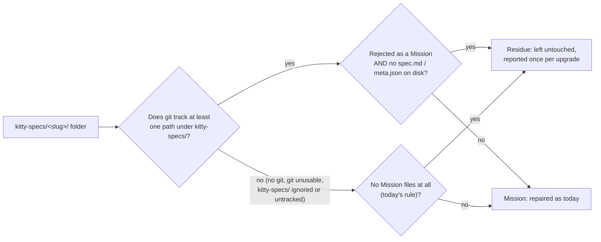

# Mission Specification: Residue-safe migration sweep and fabricated-identity audit

**Mission Branch**: `fix/residue-safe-migration-sweep`  
**Created**: 2026-10-25  
**Status**: Draft (revised after the post-specify adversarial review, 2026-10-25)  
**Input**: GitHub issues #6669 (P0) and #6668, follow-ups of #6627 / PR #6662, with the operator rulings recorded on both issues and in this session on 2026-10-25.

## Overview

A project owner switches branches, or a non-integrating worktree is cleaned up, and a `kitty-specs/<slug>/` folder keeps only untracked leftovers: a stray work package file, a status event log or snapshot, a legacy `tasks/<lane>/` file, or a `decisions/` index. The folder is not a Mission, because its tracked Mission files left with the branch. `spec-kitty upgrade` still treats it as one:
- it writes a baseline `meta.json`;
- it mints a `mission_id` that contradicts the slug's mid8 (a second identity for a real Mission's slug);
- it synthesizes `status.events.jsonl` and `status.json`;
- it rewrites the leftover work package.

The upgrade auto-commit then commits `meta.json`, `status.events.jsonl` and `status.json`. #6662 closed this for folders holding only `decisions/`, but not for folders holding Mission-shaped leftovers. Projects upgraded before #6662 may already carry such a fabricated identity in their history.

This Mission makes every upgrade migration that walks `kitty-specs/` leave such a folder untouched and report it once. It also lets `doctor mission-state --audit` point out identities that earlier upgrades already fabricated. It never deletes anything from a user's tree.

## Domain Language

| Term | Meaning | Avoid |
|------|---------|-------|
| **Residue folder** | A `kitty-specs/` child that the canonical Mission predicate rejects: no `mission_id`, and git tracks neither its `spec.md` nor its `meta.json`. When git tracks any path under `kitty-specs/`, it also has no `spec.md` or `meta.json` on disk. Otherwise it holds no Mission file at all (today's rule). | "orphan mission", "ghost mission" |
| **Git-aware mode** | The residue decision used when git can run and tracks at least one path under the project's `kitty-specs/`. | "inside git" (too loose: an ignored or untracked `kitty-specs/` inside a parent repository does not count) |
| **Fabricated identity** | A `mission_id` that an upgrade minted into a residue folder, which was then committed. | "duplicate mission" (it is not a copy of the real Mission) |
| **Write seam** | A shared helper an upgrade migration writes through; it decides residue before writing. | |
| **Successor migration** | A residue-aware migration that replaces a shipped migration through the supersession table. The shipped module is never edited. | "patched migration" |
| **Superseded migration** | One of `0.9.0_frontmatter_only_lanes`, `0.9.1_complete_lane_migration`, `2.0.6_consistency_sweep` or `3.1.1_normalize_status_json`. Each is registered as a recorded no-op whose successor does its work. | |

## User Scenarios & Testing *(mandatory)*

### User Story 1 - Upgrade leaves Mission-shaped residue untouched (Priority: P1)

A project owner runs `spec-kitty upgrade` on a project that tracks Missions in git. A branch switch left `kitty-specs/my-mission-01M5JYRC/` holding only untracked leftovers. The upgrade finishes, reports the folder as residue once, and writes and commits nothing in it. A real Mission in the same project is repaired exactly as before.

**Why this priority**: this is the P0. Today the upgrade fabricates and auto-commits a second identity for a real Mission's slug.

**Independent Test**: the red-first reproduction from PR #6672 (`tests/integration/migration/test_upgrade_residue_with_mission_files_6669.py`), run through the real `spec-kitty upgrade` CLI, passes with its `p0_repro` marker removed. It is extended to every leftover shape below.

**Acceptance Scenarios**:

1. **Given** a git project with a committed Mission and a residue folder holding only an untracked `tasks/WP01-leftover.md` (`lane: doing`), **When** `spec-kitty upgrade --yes` runs, **Then** the residue folder is byte-identical, nothing under it is tracked, and the real Mission's `mission_id` is unchanged.
2. **Given** the same project with a residue folder holding only an untracked `status.events.jsonl`, **Then** the same holds.
3. **Given** a residue folder holding only an untracked `status.json` (with or without an event log), **Then** the same holds.
4. **Given** a residue folder holding only an untracked legacy `tasks/doing/WP01-x.md`, **Then** the same holds: the file is not moved.
5. **Given** a residue folder holding only untracked `decisions/` files (the #6627 shape), **Then** the #6627 regression guard still passes.
6. **Given** a residue folder, **When** the upgrade skips it, **Then** the output names that folder as residue at least once and never repeats the same residue notice for the same folder within one run. The notice states the git-aware reason and a remedy that works (add a `spec.md` or `meta.json`, or remove the folder).

---

### User Story 2 - Real and legacy Missions keep being repaired (Priority: P1)

A project owner upgrading a project whose real Missions carry a `spec.md` or `meta.json` on disk, committed or not, gets every repair the four superseded migrations provide, through their successors. So does a project whose `kitty-specs/` git does not track. Projects that already recorded a superseded migration as `success` see no re-sweep.

**Why this priority**: a residue rule that is too wide would silently stop repairing real Missions, and the ledger would then record the work as done and never retry it.

**Independent Test**: each successor is resolved through the migration registry, or the scenario is driven by the `spec-kitty upgrade` CLI, never by importing a shipped class directly. Every repair fixture of the four superseded migrations is repaired, and every residue fixture is left untouched.

**Acceptance Scenarios**:

1. **Given** a git project with a legacy Mission whose `spec.md` is committed but which has no `meta.json`, **When** the upgrade runs, **Then** it gets its baseline `meta.json` and the later lifecycle normalization backfills its identity.
2. **Given** an uncommitted Mission with `spec.md` on disk, **Then** it is repaired, not skipped.
3. **Given** a non-git project, a project whose `kitty-specs/` is gitignored, or an untracked project nested inside an unrelated parent repository, holding a pre-identity Mission with only `tasks/` and `tasks.md`, **Then** it is repaired as today.
4. **Given** a project whose migration ledger already records a superseded migration as `success`, **When** the upgrade runs, **Then** that migration's successor writes nothing to any Mission and is recorded as not needed. `upgrade --dry-run` previews the same.
5. **Given** a project where a superseded migration has not run yet, **When** the upgrade runs, **Then** its successor runs in the same slot of the migration order, and the shipped entry is recorded as superseded.
6. **Given** a pre-ledger project on first ledger adoption, **When** the upgrade and `upgrade --dry-run` run, **Then** both use the same settled view for each successor: a superseded migration that adoption will settle counts as settled in the dry run too.

---

### User Story 3 - Doctor points out identities an earlier upgrade fabricated (Priority: P2)

A project owner whose earlier upgrade already committed a fabricated identity runs `spec-kitty doctor mission-state --audit`. The audit reports a warning that names the folder, gives the three reasons it looks fabricated, and states the manual remedy: remove that folder's `meta.json` and `status.json` in a commit. It never deletes anything and does not fail the Teamspace-blocker or error thresholds.

**Why this priority**: it repairs nothing on its own and only helps operators clean up history, but without it a fabricated identity stays invisible.

**Independent Test**: a project with one planted fabricated folder and one real Mission produces exactly one such finding. Every `kitty-specs/` child of this repository at HEAD produces none.

**Acceptance Scenarios**:

1. **Given** a folder whose `meta.json` is git-tracked, that holds only `meta.json`, `status.json`, `status.events.jsonl`, `decisions/` and `*.lock` files, whose `meta.json` has the baseline-builder shape, and whose slug's mid8 suffix contradicts its `mission_id` prefix, **When** the audit runs, **Then** it reports exactly one warning finding for that folder, with the manual remedy.
2. **Given** a folder that meets only two of the three signals (for example a real Mission whose slug carries a divergent mid8 by design, or one that also holds `research.md`), **Then** no such finding is reported.
3. **Given** the finding is present, **When** the audit runs with `--fail-on teamspace-blocker` or `--fail-on error`, **Then** the finding does not make it fail. With `--fail-on warning` it does fail, by design.
4. **Given** a project outside git, or a folder whose `meta.json` is untracked, **Then** no such finding is reported.

---

### Edge Cases

- **Accepted cost (operator ruling):** in git-aware mode, any pre-identity folder with no `spec.md` and no `meta.json` on disk is residue and left untouched. That covers both committed and never-committed folders holding only `tasks/` and `tasks.md`. The residue notice and the `RESIDUE_DIRECTORY` audit detail tell the operator how to make it a Mission again: add a `spec.md` or `meta.json`.
- A Mission whose tracked `spec.md` was deleted in the working tree is still a Mission: git still tracks the marker. It is repaired, not skipped.
- A Mission whose tracked `meta.json` is missing from the working tree is out of scope here. Today it can be given a fresh identity in the working tree (not auto-committed). That is tracked as its own issue (see Dependencies).
- Git cannot be started (not installed, or an unusable checkout): today's file-presence rule applies, and no upgrade step crashes.
- Worktrees: upgrade's worktree pass runs migrations only in non-integrating `.worktrees/*` checkouts. There the successors apply the same rule and read that checkout's own ledger. Lane and coordination worktrees are never upgraded, so they stay untouched.
- A fabricated folder that also kept a stray `tasks/` leftover is not reported by the doctor finding (signal 1 by design). Once this Mission lands, upgrade stops producing that shape.
- A real Mission created a moment ago, with only `meta.json` (identity present) and no spec yet, is not reported: its mid8 matches its `mission_id`.
- A slug without a mid8 suffix can never meet signal 3, so it is never reported.

## Requirements *(mandatory)*

### Functional Requirements

| ID | Title | User Story | Priority | Status | Delivery | No-op passable? |
|----|-------|------------|----------|--------|----------|-----------------|
| FR-001 | Git-aware residue rule | As a project owner, I want a `kitty-specs/` child to count as residue in git-aware mode whenever the canonical Mission predicate rejects it and it has no `spec.md` or `meta.json` on disk, whatever else it holds. Then Mission-shaped leftovers are never treated as Missions. | High | Open | [build] | no — the tasks, event-log, status-snapshot and lane-folder fixtures are residue under the new rule and Missions under today's rule |
| FR-002 | Git-aware mode only when kitty-specs/ is tracked | As the owner of a non-git project, a project with an ignored `kitty-specs/`, or an untracked project nested in a parent repository, I want today's file-presence rule to apply, so that my legacy Missions are still repaired. Git-aware mode applies only when git can run and tracks at least one path under the project's `kitty-specs/`. | High | Open | [build] | no — the same tasks-only fixture must be a Mission in each of those three settings and residue in a tracked project |
| FR-003 | One residue rule for every write seam and walker | As a maintainer, I want every write seam and every successor migration to decide residue through the one rule in the Mission resolver, so that no seam drifts from another. That covers the baseline `meta.json` builder, the lifecycle normalization, the runtime-state cutover and backfill walk, and the derived-files move of the canonical-context migration. | High | Open | [build] | no — the architectural walker gate pins each seam's call to the rule |
| FR-004 | Supersede the four residue-writing migrations | As a maintainer, I want `0.9.0_frontmatter_only_lanes`, `0.9.1_complete_lane_migration`, `2.0.6_consistency_sweep` and `3.1.1_normalize_status_json` listed in the supersession table, each with a residue-aware successor. Then none of their writers, as listed in each shipped `apply()`, runs on a residue folder, while every shipped module stays byte-identical. | High | Open | [build] | no — the registry must return the superseded substitute for each and register its successor |
| FR-005 | Successors keep every repair for Missions | As the owner of a legacy project, I want each successor to perform every repair its superseded migration performs, on every folder that is not residue, so that superseding loses no repair. The successor reuses the shipped module's helpers rather than duplicating its writers. | High | Open | [build] | no — each superseded migration's repair fixtures must be repaired when run through the registry or the CLI |
| FR-006 | Successors run in their predecessor's slot | As a maintainer, I want each successor ordered immediately after its superseded migration, with the same target version and an annotated tie, so that later steps that rely on its output still see it. | High | Open | [build] | no — the order-manifest gate plus a test for adjacent placement |
| FR-007 | No re-sweep where the predecessor already ran | As the owner of a project whose ledger already settles a superseded migration, I want its successor to detect nothing to do, so that upgrading after this change does not re-run that work. "Settled" means the same view migration selection uses, including migrations that first ledger adoption is about to settle, so that `upgrade` and `upgrade --dry-run` agree. | High | Open | [build] | no — paired fixtures: predecessor settled vs not, with the same Mission state, run live and as a dry run |
| FR-008 | Residue is reported once per folder | As a project owner, I want each residue folder skipped by an upgrade run named at least once and at most once per run. The notice states the git-aware reason and a working remedy, so that I can find and fix the leftover. | Medium | Open | [build] | no — a fixture run counts the notices per folder |
| FR-009 | P0 reproduction turns into a guard | As a maintainer, I want the #6669 red-first reproduction to pass, extended to every leftover shape of User Story 1, and to lose its `p0_repro` marker, so that it runs on every PR. | High | Open | [build] | no — it fails on today's `main` |
| FR-010 | Fabricated-identity audit finding | As a project owner, I want `doctor mission-state --audit` to report a warning for a folder only when all three signals hold, so that I can remove an identity an earlier upgrade fabricated. (1) Its `meta.json` is git-tracked, and the folder holds nothing outside the allow-list `meta.json`, `status.json`, `status.events.jsonl`, `decisions/`, `*.lock`. (2) Its `meta.json` has the baseline-builder shape. (3) The slug's mid8 suffix, read by the slug-only heuristic with the Crockford alphabet, differs from the `mission_id` prefix. | Medium | Open | [build] | no — paired with fixtures meeting only two of the three signals, which must not be reported |
| FR-011 | Audit finding never blocks or deletes | As a project owner, I want that finding to be a warning outside the Teamspace blocker set that changes no file. Then it does not fail the `teamspace-blocker` or `error` thresholds; it does fail `--fail-on warning`. | Medium | Open | [build] | yes — paired with FR-010's positive fixture, which must still report exactly one finding |
| FR-012 | One owner for the baseline shape | As a maintainer, I want the slug-derived baseline fields computed by one helper that both the `meta.json` builder and the audit use, so that the audit's shape check cannot drift from what the builder writes. Blank means `""`, `null` or absent. A numeric slug prefix matches as either text or an int. | Medium | Open | [build] | no — the builder's existing tests and the audit's tests both run through the helper |
| FR-013 | Walker inventory re-audited | As a maintainer, I want every entry of the migration walker inventory reclassified under the new residue definition. The labels "touches only pre-existing mission state" and "only folders with `meta.json`" stay only where the new rule really guarantees no write into residue. Then the gate stays honest. | Medium | Open | [build] | no — the gate's classification test fails for an entry whose label no longer holds |

### Non-Functional Requirements

| ID | Title | Requirement | Category | Priority | Status |
|----|-------|-------------|----------|----------|--------|
| NFR-001 | Shipped migrations byte-identical | `git diff --diff-filter=MDR origin/main -- 'src/specify_cli/upgrade/migrations/m_*.py'` prints nothing: no existing migration module is modified, deleted or renamed. | Reliability | High | Open |
| NFR-002 | No false fabricated-identity findings | The audit reports 0 fabricated-identity findings across every `kitty-specs/` child of this repository at the Mission's base commit. | Reliability | High | Open |
| NFR-003 | Bounded git cost | Over a fixture walk of 50 folders without identity, a spy counting git invocations sees at most 2 calls per walk for the tracked-path set and git-aware-mode check, plus at most 2 per folder. A folder whose `meta.json` carries a `mission_id` costs 0 git calls. | Performance | Medium | Open |
| NFR-004 | Quality gates | New and changed code passes ruff, ruff format and mypy strict with zero new issues and no new suppressions. Every function stays at complexity ≤ 15. Diff coverage is ≥ 90 %. No new allowlist entry is added to a write-site gate without a stated rationale. | Maintainability | High | Open |

### Constraints

| ID | Title | Constraint | Category | Priority | Status |
|----|-------|------------|----------|----------|--------|
| C-001 | Never delete | Nothing in this Mission deletes or repairs a fabricated folder; remedies are reported only. | Business | High | Open |
| C-002 | Supersession, not edit | Shipped migrations change only through the supersession table (ADR 2026-10-17-1, Amendment 2026-10-25). The ADR gains an amendment for successors that are new migrations with a ledger-gated `detect()`. | Technical | High | Open |
| C-003 | Shared writers untouched | `status.materialize` and the WP frontmatter write path are not guarded (option 2 of #6669 was rejected). | Technical | High | Open |
| C-004 | No mint refusal | `backfill_mission` does not refuse to mint a contradicting id; that would turn a skip into a hard upgrade failure. | Technical | Medium | Open |
| C-005 | Out of scope | #6547, #6551, #5875, marking superseded ids in `migrate ledger`, and the deleted-tracked-`meta.json` case are not addressed. | Business | Medium | Open |
| C-006 | Frozen adoption backfill | The first-adoption ledger backfill migration is not edited. A pre-ledger project whose recorded metadata lists a superseded migration as `failed` or `skipped`, at a version above it, has the successor stamped as settled by adoption. Its retry is lost. This is an accepted residual. | Technical | Medium | Open |

### Key Entities

- **Residue folder**: see Domain Language. Decided once, in the Mission resolver.
- **Fabricated identity**: a tracked `meta.json` in an allow-listed folder, with the baseline-builder fields and a `mission_id` contradicting the slug's mid8.
- **Migration ledger record**: the per-migration `success` / `skipped` / `failed` record. Together with pending first adoption, it decides whether a successor has anything to do.

## Success Criteria *(mandatory)*

### Measurable Outcomes

- **SC-001**: Upgrading a tracked project with a residue folder leaves 0 files added, changed, moved or committed in that folder, across all 5 leftover shapes of User Story 1. — [build] · no-op passable: no
- **SC-002**: 100 % of the existing repair scenarios of the four superseded migrations, run through the registry or the CLI, still repair real Missions. — [ratchet] · no-op passable: yes — paired with SC-001 on the same project, whose residue folder must stay untouched
- **SC-003**: A project that already settled the superseded migrations sees 0 Mission files changed by their successors on its next upgrade, live and in a dry run. — [build] · no-op passable: no
- **SC-004**: The audit finds 1 of 1 planted fabricated identities and 0 false findings across every `kitty-specs/` child of this repository. — [build] · no-op passable: no

## Assumptions

- Non-integrating worktrees carry their own copy of the migration ledger. A successor's settled check reads the copy of the checkout it runs in, matching how its predecessor was recorded there.
- On projects where a predecessor is already settled, its successor's single `skipped` ledger record, and its listing as not applied in `migrate ledger`, is acceptable noise. ADR 2026-10-17-1 Amendment 2026-10-25 already accepts the same for superseded ids.
- The baseline-builder shape is recognised by its slug-derived fields (`slug`, `mission_slug`, `friendly_name`, and `mission_number` either blank or equal to the slug's numeric prefix), not by the exact key set: later backfills may add keys.

## Dependencies

- PR #6672 (the red-first `p0_repro` for #6669) lands first, or merges together with this Mission's PR.
- Builds on #6662 (`is_kitty_specs_residue`, the migration walker gate) and #6589 (`upgrade/supersession.py`).
- #6673 tracks the deleted-tracked-`meta.json` case (C-005).
- Related, not blocking: #6655 makes worktree `apply()` errors fatal; the successors inherit that once it lands.
