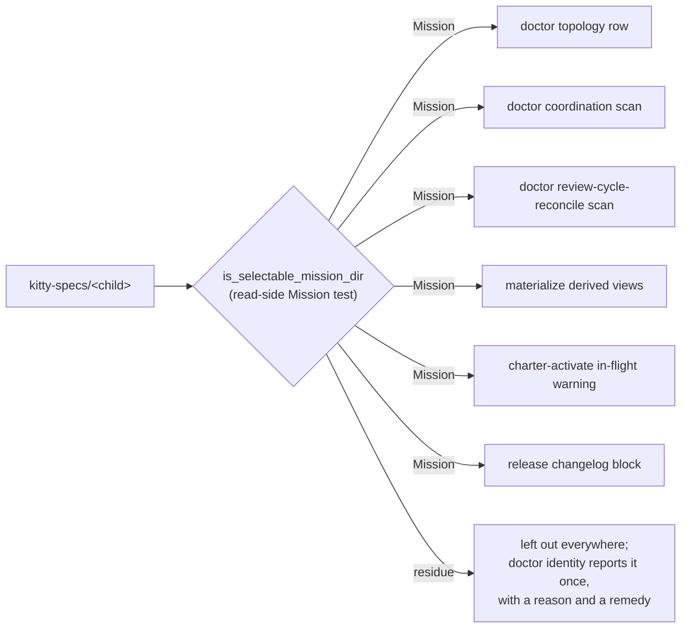

# Mission Specification: Route the remaining `kitty-specs/` walkers through the Mission predicate

**Mission Branch**: `issue-6758-kitty-specs-walkers-mission-predicate`
**Created**: 2026-10-30
**Status**: Draft
**Input**: Issue spec-kitty/spec-kitty#6758 (follow-up from the pre-merge squad on #5875): route the remaining `kitty-specs/` walkers — `doctor topology` among them — through the shared Mission predicate, so residue handling stops drifting.

## User Scenarios & Testing *(mandatory)*

### The one rule every surface asks

### User Story 1 - `doctor topology` stops calling residue a Mission (Priority: P1)

An operator runs `spec-kitty doctor topology` on a repository that has a real Mission
and a leftover `kitty-specs/` folder holding only a `spec.md` (or a `tasks/` tree). Today the
leftover folder is printed as a Mission with a `null` topology and `meta.json not found`;
after the change only real Missions are listed, in the table and in `--json`.

**Why this priority**: it is the user-visible defect. Two doctor commands currently
describe the same folder differently — `doctor identity` as residue with a remedy,
`doctor topology` as a broken Mission — and the second answer is wrong.

**Independent Test**: in a scratch git repository holding one Mission and one residue
folder, `spec-kitty doctor topology --json` returns exactly the Mission.

**Acceptance Scenarios**:

1. **Given** a repository with a Mission (`meta.json` with a `mission_id`) and a residue folder (no `meta.json`), **When** `spec-kitty doctor topology` runs, **Then** the table lists the Mission and the count is 1, and no row carries `meta.json not found`.
2. **Given** the same repository, **When** `spec-kitty doctor topology --json` runs, **Then** `missions` contains exactly the Mission.
3. **Given** a repository whose only `kitty-specs/` child is residue, **When** `spec-kitty doctor topology` runs, **Then** it reports 0 missions and does not fail.

### User Story 2 - The other five read surfaces skip residue too (Priority: P2)

Five more walkers enumerate every `kitty-specs/` child and decide for themselves: the
`doctor coordination` whole-repo scan, the `doctor review-cycle-reconcile` scan,
`materialize`, the charter-activate in-flight warning and the release-changelog block.
Each now asks the same predicate, so a folder the operator cannot select never appears
as a Mission in those reports, never gets a derived-view target or a coordination-worktree
probe, and never reaches the release notes.

**Why this priority**: the drift is the issue's real subject; `doctor topology` is only
the most visible symptom. Leaving five local rules in place leaves five ways to drift again.

**Independent Test**: for each surface, a fixture with a residue child and a selectable
Mission returns only the Mission.

**Acceptance Scenarios**:

1. **Given** a residue child (a folder with `tasks/` and no `meta.json`, in a git repository) alongside a Mission, **When** `_resolve_mission_dirs` (coordination), `_mission_dirs_for` (review-cycle-reconcile), `_mission_dirs_to_process` (materialize), `_collect_inflight_missions` (charter activate) and `build_changelog_block` (release) run, **Then** each yields only the Mission.
2. **Given** the same fixtures, **When** only a Mission is present, **Then** every surface still yields it (positive control on the shared fixture).

### User Story 3 - One authority, enforced (Priority: P3)

A reviewer can see, mechanically, that all six walkers route through the read-side
predicate, and a later change that drops the predicate from any of them fails the
architectural gate instead of silently reintroducing a walker-local rule.

**Why this priority**: "one authority" is only true while something checks. Without the
pin, the next walker edit can regress the whole issue.

**Independent Test**: remove the predicate call from any of the six functions; the
architectural gate fails naming that function.

**Acceptance Scenarios**:

1. **Given** the six walkers, **When** the architectural gate runs, **Then** it verifies each named function calls `is_selectable_mission_dir`.
2. **Given** a temporarily planted copy of one walker without the call, **When** the gate's own test drives its checker, **Then** the gate reports the missing predicate (non-vacuity of the pin).

### Edge Cases

- **Mission with a `meta.json` but no `mission_id`, tracked by git**: still a Mission (predicate rule 3); every surface keeps listing it. Covered by the positive control fixtures.
- **Mission with a `meta.json` but no `mission_id`, untracked in a git repository**: read-side residue; all six surfaces skip it. Selection never lists it either.
- **Unstattable `kitty-specs/` child during the coordination scan**: keeps raising (`#3194`); the change adds a predicate call and must not swallow the raise.
- **Broken git index**: the walks keep their current posture. `doctor topology` is a read-only report and degrades through the hardened memo (one warning) rather than crashing; a timeout still propagates.
- **No git repository at all**: the predicate falls back to file presence, so a `meta.json`-bearing folder stays a Mission and every existing non-git fixture keeps passing.
- **Every child carries a `mission_id`**: no `git ls-files` subprocess at all.

## Requirements *(mandatory)*

### Functional Requirements

| ID | Title | User Story | Priority | Status | Delivery | No-op passable? |
|----|-------|------------|----------|--------|----------|-----------------|
| FR-001 | `doctor topology` lists Missions only | As an operator, I want `doctor topology` to list only Missions, in the table and in `--json`, so that a residue folder is never described as a broken Mission. | High | Open | [build] | no |
| FR-002 | Coordination scan lists Missions only | As an operator, I want the `doctor coordination` whole-repo scan to skip residue, so that findings are never reported for a folder that is not a Mission, while an unstattable child keeps raising. | High | Open | [build] | no |
| FR-003 | Review-cycle-reconcile scan lists Missions only | As an operator, I want `doctor review-cycle-reconcile` to skip residue, so that its reports name Missions only. | High | Open | [build] | no |
| FR-004 | `materialize` processes Missions only | As an operator, I want `materialize` to skip residue, so that it neither writes a derived view for nor probes a coordination surface for a folder that is not a Mission. | High | Open | [build] | no |
| FR-005 | In-flight warning scans Missions only | As an operator, I want the charter-activate in-flight warning to scan Missions only, so that its warnings name reachable Missions. | Medium | Open | [build] | no |
| FR-006 | Release changelog lists Missions only | As an operator, I want the release-changelog block to skip residue, so that a leftover folder never reaches the release notes. | Medium | Open | [build] | no |
| FR-007 | One predicate call per walker | As a maintainer, I want each of the six walkers to decide each child through `is_selectable_mission_dir`, so that the read-side Mission rule has exactly one authority. | High | Open | [build] | no |
| FR-008 | Architectural pin on the six walkers | As a reviewer, I want an architectural gate that fails when any of the six named functions stops calling the predicate, so that the routing cannot silently regress. | High | Open | [ratchet] | no — verified by a planted walker in the gate's own test |
| FR-009 | Per-walker behavioural tests | As a reviewer, I want one test per changed walker with a residue child and a selectable Mission on the same fixture, so that each routing is pinned by behaviour, not only by structure. | High | Open | [build] | no |

### Non-Functional Requirements

| ID | Title | Requirement | Category | Priority | Status |
|----|-------|-------------|----------|----------|--------|
| NFR-001 | One git probe per walk | Each walk runs at most one `git ls-files` for the whole `kitty-specs/` tree (one `TrackedMissionPaths` memo), and none when every child carries a `mission_id`; asserted by counting subprocess invocations in the walker tests. | Performance | High | Open |
| NFR-002 | No regression for Missions | Every existing test of the six owning modules and their subsystem directories passes unchanged; no selectable Mission disappears from any surface. | Reliability | High | Open |
| NFR-003 | Blast-radius test run | The changed and added tests plus the owning subsystems (`tests/specify_cli/cli/commands`, `tests/cli/charter*`, `tests/release`, `tests/charter`) pass, with no full heavy suite (`NO_FULL_HEAVY_SUITES_IN_MISSION`). | Maintainability | Medium | Open |

### Constraints

| ID | Title | Constraint | Category | Priority | Status |
|----|-------|------------|----------|----------|--------|
| C-001 | Audit engine untouched | `src/specify_cli/audit/engine.py` and its pin test keep their looser `is_mission_dir` population; #6757 owns that change. | Technical | High | Open |
| C-002 | Predicate semantics unchanged | `is_selectable_mission_dir`, `is_mission_dir` and `is_kitty_specs_residue` keep their rules; this Mission only adds callers. | Technical | High | Open |
| C-003 | Enumeration posture preserved | Each walker keeps its own listing posture (`safe_is_dir` raising on an unstattable child, dot-directory skip, best-effort scan); the change adds exactly one predicate call per child rather than replacing the walk. | Technical | High | Open |
| C-004 | Read side only | All six are read-surface walkers and none writes into `kitty-specs/`, so none takes the write-seam predicate; a future write-side walker must not copy this routing by analogy. | Technical | Medium | Open |

### Key Entities

- **`kitty-specs/` child**: a directory under `kitty-specs/`; either a Mission or read-side residue.
- **Read-side Mission predicate** (`is_selectable_mission_dir`): the one authority for "does Mission selection list this folder?".
- **Walker**: one of the six read surfaces that enumerates `kitty-specs/` children and asks the predicate per child.
- **Predicate pin**: the architectural ledger of `(module, function)` pairs that must call the predicate.

## Success Criteria *(mandatory)*

### Measurable Outcomes

- **SC-001**: In a repository with one Mission and one residue folder, `spec-kitty doctor topology` reports exactly 1 mission and no `meta.json not found` row; `--json` returns 1 entry. — [build] · no-op passable: no
- **SC-002**: All six walkers, given a residue child and a Mission child on one fixture, return the Mission and only the Mission (6 tests, each with the positive control). — [build] · no-op passable: no
- **SC-003**: The architectural gate names and verifies all six `(module, function)` pairs, and fails when a planted walker omits the predicate call. — [ratchet] · no-op passable: no, verified by the planted-walker case
- **SC-004**: The six modules' existing tests stay green alongside the new ones, and each new test fails when its walker's predicate call is removed. — [ratchet] · no-op passable: yes — paired with the per-walker red-first proof on the same fixture
