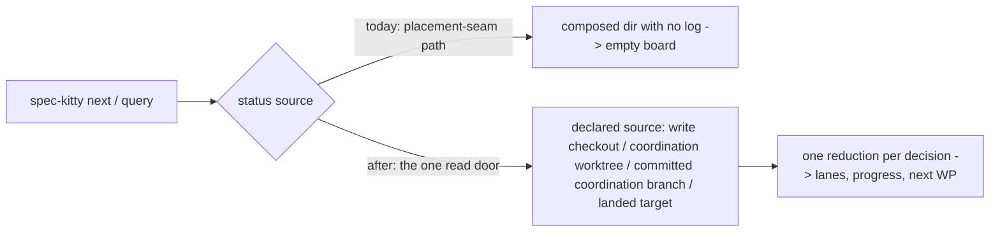

# Mission Specification: Runtime status readers through the read door

**Mission Branch**: `kitty/mission-runtime-status-read-door-01M73HHB` (lands on `refactor/7310-status-read-door-s5`)
**Created**: 2026-11-10
**Status**: Draft
**Input**: Operator request: "Move the remaining runtime/next status readers onto the one status read door (#7310, parent #7408; fixes #7507). Operator: drive end to end." Intake debrief with the operator's decisions: [`research/intake-debrief.md`](research/intake-debrief.md).

## Context

`spec-kitty next` decides what an agent does next on a Mission, and its query mode reports where a Mission stands (lanes, progress, the next work package). Both read the Mission's status log. Most of the CLI already reads status through one declared door, `status/read_surface.py::resolve_status_read` (ADR `2026-11-06-2`). The runtime decision path behind `next` still reads status through the older placement-seam path. That path cannot express a status that lives only on a committed branch, so it reads an empty history there.

The visible failure is #7507. For a coordination Mission whose coordination worktree is present but empty, `next` reports "no actionable work package", every count at 0 and 0.0% progress. Meanwhile the real lanes (for example WP01 planned, WP02 waiting for review, 30.0%) are committed on the coordination branch.

The architectural gate `tests/architectural/test_status_read_single_door.py` lists every reader that still bypasses the door. Its allowlist is transient, priced debt (charter Standing Order 5), owned by #7310 and due by 2026-12-31. It stands at 41 entries. This Mission removes the 8 entries that belong to the runtime decision path.

## Domain Language

| Term | Meaning here | Avoid |
|------|--------------|-------|
| **status read door** | `resolve_status_read` plus its read functions: the one way a status read finds its source (ADR `2026-11-06-2`) | "status reader" for the door itself |
| **coordination worktree** | the checkout that holds a coordination Mission's lifecycle files. It is *materialized* when checked out with the Mission directory, *empty* when checked out without it, and *unmaterialized* when not checked out at all | "coord husk" in user-facing text |
| **committed coordination branch** | the coordination branch's committed status log, which the door reads when the worktree is empty or unmaterialized | "the ref" in user-facing text |
| **advancing `next`** | a `next` call that hands work to an agent (dispatch), as opposed to **query** mode, which only reports | |
| **owned checkout** | a validated checkout the operator chose for a Mission (`--owned-checkout`) | |

## User Scenarios & Testing *(mandatory)*

### User Story 1 - `next` shows the real board when the coordination worktree is empty (Priority: P1)

An operator or agent runs `spec-kitty next` (advancing or query) on a coordination Mission whose coordination worktree is checked out but holds no Mission directory. Today they see "no actionable work package" and 0% progress, although the lanes are committed on the coordination branch (#7507). After this Mission they see the real lanes, progress and next work package.

**Why this priority**: it is a live wrong answer on the command agents use to decide what to do next, and it is the bug the operator asked to fix (#7507).

**Independent Test**: build a coordination Mission with WP01 `planned` and WP02 `for_review` committed on the coordination branch, then empty its coordination worktree. Query mode reports `implement` WP01 with weighted progress 30.0 and the same counts as with a materialized worktree.

**Acceptance Scenarios**:

1. **Given** a non-owned coordination Mission with lanes committed on the coordination branch and an **empty** coordination worktree, **When** the operator runs `next` in query mode, **Then** it reports the same lanes, counts, weighted progress and next work package as with a materialized worktree.
2. **Given** the same Mission, **When** an advancing `next` runs, **Then** it dispatches the same work package as it would with a materialized worktree.
3. **Given** a materialized coordination worktree, **When** `next` runs in either mode, **Then** its output is identical to today's.

---

### User Story 2 - an unmaterialized coordination worktree stays a clear block, with an opt-in fix (Priority: P1)

An operator runs an advancing `next` on a coordination Mission whose coordination worktree is not checked out at all. Today `next` blocks with "Coordination surface … is not readable … materialize it" and the doctor command. That block stays (operator ruling, DM-2). A new opt-in flag, `spec-kitty next --auto-remediate`, materializes the coordination worktree through the canonical path, says that it did, and continues the decision.

**Why this priority**: it keeps a safety stop while removing a manual step the operator always takes next.

**Independent Test**: on an unmaterialized coordination Mission, `next` without the flag shows the same block text and exit code as today. `next --auto-remediate` materializes the worktree, prints one line saying so, and returns the same decision a materialized Mission gives.

**Acceptance Scenarios**:

1. **Given** an unmaterialized coordination worktree, **When** an advancing `next` runs without `--auto-remediate`, **Then** it blocks with today's reason text and remedy, byte for byte.
2. **Given** the same Mission, **When** an advancing `next --auto-remediate` runs, **Then** the coordination worktree is materialized through the same path `spec-kitty doctor coordination --fix` uses, one line reports the remediation, and the decision equals the materialized one.
3. **Given** a coordination branch that was **deleted** without landing, **When** `next --auto-remediate` runs, **Then** nothing is remediated and today's "flatten" guidance is shown unchanged.
4. **Given** query mode, **When** `--auto-remediate` is passed, **Then** query output is unaffected and nothing is materialized. Query reads the committed coordination branch and never blocks on this state.

---

### User Story 3 - owned coordination Missions read the committed branch, and only dispatch refuses (Priority: P2)

An operator who works in an owned checkout of a coordination Mission runs `next` while the coordination worktree is empty or not checked out. Query mode and progress read the committed coordination branch, as ADR `2026-11-06-2` §2 says. An advancing dispatch still refuses with `OWNED_COORDINATION_WORKSPACE_UNAVAILABLE`, so no agent is sent into a workspace that does not exist (operator ruling, DM-1).

**Why this priority**: it makes the owned path agree with `agent tasks status`, which already reads the door. Today the two can disagree.

**Independent Test**: on an owned coordination Mission with an empty and with an unmaterialized coordination worktree, query mode shows the committed lanes, and an advancing dispatch refuses with the existing code and text.

**Acceptance Scenarios**:

1. **Given** an owned coordination Mission, **When** query mode runs with an empty or unmaterialized coordination worktree, **Then** it reports the lanes committed on the coordination branch, not an empty board and not a refusal.
2. **Given** the same Mission, **When** an advancing `next` would dispatch, **Then** it refuses with `OWNED_COORDINATION_WORKSPACE_UNAVAILABLE` and today's remedy text.
3. **Given** a Mission that exists only in the owned checkout (not in the repository root checkout), **When** the door resolves its status, **Then** it finds the Mission and does not fail with "not found".

---

### User Story 4 - `next` reads status once per decision, and the bypass allowlist shrinks (Priority: P2)

Maintainers want every status read on the runtime decision path to go through the one door, once per decision. The single-door gate's allowlist must shrink by the 8 runtime entries, so a reader cannot drift back.

**Why this priority**: it pays down priced debt (#7310) and removes a class of disagreement between `next` and the status board.

**Independent Test**: the gate test passes with the 8 runtime entries removed, and the allowlist, the live-hit floor and the ratchet baseline all record 33. A planted bypass in any of the touched modules turns the gate red.

**Acceptance Scenarios**:

1. **Given** the Mission is complete, **When** the single-door gate runs, **Then** no runtime/next entry remains in its allowlist, and the allowlist, the ratchet baseline and the live-hit floor all agree on 33.
2. **Given** one `next` decision on a Mission, **When** it builds its board, **Then** the status log is read once and reduced once.

### Edge Cases

- A coordination branch deleted without landing: unchanged "flatten" guidance on every path. `--auto-remediate` never acts on it.
- A landed Mission whose coordination branch is gone: reads the landed target's copy (door behaviour), never a refusal.
- An unreadable committed coordination branch: an explicit error naming the branch, never an empty board shown as real.
- A corrupt line in the status log: lanes and counts fail as today, and the weighted-progress figure degrades exactly as today (logged, omitted).
- A Mission with no status log yet: the same `not_finalized` / no-progress answers as today.
- `--auto-remediate` when materialization itself fails: the original block is shown with the failure reason. No partial state is reported as success.
- The `MissionNextInvoked` row in `mission-events.jsonl`: written through the write seam in every coordination state it is written in today. A later read of that file sees it.

## Requirements *(mandatory)*

### Functional Requirements

| ID | Title | User Story | Priority | Status | Delivery | No-op passable? |
|----|-------|------------|----------|--------|----------|-----------------|
| FR-001 | Empty coordination worktree shows real board (#7507) | As an operator, I want `next` query and advancing modes to show the lanes, counts, weighted progress and next work package committed on the coordination branch when the coordination worktree is empty, so that I am not told there is no work when there is. | High | Open | [build] | no — red-first: the same fixture reports "no actionable wp" and 0.0 today |
| FR-002 | Unmaterialized worktree keeps its block | As an operator, I want an advancing `next` on an unmaterialized coordination worktree to keep today's block text, remedy and exit code, so that the safety stop is unchanged. | High | Open | [ratchet] | yes — paired with FR-003 on the same fixture, whose flag run must differ |
| FR-003 | `next --auto-remediate` materializes and continues | As an operator, I want `spec-kitty next --auto-remediate` to materialize a missing or empty coordination worktree through the canonical path, report it in one line, and continue the decision, so that I need not run the doctor command by hand. | High | Open | [build] | no — without the code the flag does not exist and the run blocks |
| FR-004 | Auto-remediation never touches a deleted branch or query | As an operator, I want `--auto-remediate` to do nothing for a deleted coordination branch and in query mode, so that it never hides a case that needs a human. | High | Open | [build] | no — a positive control (FR-003) on the same fixture shape must remediate |
| FR-005 | Owned query reads the committed branch | As an operator in an owned checkout, I want query mode and progress on a coordination Mission with an empty or unmaterialized coordination worktree to read the committed coordination branch, so that `next` agrees with `agent tasks status`. | Medium | Open | [build] | no — red-first: today the empty state refuses and the unmaterialized state shows an empty board |
| FR-006 | Owned dispatch still refuses | As an operator, I want an advancing dispatch on that owned Mission to refuse with `OWNED_COORDINATION_WORKSPACE_UNAVAILABLE` and today's text, so that no agent is sent into a missing workspace. | Medium | Open | [ratchet] | yes — paired with FR-005 on the same fixture, whose query must succeed |
| FR-007 | Door finds an owned-only Mission | As an operator, I want the status read door to find a coordination Mission that exists only in my owned checkout, so that owned reads never fail with "not found". | Medium | Open | [build] | no — red-first: the door raises for that fixture today |
| FR-008 | One read, one reduction per decision | As a maintainer, I want each `next` decision and query to read the status log once through the door and reduce it once, then pass that result to every board and progress check, so that the checks cannot disagree. | Medium | Open | [build] | no — a read counter on the decision path must show exactly one read |
| FR-009 | `MissionNextInvoked` goes through the write seam | As a maintainer, I want the `MissionNextInvoked` row to be written through the status write seam, so that it is not a read-door bypass and later reads see it. | Medium | Open | [build] | no — a read-after-write test on the same fixture must find the row |
| FR-010 | Artifact-presence code receives its seam | As a maintainer, I want the guard-failure paths and the artifact-presence check to receive the placement seam they need, instead of mapping a status directory back to a seam, so that neither is a status-read bypass. | Medium | Open | [build] | no — the gate's allowlist entries for both sites must be gone and the reported paths must match today's on the existing fixtures |
| FR-011 | Gate allowlist drained by 8 | As a maintainer, I want the 8 runtime/next entries removed from the single-door gate's allowlist, with the live-hit floor and the ratchet baseline lowered in the same change, so that the debt cannot grow back. | High | Open | [build] | no — the gate counts the allowlist; a stale entry or a new bypass fails it |
| FR-012 | ADR records the owned split | As a maintainer, I want ADR `2026-11-06-2` amended to record that owned coordination Missions read the committed branch for query and progress while an advancing dispatch refuses, so that the code and its decision record agree. | Medium | Open | [build] | no — the amendment text is reviewed against FR-005/FR-006 |

### Non-Functional Requirements

| ID | Title | Requirement | Category | Priority | Status |
|----|-------|-------------|----------|----------|--------|
| NFR-001 | Progress parity | Over every `status.events.jsonl` in this repository's `kitty-specs/`, the per-WP lanes and the weighted progress (to 1 decimal place) the new path reports equal today's path for a materialized or write-checkout source: 100% of logs, pinned by a parity test. | Correctness | High | Open |
| NFR-002 | No extra cost | One `next` decision reads the status log at most once (today up to about 8 times). Wall time of the existing `next` test suites does not grow by more than 10%. | Performance | Medium | Open |
| NFR-003 | Unchanged elsewhere | Every existing refusal text, error code and exit code on the `next` path stays byte-identical, except the cells named in FR-001, FR-005 and FR-007, verified by the existing `next` / runtime test suites passing unchanged apart from re-pins listed in the PR. | Compatibility | High | Open |
| NFR-004 | Code quality | Changed code passes `ruff check`, `ruff format --check --force-exclude` and `mypy` with zero findings, and no function exceeds complexity 15. | Maintainability | High | Open |

### Constraints

| ID | Title | Constraint | Category | Priority | Status |
|----|-------|------------|----------|----------|--------|
| C-001 | One door | Status is read only through `resolve_status_read` and its read functions; no new status source finder is added beside it. | Technical | High | Open |
| C-002 | Red-first fixes | Every behaviour change (FR-001, FR-003, FR-005, FR-007) lands as a failing test committed before its fix. | Process | High | Open |
| C-003 | Tidy first | Behaviour-preserving moves come before functional changes, in separate commits (charter Standing Order 2, DIRECTIVE_025). | Process | High | Open |
| C-004 | Scope | Out of scope: the other 33 allowlist entries (lanes self-heal, the worktree-allocator guard, write-side entries owned by #7490/#6608, the planning pin #5702, the aggregate #3462 and the rest). The PR lists them with the slice that owns each. | Business | High | Open |
| C-005 | Lands on the topic branch | The Mission consolidates onto `refactor/7310-status-read-door-s5`, never onto `main`. The operator merges the PR. | Process | High | Open |
| C-006 | Test policy | No `make test-full` or full `tests/architectural/` sweep in mission work (`NO_FULL_HEAVY_SUITES_IN_MISSION`). Run the targeted files, the named gates and `make test-fast`. | Process | High | Open |

### Key Entities

- **Status read surface**: the door's answer for one Mission: which declared source holds its status (write checkout, coordination worktree, committed coordination branch, Mission branch, landed target).
- **Board status**: one reduced reading of a Mission's status for one decision. It holds the per-WP lanes and states, whether a log exists, and the weighted progress, and every board and progress check uses it.
- **Coordination worktree state**: materialized, empty, unmaterialized or deleted. It drives the block, the remediation and the owned refusal.

## Success Criteria *(mandatory)*

### Measurable Outcomes

- **SC-001**: For the #7507 fixture (empty coordination worktree), `next` query reports WP01 as next, 1 planned and 1 for-review work package, and 30.0% weighted progress, the same as the materialized control. — [build] · no-op passable: no
- **SC-002**: The single-door gate's allowlist holds 33 entries, none under `src/runtime/next/`, and the ratchet baseline and live-hit floor both read 33. — [build] · no-op passable: no
- **SC-003**: An operator recovers from an unmaterialized coordination worktree with one command (`next --auto-remediate`) instead of two. — [build] · no-op passable: no
- **SC-004**: Lanes and weighted progress agree with today's path on 100% of the repository's real status logs. — [ratchet] · no-op passable: yes — it is a parity check that a do-nothing change passes, so it is paired with SC-001, which a do-nothing change fails
- **SC-005**: #7507 is closed by the PR, and the #7310 gate entries for runtime/next are gone. — [build] · no-op passable: no

## Assumptions

- The canonical materialization path that `spec-kitty doctor coordination --fix` uses can be called from `next` without new side effects beyond creating the worktree.
- The grounding squad's reproduction of #7507 (non-owned coordination Mission, empty worktree) is representative. The `MISSION_BRANCH_REF` cell was sketched, not run, and gets its own test during implementation.
- `--auto-remediate` is a new CLI flag on `spec-kitty next` only. No other command gains it in this Mission.
