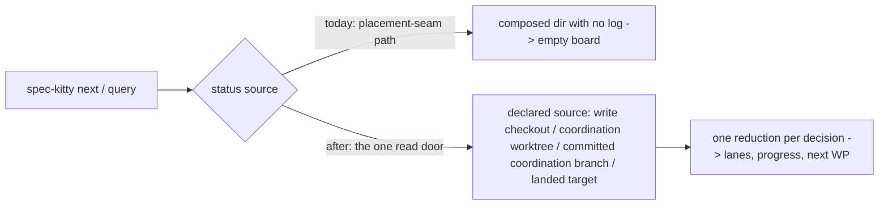

# Mission Specification: Runtime status readers through the read door

**Mission Branch**: `kitty/mission-runtime-status-read-door-01M73HHB` (lands on `refactor/7310-status-read-door-s5`)
**Created**: 2026-11-10
**Status**: Draft
**Input**: Operator request: "Move the remaining runtime/next status readers onto the one status read door (#7310, parent #7408; fixes #7507). Operator: drive end to end." Intake debrief with the operator's decisions: [`research/intake-debrief.md`](research/intake-debrief.md).

## Context

`spec-kitty next` decides what an agent does next on a Mission, and its query mode reports where a Mission stands (lanes, progress, the next work package). Both read the Mission's status log. Most of the CLI already reads status through one declared door, `status/read_surface.py::resolve_status_read` (ADR `2026-11-06-2`). The runtime decision path behind `next` still reads status through the older placement-seam path. That path cannot express a status that lives only on a committed branch, so it reads an empty history there.

The visible failure is #7507. For a coordination Mission whose coordination worktree is present but empty, `next` reports "no actionable work package", every count at 0 and 0.0% progress. Meanwhile the real lanes (for example WP01 planned, WP02 waiting for review, 30.0%) are committed on the coordination branch.

The architectural gate `tests/architectural/test_status_read_single_door.py` lists every reader that still bypasses the door. Its allowlist is transient, priced debt (charter Standing Order 5), owned by #7310 and due by 2026-12-31. It stands at 41 entries. This Mission removes the 8 entries that belong to the runtime decision path.

## Domain Language

| Term | Meaning here | Avoid |
|------|--------------|-------|
| **status read door** | `resolve_status_read` plus its read functions: the one way a status read finds its source (ADR `2026-11-06-2`) | "status reader" for the door itself |
| **coordination worktree** | the checkout that holds a coordination Mission's lifecycle files. It is *materialized* when checked out with the Mission directory, *empty* when checked out without it, and *unmaterialized* when not checked out at all | "coord husk" in user-facing text |
| **committed coordination branch** | the coordination branch's committed status log, which the door reads when the worktree is empty or unmaterialized | "the ref" in user-facing text |
| **advancing `next`** | a `next` call that hands work to an agent (dispatch), as opposed to **query** mode, which only reports | |
| **owned checkout** | a validated checkout the operator chose for a Mission (`--owned-checkout`) | |

## User Scenarios & Testing *(mandatory)*

### User Story 1 - `next` shows the real board when the coordination worktree is empty (Priority: P1)

An operator or agent runs `spec-kitty next` (advancing or query) on a coordination Mission whose coordination worktree is checked out but holds no Mission directory. Today they see "no actionable work package" and 0% progress, although the lanes are committed on the coordination branch (#7507). After this Mission they see the real lanes, progress and next work package.

**Why this priority**: it is a live wrong answer on the command agents use to decide what to do next, and it is the bug the operator asked to fix (#7507).

**Independent Test**: build a coordination Mission with WP01 `planned` and WP02 `for_review` committed on the coordination branch, then empty its coordination worktree. Query mode reports `implement` WP01 with weighted progress 30.0 and the same counts as with a materialized worktree.

**Acceptance Scenarios**:

1. **Given** a non-owned coordination Mission with lanes committed on the coordination branch and an **empty** coordination worktree, **When** the operator runs `next` in query mode, **Then** it reports the same lanes, counts, weighted progress and next work package as with a materialized worktree.
2. **Given** the same Mission, **When** an advancing `next` runs, **Then** it dispatches the same work package as it would with a materialized worktree.
3. **Given** a materialized coordination worktree, **When** `next` runs in either mode, **Then** its output is identical to today's.

---

### User Story 2 - advancing `next` says when it set up the coordination worktree (Priority: P1)

An operator or agent runs an advancing `spec-kitty next` on a coordination Mission whose coordination worktree is not checked out or is empty. Today `next` already materializes (or restores) the worktree on its own, during bootstrap, through the status write seam, and then proceeds, but says nothing. Its progress numbers in that run also show 0.0%. After this Mission the automatic materialization stays, and `next` reports it: one human-readable line, plus a `remediation` entry in `--json` output. The progress numbers are the real ones (operator ruling, DM-2 as corrected 2026-11-11: verified end to end that the "materialize it" block never reaches a CLI user, so no `--auto-remediate` flag is added).

**Why this priority**: an operator should know that `next` changed their workspace, and the progress shown must be true.

**Independent Test**: on an unmaterialized and on an empty coordination Mission, an advancing `next` proceeds as today, prints one line naming the materialized worktree, carries `remediation` in its JSON, and reports the same weighted progress as a materialized control. On a materialized Mission, nothing is reported.

**Acceptance Scenarios**:

1. **Given** an unmaterialized or empty coordination worktree, **When** an advancing `next` runs, **Then** it proceeds as today, prints `Materialized the coordination worktree for <mission> at <path>.`, and with `--json` adds `"remediation": {"kind": "materialized_coordination_worktree", "path": "<path>"}`.
2. **Given** the same Mission, **When** the advancing run reports progress, **Then** the numbers equal those of a materialized control (for the #7507 fixture, 30.0%).
3. **Given** a materialized coordination worktree, **When** an advancing `next` runs, **Then** its output is identical to today's (no line, no `remediation` key).
4. **Given** a coordination branch that was **deleted** without landing, **When** `next` runs, **Then** today's "flatten" guidance is shown unchanged and nothing is materialized.
5. **Given** a caller that invokes the board selector directly (not through bootstrap) on an unmaterialized worktree, **When** it runs, **Then** it still returns today's named "materialize it" block, byte for byte.

---

### User Story 3 - owned coordination Missions read the committed branch, and only dispatch refuses (Priority: P2)

An operator who works in an owned checkout of a coordination Mission runs `next` while the coordination worktree is empty or not checked out. Query mode and progress read the committed coordination branch, as ADR `2026-11-06-2` §2 says. An advancing dispatch still refuses with `OWNED_COORDINATION_WORKSPACE_UNAVAILABLE`, so no agent is sent into a workspace that does not exist (operator ruling, DM-1).

**Why this priority**: it makes the owned path agree with `agent tasks status`, which already reads the door. Today the two can disagree.

**Independent Test**: on an owned coordination Mission with an empty and with an unmaterialized coordination worktree, query mode shows the committed lanes, and an advancing dispatch refuses with the existing code and text.

**Acceptance Scenarios**:

1. **Given** an owned coordination Mission, **When** query mode runs with an empty or unmaterialized coordination worktree, **Then** it reports the lanes committed on the coordination branch, not an empty board and not a refusal.
2. **Given** the same Mission, **When** an advancing `next` would dispatch, **Then** it keeps today's outcome: where the coordination workspace is unavailable to dispatch it refuses with `OWNED_COORDINATION_WORKSPACE_UNAVAILABLE` and today's remedy text, and where bootstrap materializes the worktree it proceeds as it does today. The outcome for the empty and unmaterialized cells is characterised before any change (analysis finding I1).
3. **Given** a Mission that exists only in the owned checkout (not in the repository root checkout), **When** the door resolves its status, **Then** it finds the Mission and does not fail with "not found".

---

### User Story 4 - `next` reads status once per decision, and the bypass allowlist shrinks (Priority: P2)

Maintainers want every status read on the runtime decision path to go through the one door, once per decision. The single-door gate's allowlist must shrink by the 8 runtime entries, so a reader cannot drift back.

**Why this priority**: it pays down priced debt (#7310) and removes a class of disagreement between `next` and the status board.

**Independent Test**: the gate test passes with the 8 runtime entries removed, and the allowlist, the live-hit floor and the ratchet baseline all record 33. A planted bypass in any of the touched modules turns the gate red.

**Acceptance Scenarios**:

1. **Given** the Mission is complete, **When** the single-door gate runs, **Then** no runtime/next entry remains in its allowlist, and the allowlist, the ratchet baseline and the live-hit floor all agree on 33.
2. **Given** one `next` decision on a Mission, **When** it builds its board, **Then** the status log is read once and reduced once.

### Edge Cases

- A coordination branch deleted without landing: unchanged "flatten" guidance on every path; nothing is materialized or reported.
- A landed Mission whose coordination branch is gone: reads the landed target's copy (door behaviour), never a refusal.
- An unreadable committed coordination branch: an explicit error naming the branch, never an empty board shown as real.
- A corrupt line in the status log: lanes and counts fail as today, and the weighted-progress figure degrades exactly as today (logged, omitted).
- A Mission with no status log yet: the same `not_finalized` / no-progress answers as today.
- Bootstrap materialization fails: today's behaviour (the existing refusal or blocked decision) is unchanged, and nothing is reported as materialized.
- The `MissionNextInvoked` row in `mission-events.jsonl`: written through the write seam in every coordination state it is written in today. A later read of that file sees it.

## Requirements *(mandatory)*

### Functional Requirements

| ID | Title | User Story | Priority | Status | Delivery | No-op passable? |
|----|-------|------------|----------|--------|----------|-----------------|
| FR-001 | Coordination-ref status shows the real board (#7507) | As an operator, I want `next` query mode and the board selector to show the lanes, counts, weighted progress and next work package committed on the coordination branch when the coordination worktree is empty or unmaterialized, and an advancing `next` to report the real progress in those cells, so that I am not told there is no work when there is. | High | Open | [build] | no — red-first: query reports "no actionable wp" and 0.0, the board selector's empty cell blocks, and advancing progress shows 0.0 on the same fixture today |
| FR-002 | Selector block unchanged for direct callers | As a maintainer, I want the board selector, called directly on an unmaterialized coordination worktree, to keep today's named block text and remedy (decided from the door's surface source, not a seam raise), so that direct callers see no change. | High | Open | [ratchet] | yes — paired with FR-001 on the same fixture shape, whose empty-worktree run must change |
| FR-003 | Advancing `next` reports its automatic materialization | As an operator, I want an advancing `next` that materialized or restored the coordination worktree during bootstrap to say so in one line and in a `remediation` entry of its JSON output, so that I know it changed my workspace. | High | Open | [build] | no — red-first: today the same run prints nothing and has no `remediation` key |
| FR-004 | No report without a materialization | As an operator, I want no materialization line or `remediation` key when the worktree was already materialized, in query mode, or for a deleted coordination branch, so that the report is never noise or a false claim. | High | Open | [build] | no — a positive control (FR-003) on the same fixture shape must report |
| FR-005 | Owned query reads the committed branch | As an operator in an owned checkout, I want query mode and progress on a coordination Mission with an empty or unmaterialized coordination worktree to read the committed coordination branch, so that `next` agrees with `agent tasks status`. | Medium | Open | [build] | no — red-first: today the empty state refuses and the unmaterialized state shows an empty board |
| FR-006 | Owned dispatch keeps today's outcome | As an operator, I want an advancing `next` on that owned Mission to keep today's dispatch outcome: it refuses with `OWNED_COORDINATION_WORKSPACE_UNAVAILABLE` and today's text wherever the coordination workspace is unavailable to dispatch, and proceeds where bootstrap materializes it. No agent is ever sent into a missing workspace. | Medium | Open | [ratchet] | yes — characterised first (WP05 T023) and paired with FR-005 on the same fixture, whose query must change |
| FR-007 | Door finds an owned-only Mission | As an operator, I want the status read door to find a coordination Mission that exists only in my owned checkout, so that owned reads never fail with "not found". | Medium | Open | [build] | no — red-first: the door raises for that fixture today |
| FR-008 | One read, one reduction per decision | As a maintainer, I want each `next` decision and query to read the status log once through the door and reduce it once, then pass that result to every board and progress check, so that the checks cannot disagree. | Medium | Open | [build] | no — a read counter on the decision path must show exactly one read |
| FR-009 | `MissionNextInvoked` goes through the write seam | As a maintainer, I want the `MissionNextInvoked` row to be written through the status write seam, so that it is not a read-door bypass and later reads see it. | Medium | Open | [build] | no — a read-after-write test on the same fixture must find the row |
| FR-010 | Artifact-presence code receives its seam | As a maintainer, I want the guard-failure paths and the artifact-presence check to receive the placement seam they need, instead of mapping a status directory back to a seam, so that neither is a status-read bypass. | Medium | Open | [build] | no — the gate's allowlist entries for both sites must be gone and the reported paths must match today's on the existing fixtures, except one intended cell: an owned coordination Mission now finds spec/plan/tasks in its owned checkout, as the owned placement contract requires (WP05 review ruling) |
| FR-011 | Gate allowlist drained by 8 | As a maintainer, I want the 8 runtime/next entries removed from the single-door gate's allowlist, with the live-hit floor and the ratchet baseline lowered in the same change, so that the debt cannot grow back. | High | Open | [build] | no — the gate counts the allowlist; a stale entry or a new bypass fails it |
| FR-012 | ADR records the owned split | As a maintainer, I want ADR `2026-11-06-2` amended to record that owned coordination Missions read the committed branch for query and progress while an advancing dispatch refuses, so that the code and its decision record agree. | Medium | Open | [build] | no — the amendment text is reviewed against FR-005/FR-006 |

### Non-Functional Requirements

| ID | Title | Requirement | Category | Priority | Status |
|----|-------|-------------|----------|----------|--------|
| NFR-001 | Progress parity | Over every `status.events.jsonl` in this repository's `kitty-specs/`, the per-WP lanes and the weighted progress (to 1 decimal place) the new path reports equal today's path for a materialized or write-checkout source: 100% of logs, pinned by a parity test. | Correctness | High | Open |
| NFR-002 | No extra cost | One `next` decision reads the status log at most once (today up to about 8 times). Wall time of the existing `next` test suites does not grow by more than 10%. | Performance | Medium | Open |
| NFR-003 | Unchanged elsewhere | Every existing refusal text, error code and exit code on the `next` path stays byte-identical, except the cells named in FR-001, FR-005 and FR-007, the owned coordination presence cell named in FR-010, and a landed Mission's `next` lifecycle row, which is written to the PRIMARY Mission directory instead of re-creating its coordination worktree (WP06 cycle 2, SC-003), verified by the existing `next` / runtime test suites passing unchanged apart from re-pins listed in the PR. | Compatibility | High | Open |
| NFR-004 | Code quality | Changed code passes `ruff check`, `ruff format --check --force-exclude` and `mypy` with zero findings, and no function exceeds complexity 15. | Maintainability | High | Open |

### Constraints

| ID | Title | Constraint | Category | Priority | Status |
|----|-------|------------|----------|----------|--------|
| C-001 | One door | Status is read only through `resolve_status_read` and its read functions; no new status source finder is added beside it. | Technical | High | Open |
| C-002 | Red-first fixes | Every behaviour change (FR-001, FR-003, FR-005, FR-007) lands as a failing test committed before its fix. | Process | High | Open |
| C-003 | Tidy first | Behaviour-preserving moves come before functional changes, in separate commits (charter Standing Order 2, DIRECTIVE_025). | Process | High | Open |
| C-004 | Scope | Out of scope: the other 33 allowlist entries (lanes self-heal, the worktree-allocator guard, write-side entries owned by #7490/#6608, the planning pin #5702, the aggregate #3462 and the rest). The PR lists them with the slice that owns each. | Business | High | Open |
| C-005 | Lands on the topic branch | The Mission consolidates onto `refactor/7310-status-read-door-s5`, never onto `main`. The operator merges the PR. | Process | High | Open |
| C-006 | Test policy | No `make test-full` or full `tests/architectural/` sweep in mission work (`NO_FULL_HEAVY_SUITES_IN_MISSION`). Run the targeted files, the named gates and `make test-fast`. | Process | High | Open |

### Key Entities

- **Status read surface**: the door's answer for one Mission: which declared source holds its status (write checkout, coordination worktree, committed coordination branch, Mission branch, landed target).
- **Board status**: one reduced reading of a Mission's status for one decision. It holds the per-WP lanes and states, whether a log exists, and the weighted progress, and every board and progress check uses it.
- **Coordination worktree state**: materialized, empty, unmaterialized or deleted. It drives the block, the remediation and the owned refusal.

## Success Criteria *(mandatory)*

### Measurable Outcomes

- **SC-001**: For the #7507 fixture (empty coordination worktree), `next` query reports WP01 as next, 1 planned and 1 for-review work package, and 30.0% weighted progress, the same as the materialized control. — [build] · no-op passable: no
- **SC-002**: The single-door gate's allowlist holds 33 entries, none under `src/runtime/next/`, and the ratchet baseline and live-hit floor both read 33. — [build] · no-op passable: no
- **SC-003**: Every advancing `next` run that materializes or restores a coordination worktree reports it (line and JSON), and no run that did not materialize one reports it; the advancing run's progress equals the materialized control's. — [build] · no-op passable: no
- **SC-004**: Lanes and weighted progress agree with today's path on 100% of the repository's real status logs. — [ratchet] · no-op passable: yes — it is a parity check that a do-nothing change passes, so it is paired with SC-001, which a do-nothing change fails
- **SC-005**: #7507 is closed by the PR, and the #7310 gate entries for runtime/next are gone. — [build] · no-op passable: no

## Assumptions

- Advancing `next` bootstrap already materializes or restores the coordination worktree through the status write seam (verified end to end through the real CLI on 2026-11-11, `research/repro/advancing_cells.py`); this Mission reports that, it does not add a second materialization path.
- The grounding squad's reproduction of #7507 (non-owned coordination Mission, empty worktree) is representative. The `MISSION_BRANCH_REF` cell was sketched, not run, and gets its own test during implementation.
- No new CLI flag is added (the `--auto-remediate` idea was dropped by operator ruling once the block proved unreachable from the CLI).
