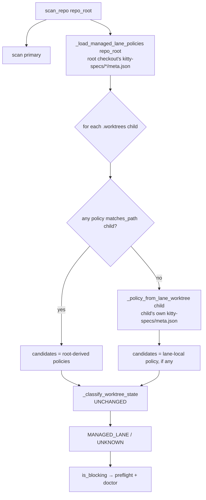

# Implementation Plan: Managed lane classification independent of the repository-root checkout's branch

**Branch**: `issue-6844-sparse-checkout-managed-lane-branch-independent` | **Date**: 2026-10-31 | **Spec**: `kitty-specs/sparse-checkout-managed-lane-branch-independent-01M68JC9/spec.md`
**Input**: Mission specification from `kitty-specs/sparse-checkout-managed-lane-branch-independent-01M68JC9/spec.md`

## Summary

`_load_managed_lane_policies()` derives the managed-lane policy set from
`<repo_root>/kitty-specs/*/meta.json` only, i.e. from whatever the repository-root checkout's
*current branch* committed. A Mission whose `kitty-specs/<slug>/` is absent from that branch
produces no policy, so `_classify_worktree_state` leaves its lane worktrees at the default
`LEGACY_USER` kind, `is_blocking` is true, and `spec-kitty agent action implement` refuses with
`legacy sparse-checkout state detected` — while recommending `doctor sparse-checkout --fix`, the
one remediation #1413 rules out for managed lanes.

The fix adds a second, branch-independent policy source: for a worktree under `.worktrees/` whose
directory name parses to `(mission_dir, lane_id)`, read that lane's **own**
`kitty-specs/<mission_dir>/meta.json` (the lane's checked-out tree, pinned to the lane's branch)
and build the policy through the same constructor the repository-root path uses. The lane-local
source is consulted only when no repository-root-derived policy already matches that path, so the
common case keeps exactly one candidate and today's verdicts are unchanged. Every existing guard
(active `core.sparseCheckout`, pattern-superset, expected lane branch, registered worktree) is
untouched, so genuinely legacy state still refuses.

## Technical Context

**Language/Version**: Python 3.11+ (the repository standard; this module has no version-specific syntax)
**Primary Dependencies**: stdlib only in the changed module — `subprocess` (git probes), `pathlib`, `dataclasses`, `enum`; the policy constructor reuses `specify_cli.coordination.workspace.lane_sparse_checkout_patterns`, `specify_cli.lanes.branch_naming` and `specify_cli.mission_metadata.load_meta`
**Storage**: filesystem only — `kitty-specs/<mission>/meta.json`, `git` config (`core.sparseCheckout`) and git's per-worktree `info/sparse-checkout` pattern files
**Testing**: pytest — `tests/integration/sparse_checkout/` (real `git init` / `git worktree add` fixtures, `pytest.mark.integration` + `pytest.mark.git_repo`); targeted run, not the full suite
**Target Platform**: Linux/macOS/Windows developer machines and CI (any platform where `git worktree` and `git config` behave as documented)
**Project Type**: single project (Python CLI/library, `src/specify_cli/`)
**Performance Goals**: `scan_repo` stays O(worktrees) git probes plus at most one `meta.json` read per lane worktree; it must stay well under the CLI's 2 s interaction budget on this repository (660 Missions, `.worktrees/` with a handful of lanes)
**Constraints**: no new dependency, no new CLI flag or config key, no mutation of git state (`scan_repo` stays side-effect-free apart from reading), and no exception may escape `scan_repo` (it is called from `warn_if_sparse_once`, which must never break the invoking command)
**Scale/Scope**: one module (`src/specify_cli/git/sparse_checkout.py`, ~40 changed lines), one helper added, two test files extended

## Charter Check

*GATE: Must pass before Phase 0 research. Re-check after Phase 1 design.*

| Charter rule | How this plan satisfies it |
|---|---|
| ATDD-first (C-011) | The failing regression test is written and run red through the production preflight (`require_no_sparse_checkout`) before the classifier changes. |
| Red-first bug-fix discipline (DIRECTIVE_034, DIRECTIVE_041) | A live reproduction on `main` @ `35318ef5` is recorded in `research.md`; the test that pins it is committed before the fix. |
| `change-apply-smallest-viable-diff` | One module touched for behaviour; no refactor of the classifier, no new module, no new abstraction layer. |
| Locality of change (DIRECTIVE_024) | The change lands where the wrong input is read (`_load_managed_lane_policies` / `scan_repo`), not in a caller. |
| Single canonical authority | The managed pattern shape stays owned by `lane_sparse_checkout_patterns`; no second pattern grammar is introduced. |
| Boy-scout rule (DIRECTIVE_025) | Only the touched helper is cleaned; no drive-by refactor of `sparse_checkout.py`'s other arms. |
| Terminology canon (Mission vs Feature) | "Mission", "lane worktree", "repository-root checkout", "current branch" used per the charter's branch-intent terminology governance. |
| Tracker Ticket Assignment Rule | #6844 assigned to the HiC and claimed before any planning artifact existed. |
| Pre-existing Failure Reporting Rule | Pre-existing reds (#6798, #6801, #6816, #5927, #5838) are classified and cited in the PR's `## Deferred`; none is touched. |
| NO_FULL_HEAVY_SUITES_IN_MISSION | Targeted suites only (`tests/integration/sparse_checkout/` plus the two existing affected surface tests); CI owns the full sweep. |
| 90% diff-cover | Every added line is exercised by the new tests (see Phase 1 test matrix). |

## Project Structure

### Documentation (this mission)

```
kitty-specs/sparse-checkout-managed-lane-branch-independent-01M68JC9/
├── plan.md              # This file
├── spec.md              # Mission specification (#6844)
├── research.md          # Phase 0: reproduction, predicate map, decisions, rejected alternatives
├── issue-matrix.json    # Per-issue verdict ledger
├── tasks.md             # Phase 2 output (/spec-kitty.tasks)
└── traces/              # approach / design-decisions / tooling-friction
```

### Source Code (repository root)

```
src/specify_cli/git/
└── sparse_checkout.py           # CHANGED: branch-independent managed-lane policy source

tests/integration/sparse_checkout/
├── test_detection.py            # EXTENDED: branch-switched managed-lane fixtures + fail-closed controls
└── test_doctor_finding.py       # EXTENDED: doctor surface reports clean / still reports genuine legacy
```

## Phase 0: Outline & Research

Recorded in `kitty-specs/sparse-checkout-managed-lane-branch-independent-01M68JC9/research.md`
(live reproduction, `file:line` predicate map, decisions D1–D6, rejected alternatives). No
`NEEDS CLARIFICATION` remains: the policy source, the ordering rule and the fail-closed boundary
are all decided there.

## Phase 1: Design & Contracts

### Design

1. **Extract the policy constructor.** `_policy_from_meta(raw, ...)` holds the existing gating
   (non-empty `coordination_branch` string, non-empty `mission_slug`, `mission_id` of ≥ 8 chars,
   `resolve_mid8`, `lane_sparse_checkout_patterns`) and returns `_ManagedLanePolicy | None`. The
   repository-root loop in `_load_managed_lane_policies` calls it — byte-identical behaviour, one
   definition of "this Mission has lane policy".
2. **Add the lane-local source.** `_policy_from_lane_worktree(path)` parses the worktree
   directory name with `parse_lane_worktree_dir` (slug-free, branch-free recognition), reads
   `<path>/kitty-specs/<mission_dir>/meta.json` through `load_meta(..., on_malformed="none")` and
   returns `_policy_from_meta(...)`. Any failure (unparsable name, missing/malformed meta) returns
   `None` — fail closed.
3. **Order the sources in `scan_repo`.** For each worktree child, use the repository-root-derived
   policies when one of them `matches_path(child)`; otherwise add the lane-local policy (if any)
   to that child's candidate tuple. `_classify_worktree_state` is not modified, so the
   "more than one candidate → `UNKNOWN`" arm keeps its meaning and cannot be tripped by an
   identical duplicate.
4. **No change to the refusal, the flags, the doctor wiring or the remediation.** `is_blocking`
   already gates the preflight text, `run_sparse_checkout` and the `--fix` plan; correcting the
   classification corrects all three.

### Control flow (the fix, in one picture)



### Test matrix (ATDD, written first)

| Fixture | Expectation | Requirement |
|---|---|---|
| Coordination lane, root branch **contains** the Mission | `MANAGED_LANE`, not blocking | FR-001 (control), FR-002 |
| Same lane, root branch **does not** contain the Mission | `MANAGED_LANE`, not blocking | FR-001 (red before the fix) |
| Same lane, root branch switched, `require_no_sparse_checkout(command="spec-kitty agent action implement")` | does not raise | FR-003 (production entry point) |
| Pattern file `/*` only, both root branches | `UNKNOWN`, blocking | FR-002, SC-003 |
| Worktree on a foreign branch, both root branches | `UNKNOWN`, blocking | FR-002, SC-003 |
| Unregistered directory under `.worktrees/` | `UNKNOWN`, blocking | FR-002, SC-003 |
| Lane whose own tree carries no `meta.json` | `UNKNOWN`, blocking (fail closed) | C-003 |
| Doctor detection on the branch-switched fixture | exit 0, lane path absent | FR-004 |
| Doctor detection on a genuine legacy worktree | exit 1, path present (positive control) | FR-004 |

### Contracts

No new public API. The module's `__all__` is unchanged; `scan_repo`'s signature and the
`SparseCheckoutState` / `SparseCheckoutScanReport` shapes are unchanged. The only internal seams
added are the two private helpers above.

## Phase 2: Task planning approach *(for `/spec-kitty.tasks`)*

One work package. It is one behaviour change in one module with one test suite; slicing it further
would create work packages that cannot be reviewed or tested independently.

## Key rules

- The test that pins the branch-switch scenario is committed **before** the fix (red → green).
- No new skip/xfail, no weakened assertion, no change to `lane_sparse_checkout_patterns`.
- The changelog entry (user-facing: a false refusal that blocked `implement`) is `[Unreleased]`,
  bold impact-first lead with `(#6844)`, before/after.
- Docs: `docs/` guidance that mentions the sparse-checkout preflight is checked for a statement
  that becomes untrue; nothing else is regenerated wholesale.
