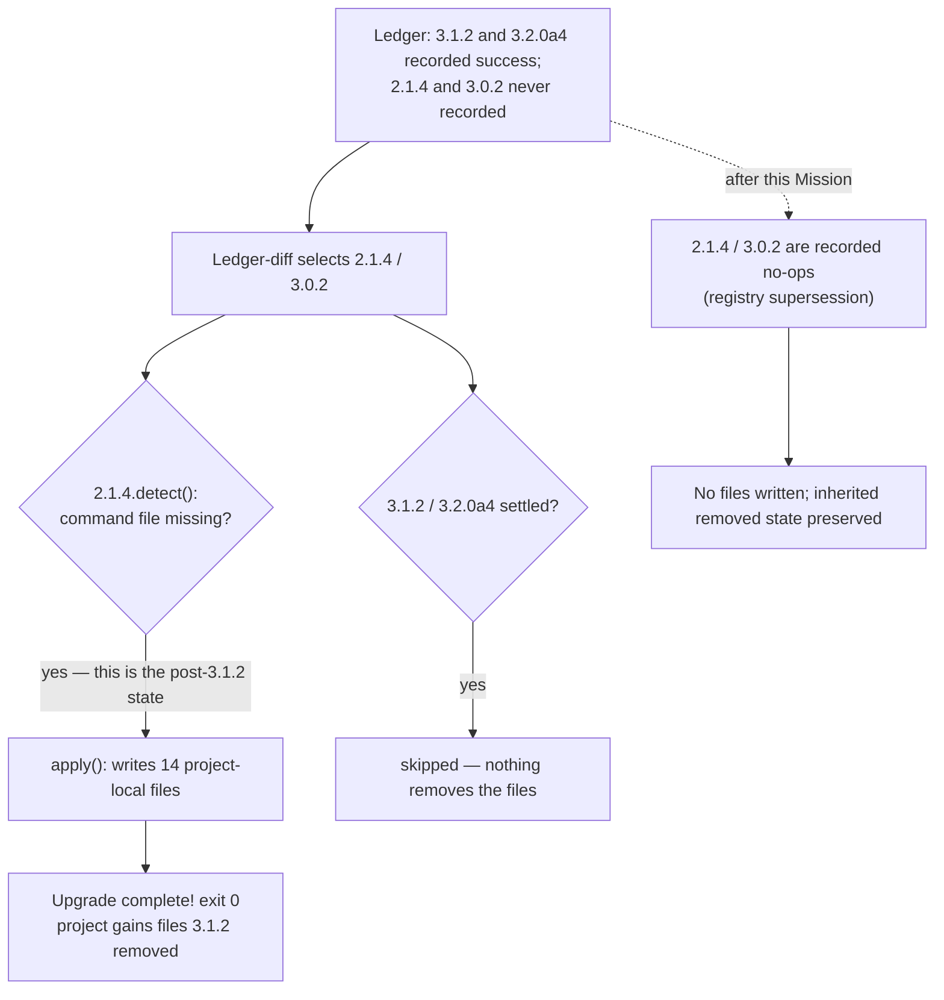

# Mission Specification: The ledger cutover preserves the retired project command files it inherits

**Mission Branch**: `issue-6547-upgrade-cutover-preserves-retired-commands`
**Created**: 2026-10-31
**Status**: Draft
**Input**: GitHub issue spec-kitty/spec-kitty#6547 — "upgrade: ledger cutover restores the per-project command files 3.1.2 retired — pre-3.1.2 writers re-selected, globalize migrations recorded and skipped".

## Overview

Since 3.1.2, the `spec-kitty.*` slash-command files are installed once, globally, into the
user's home agent directories (`~/.claude/commands/`, …). A project no longer carries its own
copy: `3.1.2_globalize_commands` and `3.2.0a4_safe_globalize_commands` remove the project-local
copies a pre-3.1.2 project had. That removal is the state an upgraded project inherits, and it is
the state it must keep.

Under the explicit migration ledger (ADR `docs/adr/4.x/2026-10-17-1-explicit-migration-ledger.md` §3),
selection is *declared minus applied*. A migration that was never recorded — because the retired
version window never offered it, or because it was not needed at the time — is selected again and
its `detect()` is asked. `2.1.4_enforce_command_file_state` writes the command files for every
configured agent "unconditionally", and `3.0.2_restore_prompt_commands` detects *any missing*
prompt-driven file. After 3.1.2, *missing* is the correct state, so both report work to do. The two
migrations that retired those files *are* recorded, so they are skipped. The run exits 0 and leaves
14 project-local command files that duplicate the global ones — untracked, or ignored and invisible
to `git status` wherever `.gitignore` ignores `.claude/`, as `init` writes it.

Reproduced on current `main` (a project whose ledger was adopted before the version-floor baseline
of #6431 — see "Reproduction" below): `2.1.4_enforce_command_file_state` applies and writes the 14
files; `3.1.2_globalize_commands` and `3.2.0a4_safe_globalize_commands` are settled and never run.

## Domain Language

| Term | Meaning | Avoid |
|------|---------|-------|
| **Per-project command files** | The `spec-kitty.*.md` / `.toml` files a pre-3.1.2 project carried in its own agent directory (`.claude/commands/`, `.codex/prompts/`, …). Since 3.1.2 the commands are global and a project-local copy is residue. | "slash commands", "prompts" (ambiguous: templates are also prompts) |
| **Retiring migration** | `3.1.2_globalize_commands` or `3.2.0a4_safe_globalize_commands`: it removes project-local command files after proving each one generated and globally replaced. | "deleter" |
| **Writer migration** | A pre-globalize migration that writes project-local command files: here `2.1.4_enforce_command_file_state` and `3.0.2_restore_prompt_commands`. | "generator" |
| **Superseded migration** | A shipped migration registered as a recorded no-op through the registry supersession table (`upgrade/supersession.py`, #6589). Its shipped module is never edited. | "patched migration", "disabled migration" |
| **Settled** | A ledger record with result `success` (or the adoption baseline that stands in for it). A `skipped` record does not settle: the migration is re-evaluated on every run. | "applied" (a skipped record is also in the ledger) |
| **Cutover** | Ledger adoption: `4.0.0rc8_backfill_migration_ledger` moves `metadata.yaml`'s record of what ran into `.kittify/migration-ledger.jsonl`, after which the ledger is the only selection authority. | "migration upgrade" |

## Reproduction

On current `main` (`35318ef51c`), built as `tests/specify_cli/upgrade/test_retired_command_writers_6547.py`
does it:

1. git repo; `.kittify/metadata.yaml` at `4.0.0rc7`; agent config `claude`; `.claude/commands/` holding
   one user-authored `my-command.md`.
2. A ledger that has already cut over the way an early rc8 build left it: `success` for
   `4.0.0rc8_backfill_migration_ledger`, `3.1.2_globalize_commands`, `3.2.0a4_safe_globalize_commands`.
3. `MigrationRunner(project).upgrade("4.0.0rc8")`.

**Before the fix**: `2.1.4_enforce_command_file_state` appears in `migrations_applied`, and
`.claude/commands/` gains `spec-kitty.accept.md` … `spec-kitty.tasks.md` (14 files) beside
`my-command.md`, with exit 0.

**After the fix**: neither writer appears in `migrations_applied`; `.claude/commands/` still holds
only `my-command.md`; the writers are recorded as superseded no-ops; a second and third upgrade
change nothing.

## User Scenarios & Testing *(mandatory)*

### User Story 1 - The cutover keeps the removed state it inherited (Priority: P1)

A project owner upgrades a project that was already cut over to the ledger by an earlier rc8 build
(one without the #6431 adoption baseline) through 3.1.2, so its ledger settles the two retiring
migrations and records neither writer. `spec-kitty upgrade` finishes without writing a single
project-local `spec-kitty.*` command file; the project's own `my-command.md` is untouched. The
global commands in the user's home directory are the only copies, as 3.1.2 intended.

**Why this priority**: this is the reported defect. The upgrade silently reintroduces a surface the
product retired, and because `init` gitignores `.claude/`, the owner cannot see it in `git status`.
On a long-lived project the same path restored `spec-kitty.checklist.md`, a command that no longer
ships, which the agent then offered as a live slash command.

**Independent Test**: the reproduction above, run through the real `MigrationRunner.upgrade` entry
point (the same one `spec-kitty upgrade` calls), asserting the exact file set of `.claude/commands/`
before and after.

**Acceptance Scenarios**:

1. **Given** a post-cutover project whose ledger settles `3.1.2_globalize_commands` and
   `3.2.0a4_safe_globalize_commands` and records neither writer, **When** the upgrade runs,
   **Then** `.claude/commands/` still holds exactly the user-authored file and no `spec-kitty.*`
   file, and neither writer is in `migrations_applied`.
2. **Given** the same project, **When** the upgrade runs a second and a third time, **Then** the
   directory is byte-identical each time and both writers are recorded as superseded no-ops, never
   as `success`.
3. **Given** the same project, **When** `upgrade --dry-run` runs, **Then** it does not list a write
   to any project-local command file.

### User Story 2 - Every ledger shape reaches the same end state (Priority: P1)

A project owner upgrades a project whose ledger shape is any of: no ledger yet (first adoption,
which the #6431 version floor covers), a ledger adopted with the floor (2.1.4/3.0.2 already settled
`success`), or a ledger adopted without it (the defect shape). In every shape, and for a project
that still carries real per-project command files from before 3.1.2, the end state is the same: no
project-local `spec-kitty.*` files, and the user's own files preserved.

**Why this priority**: a fix that only patches the adoption path would leave the already-adopted
ledger — the defect shape — unfixed, and a fix that stopped the writers without letting the
retiring migrations run would leave a pre-3.1.2 project with stale local copies forever.

**Independent Test**: a parameterised test over the three ledger shapes plus a "still has local
command files" fixture, all driven through `MigrationRunner.upgrade`, asserting the same final
directory contents for each.

**Acceptance Scenarios**:

1. **Given** a pre-ledger project at a version whose floor settles both writers, **When** it
   upgrades, **Then** no project-local command file is written and the run succeeds.
2. **Given** a project whose ledger already settles every migration including both writers,
   **Then** the upgrade writes nothing and the writers stay settled.
3. **Given** a project that still holds generated project-local command files (a pre-3.1.2
   position) and no global equivalents, **When** it upgrades, **Then** the retiring migrations still
   run in their slots (they are not superseded), the writers write nothing, and no *new* files
   appear.
4. **Given** any of the shapes above, **Then** a user-authored file in the same directory —
   including one named `spec-kitty.custom.md` without a version marker — is never modified or
   removed.

### User Story 3 - The declaration is the single source of truth and is testable (Priority: P2)

A maintainer reading `upgrade/supersession.py` sees two new entries, each naming its successor, and
the invariant tests that already guard the table (`SHIPPED_SUPERSEDED` coverage, identity and
`content_hash` carry-over, manifest order, direct import keeps the shipped class) cover them.
Shipped migration modules stay byte-identical, so no recorded history reads as drift.

**Why this priority**: the supersession table (#6589) is the established seam for exactly this
decision; a one-off `if` in the runner or backfill would be a second authority. Keeping the shipped
modules unedited is DIRECTIVE_044 and keeps `content_hash` stable for every project's ledger.

**Independent Test**: the existing table-invariant tests in
`tests/specify_cli/upgrade/test_gitignore_backfills_superseded_6589.py`, extended to the two new
entries, plus a direct-import assertion for both shipped classes.

**Acceptance Scenarios**:

1. **Given** the registry, **When** `2.1.4_enforce_command_file_state` and
   `3.0.2_restore_prompt_commands` are looked up, **Then** each is a `SupersededMigration` whose
   `superseded_by` names `3.2.0a4_safe_globalize_commands`, with unchanged `migration_id`,
   `target_version` and `content_hash`.
2. **Given** a direct import of either shipped module, **Then** it still yields the shipped class,
   not the substitute.
3. **Given** the manifest, **Then** each superseded id precedes its successor and the successor is
   not itself superseded.

---

### Edge Cases

- A project whose `metadata.yaml` version is unparseable: the #6431 floor stamps nothing, so the
  writers would be selected; they must be no-ops anyway.
- A project whose `3.1.2` record is `skipped` rather than `success` (a `skipped` record does not
  settle): the retiring migration is re-evaluated and re-skips; the writers must not have written
  anything in between.
- A project with no agent command directory at all: nothing to do, no spurious report.
- A project whose `.claude/commands/` holds only user files: no `spec-kitty.*` residue is reported,
  and no file is written.
- A project carrying a stale `spec-kitty.checklist.md` that no longer ships: it is not restored; the
  retiring migrations keep it only if it has no version marker (unproven) or no global equivalent,
  exactly as today.

## Requirements *(mandatory)*

### Functional Requirements

| ID | Title | User Story | Priority | Status | Delivery | No-op passable? |
|----|-------|------------|----------|--------|----------|-----------------|
| FR-001 | Cutover writes no project command files | As a project owner whose ledger was cut over before the version floor, I want the upgrade to keep the removed state so that my project does not gain 14 duplicate command files. | High | Open | [build] | no — the post-cutover fixture gains 14 files without the fix |
| FR-002 | Writers are recorded no-ops | As a maintainer, I want `2.1.4_enforce_command_file_state` and `3.0.2_restore_prompt_commands` declared superseded by `3.2.0a4_safe_globalize_commands` in the registry supersession table, so that ADR §3's recorded-no-op path applies to them. | High | Open | [build] | no — the registry returns the shipped class today |
| FR-003 | Every ledger shape nets to the same end state | As a project owner, I want the same result whether my ledger is unadopted, adopted with the floor, or adopted without it, so that the fix does not depend on when I upgraded. | High | Open | [ratchet] | no — the adopted-without-floor shape fails before the fix |
| FR-004 | Legacy local copies are still retired | As a project owner upgrading from before 3.1.2, I want the retiring migrations to keep running in their slots so that stale project-local copies do not survive because the writers were silenced. | High | Open | [ratchet] | yes — paired on the same fixture with FR-001's absence assertion: the legacy fixture proves the retire path still removes marked files |
| FR-005 | User files are never touched | As a project owner, I want my own command files preserved, so that an upgrade never edits or removes them. | High | Open | [ratchet] | yes — positive control asserts the same probe sees a `spec-kitty.*` named user file and leaves it |
| FR-006 | Shipped modules and recorded history are untouched | As a maintainer, I want the two writer modules byte-identical and their `content_hash` unchanged, so that no project's ledger reads as drift. | High | Open | [ratchet] | no — asserted by hash equality against the shipped class |
| FR-007 | The behaviour is documented | As a project owner reading the changelog, I want an `[Unreleased]` entry describing what changed and what to do, so that I know no local action is needed. | Medium | Open | [build] | no — the entry must exist and be linked to #6547 |

### Non-Functional Requirements

| ID | Title | Requirement | Category | Priority | Status |
|----|-------|-------------|----------|----------|--------|
| NFR-001 | No extra work per run | The two superseded entries add no filesystem writes and no subprocess work to an upgrade: their registered `detect()` returns `False` without touching the project. | Performance | Medium | Open |
| NFR-002 | Regression suite runtime | The new regression module runs in under 60 seconds on CI and needs no network, no second CLI build and no `uvx`. | Performance | Medium | Open |
| NFR-003 | Determinism | The new test asserts on stable file names and ledger record results, never on upgrade output ordering or timing. | Reliability | Medium | Open |

### Constraints

| ID | Title | Constraint | Category | Priority | Status |
|----|-------|------------|----------|----------|--------|
| C-001 | One authority for supersession | The change is declared only in `src/specify_cli/upgrade/supersession.py`; selection, the runner, the backfill and the CLI read it from there. No new selection authority and no change to `get_applicable` or the runner. | Technical | High | Open |
| C-002 | Shipped modules are never edited | `m_2_1_4_enforce_command_file_state.py`, `m_3_0_2_restore_prompt_commands.py` and the retiring modules stay byte-identical (DIRECTIVE_044). | Technical | High | Open |
| C-003 | Existing gates stay as they are | No gate, marker, threshold or allowlist is weakened or skipped; the existing supersession table-invariant tests are extended, not relaxed. | Technical | High | Open |
| C-004 | Scope | No change to the adoption baseline (#6431), to `get_applicable`, or to any other migration's behaviour. Migrations not named in the issue's reproduction stay as they are. | Technical | Medium | Open |

### Key Entities

- **Supersession entry**: `superseded id → successor id`, declared in `SUPERSEDED_MIGRATIONS`; the
  registry registers a `SupersededMigration` substitute under the same id.
- **Ledger record**: `{id, applied_at, result, identity, content_hash, cli_version, clone_local,
  superseded_by}`; only `result == success` settles.
- **Project command file**: a `spec-kitty.*` file in a project agent directory; carries a
  `<!-- spec-kitty-command-version: … -->` marker when generated.

## Success Criteria *(mandatory)*

### Measurable Outcomes

- **SC-001**: On the post-cutover fixture, `.claude/commands/` holds exactly one file (the user's) after three consecutive upgrades, and `2.1.4_enforce_command_file_state` never appears in `migrations_applied` — [build] · no-op passable: no
- **SC-002**: All three ledger shapes and the legacy-local-files fixture reach the same final directory contents, asserted in one parameterised test — [ratchet] · no-op passable: no
- **SC-003**: `SUPERSEDED_MIGRATIONS` names `3.2.0a4_safe_globalize_commands` as successor for both writers, and the existing table-invariant tests pass with the two new entries — [build] · no-op passable: no
- **SC-004**: The two shipped writer modules and the two retiring modules are byte-identical to `origin/main`, and every new test file passes locally and in CI — [ratchet] · no-op passable: no
